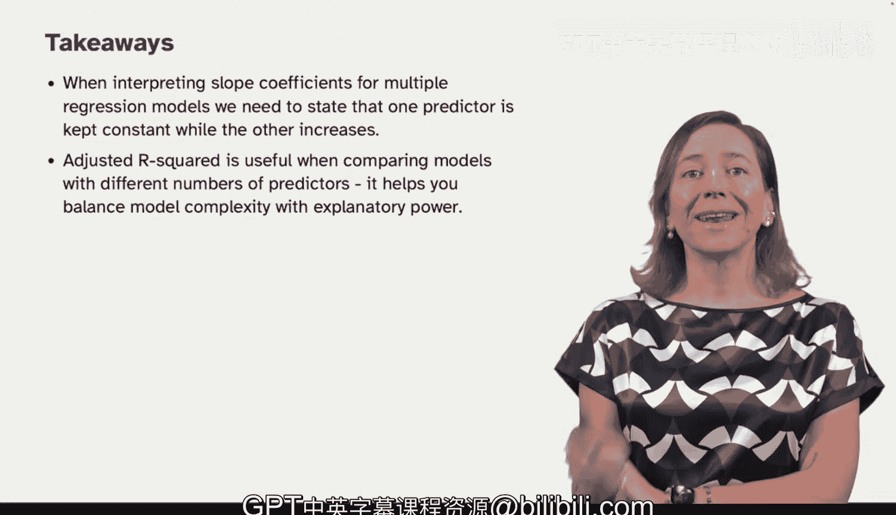

R语言数据科学：07_02_02：多预测变量的线性回归


在本节课中，我们将要学习如何构建包含多个预测变量的线性回归模型。我们将从一个简单的单变量模型开始，逐步引入第二个预测变量，并学习如何解释模型结果、比较模型优劣以及进行可视化。


在开始分析之前，我们需要加载必要的R包。本次分析将使用三个关键包：
*   `DAAG`：用于获取数据集。
*   `tidyverse`：用于数据处理和可视化。
*   `tidymodels`：用于建模。

我们将分析 `allbacks` 数据框，它包含了从澳大利亚国立大学J.H. Madonald教授书架上收集的15本书的测量数据。每本书有四个关键特征：
*   `volume`：体积，以立方厘米为单位。
*   `area`：面积，以平方厘米为单位（本教程中不会过多使用此变量）。
*   `weight`：重量，以克为单位。
*   `cover`：封面类型，精装（HB）或平装（PB）。


上一节我们介绍了数据集，本节中我们来看看第一个模型：一个仅使用体积来预测重量的简单线性回归。

我们使用 `linear_reg()` 函数来指定模型，然后使用 `fit()` 函数来拟合模型。模型公式为 `weight ~ volume`，并指定数据框为 `allbacks`。我们将模型对象存储为 `allbacks_fit_1`，然后使用 `tidy()` 函数来显示模型摘要。

```r
allbacks_fit_1 <- linear_reg() %>%
  fit(weight ~ volume, data = allbacks)
tidy(allbacks_fit_1)
```

观察模型输出，我们可以看到斜率系数为 **0.709**。这意味着，体积每增加一立方厘米，模型预测书的重量平均增加 **0.709** 克。

散点图清晰地显示了体积与重量之间的正相关关系，这符合直觉：更大的书往往更重。


我们知道，书的体积并不是影响其重量的唯一因素。书的封面类型（平装或精装）也会对重量产生影响。

因此，让我们通过添加封面类型作为预测变量来增强我们的模型。这就得到了一个多元线性回归模型。代码中唯一的改变是在 `fit()` 函数中，我们现在使用加号运算符将 `cover` 添加到模型公式中：`weight ~ volume + cover`。

```r
allbacks_fit_2 <- linear_reg() %>%
  fit(weight ~ volume + cover, data = allbacks)
tidy(allbacks_fit_2)
```

请注意，这不仅增加了一个新的斜率系数，也略微改变了原有的系数。体积系数现在是 **0.718**，而封面系数是 **-184**。同时，由于 `cover` 是一个分类变量，R自动创建了一个名为 `coverPB` 的虚拟变量（哑变量）来表示平装书。按字母顺序排在首位的水平（精装HB）被设定为基线水平，因此不会在模型输出中单独显示。我们稍后会解释 **-184** 这个数字的含义。


现在，让我们仔细解读多元线性回归模型的系数。

*   **体积的斜率 0.718**：在保持封面类型不变的情况下，书的体积每增加一立方厘米，模型预测其重量平均增加 **0.718** 克。
*   **封面（平装）的斜率 -184**：在保持体积不变的情况下，模型预测平装书比精装书平均轻 **184** 克。
*   **截距 198**：这表示体积为零的精装书的预测重量，这在现实中不具实际意义。

“保持其他变量不变”是一个新的概念，只要你使用包含多个预测变量的模型，这个概念就会一直存在。它的意思是，系数估计值告诉我们，在**其他预测变量保持不变**的情况下，当给定的预测变量发生变化时，结果变量的预测变化量。

在书的重量的例子中，这个假设是合理的：一本书的重量可以随着其体积的增加而增加，同时不改变其封面类型（毕竟，现实中存在体积很大的平装书）。然而，在某些自然现象中，这可能是一个非常不现实的假设。例如，很难在不改变湿度的情况下改变降雨量。因此，当我们使用包含独立预测变量的线性模型时，需要考虑我们所做的这些简化假设在现实中是否可行，或者是否需要考虑预测变量之间的交互作用。这将是下一个视频的主题。现在，让我们先专注于这个模型。


到目前为止，我们拟合了两个模型：一个仅用体积预测重量，另一个用体积和封面类型预测重量。我们如何知道哪个模型更好呢？

让我们检查 **R平方**，它衡量了模型解释结果变量（重量）变异性的百分比。

*   我们的第一个模型（仅使用体积）解释了约 **80.3%** 的书重变异性（来自 `glance(allbacks_fit_1)` 输出中的 `r.squared` 值）。
*   我们的第二个模型（添加了封面类型）解释了约 **92.7%** 的重量变异性。这是一个显著的提升。

然而，有一个重要的注意事项：**当我们向模型添加预测变量时，R平方总是会增加**，无论它们是否真正有帮助。这时就需要引入**调整后R平方**。

调整后R平方会对拥有额外预测变量的模型进行惩罚。其背后的思想是，如果你使解释变异性的方式变得更复杂，你就会受到惩罚。如果调整后R平方值仍然更高，意味着即使有惩罚，R平方的增益也足够高，这说明新的预测变量确实有意义地为模型增加了预测能力，值得保留。因此，我们说**调整后R平方是一个更客观、因而也是更好的统计量，用于比较具有不同数量预测变量的模型**。

*   第一个模型的调整后R平方是 **0.787**。
*   第二个模型（增加了预测变量）的调整后R平方要高得多，为 **0.915**。

因此，对于预测书的重量，**模型2更优**。


在结束之前，让我们将我们的模型可视化。

在模型1中，我们看到数据点和一条穿过它们的单一回归线。这条线捕捉了总体的上升趋势，但请注意点是如何分散在直线周围的。这代表了模型中未解释的变异性。R平方为 **0.803**，意味着我们仅用体积作为预测变量就解释了约80%的书重变异。

我们的第二个模型讲述了一个更丰富的故事。我们现在有两条平行的回归线：橙色代表精装书，蓝色代表平装书。平行线表明，对于精装书和平装书，重量都随着体积的增加而类似地增加，但平装书的重量始终更轻。请注意，与我们的第一个模型相比，数据点更紧密地聚集在它们各自的线周围。这种视觉上的改进与我们R平方值的增加是匹配的。

**非常重要的一点是**：我们并没有“发现”精装书和平装书的重量随体积增加的方式相似。相反，我们是通过拟合一个用两个独立变量预测重量的模型，**强制**了这种平行结构。





本节课中我们一起学习了多元线性回归模型的构建与解读。关键要点是：
1.  在解释多元回归模型的斜率系数时，需要说明是在**保持其他预测变量不变**的情况下，某个预测变量的变化所产生的影响。
2.  **调整后R平方**是你在比较具有不同数量预测变量的模型时的好帮手，它帮助你在模型复杂度和解释力之间取得平衡。