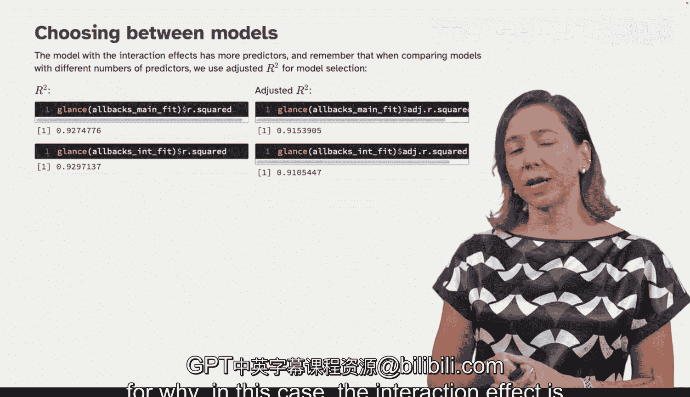

#  045：主效应与交互效应 📊


在本节课中，我们将学习何时在模型中加入预测变量之间的交互效应，以及如何运用奥卡姆剃刀原则，在包含与不包含交互效应的竞争模型之间做出选择。

## 概述


在预测变量对结果的影响中，有时一个变量的影响会因另一个变量的水平不同而改变。这种关系被称为交互效应。我们将通过一个书籍重量预测的案例，探讨如何判断是否需要引入交互效应，并学习使用调整后的R平方作为客观的模型选择标准。

## 数据准备与问题定义

在开始分析之前，我们需要加载必要的R包。我们将使用三个包：`DAAG` 用于获取数据集，`tidyverse` 用于数据处理和可视化，`tidymodels` 用于建模。

```r
library(DAAG)
library(tidyverse)
library(tidymodels)
```

我们将再次使用 `allbacks` 数据集，它包含15本书的信息，目标是基于书的**体积**和**封面类型**来预测其**重量**。

在预测时，我们考虑两种可能的解释：
1.  体积与重量之间的关系不因封面类型而变化。
2.  体积与重量之间的关系会因封面类型而变化。

第一种情况对应着平行线的模型，第二种情况则对应着非平行线的模型。从视觉上看，哪个模型拟合得更好？这似乎有些主观。因此，在做出决定之前，我们需要更正式地分析。

## 模型选择原则：奥卡姆剃刀 🪒

我们的指导原则是**奥卡姆剃刀**。该原则指出，在预测能力相当的竞争性假设中，应选择假设最少的那一个。

在建模术语中，这意味着我们只应在新变量能为模型带来有价值的预测能力提升时，才将其加入模型。换句话说，我们更倾向于最简单、最好的模型，即**简约模型**。

现在，让我们重新审视这两个模型。根据奥卡姆剃刀原则，哪个模型更可取？两个模型看起来差异不大，非平行线的斜率也没有显著不同。两个模型似乎都能合理地拟合数据，但平行线模型更简单。除非交互效应模型能显著提高预测能力，否则我们应该选择更简单的主效应模型。

那么，我们能否找到一种方法来量化这个决策呢？在做出选择之前，我们先回顾一下如何拟合这些模型。

## 模型拟合与比较

### 模型1：主效应模型

模型1是我们之前见过的**主效应模型**，它只考虑体积和封面类型的主效应，而不考虑它们之间的交互作用。

以下是拟合该模型的步骤：
1.  使用 `linear_reg()` 指定模型。
2.  使用 `fit()` 函数拟合模型，预测变量之间用加号 `+` 连接。
3.  使用 `tidy()` 显示模型系数摘要。
4.  使用 `glance()` 显示模型级别的统计量，如R平方和调整后的R平方。

```r
# 拟合主效应模型
model_main <- linear_reg() %>%
  fit(weight ~ volume + cover, data = allbacks)

# 查看系数
tidy(model_main)

# 查看模型整体统计量
glance(model_main)
```

### 模型2：交互效应模型

模型2在预测变量之间加入了**交互效应**，允许重量随体积变化的速率因封面类型而异。

拟合交互效应模型的步骤类似，但在模型公式中，我们使用星号 `*` 或显式地使用冒号 `:` 来添加交互项。R的语法很智能：当你使用 `*` 时，它会自动包含主效应。

```r
# 拟合交互效应模型（使用 * 自动包含主效应）
model_int <- linear_reg() %>%
  fit(weight ~ volume * cover, data = allbacks)

# 查看系数
tidy(model_int)

# 查看模型整体统计量
glance(model_int)
```

**关于R语法的一个说明**：在统计建模中，如果你包含了交互效应，主效应也应该包含在模型中。即使你在 `fit()` 函数中疏忽或省略了它们，R仍然会将它们添加到模型中（正如从模型摘要中看到的那样）。虽然你可能会在其他地方看到以简化方式编写的交互效应模型代码，但在本课程中，我们将力求精确，始终在公式中明确写出主效应和交互效应。

## 做出选择：调整R平方

现在，到了决定是否包含交互效应的时候了。包含交互效应的模型拥有更多的预测变量。请记住，在比较具有不同数量预测变量的模型时，我们使用**调整后的R平方**进行模型选择。

虽然交互效应模型的R平方略高（93% 对 92.7%），但**调整后的R平方**对增加的交互效应施加了惩罚，其值并未更高。主效应模型的调整R平方为91.5%，而交互效应模型为91.05%。

这个结果与我们最初的视觉观察一致，并为我们提供了一个客观的衡量标准，解释了为何在本案例中，交互效应不值得被纳入预测变量之中。

## 总结



本节课中，我们一起学习了主效应与交互效应的概念。我们了解到，交互效应描述了一个预测变量对结果的影响如何随另一个预测变量的变化而变化。通过运用奥卡姆剃刀原则，我们倾向于选择更简约的模型。在比较模型时，**调整后的R平方**是一个关键指标，因为它考虑了模型的复杂度，惩罚了不必要的额外参数。在我们的书籍重量预测案例中，尽管交互效应模型的普通R平方略高，但其调整R平方更低，这支持我们选择更简单的主效应模型。