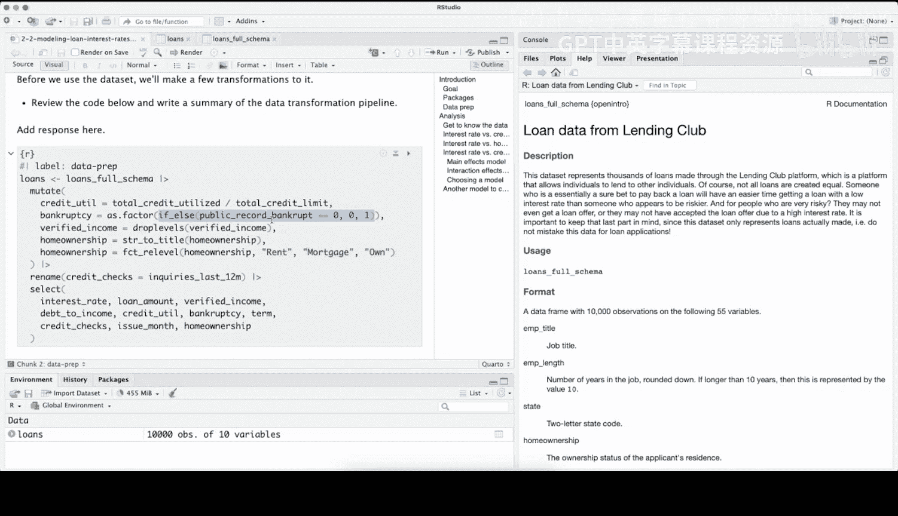
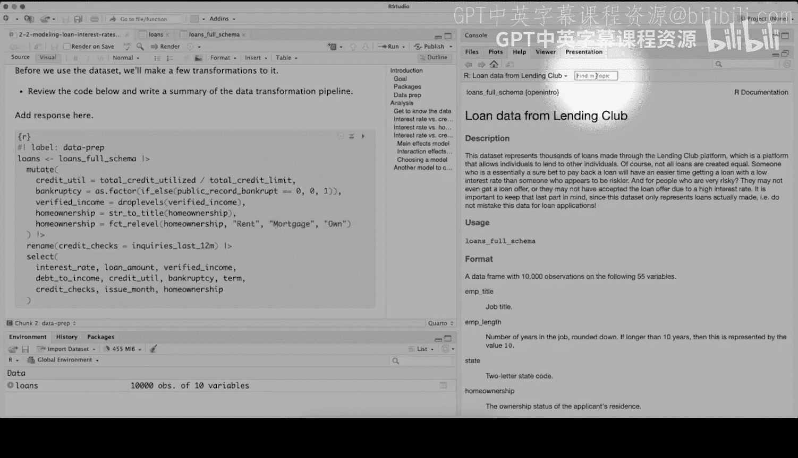
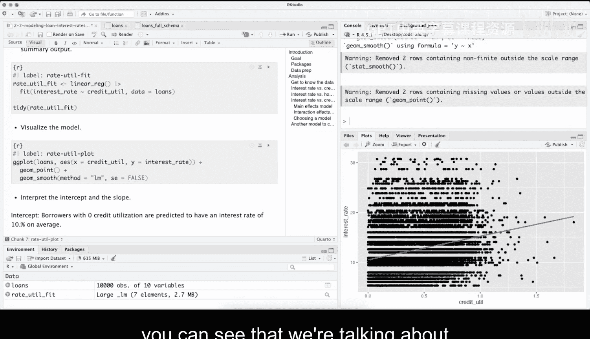
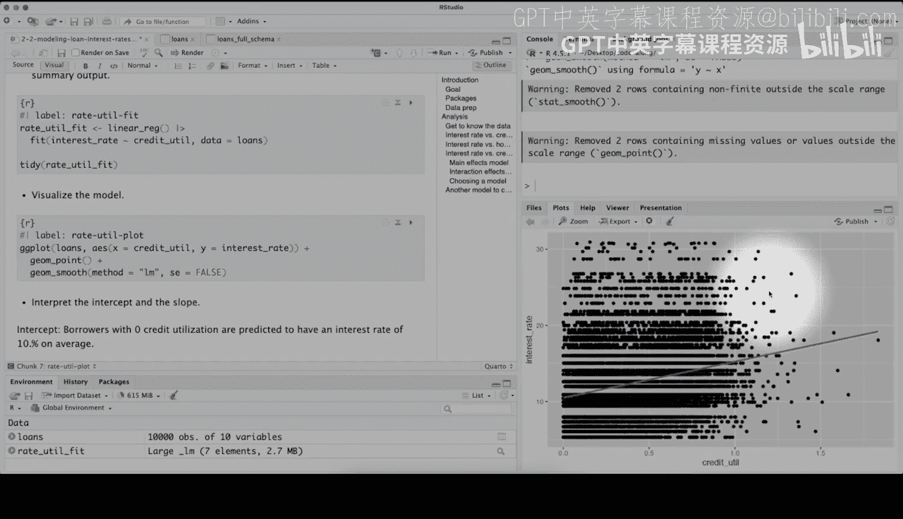
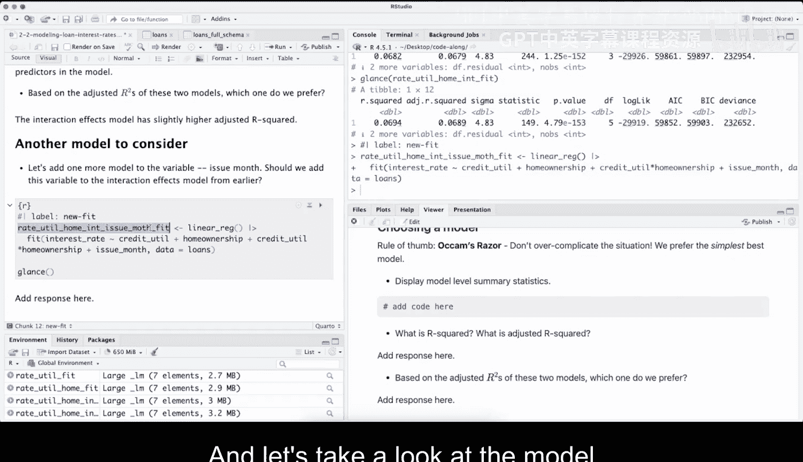

#  046：贷款利率建模 📊


在本节课中，我们将通过一个关于贷款利率的实际数据集，练习使用多个预测变量进行建模。我们将学习如何准备数据、探索数据、拟合线性回归模型，并解释模型结果。

---

## 数据准备与探索

首先，我们需要加载必要的R包并准备数据。我们将使用 `tidyverse` 进行数据处理和可视化，使用 `tidymodels` 进行建模，并使用 `openintro` 包中的数据集。

```r
# 加载必要的包
library(tidyverse)
library(tidymodels)
library(openintro)

# 数据准备
loans <- loan_full_schema %>%
  mutate(
    credit_utilization = total_credit_utilized / total_credit_limit,
    bankruptcy = as.factor(if_else(public_record_bankrupt == 0, 0, 1)),
    verified_income = droplevels(verified_income),
    homeownership = str_to_title(homeownership),
    homeownership = factor(homeownership, levels = c("Rent", "Mortgage", "Own")),
    credit_checks = inquiries_last_12m
  ) %>%
  select(
    interest_rate,
    credit_utilization,
    bankruptcy,
    verified_income,
    homeownership,
    issue_month,
    credit_checks,
    debt_to_income,
    total_credit_limit,
    total_credit_utilized
  )
```

以上代码执行了数据清洗和变量创建。我们创建了 `credit_utilization`（信用利用率）和 `bankruptcy`（破产记录）等新变量，并对分类变量进行了因子化处理，以便在建模中使用。

接下来，让我们初步探索数据，了解典型贷款利率和借款人的特征。

```r
# 查看典型贷款利率
summary(loans$interest_rate)
mean(loans$interest_rate)
median(loans$interest_rate)
min(loans$interest_rate)
max(loans$interest_rate)





# 可视化利率分布
ggplot(loans, aes(x = interest_rate)) +
  geom_histogram(binwidth = 1, fill = "steelblue", color = "white") +
  labs(title = "贷款利率分布", x = "利率 (%)", y = "计数")
```

探索结果显示，平均利率约为12.4%，中位数为12%，范围从5.31%到30.9%。这表明数据中存在较高的利率变异性。

---

## 单预测变量建模

上一节我们介绍了数据的基本情况，本节中我们来看看如何使用单个预测变量建立模型。

首先，我们尝试用信用利用率来预测贷款利率。

```r
# 拟合模型：利率 ~ 信用利用率
rate_u_fit <- linear_reg() %>%
  fit(interest_rate ~ credit_utilization, data = loans)

# 查看模型摘要
tidy(rate_u_fit)

# 可视化模型
ggplot(loans, aes(x = credit_utilization, y = interest_rate)) +
  geom_point(alpha = 0.3) +
  geom_smooth(method = "lm", se = FALSE, color = "red") +
  labs(title = "利率与信用利用率的关系", x = "信用利用率", y = "利率 (%)")
```

模型摘要显示，截距约为10.5，斜率约为4.73。这意味着信用利用率为0的借款人，其预测利率平均为10.5%。信用利用率每增加1个单位（即100%），预测利率平均增加4.73%。

---

## 分类预测变量建模

接下来，我们看看房屋所有权状态如何影响贷款利率。

```r
# 拟合模型：利率 ~ 房屋所有权
rate_home_fit <- linear_reg() %>%
  fit(interest_rate ~ homeownership, data = loans)

# 查看模型摘要
tidy(rate_home_fit)
```

模型摘要中，截距（12.9%）代表租房者（基线水平）的平均预测利率。`homeownershipMortgage` 的系数为-0.866，表示有抵押贷款的借款人，其利率平均比租房者低0.866%。`homeownershipOwn` 的系数为-0.611，表示拥有房产的借款人，其利率平均比租房者低0.611%。

---

## 多预测变量建模（主效应）

现在，我们将信用利用率和房屋所有权状态同时纳入模型，但不考虑它们的交互作用。

```r
# 拟合模型：利率 ~ 信用利用率 + 房屋所有权
rate_u_home_fit <- linear_reg() %>%
  fit(interest_rate ~ credit_utilization + homeownership, data = loans)

# 查看模型摘要
tidy(rate_u_home_fit)
```

根据模型结果，我们可以为不同房屋所有权状态的群体分别写出回归方程。

以下是针对不同群体的估计回归方程：

*   **租房者 (Renters):**
    `interest_rate_hat = 9.93 + 5.34 * credit_utilization`

*   **抵押贷款者 (Mortgage):**
    `interest_rate_hat = (9.93 - 0.696) + 5.34 * credit_utilization = 10.626 + 5.34 * credit_utilization`





*   **房产拥有者 (Own):**
    `interest_rate_hat = (9.93 - 0.128) + 5.34 * credit_utilization = 10.058 + 5.34 * credit_utilization`

在这个主效应模型中，不同群体的预测利率随信用利用率变化的**斜率是相同的**（均为5.34），但**截距不同**。

---

## 多预测变量建模（交互效应）

上一节我们假设信用利用率对利率的影响在不同房屋所有权群体中是相同的。本节中，我们允许这种影响存在差异，即引入交互效应。

```r
# 拟合模型：利率 ~ 信用利用率 * 房屋所有权 (包含交互项)
rate_u_home_int_fit <- linear_reg() %>%
  fit(interest_rate ~ credit_utilization * homeownership, data = loans)

# 查看模型摘要
tidy(rate_u_home_int_fit)
```

现在，我们可以为每个群体写出包含不同斜率的回归方程。

以下是包含交互效应时，针对不同群体的估计回归方程：

*   **租房者 (Renters):**
    `interest_rate_hat = 9.44 + 6.20 * credit_utilization`

*   **抵押贷款者 (Mortgage):**
    `interest_rate_hat = (9.44 + 1.39) + (6.20 - 1.64) * credit_utilization = 10.83 + 4.56 * credit_utilization`

*   **房产拥有者 (Own):**
    `interest_rate_hat = (9.44 + 0.697) + (6.20 - 1.06) * credit_utilization = 10.137 + 5.14 * credit_utilization`

在这个交互效应模型中，不同群体的预测利率随信用利用率变化的**斜率和截距都不同**。

---

## 模型比较与选择

我们有了两个包含多个预测变量的模型：一个只有主效应，另一个包含交互效应。如何选择？

我们可以使用 `glance()` 函数查看模型级别的统计量，如 R² 和调整后 R²。

```r
# 比较两个模型
glance(rate_u_home_fit)      # 主效应模型
glance(rate_u_home_int_fit)  # 交互效应模型
```

*   **R²** 表示模型解释的结果变量变异性的百分比。
*   **调整后 R²** 对 R² 进行了调整，惩罚了模型中预测变量的数量。公式为：`调整后 R² = R² - 惩罚项`。

比较结果：
*   主效应模型的调整后 R² 约为 0.0679。
*   交互效应模型的调整后 R² 约为 0.0689。

交互效应模型的调整后 R² **略高**。虽然增幅很小，但考虑到它可能捕捉到了更真实的群体间差异，在此例中可能更受青睐。在实际分析中，还需要结合领域知识和研究目标进行判断。

最后，我们尝试在交互效应模型中加入 `issue_month`（贷款发放月份）变量。

```r
# 尝试添加新变量
rate_u_home_int_month_fit <- linear_reg() %>%
  fit(interest_rate ~ credit_utilization * homeownership + issue_month, data = loans)

glance(rate_u_home_int_month_fit)
```

新模型的调整后 R² 下降至 0.0688。**调整后 R² 并未随着该预测变量的加入而增加**，因此不建议将其纳入最终模型。

---

## 总结



本节课中我们一起学习了如何使用 R 语言对贷款利率数据进行多预测变量建模。

我们首先进行了数据准备，创建了关键变量并处理了分类数据。接着，我们从单变量模型开始，逐步构建了包含多个预测变量及其交互项的模型。我们学会了如何解释连续变量和分类变量的系数，并为不同子群体写出具体的回归方程。最后，我们使用调整后 R² 作为标准，比较了不同复杂度模型的性能，并做出了模型选择。

通过这个完整的流程，你掌握了从数据探索到模型构建、解释和比较的基本技能，这是数据科学实践中至关重要的一环。