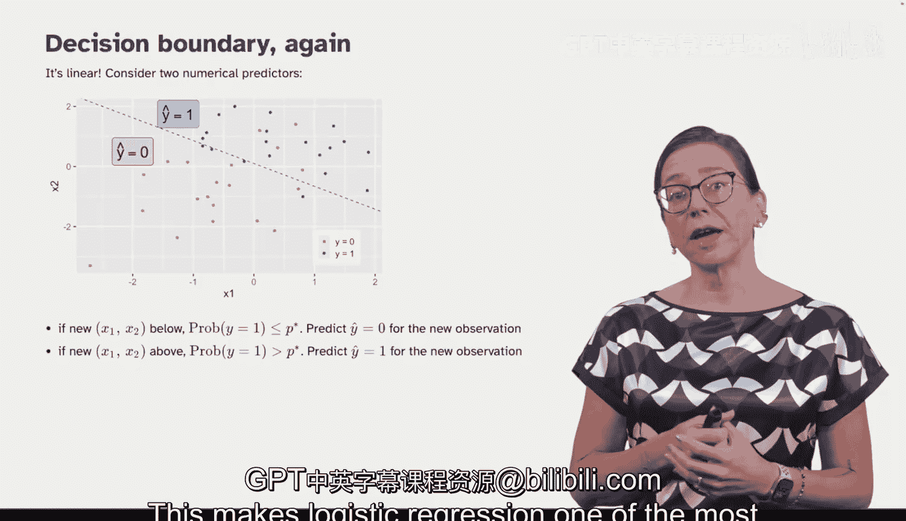

#  047：逻辑回归 📊

在本节课中，我们将要学习逻辑回归，它也被称为分类。我们将了解如何将线性回归的思想扩展到处理结果变量是二分类（例如是/否、成功/失败）的情况。

## 回顾已学的回归类型

在深入新概念之前，我们先快速回顾一下之前学过的回归类型。

### 简单线性回归
在简单线性回归中，我们建模一个数值型结果变量与一个数值型预测变量之间的关系。其核心公式为：
`Y = β₀ + β₁X + ε`
例如，我们可以用影评人的评分（X）来预测观众评分（Y）。

### 带有分类预测变量的多元线性回归
我们也可以将分类预测变量纳入模型。例如，预测婴儿出生体重时，可以将母亲的吸烟习惯（吸烟者=1，非吸烟者=0）作为一个预测变量。模型公式与简单线性回归类似，但X代表一个二元指示变量。

### 结合数值与分类预测变量
更进一步，我们可以在同一个模型中结合数值型和分类型预测变量。例如，用企鹅的鳍肢长度（数值）和所在岛屿（分类）来预测其体重。这可以是一个主效应模型（不同组有相同斜率但不同截距）或交互效应模型（允许斜率也不同）。

上一节我们回顾了处理数值型结果的线性模型，本节中我们来看看当结果变量本身是二分类时，情况会发生什么变化。

## 二分类结果与逻辑回归

当我们的结果变量不是数值型，而是二分类时，它只能取两个值：0或1。这可以代表是/否、成功/失败、真/假等。

观察一个散点图，你会发现Y值只有0和1，但它们与预测变量X之间存在明显关系：X值较高时，Y更可能为1；X值较低时，Y更可能为0。描述这种关系的典型曲线是一条S型曲线（或Sigmoid曲线），这正是逻辑回归的标志。

你可能会问，这为什么重要？因为如果我们能建模预测变量与二分类结果之间的关系，我们就能进行一项强大的操作：**分类**。我们不再预测精确的数值，而是预测一个新的观测属于哪个类别。

以下是几个现实世界的例子：
*   **垃圾邮件过滤**：预测变量是邮件中的词频、字符特征等，结果是邮件是否为垃圾邮件（1=是，0=否）。
*   **医疗诊断**：预测变量是医学影像的特征（如像素强度、纹理），结果是组织是否癌变（1=是，0=否）。这种分类的准确性至关重要。
*   **金融风控**：银行使用逻辑回归评估贷款违约风险。输入申请人的财务和人口统计信息，模型输出其违约的概率。

需要注意的是，虽然数学模型相同，但这些应用引发了关于偏见、公平性和伦理的重要问题，我们必须始终予以考虑。

## 为何不能直接用线性回归？

如果我们尝试用一条直线去拟合二分类数据，会得到类似下图的结果。这条直线会预测出小于0和大于1的值，这对于概率来说没有意义。一条直线无法捕捉二分类结果的本质。

显然，我们需要一种不同于标准线性回归的方法。

## 逻辑回归模型原理

逻辑回归不直接建模Y，而是建模 **Y等于1的概率**。例如，给定一封新邮件，它是垃圾邮件的概率是多少？

这个S型曲线有特定的数学形式。概率P（Y=1）的公式为：
`P = e^(β₀ + β₁X) / [1 + e^(β₀ + β₁X)]`
其中，`β₀ + β₁X` 是我们熟悉的线性部分。

经过代数变换（我们不必手动计算），可以得到一个更简洁的形式，即**逻辑回归模型**：
`log[P / (1 - P)] = β₀ + β₁X`
让我们分解一下这些术语：
*   **P**：概率，介于0和1之间。
*   **P / (1-P)**：**优势比**，范围从0到正无穷。
*   **log[P / (1-P)]**：**对数优势比**（或Logit），范围从负无穷到正无穷。

这样，通过Logit函数（链接函数）的转换，我们又将模型预测值映射到了一个线性空间（负无穷到正无穷）。这使得逻辑回归成为**广义线性模型**的一个例子。

我们使用**最大似然估计**来拟合模型参数（即找到最佳拟合数据的S曲线），得到带有估计系数 β̂₀ 和 β̂₁ 的方程。

## 从概率到分类的三步过程

一旦我们有了拟合模型，分类就成为一个三步过程：

以下是分类决策的三个步骤：

1.  **选择阈值概率（P*）**：例如，设定 P* = 0.85。规则是：如果预测概率 ≤ P*，则预测 Y=0；如果预测概率 > P*，则预测 Y=1。
2.  **找到决策边界（X*）**：求解S曲线与阈值概率线相交时对应的X值。这个X*就是分界点。在X*左侧的点被分类为0，右侧的点被分类为1。
3.  **执行分类**：对于一个具有新值 X_new 的数据点，只需检查它位于决策边界的哪一侧，即可做出预测。

**阈值的选择至关重要**。降低阈值（例如从0.85降到0.15）会使决策边界左移，导致更多观测被分类为1。这个选择取决于对不同类型错误（如将垃圾邮件误判为正常邮件 vs. 将正常邮件误判为垃圾邮件）的成本考量。

## 多预测变量的逻辑回归

逻辑回归不限于单个预测变量。以下是使用两个数值预测变量和一个二分类结果的例子。我们可以看到两个不同的点簇（橙色代表Y=0，蓝色代表Y=1）。

对于多个预测变量，概率公式变得更复杂，但对数优势比仍然保持线性关系。我们只需在线性方程中为每个预测变量添加一项：
`log[P / (1 - P)] = β₀ + β₁X₁ + β₂X₂ + ... + βₖXₖ`

一个美妙之处在于，即使有多个预测变量，**决策边界仍然是线性的**。在二维情况下，它是一条分隔两个类别的直线；在三维情况下，是一个平面；维度更高时，则是一个超平面。

## 总结

本节课中我们一起学习了逻辑回归。我们看到了它如何通过建模概率而非原始结果，将线性回归扩展到处理二分类结果。我们探讨了从垃圾邮件检测到医疗诊断的实际应用，了解了其基于Logit函数和对数优势比的数学基础，并学习了三步分类过程。

核心洞见在于：通过使用正确的转换（Logit链接函数），我们可以将线性建模技术应用于分类问题。这使得逻辑回归成为最通用、应用最广泛的统计方法之一。