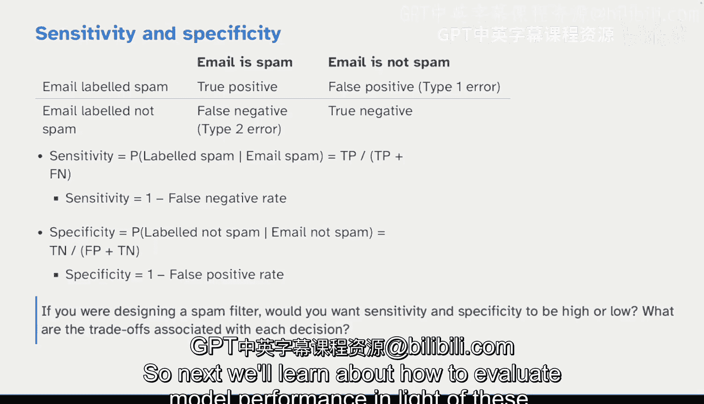

#  049：分类与决策错误

在本节课程中，我们将讨论分类问题以及可能出现的决策错误。我们将通过垃圾邮件检测的实际例子，探讨分类过程中可能出错的地方，以及如何量化模型在决策方面的性能。

## 分类决策的四种可能结果

上一节我们介绍了分类问题的基本概念。本节中，我们来看看当我们对一封邮件（例如一封声称您已获得专属奖励的推广邮件）进行分类决策时，可能出现的四种情况。

我们的目标是构建一个垃圾邮件过滤器模型，根据邮件的特征（如单词和字符数量，或更相关的特征如用词选择）将其分类为垃圾邮件或非垃圾邮件。

一旦我们做出决策或分类，可能会出现以下四种情况：

*   **真阳性**：将一封确实是垃圾邮件的邮件标记为垃圾邮件。
*   **真阴性**：将一封确实不是垃圾邮件的邮件标记为非垃圾邮件。
*   **假阳性**：将一封不是垃圾邮件的邮件标记为垃圾邮件。这被称为**第一类错误**。
*   **假阴性**：将一封是垃圾邮件的邮件标记为非垃圾邮件。这被称为**第二类错误**。

到目前为止，前两种情况没有错误。但有时，垃圾邮件会进入收件箱，或者真实邮件会意外进入垃圾邮件箱。我们当然希望永远不犯后两种错误，但可以想象，这通常是不可能的，或者至少不太可能。

## 错误率与性能指标

理解了决策的可能结果后，我们需要量化这些错误的程度。以下是评估分类模型性能的几个关键指标。

**假阴性率**是指一封垃圾邮件被标记为非垃圾邮件的概率。用公式表示为：

`假阴性率 = 假阴性数量 / (真阳性数量 + 假阴性数量)`

**假阳性率**是指一封非垃圾邮件被标记为垃圾邮件的概率。用公式表示为：

`假阳性率 = 假阳性数量 / (真阴性数量 + 假阳性数量)`

我们希望这两个比率都尽可能低。

另外两个重要的术语是**敏感度**和**特异度**。

*   **敏感度**是假阴性率的补数。`敏感度 = 1 - 假阴性率`
*   **特异度**是假阳性率的补数。`特异度 = 1 - 假阳性率`

## 敏感度与特异度的权衡

如果您正在设计一个垃圾邮件过滤器，您会希望敏感度和特异度是高还是低？与此相关的权衡是什么？

显然，我们希望它们都很高。但可以想象，当一个指标上升时，另一个往往会下降。例如，为了提高敏感度（减少漏掉的垃圾邮件），我们可能需要降低阈值，这可能导致更多的正常邮件被误判为垃圾邮件（降低特异度）。反之亦然。

因此，接下来我们将学习如何在考虑这些权衡的情况下评估模型的整体性能。

## 课程总结

本节课中，我们一起学习了分类决策中的四种可能结果：真阳性、真阴性、假阳性和假阴性。我们定义了假阳性率（第一类错误）和假阴性率（第二类错误），并引入了敏感度与特异度这两个关键性能指标。最后，我们讨论了在模型设计中敏感度与特异度之间存在的固有权衡关系，为后续学习模型性能评估方法奠定了基础。