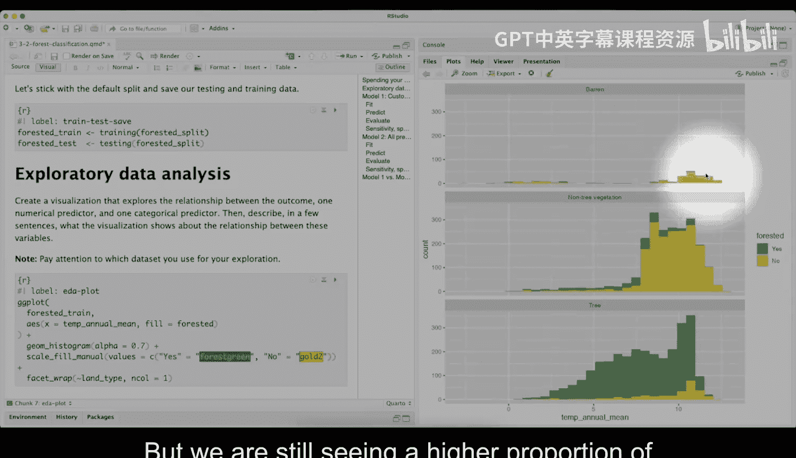
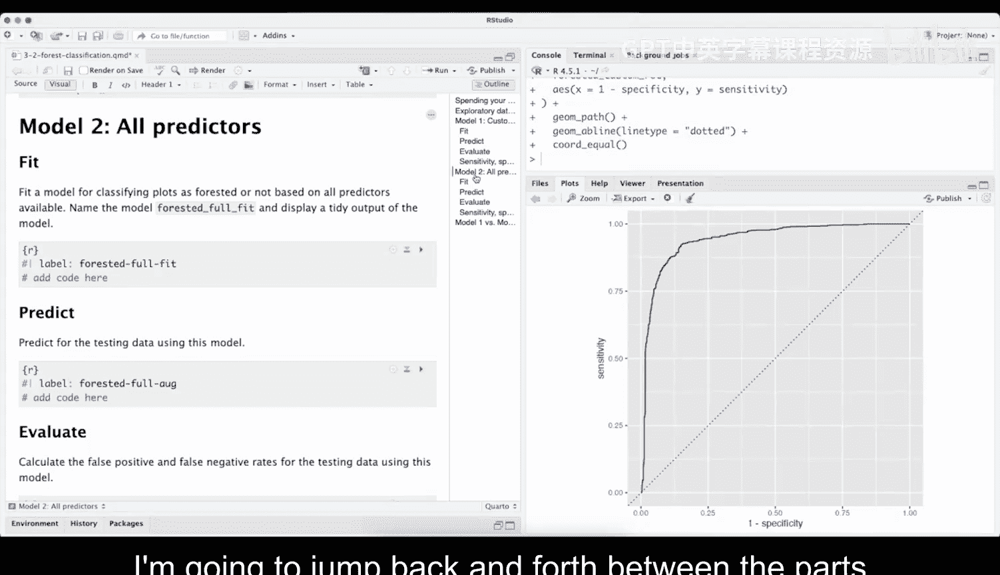
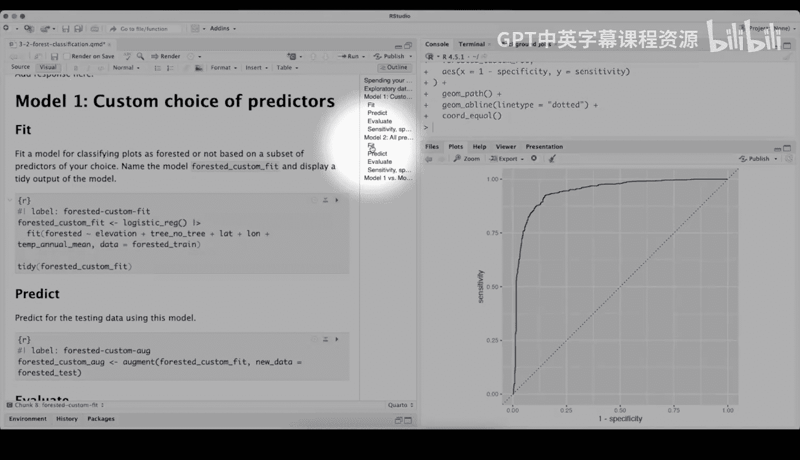
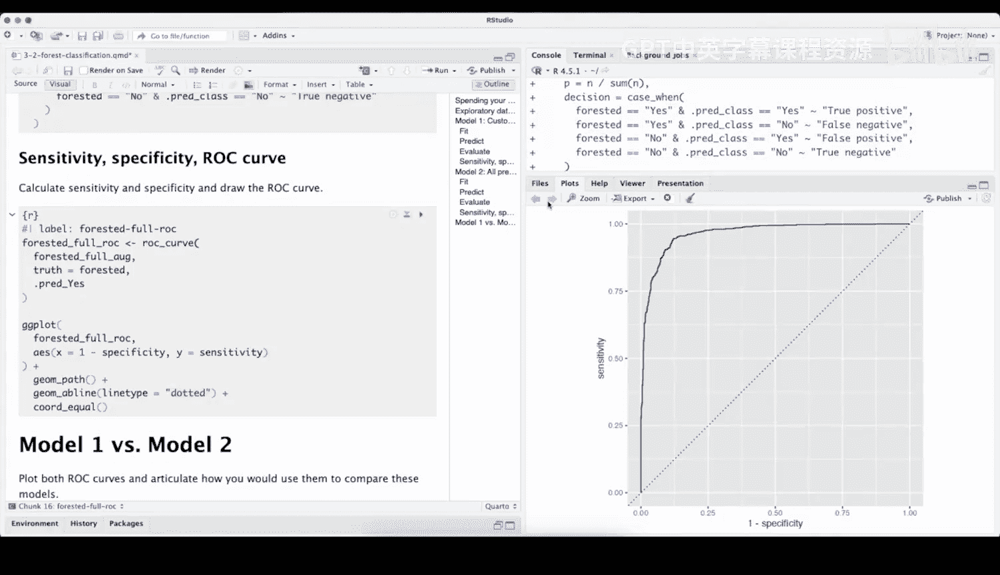
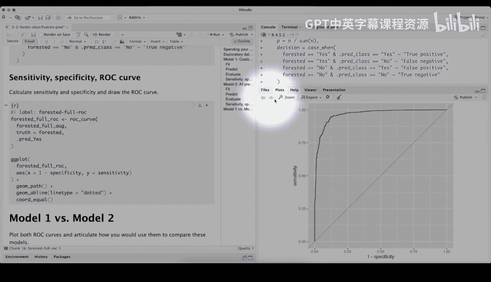
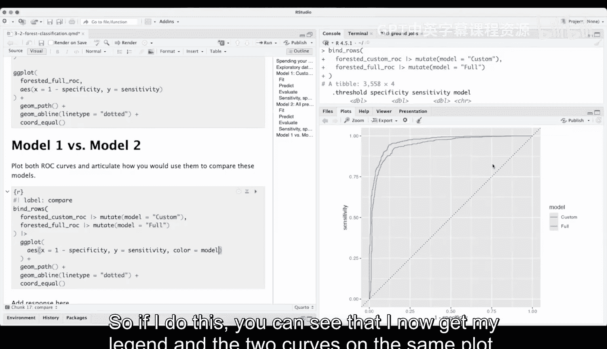
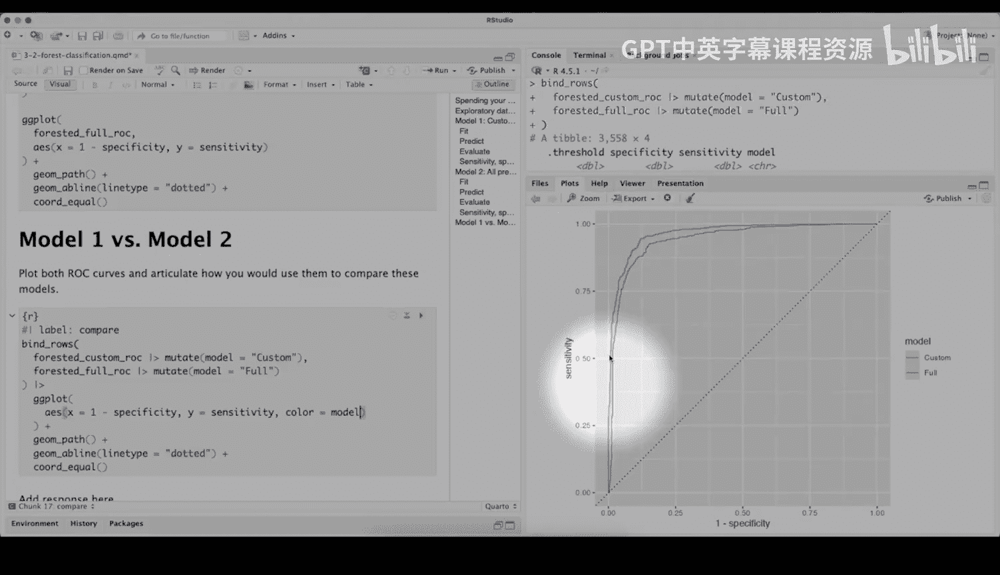
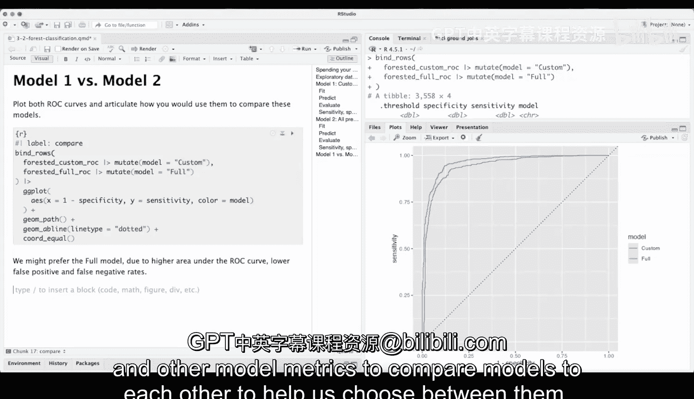

#  051：森林分类 🌲


在本节课中，我们将通过一个完整的代码实践，学习如何使用R语言进行逻辑回归分类。我们将使用`forested`数据集，预测一个地块是否为森林。整个过程包括：数据分割、探索性数据分析、模型拟合、预测以及模型性能评估。

我们将使用`tidyverse`和`tidymodels`包来完成数据探索和建模工作。

---

## 数据准备与分割

首先，我们需要将数据分割为训练集和测试集。这确保了我们的模型可以在未见过的数据上进行评估，从而更可靠地衡量其性能。

为了确保结果的可重复性，我们首先设置一个随机种子。然后使用`initial_split`函数来分割数据。

```r
# 设置随机种子以确保结果可重复
set.seed(123)

# 使用 initial_split 函数分割数据
forested_split <- initial_split(forested_data)

# 查看分割结果
forested_split
```

运行上述代码后，我们可以看到大约75%的数据被分配到了训练集，25%分配到了测试集。这是`initial_split`函数的默认设置。

**如何调整分割比例？**
如果我们希望将80%的数据用于训练，20%用于测试，可以修改`initial_split`函数的`prop`参数。

```r
# 将80%的数据分配给训练集
forested_split_80 <- initial_split(forested_data, prop = 0.8)
```

接下来，我们根据分割对象创建具体的训练和测试数据集。

```r
# 创建训练集和测试集
forested_train <- training(forested_split)
forested_test <- testing(forested_split)
```

现在，我们已经准备好了用于建模和评估的数据。

---

## 探索性数据分析

在建模之前，理解数据中变量之间的关系非常重要。本节中，我们将创建一个可视化图表，探索结果变量（是否为森林）与一个数值型预测变量、一个分类型预测变量之间的关系。

我们将使用训练集`forested_train`进行探索，以避免“窥探”测试集。

首先，我们查看数据字典，了解可用的变量。例如，`temp_annual_mean`（年平均温度）是一个有趣的数值型变量。

以下是创建一个探索性可视化的步骤：

1.  **选择一个数值型预测变量**：我们选择`temp_annual_mean`。
2.  **选择一个分类型预测变量**：我们选择`land_type`（土地覆盖类型）。
3.  **创建可视化**：我们将绘制一个按`land_type`分面的直方图，并用`forested`（是否为森林）变量填充颜色，以观察不同土地类型和森林状态下的温度分布。

```r
# 创建探索性可视化图表
exploratory_plot <- ggplot(forested_train, aes(x = temp_annual_mean, fill = forested)) +
  geom_histogram(alpha = 0.7, position = "identity", bins = 30) +
  scale_fill_manual(values = c("yes" = "forestgreen", "no" = "gold")) +
  facet_wrap(~ land_type, ncol = 1) +
  labs(title = "年平均温度分布（按土地类型和森林状态）",
       x = "年平均温度 (°C)",
       y = "计数") +
  theme_minimal()

# 显示图表
print(exploratory_plot)
```

**图表解读**：
*   在土地类型为“树木”的区域，森林地块（绿色）的比例明显更高。
*   在土地类型为“非树木植被”的区域，非森林地块（金色）的比例更高。
*   在“贫瘠”土地类型中，数据点较少，但非森林地块的比例仍然高于森林地块。
*   总体来看，非森林地块的年平均温度似乎略高于森林地块，这与生态学常识相符。

这个可视化帮助我们直观理解了预测变量与结果之间可能存在的关系。




---

## 模型一：自定义预测变量

上一节我们探索了数据，本节中我们开始构建第一个逻辑回归模型。我们将手动选择几个预测变量来拟合模型。

我们从数据字典中选择了以下变量：`elevation`（海拔）、`tree_no_tree`（是否有树木）、`latitude`（纬度）、`longitude`（经度）和`temp_annual_mean`（年平均温度）。

```r
# 使用自定义的预测变量拟合逻辑回归模型
forested_custom_fit <- logistic_reg() %>%
  set_engine("glm") %>%
  fit(forested ~ elevation + tree_no_tree + latitude + longitude + temp_annual_mean,
      data = forested_train)

# 查看模型摘要
tidy(forested_custom_fit)
```

模型拟合完成后，我们使用测试集进行预测，并评估模型性能。

```r
# 使用模型对测试集进行预测
forested_custom_aug <- augment(forested_custom_fit, new_data = forested_test)

# 查看预测结果的前几行
head(forested_custom_aug)
```

`augment`函数在测试数据框中添加了新的列，包括预测类别（`.pred_class`）和属于“是/否”类别的概率（`.pred_yes`， `.pred_no`）。

接下来，我们计算模型的**假阳性率**和**假阴性率**。首先，我们需要统计预测结果。

```r
# 计算混淆矩阵并得出错误率
error_rates_custom <- forested_custom_aug %>%
  count(forested, .pred_class) %>%
  group_by(forested) %>%
  mutate(rate = n / sum(n)) %>%
  ungroup() %>%
  mutate(decision = case_when(
    forested == "yes" & .pred_class == "yes" ~ "true_positive",
    forested == "yes" & .pred_class == "no" ~ "false_negative",
    forested == "no" & .pred_class == "yes" ~ "false_positive",
    forested == "no" & .pred_class == "no" ~ "true_negative"
  ))

# 查看假阴性率和假阳性率
error_rates_custom %>%
  filter(decision %in% c("false_negative", "false_positive")) %>%
  select(decision, rate)
```

我们也可以使用`conf_mat`函数快速得到混淆矩阵。

```r
# 使用 conf_mat 函数计算混淆矩阵
confusion_matrix_custom <- conf_mat(forested_custom_aug,
                                    truth = forested,
                                    estimate = .pred_class)
print(confusion_matrix_custom)
```

为了更全面地评估模型，我们计算**敏感度**、**特异度**并绘制**ROC曲线**。

```r
# 计算ROC曲线数据
forested_custom_roc <- roc_curve(forested_custom_aug,
                                 truth = forested,
                                 .pred_yes)

# 绘制ROC曲线
roc_plot_custom <- ggplot(forested_custom_roc, aes(x = 1 - specificity, y = sensitivity)) +
  geom_path(linewidth = 1) +
  geom_abline(linetype = "dotted", color = "grey50") +
  coord_equal() +
  labs(title = "自定义模型ROC曲线",
       x = "1 - 特异度 (假阳性率)",
       y = "敏感度 (真阳性率)") +
  theme_minimal()

print(roc_plot_custom)
```

ROC曲线位于对角线上方，说明模型优于随机猜测。曲线下面积（AUC）越大，模型性能越好。

---

## 模型二：使用全部预测变量

现在，我们构建第二个模型，这次使用数据集中的所有可用预测变量。这有助于我们比较“简单”模型和“复杂”模型的性能。

```r
# 使用所有预测变量拟合逻辑回归模型
forested_full_fit <- logistic_reg() %>%
  set_engine("glm") %>%
  fit(forested ~ ., # 公式中的‘.’代表除结果变量外的所有变量
      data = forested_train)

# 查看模型摘要（可能很长）
tidy(forested_full_fit)
```

同样地，我们对这个完整模型进行预测和评估。

```r
# 使用完整模型对测试集进行预测
forested_full_aug <- augment(forested_full_fit, new_data = forested_test)

# 计算完整模型的错误率
error_rates_full <- forested_full_aug %>%
  count(forested, .pred_class) %>%
  group_by(forested) %>%
  mutate(rate = n / sum(n)) %>%
  ungroup() %>%
  mutate(decision = case_when(
    forested == "yes" & .pred_class == "yes" ~ "true_positive",
    forested == "yes" & .pred_class == "no" ~ "false_negative",
    forested == "no" & .pred_class == "yes" ~ "false_positive",
    forested == "no" & .pred_class == "no" ~ "true_negative"
  ))

# 计算完整模型的ROC曲线
forested_full_roc <- roc_curve(forested_full_aug,
                               truth = forested,
                               .pred_yes)
```





---

## 模型比较与选择

我们已经构建了两个模型并计算了它们的评估指标。现在，我们将它们放在一起比较，以决定哪个模型更优。

首先，比较它们的假阳性率和假阴性率。

```r
# 并排比较错误率
custom_errors <- error_rates_custom %>%
  filter(decision %in% c("false_negative", "false_positive")) %>%
  select(model = "Custom", decision, rate)

full_errors <- error_rates_full %>%
  filter(decision %in% c("false_negative", "false_positive")) %>%
  select(model = "Full", decision, rate)

bind_rows(custom_errors, full_errors)
```

**结果分析**：
*   **自定义模型**：假阴性率约为10.6%，假阳性率约为13.7%。
*   **完整模型**：假阴性率和假阳性率均低于自定义模型。

仅从错误率来看，完整模型表现更好。

接下来，我们将两个模型的ROC曲线绘制在同一张图上，进行直观比较。

```r
# 为ROC曲线数据添加模型标识
forested_custom_roc <- forested_custom_roc %>% mutate(model = "Custom")
forested_full_roc <- forested_full_roc %>% mutate(model = "Full")

# 合并ROC曲线数据并绘图
combined_roc <- bind_rows(forested_custom_roc, forested_full_roc)





combined_roc_plot <- ggplot(combined_roc, aes(x = 1 - specificity,
                                              y = sensitivity,
                                              color = model)) +
  geom_path(linewidth = 1) +
  geom_abline(linetype = "dotted", color = "grey50") +
  coord_equal() +
  scale_color_brewer(palette = "Set1") +
  labs(title = "模型ROC曲线比较",
       x = "1 - 特异度 (假阳性率)",
       y = "敏感度 (真阳性率)",
       color = "模型类型") +
  theme_minimal()

print(combined_roc_plot)
```

在ROC图中，曲线越靠近左上角（即敏感度高且假阳性率低），模型性能越好。从图中可以清晰看出，**完整模型（Full）的ROC曲线更接近左上角**，其曲线下面积（AUC）也更大。

**模型选择建议**：
基于更低的错误率（假阳性率、假阴性率）和更高的ROC曲线下面积，我们倾向于选择**完整模型**。它在本测试集上展现了更强的预测能力。

然而，在实际应用中，我们还需要考虑**模型简约性**原则。如果自定义模型是由领域专家基于专业知识构建的，且与完整模型性能差异不大，那么更简单、更易解释的自定义模型可能是更好的选择。本例中，我们的自定义变量是随机选取的，因此完整模型的显著优势是合理的。

---



## 总结



本节课中，我们一起完成了一个完整的逻辑回归分类项目。我们学习了：

1.  **数据分割**：使用`initial_split`将数据划分为训练集和测试集，并设置随机种子保证可重复性。
2.  **探索性数据分析**：通过可视化初步理解预测变量与结果变量之间的关系。
3.  **模型拟合**：使用`logistic_reg()`和`fit()`函数拟合逻辑回归模型。
4.  **预测**：使用`augment()`函数对测试集进行预测并获得预测类别和概率。
5.  **性能评估**：
    *   计算**混淆矩阵**、**假阳性率**和**假阴性率**。
    *   计算**敏感度**和**特异度**。
    *   绘制**ROC曲线**并计算曲线下面积（AUC）。
6.  **模型比较**：通过并排比较错误率和叠加ROC曲线，选择性能更优的模型。



通过这个实践，你将逻辑回归的理论知识应用到了真实的数据分析流程中，掌握了从数据准备到模型选择的全套技能。