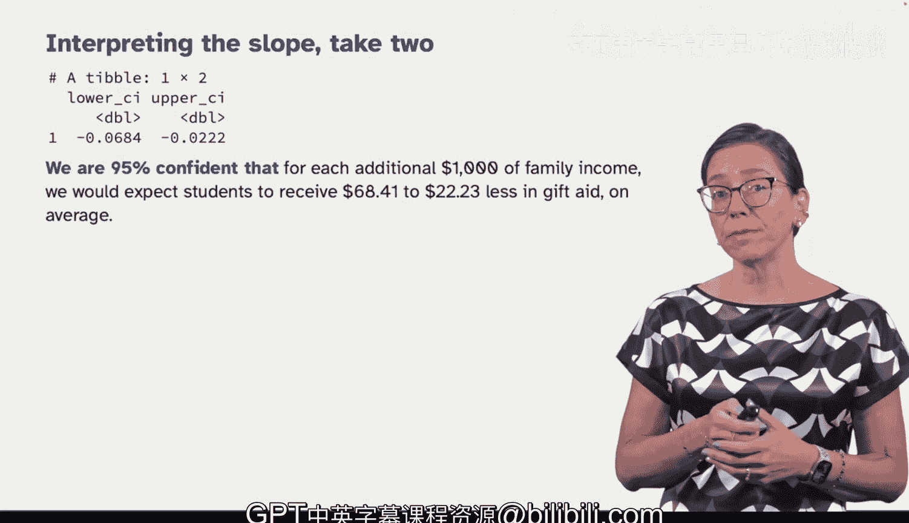

#  052：量化不确定性


在本节课中，我们将学习统计学和数据科学中一个至关重要的概念：如何从点估计转向理解围绕这些估计的可能性范围，即量化不确定性。

## 数据准备与探索

首先，我们需要加载必要的R包并查看数据。我们将使用`tidyverse`进行数据处理和可视化，`scales`优化坐标轴标签，`tidymodels`进行建模，以及`openintro`提供数据集。

```r
library(tidyverse)
library(scales)
library(tidymodels)
library(openintro)
```

我们分析的数据来自伊利诺伊州埃尔姆赫斯特学院大一新生的一个随机样本，包含50名学生的家庭收入和助学金信息。助学金是无需偿还的经济援助。

在散点图中，X轴代表家庭收入，Y轴代表助学金。数据显示出一种负相关关系：随着家庭收入增加，助学金倾向于减少。这从经济援助的角度来看是符合直觉的。

## 建立线性模型

为了量化这种关系，我们拟合一个线性模型。

```r
# 假设数据框名为 'elmhurst'
model <- lm(gift_aid ~ family_income, data = elmhurst)
summary(model)
```

我们的线性回归给出了一个截距（约24,300美元）和一个斜率（约-0.0431）。这个斜率意味着，家庭收入每增加1,000美元，我们预计学生获得的助学金平均会减少约43.10美元。

## 从点估计到不确定性

然而，一个关键问题随之而来：这是否意味着对于该校的每一位学生，家庭收入每增加1,000美元，我们预计其助学金都会恰好减少43.10美元？当然不是。这就是不确定性发挥作用的地方。我们计算的斜率来自一个样本。如果我们抽取不同的样本，会得到略有不同的斜率。因此，问题变成了：这个斜率的合理取值范围是多少？

这引出了**统计推断**的概念：利用样本数据对样本来源的总体做出结论的过程。统计推断提供了方法和工具，使我们能够使用单个观测样本来对其来源的总体做出有效的推断。为了使推断有效，样本应该是随机的，并且能代表我们感兴趣的总体。

## 置信区间：捕捉不确定性

到目前为止，我们做了很多估计，如均值、中位数、斜率等。我们使用样本数据计算样本统计量，然后将其用作总体参数的估计值。但从这些基于样本计算出的数字到对总体做出陈述，我们还需要考虑什么？

可以这样思考：如果你想捕鱼，你更愿意用鱼叉还是渔网？大多数人会选择渔网。同样，在估计总体参数时，你是愿意报告一个单一值，还是一个合理的取值范围？如果我们只报告一个点估计，很可能无法命中确切的总体参数。但如果我们报告一个合理的取值范围，我们就有更大的机会捕捉到真实参数。

这个合理的取值范围被称为**置信区间**。但要构建它，我们需要量化样本统计量的预期变异性。

## 量化变异性：自助法

为了构建置信区间，我们需要量化样本统计量的变异性。例如，要构建总体斜率的置信区间，我们需要围绕观测到的样本斜率提出一个合理的取值范围。这个范围取决于样本均值作为总体均值估计的精确度和准确度。量化这一点需要测量我们预期样本统计量在不同样本间会有多大变化。

我们可以通过计算方法来做到这一点，即使用一种称为**自助法**的模拟技术。或者，我们也可以通过理论（即中心极限定理）来实现。作为预览，你一直在回归输出中看到的标准误值就是基于该理论计算的。

那么，什么是自助法？这个术语来源于“靠自己的鞋带把自己拉起来”这个短语，意指在没有外部帮助的情况下完成不可能的任务。我们的“不可能任务”是：仅使用给定样本的数据来估计总体参数。

## 自助法步骤详解

以下是自助法的工作原理，分为四个步骤：

1.  **抽取自助样本**：从原始样本中有放回地随机抽取一个样本，其大小与原始样本相同。
2.  **计算自助统计量**：在自助样本上计算统计量，如均值、中位数、比例、斜率等。
3.  **重复多次**：重复步骤1和2多次，以创建**自助分布**，即自助统计量的分布。
4.  **计算置信区间边界**：将置信区间的边界计算为自助分布的中间部分，具体取决于你想要的置信水平。

让我们看看实际操作。第一个自助样本及其拟合线和斜率与原始样本相似，但不完全相同。第二个、第三个、第四个样本的斜率值都不同。当我们叠加这些样本时，可以看到拟合线是如何变化的。这种变化正是我们想要捕捉和量化的。

当然，我们不会只停留在四个样本。我们会生成成百上千个自助样本。当我们为100个自助样本拟合直线并收集所有斜率绘制成直方图时，就得到了斜率的自助分布。这向我们展示了如果我们能回到总体并抽取许多新样本，可能合理看到的斜率值范围。

## 构建与解释置信区间

从这个自助分布中，我们可以计算95%置信区间，只需找到分布的中间95%部分。

我们的斜率95%置信区间大约从-0.0699到-0.0217。

因此，我们对斜率的解释也包含了不确定性的度量：**我们有95%的置信度认为，家庭收入每增加1,000美元，我们预计学生获得的助学金平均会减少69.95美元到21.70美元**。

请注意，这比仅仅说“减少43.10美元”提供了更多的信息。这个置信区间让我们了解了估计的精确度，并承认了使用样本数据所固有的不确定性。

## 总结



本节课中，我们一起学习了如何量化不确定性。点估计是有用的，但它们不能说明全部情况。置信区间帮助我们量化不确定性，并提供了一个更完整的图景，说明我们可以从样本数据中对总体做出哪些合理的结论。自助法是一种强大、直观的计算方法，用于构建这些区间。