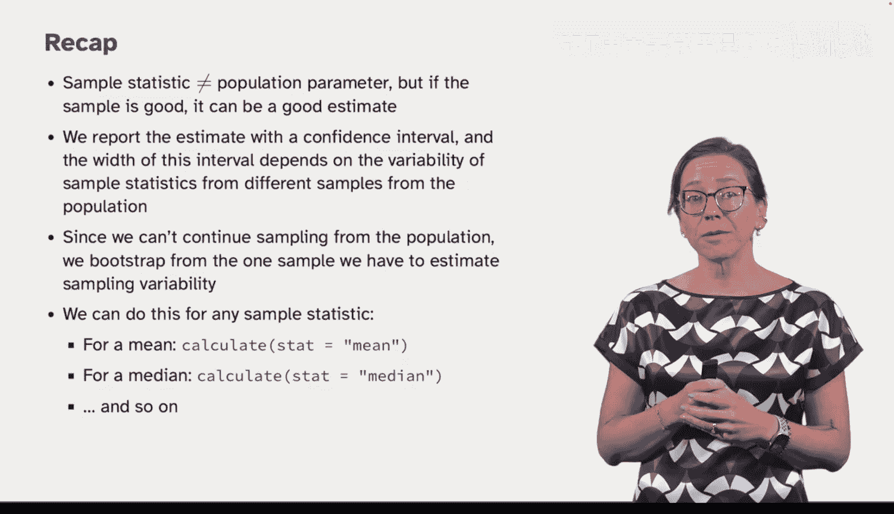

#  053：自助法 🎼


在本节课中，我们将学习如何使用自助法来量化统计估计中的不确定性。我们将通过一个具体的例子——估算苏格兰爱丁堡三居室公寓的平均租金——来演示自助法的完整流程，并解释如何构建和解读置信区间。

## 概述

在上一节中，我们讨论了不确定性量化的动机，并介绍了通过构建置信区间来量化抽样统计量变异性的思想。本节中，我们将通过一个新的例子来重温自助法。

## 数据准备与探索

我们将使用 `tidyverse` 进行数据处理和可视化，使用 `tidymodels` 进行建模任务。

我们的数据集包含从英国主要房产网站 `rightmove.co.uk` 上随机抽取的15套位于苏格兰爱丁堡的三居室公寓的租金信息。数据列由分号分隔，因此我们使用 `read_csv2` 函数加载数据。

```r
library(tidyverse)
library(tidymodels)

# 加载数据
rent_data <- read_csv2("path/to/your/data.csv")
```

查看数据，我们发现租金范围从每月825英镑到3250英镑不等，这反映了爱丁堡不同社区、房产状况和设施的差异。样本数据的直方图显示，大多数公寓价格在1500至2000英镑之间，存在少数高价的离群值。

我们的样本均值约为1895英镑。但关键问题是：如果我们从爱丁堡随机抽取另一组15套公寓，会得到完全相同的均值吗？几乎肯定不会。这个样本均值是我们对总体均值的最佳估计，但它伴随着不确定性。问题在于，不确定性有多大？这正是自助法要解决的问题。

## 自助法核心思想

自助法通过模拟抽样过程来估计统计量的变异性。我们通过从现有样本中**有放回地重复抽样**，来创建一个假设的“自助法总体”。

以下是自助法的分步流程：

1.  **抽取自助样本**：从原始样本中有放回地随机抽取一个样本，其大小与原始样本相同。
2.  **计算自助统计量**：计算该自助样本的统计量（如均值、中位数、比例等）。
3.  **多次重复**：重复步骤1和2许多次，以创建**自助分布**（即自助统计量的分布）。
4.  **构建置信区间**：使用该分布的中间一定百分比（例如95%）来创建我们的置信区间。

核心见解是，**有放回抽样**允许我们模拟从总体中抽取不同样本的过程。

## 在R中实现自助法

现在，让我们看看如何使用 `tidymodels` 框架（特别是 `infer` 包）在R中实现这一过程。我们将逐步构建自助分析。

首先，我们设置随机种子以确保结果可重现。由于自助法涉及随机抽样，设置种子意味着每次运行代码都会得到相同的随机样本。

```r
set.seed(123) # 确保结果可重现
```

接下来，我们使用 `specify` 函数来指定我们的模型。在本例中，我们只关心估计单个总体参数（租金均值），因此将响应变量设置为 `rent`。

```r
rent_spec <- rent_data %>%
  specify(response = rent)
```

`generate` 函数是产生自助样本的地方。我们将创建15000个自助样本，每个样本大小与原始样本相同（15个）。每个自助样本都是通过从原始15个观测值中有放回地抽样创建的。

```r
rent_boot <- rent_spec %>%
  generate(reps = 15000, type = "bootstrap")
```

为什么是15000次重复？更多的自助样本能让我们对抽样分布的估计更稳定，但超过一定点后，收益会递减。

然后，对于我们15000个自助样本中的每一个，我们使用 `calculate` 函数计算均值。

```r
boot_dist <- rent_boot %>%
  calculate(stat = "mean")
```

现在，我们有了15000个不同的样本均值，每个都基于一个不同的自助样本。这15000个均值的集合近似于如果我们真的能从总体中抽取15000个不同样本时会看到的情况。

## 可视化与解读结果

我们可以使用 `visualize` 函数创建自助分布的直方图。

```r
boot_dist %>%
  visualize()
```

这个直方图展示了样本均值的自助分布。请注意，该分布大致以我们原始样本均值1895为中心，但它显示了我们可能预期的样本间的变异性。这个分布的范围告诉了我们估计的精确度：**分布越窄，我们的样本均值就越精确**。

一个95%的置信区间由我们自助分布的中间95%界定。我们可以使用 `get_ci` 函数来计算。

```r
ci_95 <- boot_dist %>%
  get_ci(level = 0.95)
ci_95
```

我们可以使用 `shade_ci` 函数将刚刚计算的置信区间边界覆盖在自助分布图上并着色。

```r
boot_dist %>%
  visualize() +
  shade_ci(ci_95)
```

现在，让我们来讨论这些边界（例如1601到2216）代表什么含义。以下是几个听起来合理的解释，我们来判断它们是否正确：

*   **错误**：95%的时间里，样本中三居室公寓的平均租金在1601和2216之间。（这听起来像是这个单一样本的均值会随时间变化，但事实并非如此。我们知道样本均值是多少，我们已经计算过了。）
*   **错误**：爱丁堡95%的三居室公寓的租金在1601和2216之间。（这是关于单个公寓的，而不是均值。我们的置信区间是关于平均租金的，而不是单个租金的范围。）
*   **正确**：我们有95%的把握认为，所有三居室公寓的平均租金在1601和2216之间。（这是正确的。我们有95%的把握认为真实的总体均值——爱丁堡所有三居室公寓的平均租金——落在这个区间内。）
*   **错误**：我们有95%的把握认为，这个样本中三居室公寓的平均租金在1601和2216之间。（同样，我们的样本均值是固定的。我们确切地知道它是什么，我们不需要围绕它的边界。）

## 准确度、精确度与置信水平

我们说“有95%的把握”在统计学中有非常具体的含义。**如果我们多次重复整个研究（每次收集新的15套公寓样本并构建95%的置信区间），那么大约95%的这些区间会包含真实的总体均值。**

这并不意味着我们刚刚计算出的这个特定区间有95%的概率包含真实均值。而是意味着，从长远来看，我们的方法产生的区间中有95%会包含真实的总体参数。

常用的置信区间有90%、95%和99%。更高的置信水平需要更宽的区间，以确保有更高的把握捕获真实参数。**如果我们想非常确定能捕获参数，就需要一个更宽的区间（一张更大的网）。但更宽的区间精确度较低**，它们提供的关于参数可能位置的信息不那么具体。

那么，如何同时获得高置信度和高精确度呢？答案是：**增加样本量**。更大的样本会导致样本统计量的变异性更小，这意味着在相同置信水平下，置信区间会更窄。

## 计算不同置信水平的区间

在实际操作中，我们如何改变计算置信区间边界时的置信水平呢？只需更改 `get_ci` 函数中的 `level` 参数即可。

```r
# 计算90%置信区间
ci_90 <- boot_dist %>%
  get_ci(level = 0.90)

# 计算99%置信区间
ci_99 <- boot_dist %>%
  get_ci(level = 0.99)
```

## 总结

本节课中我们一起学习了自助法的核心应用。我们回顾了关键概念：

*   **样本统计量不等于总体参数**，但如果样本是好的，它可以是一个良好的估计。
*   我们通过**置信区间**来报告估计值，该区间的宽度取决于从总体中抽取的不同样本所产生的统计量的变异性。
*   由于我们无法持续从总体中抽样，因此我们从已有的一个样本进行**自助法抽样**，以估计抽样变异性。
*   这种方法适用于任何统计量。对于均值，我们在 `calculate` 函数中设置 `stat = "mean"`；对于中位数，则设置 `stat = "median"`。自助法本身也适用于许多其他统计量。




通过本教程，你应该能够理解自助法的原理，并在R中使用 `tidymodels` 的 `infer` 包来为各种统计量构建置信区间，从而量化你的估计中的不确定性。