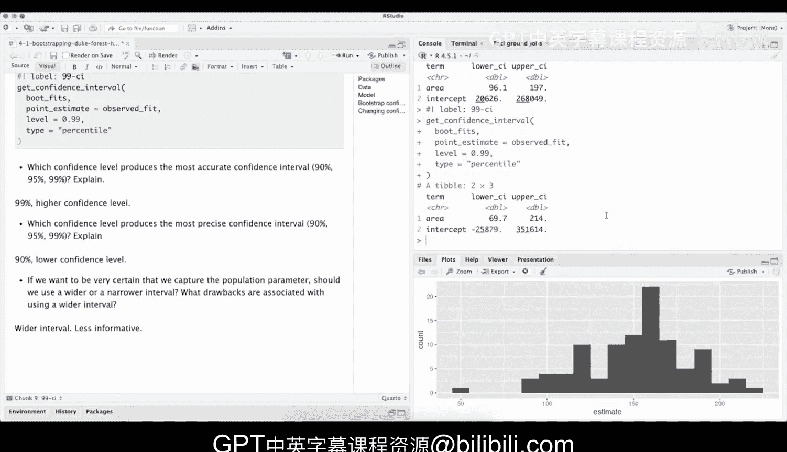

#  054：杜克森林房屋自助法 🏠


在本节课中，我们将学习如何使用自助法来构建置信区间。我们将使用杜克森林社区的房屋销售数据，通过线性回归模型预测房屋价格与面积的关系，并利用自助法来估计模型斜率（即每平方英尺的增量价格）的不确定性。

我们将使用 `tidyverse`、`tidymodels` 包进行数据探索和建模，并使用 `openintro` 包来获取数据。

## 加载数据与初步探索

首先，让我们加载必要的R包并查看数据。

```r
library(tidyverse)
library(tidymodels)
library(openintro)
```

我们使用的数据来自北卡罗来纳州达勒姆市杜克森林社区的房屋销售记录，时间大约在2020年11月。这些数据最初从Zillow抓取，并包含在 `openintro` 包的 `duke_forest` 数据集中。

```r
data("duke_forest")
glimpse(duke_forest)
```

数据包含98行（即98套房屋）和多个变量，如地址、价格、面积、卧室和浴室数量等。

## 建立线性回归模型

我们感兴趣的模型是使用房屋面积来预测其价格。这是一个典型的线性回归问题。

*   **结果变量**：`price`（价格，数值型）
*   **预测变量**：`area`（面积，数值型）

让我们拟合一个线性回归模型。

```r
df_fit <- linear_reg() %>%
  fit(price ~ area, data = duke_forest)

tidy(df_fit)
```

模型输出显示：
*   **截距**：约为116,652美元。这表示当房屋面积为0时模型的预测价格，在实际中无意义，但提供了基准线。
*   **斜率**：约为159美元。这表示**每增加一平方英尺面积，房屋价格预计平均上涨159美元**。

然而，这个斜率估计仅来自一个样本。为了更可靠地报告，我们需要构建一个置信区间。

## 使用自助法构建置信区间

上一节我们得到了一个点估计。本节中，我们将通过自助法来量化这个估计的不确定性。自助法的核心思想是从原始样本中**有放回地重复抽样**，生成许多“新样本”（自助样本），并在每个样本上重新拟合模型，从而得到估计量的分布。

### 第一步：计算观测拟合值

首先，我们将观测到的模型拟合结果存储起来，作为后续比较的基准。

```r
observed_fit <- linear_reg() %>%
  fit(price ~ area, data = duke_forest)
```

### 第二步：生成自助样本并拟合模型

接下来，我们从原始数据中生成自助样本。为了确保结果可重复，我们首先设置随机种子。

```r
set.seed(1234) # 设置随机种子以保证结果可重复
```

现在，让我们生成自助样本。我们先从较小的数量（例如10个）开始以便理解过程，然后再增加到更合理的数量（如100个）。

以下是生成10个自助样本并拟合模型的代码：

```r
n <- 10
bootstrap_fits <- duke_forest %>%
  specify(response = price, explanatory = area) %>%
  generate(reps = n, type = "bootstrap") %>%
  fit()
```

代码解析：
1.  `specify(...)`: 指定模型公式。
2.  `generate(reps = n, type = "bootstrap")`: 生成 `n` 个自助样本。`bootstrap` 类型意味着有放回抽样，且每个新样本大小与原始样本相同（98个观测值）。
3.  `fit()`: 在每个自助样本上拟合线性回归模型。

查看结果 `bootstrap_fits`，我们会发现每个自助样本都产生了截距和斜率两个估计值。我们关心的是斜率（`term == "area"`）。

### 第三步：可视化自助分布

让我们将自助样本数量增加到100，并存储结果，然后可视化斜率的自助分布。

```r
set.seed(1234)
n <- 100
bootstrap_fits <- duke_forest %>%
  specify(response = price, explanatory = area) %>%
  generate(reps = n, type = "bootstrap") %>%
  fit()

# 提取斜率估计并绘制直方图
bootstrap_fits %>%
  filter(term == "area") %>%
  ggplot(aes(x = estimate)) +
  geom_histogram(binwidth = 10) +
  labs(title = "Bootstrap Distribution of Slope (Price per Sq Ft)",
       x = "Slope Estimate ($ per sq ft)",
       y = "Count")
```

这张直方图展示了基于我们原始样本的100个自助样本所产生的斜率估计的分布情况，直观地反映了估计的变异性。

### 第四步：计算百分位置信区间

现在，我们利用这个自助分布来计算95%置信区间。我们将使用 `get_confidence_interval()` 函数，并指定使用百分位法。

```r
ci_95 <- get_confidence_interval(
  bootstrap_fits,
  point_estimate = observed_fit,
  level = 0.95,
  type = "percentile"
)
ci_95
```

结果解释：我们有95%的置信度认为，对于杜克森林的房屋，**每增加一平方英尺面积，其价格预计会上涨92.4美元到206美元**。

### 第五步：探索不同置信水平

我们可以轻松修改代码来计算不同置信水平（如90%和99%）的区间。

以下是计算90%置信区间的代码：

```r
ci_90 <- get_confidence_interval(
  bootstrap_fits,
  point_estimate = observed_fit,
  level = 0.90,
  type = "percentile"
)
ci_90
```

以下是计算99%置信区间的代码：

```r
ci_99 <- get_confidence_interval(
  bootstrap_fits,
  point_estimate = observed_fit,
  level = 0.99,
  type = "percentile"
)
ci_99
```

比较这三个区间：
*   **90% CI**：最窄（最精确），但置信水平最低。
*   **95% CI**：常用的平衡选择。
*   **99% CI**：最宽（最不精确），但置信水平最高，即最有可能包含真实的总体参数。

选择哪个置信水平取决于研究目标：
*   若想**高度确信**捕获真实参数，应使用更宽的区间（如99% CI），但这会降低信息的精确性。
*   若想获得**更精确**的估计，应使用更窄的区间（如90% CI），但这意味着犯错的风险略有增加。

## 总结

本节课中我们一起学习了自助法的完整应用流程：
1.  我们基于杜克森林房屋数据，建立了以面积为预测变量、价格为响应变量的线性回归模型。
2.  我们理解了单一斜率点估计的局限性，并引入了自助法来评估估计的不确定性。
3.  我们通过**有放回地重复抽样**从原始数据生成多个自助样本，并在每个样本上重新拟合模型，从而构建了斜率估计的**自助分布**。
4.  我们利用自助分布计算了不同置信水平（90%， 95%， 99%）的**百分位置信区间**。
5.  最后，我们讨论了在**置信度（准确性）** 和**区间宽度（精确性）** 之间进行权衡的概念，以及如何根据研究目的选择合适的置信水平。



自助法是一种强大且直观的统计工具，它不依赖于复杂的理论假设，仅通过重抽样就能对估计量的变异性进行稳健的推断。