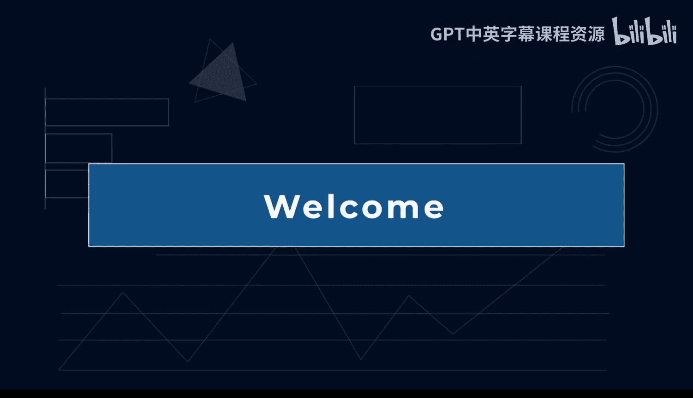
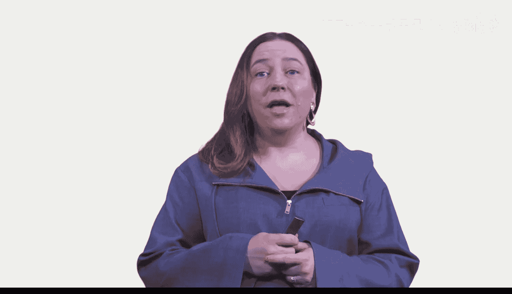
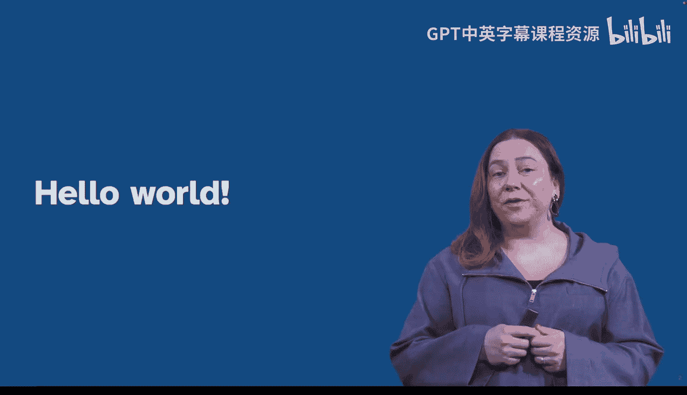
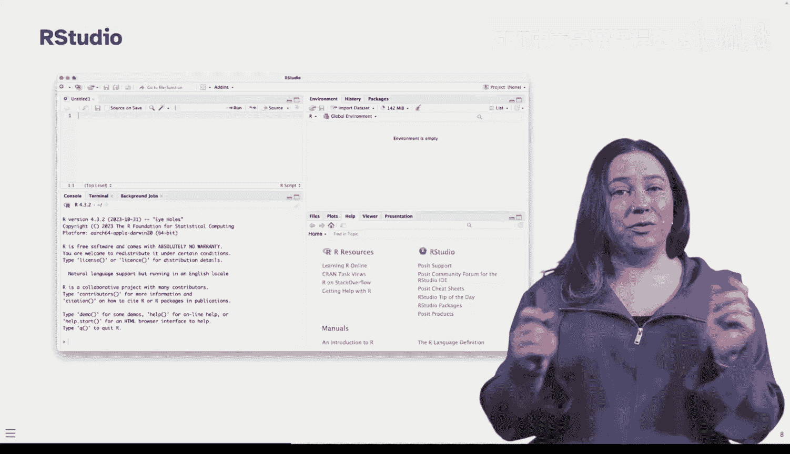
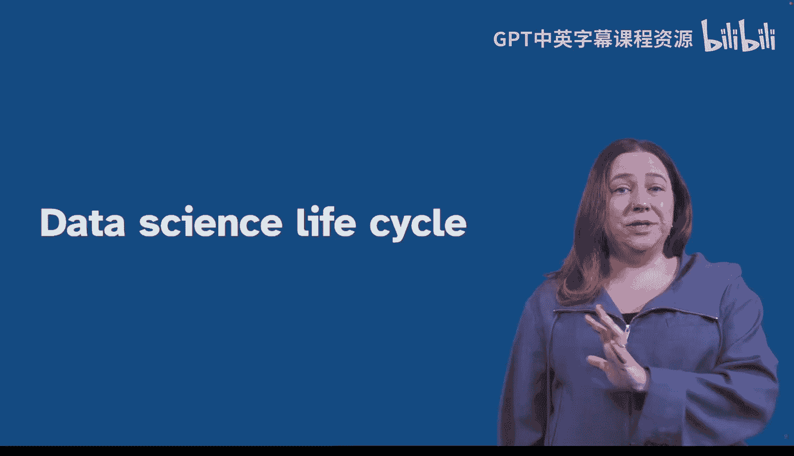
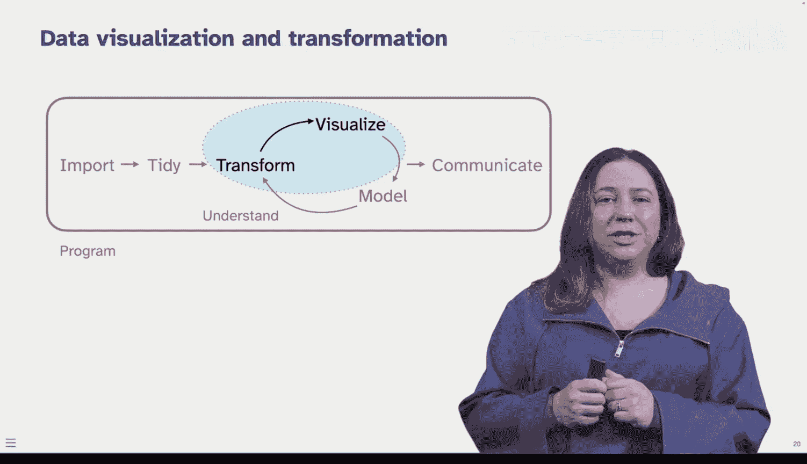
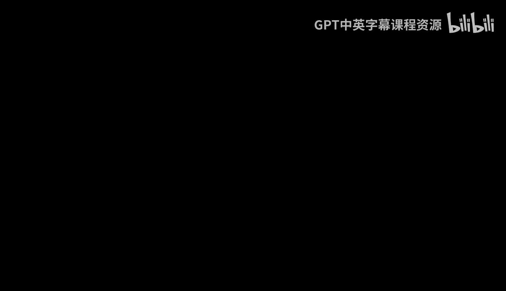

# 杜克大学《R语言数据科学｜Data Science with R》中英字幕 p01 01_01_03_欢迎.zh_en -BV1Zpv6BaEkB_p1-

🎼。

Hello and welcome， My name is Minet Tiinkaandel， and I will be your instructor for the specialization titled data Science with R。

 The first course in the specialization is data visualization and transformation。 Let's dive in。

Hello World is often the first program beginners right and since we'll be doing lots of coding in this course。

 we'll start with a Hello world too。

But before we get there， let's talk about data science Data science is an exciting discipline that allows you to turn raw data into understanding insight and knowledge There are many ways and toolkits for doing data science in this course you'll learn to do data science the tidy way。

 but more on what tidy means in this context later specifically this is a course that introduces you to data science with an emphasis on statistical thinking。

However， before we get to data science content， let's review some commonly asked questions。

First question。 What data science background does this course assume Aner none。 However。

 it does require a willingness to learn and a motivation to work with data。 Another question。

 Will we be doing computing。 Oh， yes。 What computing language will we learn or。Why not language X。

 Great question。 There are many languages data scientists use， In fact。

 many data scientists use multiple languages， one for some parts of their data analysis and another for others。

 In this course， we've made the choice to stick with R。Let's talk a bit about software。

Data organized in rows and columns in a spreadsheet program might be familiar to some of you spreadsheets are a ubiquitous tool for storing tabular data。

 some people do data analysis in them as well， but we won't be doing that。Instead， we'll use R。

 This is what working in R looked like when I started learning R in graduate school。 And frankly。

 that looked a little intimidating。 Nowadays， a large portion of people working in R use our studio。

 which you will also learn in this course。 The our studio window might look for into you。

 but that's okay。 We will walk through the panes and how we use them throughout the course。😊。

So we've said a bit about software we'll use to conduct data analysis。

 but what doesn't end to end data analysis entail， let's take a look。

Here is the data Science Lifecycle diagram from the book R for Data Science。

 which you will be reading in this course， the diagram outlines many stages of data science。

We start by importing data from a spreadsheet or a database or scraping it off the web。

Then reality strikes， you almost never get data that is perfectly pristine and organized precisely for the analysis you'll conduct。

 so you usually need to tidy it and transform it a bit to get it ready for analysis。

We often start with exploratory analysis， which involves visualizing and summarizing。

Then you might apply modeling techniques to make inferences and predictions with your data。

This will often reveal aspects of your data that you want to address by transforming and visualizing it further。

 So you spend some time in this cycle to understand your data。

 Either you get to a point where you're happy with your data analysis or you hit a deadline。

 So finally， you need to communicate your results。 Here is data from the Google trend index。

 which measures how popular specific search terms related to topics like travel pictured here。

 vary over time。 We're seeing a cyclical or a seasonal pattern for when travel related search terms gain and lose popularity。

 This prompts us us to return to the raw data， which has dates。

And we may want to create a new column for the season that we calculate based on these dates and then use that variable as an indicator in subsequent analyses。

 This is an example of how a visualization and some modeling results that's the red smooth curve overlaid on the visualization might prompt us to do further data transformation and that keep us in that explore cycle。

Then as I said， you either come to a deadline and analyze the or analyze the data sufficiently and need to communicate your results。

 but that feels like holding off on writing your term paper until the very last minute after researching it for a long time。

 which is not a habit we want to promote， so instead we'll add communication stage to our cycle of understanding the data。

 writing up our results and analyzing the data as we go。

 but we need a way to do this without too much context switching。

 therefore we'll do our analysis in computational notebooks specifically Quao documents that allow you to write and run code and write your narrative in the same document。

We can also see one more stage in the data science cycle encapsulating everything else program。

It's out there not because it's less important than the other stages。

 but because it sort of governs all of them， all of these stages require a little bit of programming。

And all of these stages together can take a considerable amount of time to learn。

 so in the first course of the specialization we'll focus primarily on the data。

 visualization and transformation stages and we're going to talk about the tooling for doing data science with R。

😊。

