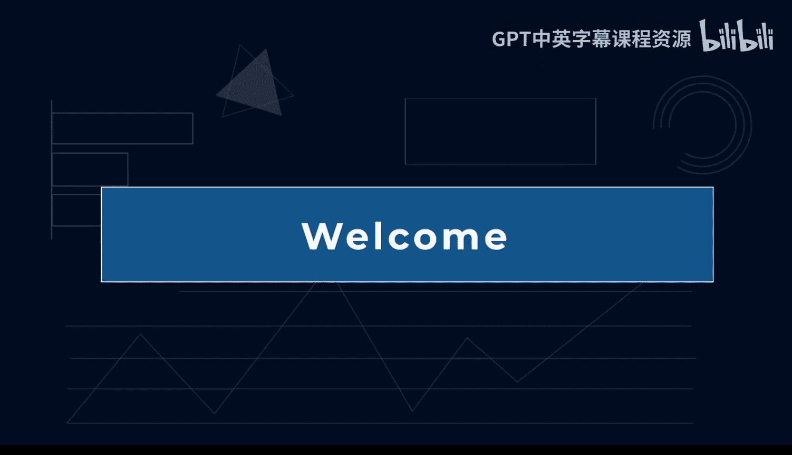
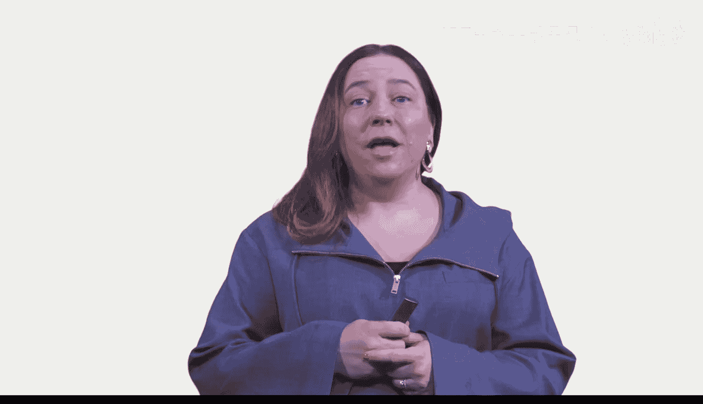
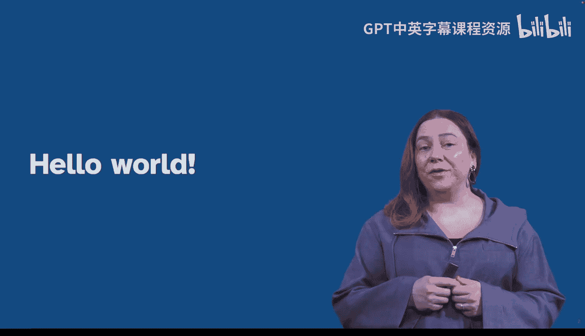
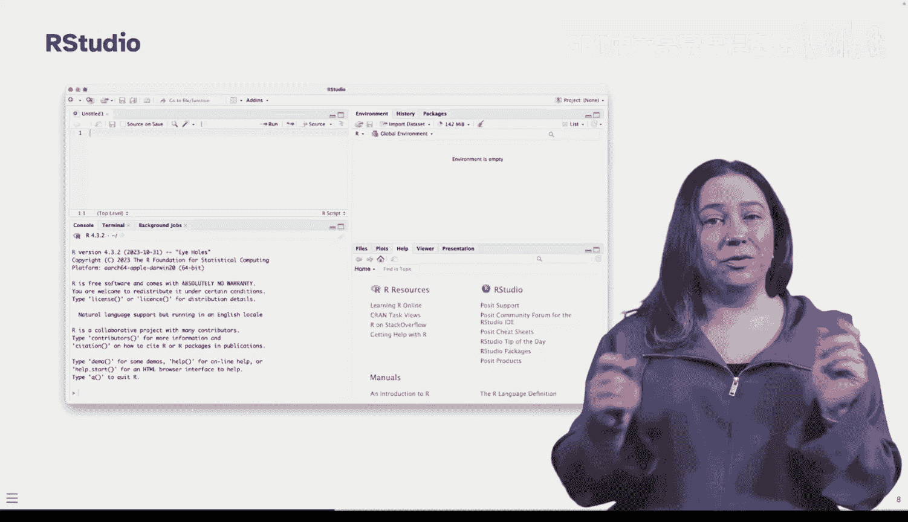
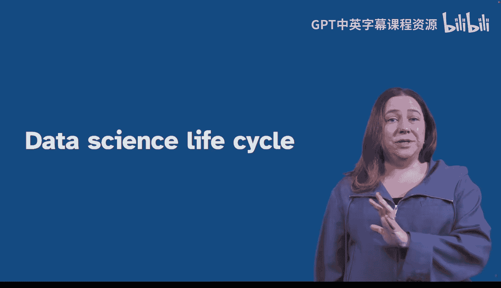
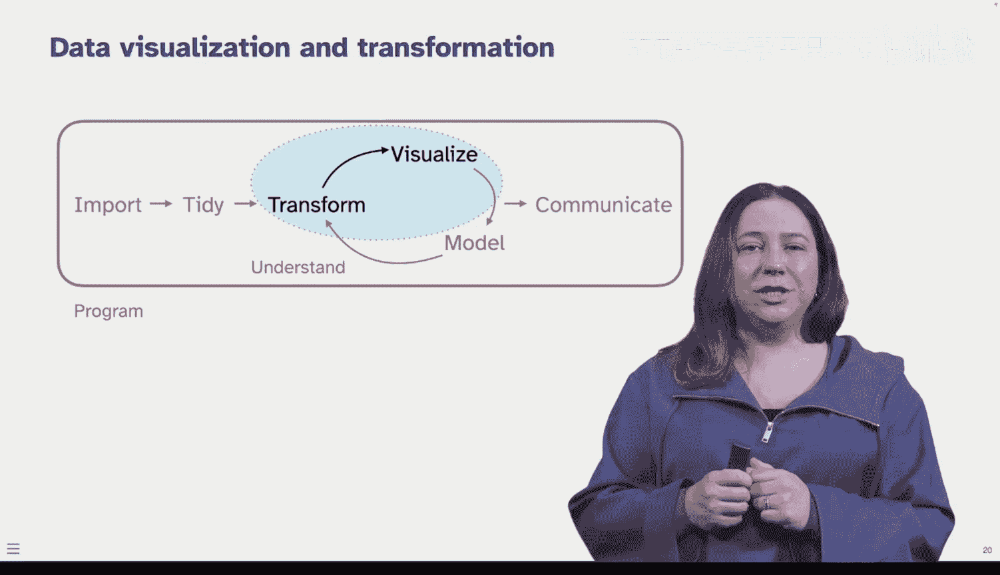
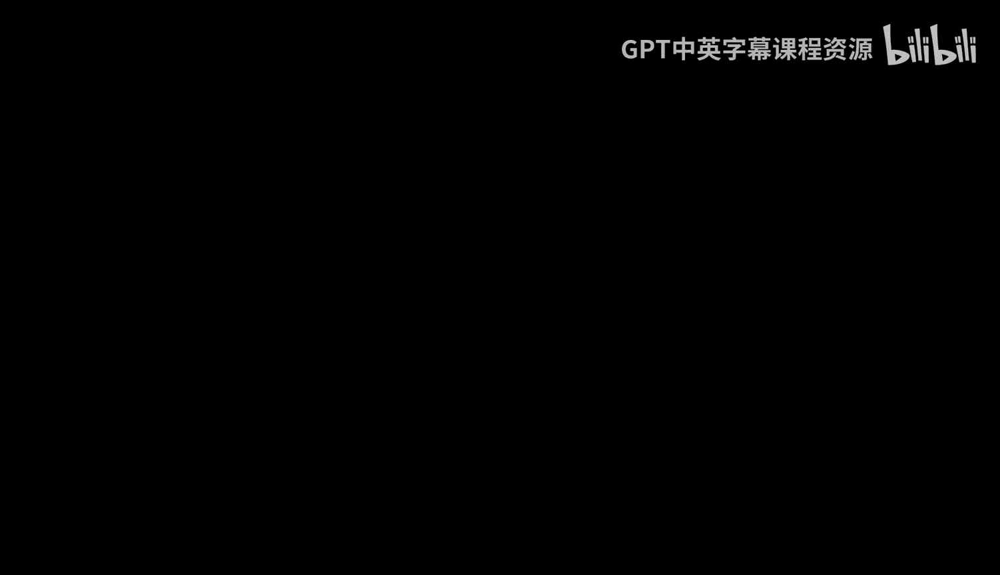

# R语言数据科学：01：欢迎与课程概述 🎼

在本节课中，我们将学习课程的基本介绍、数据科学的整体流程，以及我们将要使用的核心工具。课程将从最基础的“Hello World”程序开始，逐步引导你进入数据科学的世界。

大家好，欢迎来到本课程。我的名字是Minet Tiinkaandel，我将担任“R语言数据科学”专项课程的讲师。本专项课程的第一门课是“数据可视化与转换”。让我们开始吧。

“Hello World”通常是初学者编写的第一个程序。由于本课程将涉及大量编码，我们也将从“Hello World”开始。

但在开始之前，让我们先谈谈数据科学。数据科学是一门令人兴奋的学科，它能让你将原始数据转化为理解、洞察和知识。进行数据科学的方法和工具有很多，在本课程中，你将学习以“整洁”的方式进行数据科学。关于“整洁”在此语境下的具体含义，我们稍后会详细讨论。具体来说，这是一门强调统计思维的数据科学入门课程。

然而，在接触数据科学内容之前，让我们先回顾一些常见问题。

以下是关于课程背景和工具的几个常见问题：

*   **问：本课程需要什么数据科学背景？**
    *   答：不需要任何背景。但是，它要求你有学习的意愿和与数据工作的动力。
*   **问：我们会进行计算吗？**
    *   答：是的，我们会。
*   **问：我们将学习什么计算语言？为什么是R语言而不是X语言？**
    *   答：这是个好问题。数据科学家使用许多语言。事实上，许多数据科学家使用多种语言，一部分分析用一种语言，另一部分用另一种语言。在本课程中，我们选择坚持使用R语言。

现在，让我们谈谈软件。

你们中的一些人可能熟悉电子表格程序中按行和列组织的数据。电子表格是存储表格数据的普遍工具，有些人也在其中进行数据分析，但我们不会这样做。相反，我们将使用R语言。

这是我研究生时期开始学习R时的工作界面。坦率地说，那看起来有点令人生畏。如今，大部分使用R工作的人都使用RStudio，你也将在本课程中学习它。RStudio的窗口一开始可能看起来令人生畏，但这没关系。我们将在整个课程中逐步介绍各个窗格及其使用方法。

我们已经介绍了用于进行数据分析的软件，但一个端到端的数据分析包含哪些内容呢？让我们来看一下。

上图是来自《R for Data Science》一书的数据科学生命周期图，你将在本课程中阅读这本书。该图概述了数据科学的许多阶段。

我们从导入数据开始，数据可能来自电子表格、数据库，或从网络上抓取。

然后现实情况出现了：你几乎永远无法获得完全原始、并且恰好为你将要进行的分析完美组织好的数据。因此，你通常需要对其进行整理和转换，使其为分析做好准备。

我们通常从探索性分析开始，这包括可视化和数据摘要。

然后，你可能会应用建模技术，用你的数据进行推断和预测。

这通常会揭示出你希望通过进一步转换和可视化来解决的数据方面的问题。因此，你会花一些时间在这个循环中，以理解你的数据。

最终，你要么对你的数据分析感到满意，要么遇到了截止日期。所以最后，你需要传达你的结果。

这里有一个来自谷歌趋势指数的数据示例，它衡量了与旅行等主题相关的特定搜索词（如图所示）的受欢迎程度随时间的变化。我们看到旅行相关搜索词的流行度呈现出周期性或季节性模式。

这促使我们回到包含日期的原始数据。我们可能希望基于这些日期计算并创建一个新的“季节”列，然后在后续分析中使用该变量作为指标。

这是一个例子，说明可视化和一些建模结果（即叠加在可视化上的红色平滑曲线）如何促使我们进行进一步的数据转换，并让我们保持在那个探索循环中。

然后，正如我所说，你要么遇到截止日期并分析数据，要么充分分析数据后需要传达结果。但这感觉就像研究了很长时间后，直到最后一刻才动笔写学期论文，这不是我们想要提倡的习惯。

因此，我们将在理解数据的循环中加入沟通阶段，边分析数据边撰写结果。但我们需要一种无需太多上下文切换就能做到这一点的方法。

因此，我们将在计算笔记本中进行分析，特别是Quarto文档，它允许你在同一文档中编写和运行代码，并撰写叙述性文字。

我们还可以在数据科学生命周期中看到另一个阶段，它囊括了所有其他阶段：编程。

它被单独列出来，不是因为它比其他阶段不重要，而是因为它某种程度上管理着所有阶段。所有这些阶段都需要一点编程。

所有这些阶段加在一起，可能需要相当长的时间来学习。因此，在本专项课程的第一门课中，我们将主要关注数据可视化和转换阶段，并讨论使用R进行数据科学的工具。

---

**本节课总结**

在本节课中，我们一起学习了课程的欢迎介绍和数据科学的基本流程。我们明确了课程不需要先验知识，但需要学习的热情。我们了解到本课程将使用R和RStudio作为核心工具，并初步认识了数据科学生命周期的各个阶段：导入、整理、转换、探索、建模和沟通。在接下来的课程中，我们将重点深入数据可视化和数据转换这两个核心环节。