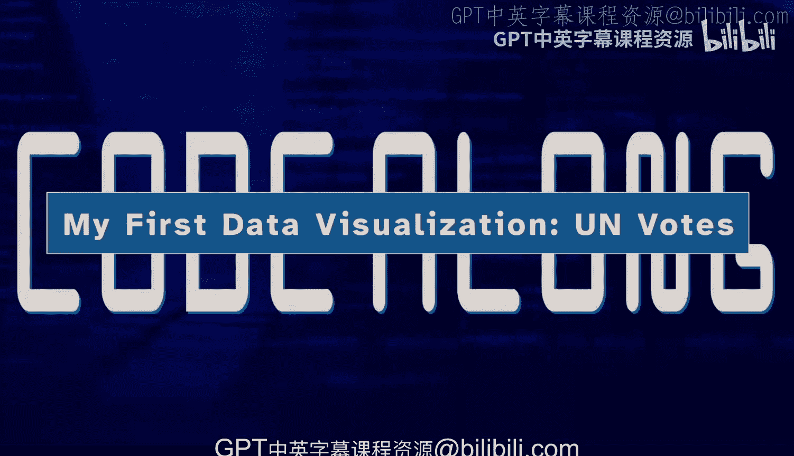
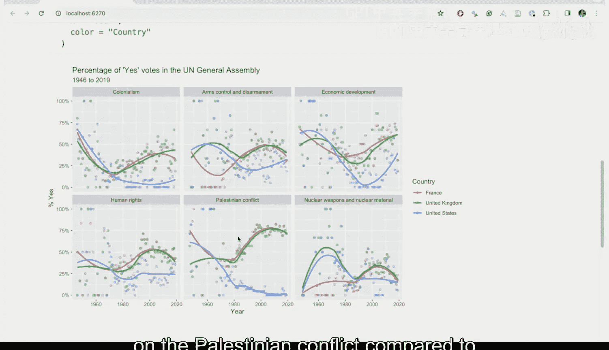

# 杜克大学《R语言数据科学｜Data Science with R》中英字幕 p02 02_01_03_代码实践：我的首次数据可视化-联合国投票.zh_en -BV1Zpv6BaEkB_p2-

Hello and welcome to the first code along Our first code along is called UN votes。

 so open up your file called UN votes and let's take a look at what's in there。

 each of these code alongs are going to be structured somewhat similarly an introduction where we say a little bit about the data that we're going to be working with。

 load some packages， load the data itself and then we go on to running different analyses and talking through it。

 So in this particular analysis， we're going to look at how countries vote in the United Nations General Assembly and how their voting patterns have evolved throughout time。

And how similarly or differently do they view certain issues？

We're going to try to answer these questions at a very。

 very high level and we're going to throw a bunch of code at you and really the challenge for this code along is to be able to look at a bunch of code and try to figure out what is the one little update you might need to do to get what you need out of it。

So let's go ahead and start by first rendering our document。

 it's always good practice when you open a newCo document that has been provided to you with some code on hand to go ahead and render it before you even touch it。

This makes sure that there are no errors that persist in the document before you even get started。

 because if there are， you know， that's not your fault and you can go back and try to figure that out or go to the person who provided the courto document for you and ask them questions before you even get started。

We can see that in our Quao document on top we have this area called YamL where we have some metadata about our analysis。

 we just have a title for this one and when we render it。

 we can see that it is formatted a particular way The rest of the document looks very different between the source code that is the QMD file and the output the HTML file except when we get to the code chunks so we're going to talk about those code chunks in a second。

So I have a first level heading introduction where we talk through a little bit about the introduction that I just gave you and then we have a second level heading packages and it it has a code chunk in it that loads the packages that we're going to use for this analysis remember I said we're going to throw a bunch of code at you well we're going to throw a bunch of packages at you as well。

 some of which I haven't even introduced in the course yet。

So the first package should be one that's familiar。

 the tidyverse package for data wrangling and visualization。

 the scales package for making pretty access labels。

 the DT package creates an interactive data table so if you scroll to the very bottom of your document at some point I'm going to be asking you to come out with a country that you might want to visualize yourself。

 and if you want to check to see how exactly that country is spelled in your document for example。

 Congo tends to be a country that might be spelled differently in different resources so you can go ahead and use that interactive data table to filter for that country so you can decide how you need to spell it in your code。

And finally， the UN votes package is a package that bundles information on how countries vote in the United Nations into a data frame that then is distributed within this package。

 the package is updated somewhat regularly， so this is a recent ish data set that we're going to be working with。

Here it says that the data we're using originally came from this UN votes package and in the chunk below we modify the data by joining various data frames provided in the package joiningining data frames is something you're going to learn more about in the class。

 but for now just think about it as I have some data and I have some additional information about these countries that I have data on and I want to sort of slurp all of that up into creating a single data frame called UN votes。

And then we have another code chunk here that if I scroll in my output ultimately produces a visualization and this is the visualization that is sort of the point of this code along。

We can see that in this visualization， let me pop this out a little bit。😊。

And let's go ahead and zoom in on it。We can see that on the X axis we have a year。

 so we have some data over time on the y axis we have percentage of yes votes。

 so for each of the countries that are applauded in this case the countries that are applauded are Turkey where I'm originally from United Kingdom where I've lived for a few years。

 and United States where I'm currently living now these are all represented by different colored lines and points we're looking to see what percent of the time did they vote Yes in UN resolutions that are on particular topics。

 the topics or issues as they're referred to in the data are colonialism。

 arms control and disarmament， economic development， human rights。

 Palestinian conflict and nuclear weapons and nuclear material something important of note is yes doesn't necessarily mean I agree or I disagree we don't know at this point in time what。

The content of the resolutions they're voting yes are it could be yes for colonialism or yes for stopping colonialism。

 so we don't have that information though if you have some political knowledge and some understanding of how these countries vote today or historically have voted in these issues。

 you might be able to get a sense of what those resolutions were saying。

 but it's just important to note that this is not necessarily the full picture。

Some of the things we can see is that while for arms control and disarmament。

 these three countries seem to be voting somewhat in harmony over time。

 on other issues like colonialism or Palestinian conflict。

 the way they have voted have changed over the years and diverged from one another。

And here is the challenge Let's close this up。Go back to the code and taking a look at this code that seems to be doing a lot of stuff that you haven't yet learned。

 the challenge is to replace the country， Turkey or one of the other countries if you want。

 with a country of your choice。So the goal is to figure out without understanding all of the code here。

 is it possible to make a modification and get what you need out of this。

 So if it is that we want to replace one of the countries。

 the first question you want to ask yourself is where in this pipeline Would I be making an adjustment。

 is it going to be once I start making the plot， So starting with Ggipl or lower or is it going to be earlier than that in the pipeline where I'm preparing my dataset。

 Well， where we're preparing our data， it appears that we start with that join data that we created in an earlier code chunk。

 and then we are filtering， which is a function you haven't learned yet。

 but perhaps can guess what it means for some countries Here's another operator you haven't learned yet。

 but it seems to list the three countries。We actually have plotted。

 So if I wanted to replace this with another country， how would I go about it。

 Let's go ahead and replace Turkey with another country that happens to pop into my mind。

And in order to recreate our visualization， we go ahead and click render again。When you click render。

 if the result isn't showing up in this viewware pane， but it's popping up as a pop up window。

 you can click on the gear icon next to the render button。And。

That probably means that you have preview in window selected。

 you can go back and select preview in viewer pane if you like seeing your input and your output next to each other if you happen to have a much smaller screen。

 you may not prefer this and you may prefer the preview in window option。

So I'm going to pop this out one more time so we can zoom in and look at the visualization a little bit more closely。

 we can see that in fact， the adjustment that we made to our code has propagated through the code itself and has made its way onto our visualization we're still using the same three colors but this time we have the red color representing France instead of Turkey and we can sort of see how the voting patterns in this case of France and United Kingdom seem to be much similar for example。

 when it comes to resolutions on the Palestinian conflict compared to how Turkey voted on these issues。

So in this brief code along， what we managed to do was to open up a cho document。

 render our Coro document。Change how we might view the output in a pop up window or in the viewer pane next to our document。

Write some code and create your first data visualization with R without really learning a whole lot of R。

 but with learning to have the confidence to play around with the code that has already been provided for you and rendering again to see if what you expect might happen actually happens when you run the code。

