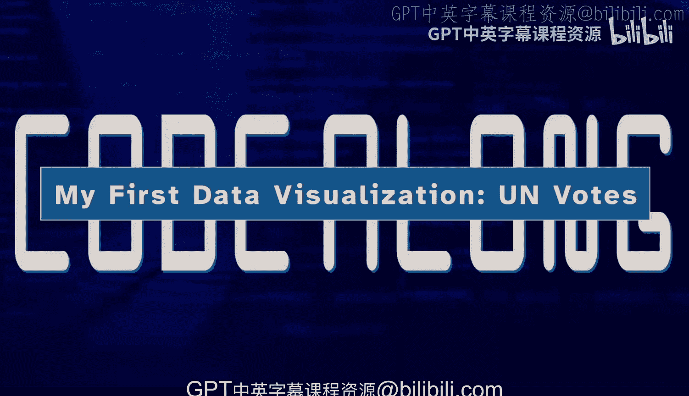
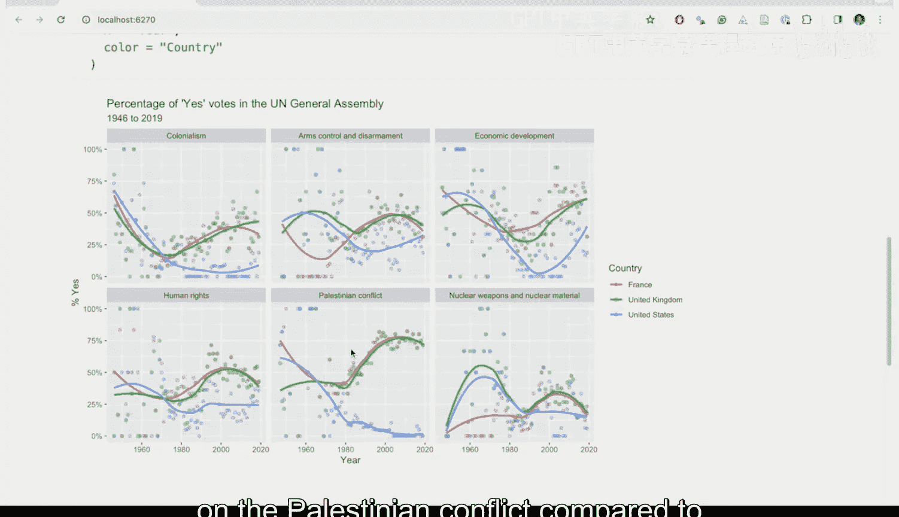

# R语言数据科学：01：代码实践：我的首次数据可视化-联合国投票 📊




在本节课中，我们将学习如何打开并运行一个R Markdown文档，通过修改代码来探索不同国家在联合国大会上的投票模式，并生成你的第一个数据可视化图表。

## 概述

我们将使用一个名为“UN votes”的R Markdown文件。这个分析旨在探索各国在联合国大会上的投票模式如何随时间演变，以及它们在特定议题上的投票相似性或差异性。我们将通过修改现有代码，替换图表中的国家，来实践如何在不完全理解所有代码的情况下，通过调整关键部分来获得所需结果。

## 数据与工具包

我们将使用几个R包来完成分析。以下是所需包及其简要说明：

*   **tidyverse**：用于数据整理和可视化。
*   **scales**：用于美化坐标轴标签。
*   **DT**：用于创建交互式数据表格，方便我们查找和确认国家的准确拼写。
*   **unvotes**：该数据包包含了联合国投票数据，我们将使用它提供的数据框。

在开始分析前，我们首先加载这些包并准备数据。数据来源于`unvotes`包，我们通过连接（join）包内的多个数据框，创建了一个名为`un_votes`的单一数据框。

## 初始可视化与代码解读

上一节我们加载了数据，本节中我们来看看初始的可视化结果及其背后的代码逻辑。

运行初始代码后，我们得到一张折线图。X轴代表年份，Y轴代表投“赞成”票的百分比。图表显示了三个国家（土耳其、英国、美国）在六个不同议题（如殖民主义、军备控制、人权等）上的投票趋势。

以下是生成该图表的代码核心部分。我们不需要完全理解每一行，但需要识别出决定显示哪些国家的关键代码段：

```r
# 示例代码结构（非完整代码）
un_votes %>%
  filter(country %in% c(“Turkey”, “United Kingdom”, “United States”)) %>%
  # ... 后续的数据处理和绘图代码
```

可以看到，`filter(country %in% c(...))` 这一行通过一个列表指定了要筛选出的国家。我们的目标就是修改这个列表。

## 实践挑战：替换国家

现在，我们的挑战是修改代码，将图表中的一个国家（例如土耳其）替换为你感兴趣的国家。

关键步骤是定位到筛选国家的代码行，并更新国家名称列表。例如，将 `“Turkey”` 替换为 `“France”`。修改后，重新渲染（Render）整个文档，观察可视化图表是否相应地更新。

修改并渲染后，新的图表会显示法国、英国和美国的投票模式。我们可以观察到，例如在巴勒斯坦冲突议题上，法国和英国的投票模式比之前土耳其的投票模式更为相似。

## 总结



本节课中我们一起学习了如何操作一个R Markdown分析项目。我们实践了打开文档、首次渲染以确保无错误、识别关键代码段（特别是用于筛选数据的部分）、修改代码以替换分析对象（国家），并重新渲染文档以查看更新后的可视化结果。


这个练习的核心在于建立信心：即使面对尚未完全掌握的代码，也能通过有根据的尝试和观察结果来探索数据并完成简单的定制化分析。