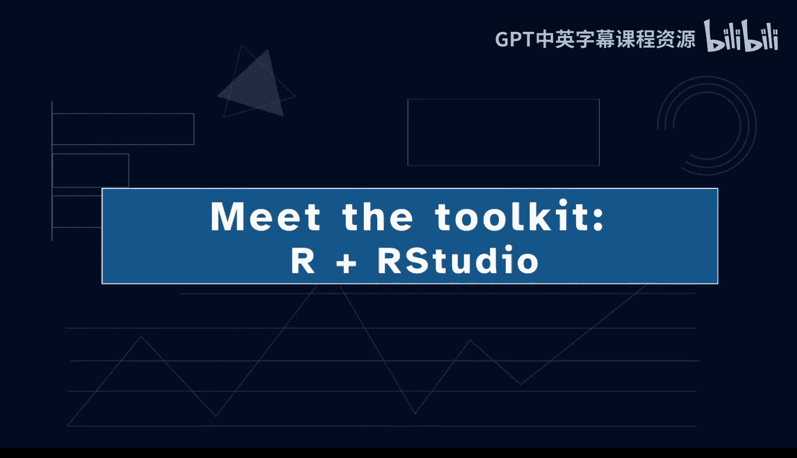
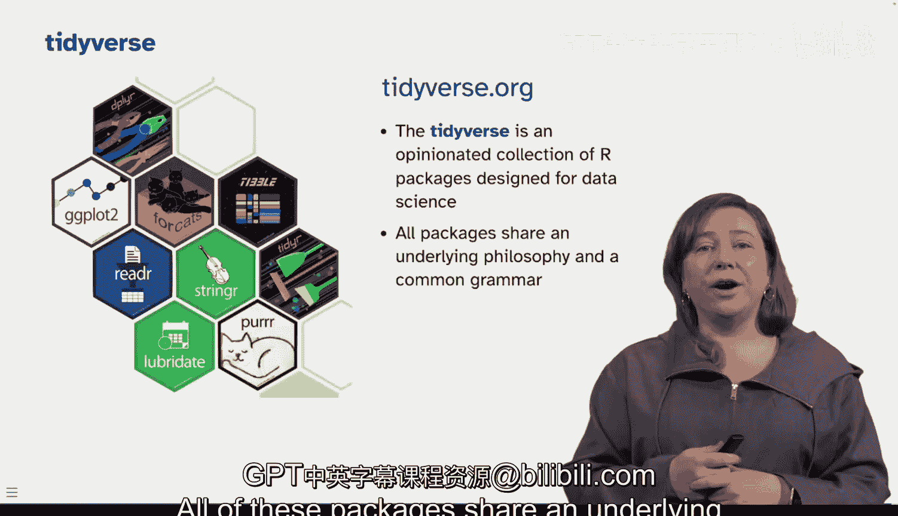

# 杜克大学《R语言数据科学｜Data Science with R》中英字幕 p03 03_01_01_认识工具：R与RStudio.zh_en -BV1Zpv6BaEkB_p3-

🎼。

In this course and throughout the specialization we'll use a number of modern data science tools in this video we'll meet two of them R and RC。

Before we meet them， let's review our learning goals。By the end of this course。

 you will be able to gain insights from data or to be more specific。

 gain insights from data using modern programming tools and techniques， or more specifically。

 gain insights from data using modern programming tools and techniques reproducibly with litter programming。

 or let's get a bit more specific， gain insights from data using modern programming tools and techniques。

 reproducibly with literal programming and version control。In this video， though。

 we'll focus on gaining insights from data using modern programming tools and techniques。

 just that one bullet point。With RNR studio。So what is R R is an open source statistical programming language。

 It's also an environment for statistical computing and graphics。An Rsudio。

 Ridio is a convenient interface for R called an IDdeE， an integrated development environment。

 For example， I could say I write R code in the Ridio IDE usings ourudio is not a requirement for programming with R。

 but it's very commonly used by our programmers and data scientists。

 A good analogy for R versus ourtio is a car engine versus a dashboard。

 R is like the engine under the hood。 Ourtio is a dashboard via which you interact with the engine。

 and R packages。 Packages are the fundamental units of reproducable R code。

 They include reusable R functions， documentationations of these functions and sample data。

They're how the our community extends our。As of April 2024， there are over 20。

000 R packages available on Crran， the Compreive R archive network。

 we are going to work with a small but a really important subset of these packages。

So let's take a tour of our and our studio。Alright， so here is R studio。 What do we have here。

 First of all， we have the R console when we open up our studio， we can see that we get access to R。

 it tells me the version of R that I'm using， for example。

 so if you haven't updated your R version recently you might have a different number here and in the console I can do just simple arithmetic I could do something like two plus2 and I get a four as a result this is not that exciting。

 of course， but it is something that you're seeing that we can just do these simple things here other things you can do that you can also sort of do with a calculator but starts to feel a little bit different is we can assign things to object so for example。

 I can say X is2。I can see that soon as I do this in my environment tab。

 I can see the object that I created and the value that it has。

 and then I can do athmetic operations with that X as well and I've been putting spaces between my operators but that's entirely optional I could also get you know ammit the spaces and do something like this I like putting these spaces so things have a bit of a room to breathe that they're easier to read but spaces in R are optional。

Now let's get into actually doing things with data in R One of the packages we're going to use on and off throughout the course is a package that contains some data on penguins to load a package。

 the name of the package is Palm or penguins so to load a package。

 I would type library Palmer penguins， the name of the package and when I do that you can see that sort of nothing happens when you're programming with R and really other languages as well。

 something to get used to is that the lack of a response doesn't always mean something is wrong In fact。

 if something is wrong， you will see an error or a warning or a message。

In this case the package has been loaded， it's just that we haven't asked R to return anything to us and therefore it's just saying I've done what I need to do and I'm ready to accept the next command and we know that it's ready to accept the next command because we can see that little carriage return and our cursor blinking on the screen。

In this particular package， there is a data frame called penguins。

 I can type the name of the data frame。I happen to know that this data frame exists and I can take a look at it this way。

 it's printed to my screen。 It seems like not all of it is fitting in my screen， for example。

 there's a variable cold year that we we can't actually see and generally when you have a data frame like this it's nice to be able to see it in sort of like a spreadsheetheet view so one other thing I could do because I could type。

View。Panguins。And this will actually open it in the data viewer when I'm working with data。

 I like being able to open it in the data viewer and see it if you have a much larger data set。

 this operation could be timecon to do like millions and millions of rows or thousands and thousands of columns。

 but as we're easing in to learning doing data science with R。

 we are going to be working with not tiny but moderately sized data sets and it should always be possible to open them here。

Once you open things in the viewer， it's possible to filter things， for example。

 so you can you know sort of start interacting with your data， you're not changing it。

 but you're just taking a look at it， it's possible to arrange columns by clicking on their names in alphabetical or numerical order。

How do we access one of these columns， so one of these variables in our data frame。

 it's always the name of the data frame。Dollar sign and then the name of the variable that you're interested in。

 And when you're programming in our studio， it has some of these helper features for you。

 It brings up the names of the variables that are in the data frame。

 So if I forgot that the weight of penguins， for example。

 is recorded as body mass G I can just you know go ahead and pick it from there with my arrows and I can take a look at them this way。

 Ra is this a good view of my data。 I don't want to see the weights of every single penguin。

 I probably want to do something with these like maybe figure out what's the average weight of a penguin Do you have any idea how big they are So let's try to figure that out。

Well， when we say average in statistics， we mean the mean and the function in R for calculating the mean is just mean how would you have known that not you would not have necessarily known that you might Google how do I calculate mean in R or some many。

 maybe not all but many of these functions are sort of appropriately named so you might take a guess and Google your way around it？

In R， once we type the name of the function， then we'll put parentheses。

 so what we want to apply the function goes into the parentheses and we want to find the mean of penguins。

Body mass。嗯。We get an NA as a response whenever you have an unexpected result like this。

It's good to first check。 Did I do something wrong， but also quickly to see。

 I wonder how the mean function works， what could be going wrong。

 which means we want to take a look at the documentation。 We have two ways of doing that。

 We can either in our console type a question mark and then the name of the function。

And that will pop open the help menu here or let me you know go back to the home for the help menu here in the search bar in the help menu。

 I could type the name of the function and you can see that it brings a list of functions I can choose from the list that it provides to you will depend on the packages you have installed so if this is your very first day using R you might have a fewer number of packages installed that you might be presented options with but the mean function is in base R it's available to everybody we didn't have to load any package for it and we can get to the help this way。

Once you get to the help， you'll be able to see the name of the function， the package it's in。

 as I said， this is a base R， some you know title for what the function does and a description of it。

And if we go down we can then see what we call the argument of the function R。

 so the first argument is x。 it's what we want to take the mean of。

 but we also see that we have options to find a trimmed mean where we trimmed sort of the extreme values in our data frame and also an option called NA Rm it says a logical evaluating to true or false indicating whether NA values should be stripped before the computation proceeds。

 and we can see here that the default value for NA do Rm argument is false So if we have any NAs in our data frame。

 any penguins for which we don't have body mass this is about whether we should take them out before we calculate the mean we very well might want to do that so let's go ahead and give that a try I could type the function again。

 so I could start typing the function one more time and add this argument or。Let me go back。

 I can use the up arrow on my keyboard to scroll through the latest code that I have written。

 so I'm going to go down to here just to save some typing and I'm going to put a comma to say I'm going to add a new argument and a dot Rm equals true。

And now I see that the average body mass of these penguins， palm penguins， is 4，202 roughly grams。

 so that's about 4。2 kilograms or so。As a recap， we can use the R console as a calculator to do simple arithmetic or for object assignment。

 which then shows up in the environment tab， we can load a package with the library function。

 we can view data sets in the data viewer with the view function。

 we can access variables in a data frame with the dollar sign so that's the name of the data frame dollar sign。

 the name of the variable our functions like mean are followed by parentheses in which what the object we want to apply them to go to and when a function gives an unexpected result like the NA we got or an error。

 the best first place to go to is the function documentation which can be accessed in the help pane or by typing question mark followed by the name of the function。

And further arguments that go into a function are separated by commas。

Let's review a short list for now of our essentials functions are which are most often verbs are followed by what they will be applied to and these go in the parentheses like do this to that or do this。

 to this， comma to that comma with those， so the additional arguments are separated by commas。

Packages are installed with the installed packages function and loaded with the library function once per session。

Columns or variables in data frames are accessed with the dollar sign like data frame。

 Do sign variable name。An object documentation can be accessed with question mark。

 like question mark me。And finally， let's say a word about the tidyverse。

 The tidy verse is an opinionated collection of our packages designed for data science。

 These are the packages we are going to be most regularly using in this course and throughout the specialization。

 all of these packages share an underlying philosophy and a common grammar。

