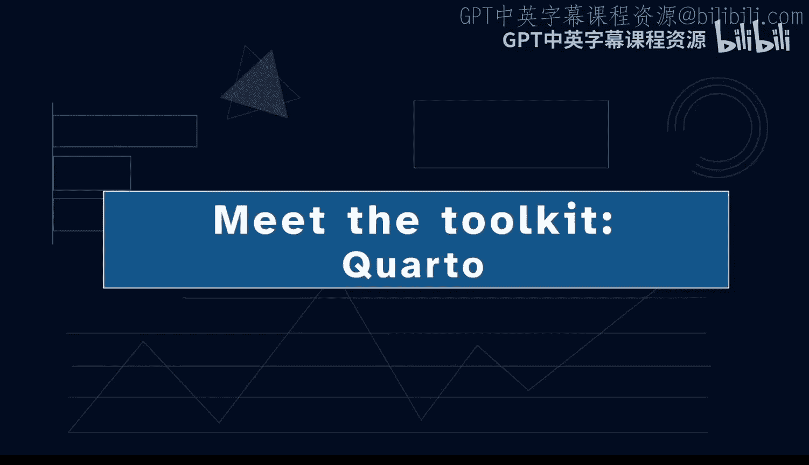
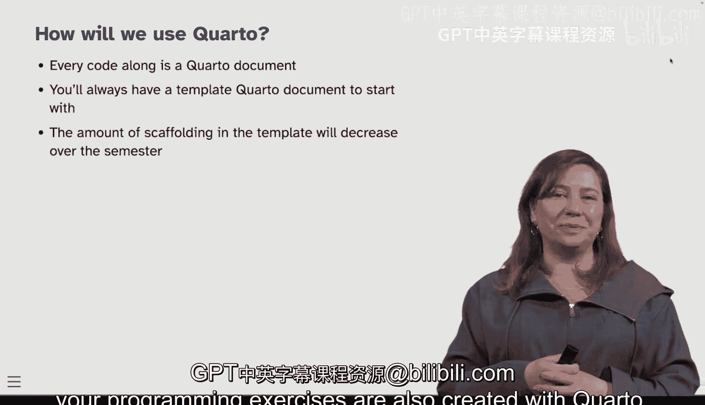

# 杜克大学《R语言数据科学｜Data Science with R》中英字幕 p04 04_01_03_认识工具：Quarto.zh_en -BV1Zpv6BaEkB_p4-

🎼。

Another tool in our course toolkit is Corto， so where does Corto fit in the learning goals for the course？

We said previously that by the end of the course， you will be able to gain insights from data using modern programming tools and techniques reproducibly with literary programming。

 And that's exactly where corto fits in。 Let's introduce what we mean by reproducible data analysis。

 What exactly does it mean for a data analysis to be reproducible in a nutshell。

 it means that the same results should be obtained when the same analysis is run on the same data。

 This might seem very obvious， but it's actually not always feasible and choices of tooling and workflows used for the analysis can make all the difference。

 For example， if you're doing your data analysis and a spreadsheet software like Excel。

 and you decide to omit some observations from your analysis because you think their data errors or outliers that don't belong in the analysis。

 you might just delete the corresponding rows from your spreadsheet。😊，This is difficult。

 if not impossible to document。 There's no way to really reproduce the deletion of something once it's been deleted。

 On the other hand， if you're doing this with a tool that allows you to script your steps。

 For example， by writing our code， the original data remains untouched。

 and the corresponding rows get filtered out。 and this gets documented in your code。

 So it's feasible。 for another analyst or yourself months later to actually reproduce the step from the original raw data。

 So in the short term， we want to make sure that tables and figures are reproducible from the code and data。

 the code should actually do what you think it does。 And in addition to what was done。

 it should be clear why it was done。And in the long term。

 we also aim to have our code be written in a way that it's usable for other data and extendable to do other things。

How do we achieve these goals Well， we need our data analysis to be scriptable。

 which we discussed we'll use R4 and for reproducibility of results。

 we'll use literate programming where in a single document are code and narrative go and comes the output all in one place where it becomes impossible to separate these two steps。

 and ultimately we will also use Git and Gitthub for more indep projects for version control。

In this video， we focus on the second bullet point， literate programming。

And we're going to use Corto for it。Corto is an open source scientific and technical publishing system with corto。

 you can produce fully reproducible reports where each time you render your document。

 the analysis is ran from the beginning。 Your code goes in areas will'll call code chunks or code cells。

 and your narrative goes outside of there。And when writing Corto in our studio。

 you get the benefit of a familiar Google Docs or MS word like editing experience。

 So let's take a tour of Corto。So here I am in our studio， and I can see that in my files pane。

 I have a document。 It's called Me the penguins， and it has an extension called QM D Hrto markdown document。

 Let's go ahead and open up this document。It has a little bit of content in there just that I prepared for you so we can go through some of the features of Quato first and foremost。

The top of the document looks a little bit different than the rest of the document。

 So what we call the top of this document is the Yal or in other words。

 the metadata for our document for now， I just have one thing in here。

 the title and let's go ahead and take a look to see what happens when I actually produce the output of this document for which I click on the render button。

When I render the document， I can see that the title I have here。

 which is in between these three dashes and looks like it's written with some mono spaced font。

 is formatted a little bit differently on the output。 In fact， let's add another field to our yaml。

 I'm going to add。Author。And I will put my name there。And I'll go ahead and render my document again。

 we can see that when I hit render the document runs one more time and it processes all of the code I have in it as well。

 and my name not only does it appear in the output but it appears with this you know tag called author which is spelled a little bit differently with capita letters compared to what I had here So what corto is doing is for each of the fields in your Yaml。

 it has some predefined sort of styling choices these are things you have control over if you want to sort of like as your experience with coro increases you can choose to style these in any way you want but for now we're going to stick with the default styling So the top of the document is about the metadata about your document as a whole and let's go down to the rest of the document now。

We can see that we have some text that gets rendered in a way where it looks exactly the same way as the input and then over here we have what we call a code chunk So in this code chunk I have a label for my code chunk I have an option for my code chunk which says message false so do not print any messages for me。

 we'll see in a second what happens when we turn this to true and then we have some our code we're loading two packages for our analysis and in the rendered document all we can see are the two lines of code so anything that is followed that has the hash and then the pipe is not actually reflected in our output because those are our code chunk options the labels that we have for our code chunks make it easy for us to navigate throughout our document jumping from one code chunk to another which you can imagine would be helpful。

Especially if I had a really lengthy document to have these labels that are informative of what's actually in them。

And the code chunk options control the behavior of the output。 For example。

 if I set message to true and render my document one more time。

 I'll be able to see the message that loading the tidyverse package prints。

 The tidyverse package we said， is a meta package。 It loads a bunch of packages along with it。

9 packages to be exact。 So this message prints out the names of these packages and any sort of conflicts loading this package might be introducing。

 So a new package that's being loaded that brings in a function with a name of an existing function in base R。

 for example。Once you review this message chances are you don't want to see this message in your output。

 so you might set the option for message to false and then render your document again and that goes away in fact。

 if you wanted to hide your code all together from your output we could say Eco。And you can see。

Equales false and render again。 And we'll see that code chunk completely go away。

 We haven't deleted the code chunk。 The functionality of the code chunk is still there。

 We're just not reflecting it in our output。 So if you're writing up a data analysis and you need a professional looking output for an audience that only wants to see your results。

 not your code。 you could turn off your code chunks and only share your output with them。

 you can do that by adding this Eco false option to every single code chunk。

 or you can say I want to express an option at the document level so we could scroll up to the metadata for our document And under the execute options。

 I could set Eco to false。 you can see that our studio is helping me with the options I have available to me。

 and I can render my document。And all of the code chunks go away， but their output stays。

When you hit render， you might be experiencing a slightly different behavior。

 You'll see the little gear icon next to the render button where you can choose whether you preview your output in a viewer pane like I have here in the viewer pane or preview in a new window。

 So let's select the new window first up now and hit render。

And you can see that the result is actually displayed in a new browser window if you are working on multiple screens。

 this might be preferable to you， but for me I like working in our studio and being able to see my output right next to my input and therefore I'm going to select preview and viewer pane and see that there。

And let's go ahead and remove this option as well。So that we can actually see our code in our output and take a look at a couple more features。

 so I'm going to keep scrolling down， you can see that in addition to sort of plain text。

 I can style my text a particular way I can use code formatting。

When I'm referring to things related to code， I can also do things like bolding words。

 italicizing words， or use keyboard shortcuts for it as well。

The first set of instructions says replace wherever it says add code here with the code for glsing at the penguins data。

 so the glimpse function is what function we can use to just take a peek at our data。

 so let's go ahead and do that name of the function。

Followed by parentheses and in goes what we want to apply the function to， and let's now render。

 we'll see that the code chunk is going to be replaced with the code that we wrote and we can also see the output of that code in our output as well。

Next it says first replace the blank below with the number of rows in the penguins data frame so if I scroll down。

 I can see that the number of rows in my penguins data frame is 344 so let's go ahead and do that and let's go ahead and render so I can use code to learn something about my data and then I can write about it the thing is what if the data changed what if my collaborator who collects data on penguins tomorrow sends me a new data set I don't want to have to keep updating this number manually so I can say I want to insert an inline code chunk I'm going to use my insert anything tool that is command and then forward slash to say I want to insert an inline R code and in here I can type the code that I want to run and row。

Of penguins。And let's go ahead and render we can see that in the output。

 it looks exactly the same as if I had hand typed that number。

 but what is different is that under the hood that is code running。

 So if my penguin's data frame was to change， the result would change as well。

Now let's show one last thing。 I am going to go ahead and define a variable in my console。

 I'm going to say x is equal to2。 I can see that that variable is defined in my environment as well。

And now I am going to insert a new code chunk again using my insert Anything tool forward slash our code chunk。

 and let's say I want to multiply x by3 I would expect that the result would print out at two times3 we would get6。

Let's go ahead and render。But instead of the result printing out， I get an error。

 My error says that object X is not found。 It also tries to tell me where this is happening。

 but it says it's quitting from lines 35 to 36， but I really have no way of knowing while I'm in the visual editor what lines 35 to 36 are。

 if on the other hand I switched over to the source editor where I don't get the nice view of my text being rendered exactly what it's going to look like when I actually render my document。

 but I do get the benefit of the line numbers and I can see that at line 35。

 this is the code chunk that's giving the error。Remember， we mentioned code chunk labels。

 This is another place where it could have actually helped me。

 Let's switch over to the visual editor and let's go ahead and add a label to our code。

Multiply x by3， for example。Let's try to render again。 I should expect to get the same error。

 but when I get the same error I actually get a little bit more information about it。

 It tells me the label of the code chunk so even though in my visual editor which I find to be a lot more handy when I'm actually authoring a document I don't get the line numbers I actually can find which is the offending code chunk because of its label and now let's focus on trying to fix this issue it says object X is not found well I can see that object X is here but object X is in my global environment I have no record of having defined X in my coro document remember the whole point of introducing this new paradigm this new tool called quao was for reproducibility any analysis you do should be reproducible with code so any code that should contribute to the results。

That you need should be documented and contained in your courto document。

 so let's go ahead and first define X in here as well。And then render the document and see that we。

 the output is there， and I don't actually have to define X in the same code chunk。

 I could have defined X at the very top of my document。

Say somewhere here and then rendered my document and corto would still find it。

 so the idea isn't that everything that you do needs to be happen in a single code chunk。

 but that they need to happen in your single coro document。As a recap。

 the top of our document is called the Yaml， that's where the metadata goes。

 code goes in code chunks and is run when rendering， and we render with the render button。

And something super important and is sure to bite you a few times as you're learning is that the environment of your corta document is separate from the console。

 so all of your work， all the variables you define。

 all the packages you load must be done in your coro document when you hit render that's allCto has access to not any loose objects that you might have laying around in your global environment。

You might be wondering how we will use corto in this course。

 the basis of every code along will be a quao document you'll always have a template quao document to start with and the amount of scaffolding in the template will decrease over the course and over the specialization。

And just as an FYI， all of these slides and all of your programming exercises are also created with Corto。

