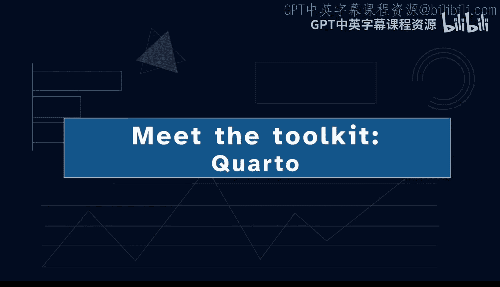
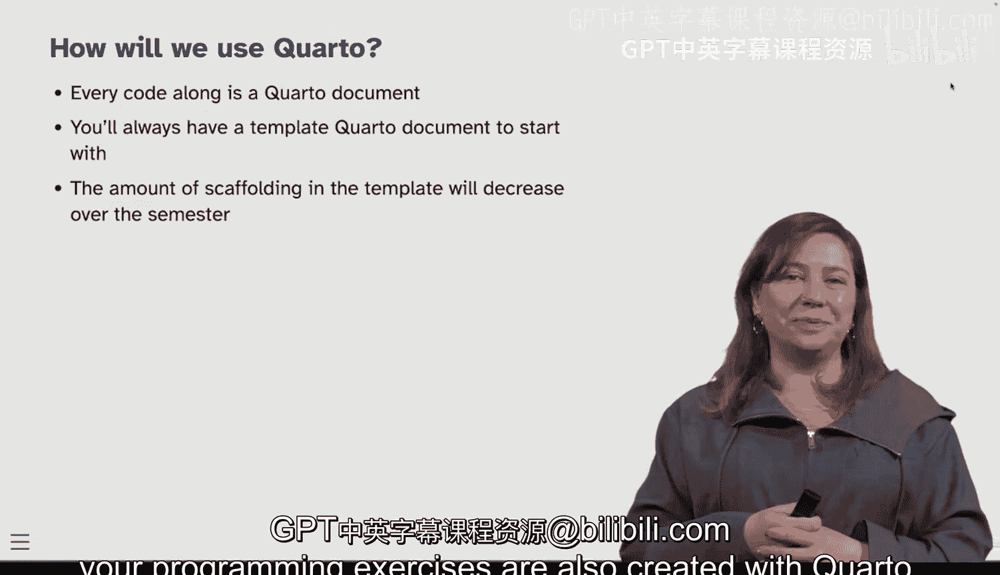

# R语言数据科学：04：认识工具：Quarto



## 📖 概述

在本节课中，我们将学习一个名为 **Quarto** 的重要工具。Quarto 是一个开源的科学与技术出版系统，它能帮助我们创建**可重复**的数据分析报告。我们将了解什么是可重复的数据分析，以及如何使用 Quarto 来实现这一目标。

---

## 🔍 什么是可重复的数据分析？

上一节我们介绍了课程目标，本节中我们来看看实现这些目标的关键工具。课程结束时，你将能够使用现代编程工具和技术，以**文学化编程**的方式，从数据中获得可重复的见解。这正是 Quarto 发挥作用的地方。

那么，数据分析的“可重复性”具体指什么？简单来说，它意味着**在相同的数据上运行相同的分析，应该得到相同的结果**。这听起来显而易见，但实际上并非总能实现。分析所使用的工具和工作流程的选择至关重要。

例如，如果你在 Excel 这样的电子表格软件中进行数据分析，并决定因为数据错误或离群值而删除某些观测行，你可能会直接从电子表格中删除这些行。这种做法很难（甚至不可能）被记录和复现。一旦删除，就无法追溯。

相反，如果你使用支持脚本化步骤的工具（例如编写 R 代码），原始数据将保持不变，相应的行会被代码过滤掉，并且这一步骤会记录在你的代码中。这样，无论是其他分析师还是几个月后的你自己，都可以从原始数据开始，准确地复现整个分析过程。

因此，我们的目标是：
*   **短期**：确保图表和结果可以从代码和数据中复现。代码应准确执行你的意图，并且除了“做了什么”，还应清楚“为什么这么做”。
*   **长期**：编写的代码应能适用于其他数据，并可扩展用于其他任务。

---

## 🛠️ 如何实现可重复性？

为了实现这些目标，我们需要：
1.  **脚本化分析**：我们将使用 R 语言。
2.  **文学化编程**：将代码、叙述文字和输出整合在单一文档中，使两者密不可分。这正是 Quarto 的核心功能。
3.  **版本控制**：对于更复杂的项目，我们将使用 Git 和 GitHub。

本视频将重点介绍第二点：**文学化编程**，并使用 **Quarto** 来实现它。

---

## 🧭 Quarto 导览

Quarto 允许你生成完全可重复的报告。每次渲染文档时，分析都会从头开始运行。你的代码放在称为**代码块**或**代码单元**的区域，叙述性文字则放在代码块之外。在 RStudio 中编写 Quarto 文档，你还能获得类似 Google Docs 或 MS Word 的熟悉编辑体验。

让我们来实际浏览一下 Quarto。

### 文档结构

一个 Quarto 文档（扩展名为 `.qmd`）主要包含两部分：

**1. YAML 元数据**
文档顶部，由三个短横线 `---` 包围的区域称为 YAML 头部。这里存放文档的元数据，例如标题、作者等。Quarto 会为这些字段应用预定义的样式。

**示例：**
```yaml
---
title: "我的企鹅分析"
author: "你的名字"
---
```

**2. 内容区域**
YAML 头部之后是文档的主要内容，包括普通文本和代码块。

### 代码块

以下是代码块的核心组成部分。

**代码块结构：**
一个典型的代码块如下所示：
````
```{r}
# 这里是你的R代码
library(tidyverse)
```
````

**代码块选项：**
你可以在花括号 `{}` 内为代码块设置选项，以控制其行为。
*   **标签**：`{r my-label}` 为代码块命名，便于在长文档中导航。
*   **`echo`**：控制是否在输出中显示代码。`echo=FALSE` 会隐藏代码，只显示结果。
*   **`message`**：控制是否显示包加载等信息。`message=FALSE` 会隐藏这些消息。

**示例：**
````
```{r load-data, message=FALSE, echo=FALSE}
# 这个代码块加载数据，但在最终报告中不显示代码和加载信息
library(palmerpenguins)
```
````

### 渲染文档

点击 **“Render”** 按钮，Quarto 会执行文档中的所有代码块，并将结果（文本、图表、表格）整合成一个格式美观的输出文档（如 HTML、PDF）。渲染时，Quarto 只使用文档内部定义的对象和加载的包，与 RStudio 控制台中的全局环境是隔离的。

### 行内代码

你还可以在叙述文字中直接嵌入代码，动态生成内容。使用 `` `r ` `` 语法插入行内 R 代码。

**示例：**
*   输入：`企鹅数据集共有 \`r nrow(penguins)\` 行。`
*   输出：企鹅数据集共有 344 行。

这样做的好处是，如果底层数据（`penguins`）发生变化，这个数字会自动更新，无需手动修改。

---

## ⚠️ 重要注意事项：环境隔离

一个常见且重要的陷阱是：**Quarto 文档的环境与 RStudio 控制台的环境是分离的**。

这意味着，所有用于生成结果的变量定义、数据操作和包加载，都必须在 **Quarto 文档内部的代码块中完成**。当你点击“Render”时，Quarto 只会访问文档内部的内容，而不会识别你在控制台中随意创建的“游离”对象。

**错误示例：**
1.  在控制台输入：`x <- 2`
2.  在 Quarto 文档中写：`` `r x*3` ``
3.  渲染时会报错：`object 'x' not found`

**正确做法：**
必须在 Quarto 文档的某个代码块中定义 `x`，例如：
````
```{r}
x <- 2
```
然后才能在行内代码或后续代码块中使用 `x`。

---

## 📚 课程中的应用

在本课程中，Quarto 将是核心工具：
*   **代码练习**：每次练习都将基于一个 Quarto 模板文档开始。随着课程的深入，模板提供的“脚手架”会逐渐减少，以鼓励你独立编写更多代码。
*   **创建材料**：值得一提的是，本课程的所有幻灯片和编程练习也都是使用 Quarto 创建的。

---

## 🎯 总结

本节课我们一起学习了：
1.  **可重复数据分析**的重要性：确保分析过程透明、结果可复现。
2.  **Quarto 工具**：一个用于文学化编程和创建可重复报告的强大系统。
3.  **Quarto 文档结构**：包括 YAML 元数据、代码块和叙述文本。
4.  **核心操作**：如何编写代码块、设置选项、插入行内代码以及渲染文档。
5.  **关键原则**：牢记 Quarto 文档的环境隔离性，所有分析步骤都应在文档内编码完成。



掌握 Quarto 将帮助你构建专业、透明且易于维护的数据分析工作流。