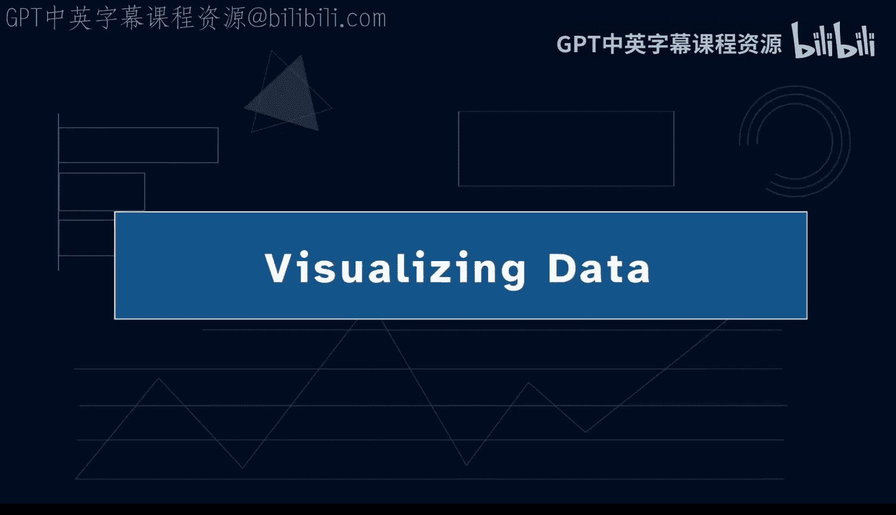
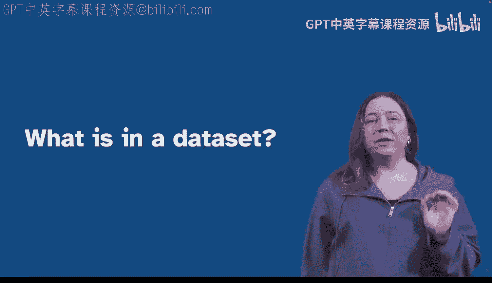
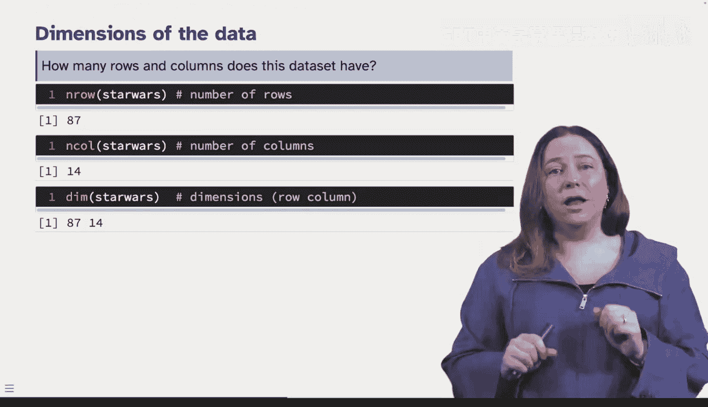
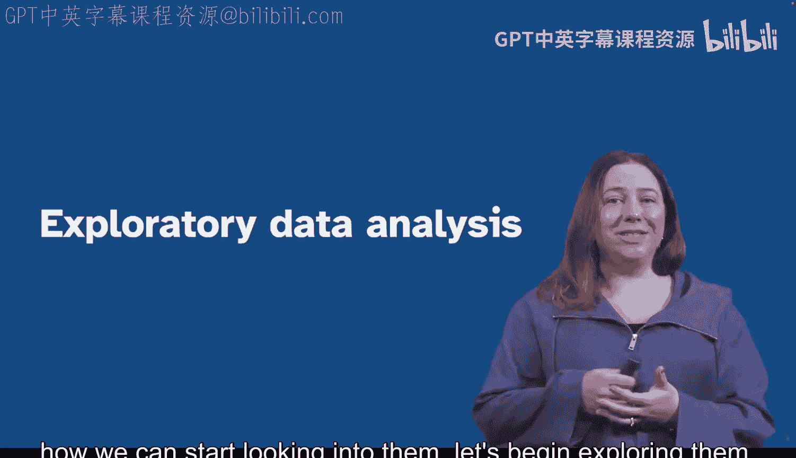
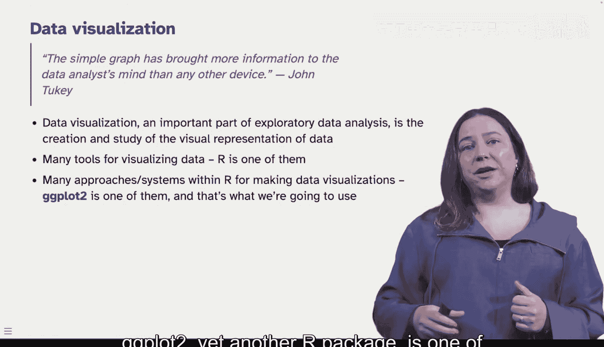
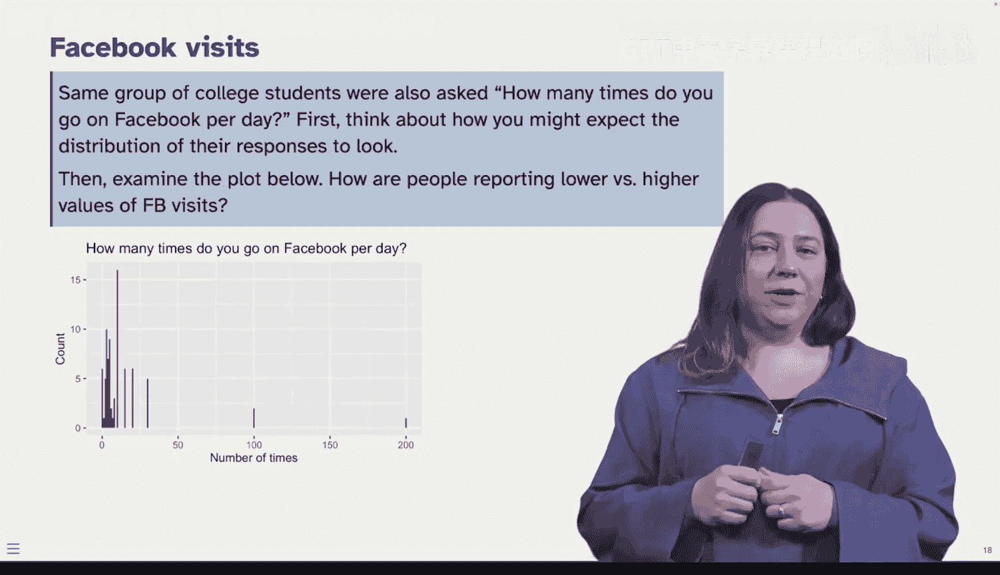

# 杜克大学《R语言数据科学｜Data Science with R》中英字幕 p05 05_02_01_数据可视化.zh_en -BV1Zpv6BaEkB_p5-

🎼。

Hello， in this video， we will introduce data visualization and give an overview of the why and how of it。

But before we do so， let's formally introduce the idea of a data set。

There are two pieces of terminology that are important about data sets。 Each row is an observation。

 Each column is a variable Here， we're looking at a data set called Star Wars that contains information on characters from the Star Wars En。

 Each row is a character， and each column is an attribute of that character。 For example。

 the first row is Luke Skywalker。 Let's take a quick closer look at this row。

We know some things about Luke， his name， his height， which is hundred and72 cm。 His weight is 77 kg。

 His hair color is blonde。 We know his birth ear and so on。 Additionally。

 some of the things we know about him are a single entry， for example， the eye colors is blue。

 the skin color is fair， the species is human。 However。

 some of the other things are lists because he has multiple entries for that particular variable。

 For example， the films， the vehicles and the starships he's been in。

this course will focus on variables where we only have a single entry per observation like height。

 weight， eye color， skin color， species， etc Later in the specialization we will talk more about list columns where we have multiple entries per observation in a column。

For now， let's set those aside since they require us to know a little bit more programming before we can wrangle and visualize them。

A helpful function when you're getting started with a dataset set is the glimpse function。

 which will not only report the number of rows and the number of columns in the dataset。

 but also give us a list of the columns， So particularly if you have a wide data set with lots of columns。

 This is a great way to list all of them down a list。 This view also tells us the types of columns。

 For example， CHR stands for character I for integer， DBL for double， etc cea。

 We'll discuss formal data types and classes later in the course。

 But this output also shows us the first few observations in each variable。

 which is also helpful for getting a sense of the data。😊，When you start analyzing a new dataset set。

 the first questions you should ask are how many rows and how many columns this data set has。

 What does each row represent and what does each column represent The data dictionary or the data documentation is a good place to find answers to these questions。

 This particular Star Wars data set is distributed with an R package。

 specifically the D p or package that we will introduce a bit more formally soon。

 since it's distributed with a package， its documentation can be accessed just like documentation for any R function with a question mark followed by the name of the thing you want to learn more about The documentation tells us something about the data overall。

 and has description for each of the variables。I introduce one more new concept here， a package。

 Packages are the fundamental units of reproducible R code。 They include reusable R functions。

 the documentation that describes how to use them and sample data like the Star Wars data set。

 Deeppler is one of the most popular R packages for data wrangling。Okay， back to Star Wars。

 How else can we answer these preliminary data questions， such as the number of rows and columns。

 Some handy functions are N row N call and dim They have pretty evocative names N row for number of rows and call for number of columns。

 dim for the dimensions of the data set where the output is first。

 the number of rows and then the number of columns Note that in each case。

 the function name is followed by parentheses， and in the parentheses goes the name of the object you want to apply the function to So we would articulate these functions as N row of star Wars it has 87 rows。

 N call of star Wars，14 columns， dim of star Wars，87 by 14。

Now that we know a bit about how data frames are represented in R and how we can start looking into them。

 let's begin exploring them。

Exploratory data analysis， commonly referred to as EDA is an approach for analyzing data sets to summarize their main characteristics。

Often this is visual， this is what we'll focus on first。

 but we might also calculate summary statistics， this is what we'll focus on next。

 and both visualization and summarization may require wrangling， manipulation。

 transformation at or before this stage of the analysis。

Our first exploration is the mass and height of Star Wars characters。

 We want to answer the following questions。 How would you describe the relationship between mass and height of Star Wars characters。

 What other variables would help us understand data points that don't follow the overall trend。

 Who is the not so tall but really chubby character。To answer this question。

 let's look at a visualization of mass on the Y axis and height on the X axis。

 Usually height and weight are positively associated for humans and animals。

 but the Star Wars En has some nonhu characters like droidits。

 and who knows how their heights and weights are associated。

 So while we can spot this positive association for most of the observations in the data。

 the overall trend is difficult to see because of the one extreme outlier which squishes the rest of the data to the bottom of the plot。

😊，So who is this Not so tall， but really chubby character。 If you're a Star Wars fan。

 you probably got this already。 But even if you know very little about Star Wars。

 you'll recognize this little character。 It turns out it's Java， not so tall， but really。

 really chubby。 The visualization helped us identify the observation that stands out from the rest。

 and some digging into the data revealed the observation。This quote from John Tki。

 who wrote a bunch about exploratory data analysis is fitting here。

 The simple graph has brought more information to the data analyst's mind than any other device。

Data visualization， an essential part of exploratory data analysis at a high level。

 is the creation and study of the visual representation of data。

There are many tools for visualizing data， R is just one of them。

 and within R there are many approaches and systems for making data visualizations， GG P 2。

 yet another R package is one of them， and that's what we're going to use。

We'll get to the house soon， but let's briefly talk about why， why do we visualize？

Take a look at this data set， it's a famous one called Anscomb's Corrtet。

There are actually four data sets stacked on top of each other， and each data set has two variables。

 X and Y。This slide has a bunch of code you'll soon learn more about， but in a nutshell。

 it calculates some summary statistics for each dataset。 Let's focus on the output for now。

 not the code。 What do you see the means of x values for each dataset are the same。

 so are the means of y values and the standard deviations and even the correlation between the x's and y's for each dataset。

Based on these summary statistics， how do you think these data sets compare？

They appear identical to me。But let's not yet jump to conclusions and visualize the data first。

Once again， focus on the output now and not the code。

These scatter plots reveal something very different； these data sets don't look similar at all。

In case I haven't convinced you that visualization is a crucial part of exploratory analysis。

 here are two more examples， the first one comes from a survey where college students are asked how old they were when they had their first kiss first think about how you expect the distribution of their responses to look。

Then examine this plot。 Do you see anything out of the ordinary。

Many of the responses are where I would expect them to be。

 But what about the answers in the much younger ages。

 This is likely an indication of a bad survey question。

 Some respondents must have interpreted the question as a romantic kiss while others as any kiss。

 like a kiss from a mom to a baby。 if we had simply viewed the summary statistics like mean age at first kiss。

 we would not be able to catch this data feature。Here's another one。

 The same group of students were asked how many times they visit Facebook daily。 Once again。

 think about how you might expect the distribution of their responses to look。

Then take a look at this plot， How are people reporting lower versus higher values of Facebook visits？

Those reporting lower values seem to give precise answers like three times a day or eight times a day。

 while those reporting higher values seem to provide rounded answers like 100 times a day。

This is yet another feature that wouldn't be identifiable from summary statistics。

 but a visualization makes it clear as they。 Each of these examples was about why we visualize data Next up is the how。

