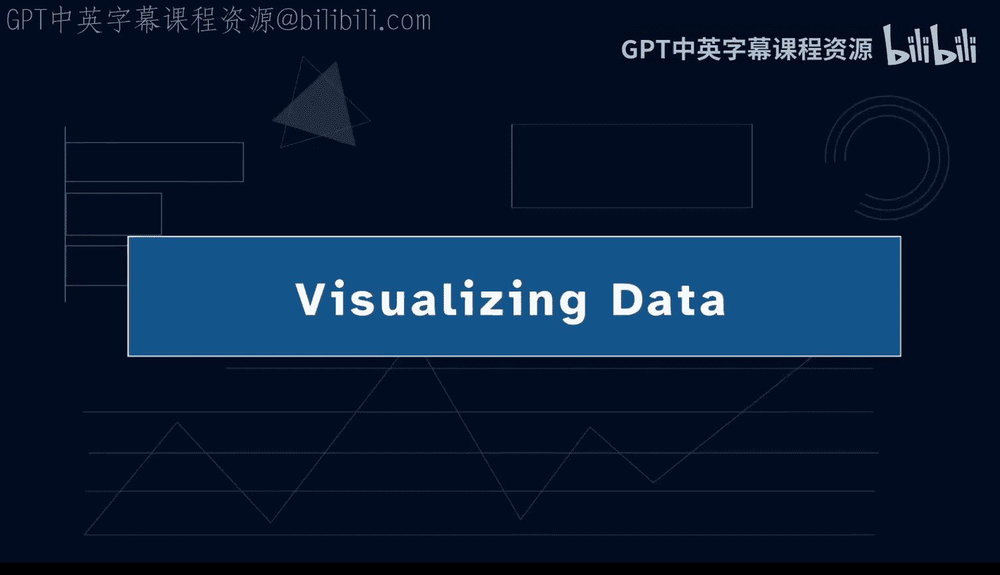
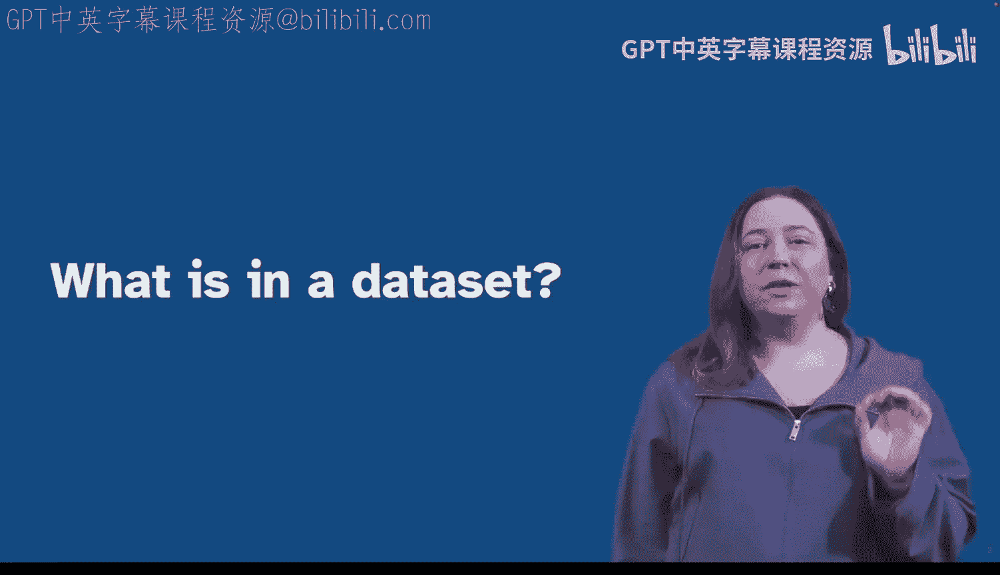
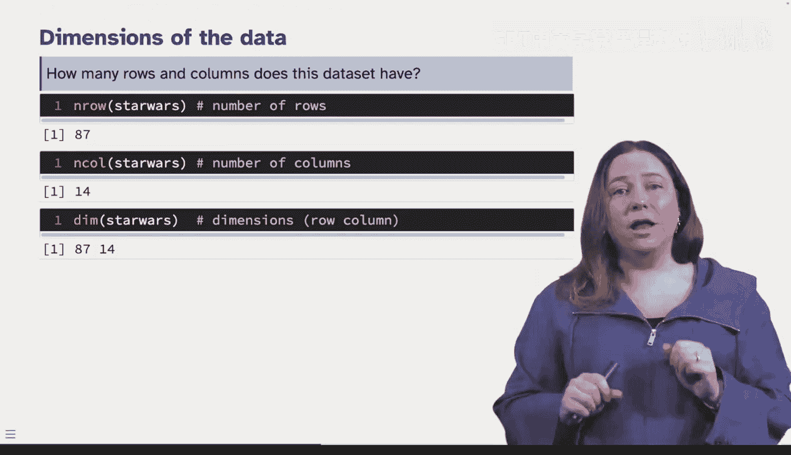
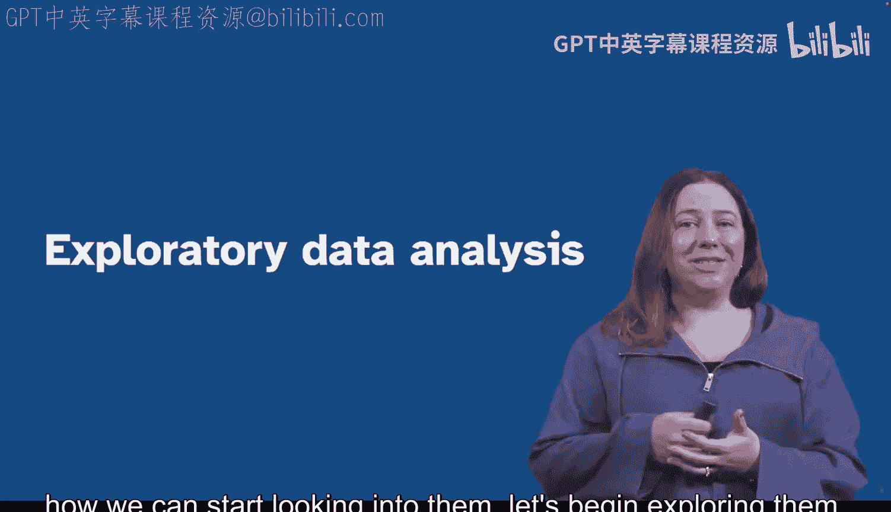
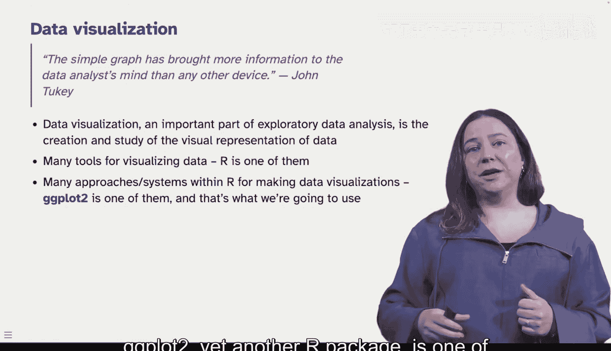
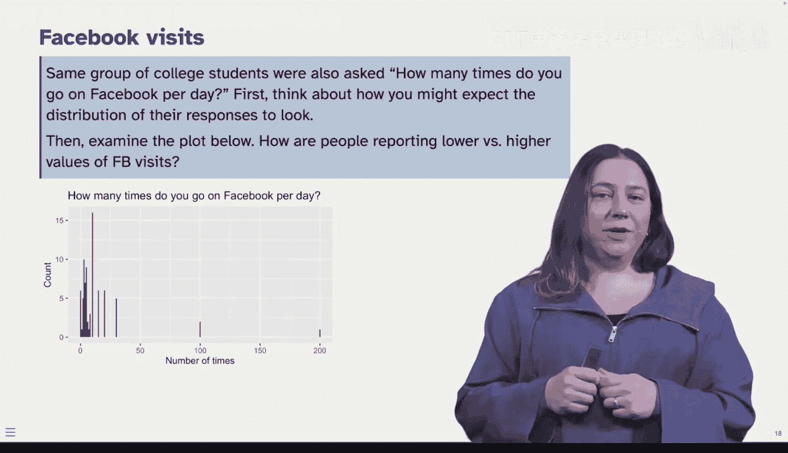

# R语言数据科学：05：数据可视化入门

在本节课中，我们将介绍数据可视化的基本概念，探讨其重要性，并概述如何利用R语言进行数据可视化。我们将从理解数据集的结构开始，逐步学习如何通过可视化来探索和发现数据中的模式与异常。

## 数据集的结构

在深入数据可视化之前，我们首先需要正式理解数据集的概念。

关于数据集有两个重要的术语：
*   每一行代表一个**观测值**。
*   每一列代表一个**变量**。

我们正在查看一个名为`Star Wars`的数据集，它包含了《星球大战》宇宙中角色的信息。每一行是一个角色，每一列是该角色的一个属性。例如，第一行是卢克·天行者。让我们快速查看这一行。

我们知道关于卢克的一些信息：他的名字、身高（172厘米）、体重（77公斤）、头发颜色（金色）、出生年份等等。此外，我们知道的关于他的一些信息是单一条目，例如眼睛颜色是蓝色，皮肤颜色是白皙，物种是人类。然而，其他一些信息是列表，因为他在该特定变量上有多个条目，例如他出演过的电影、驾驶过的车辆和星际飞船。

本课程将重点讨论每个观测值只有一个条目的变量，如身高、体重、眼睛颜色、皮肤颜色、物种等。在本专业课程的后续部分，我们将更多地讨论列表列，即一列中每个观测值有多个条目的情况。目前，我们暂时搁置这些列，因为在能够处理和可视化它们之前，我们需要了解更多编程知识。

当你开始接触一个新数据集时，一个有用的函数是`glimpse`函数。它不仅会报告数据集中的行数和列数，还会给我们一个列的列表。特别是如果你有一个包含许多列的宽数据集，这是列出所有列的好方法。这个视图还告诉我们列的类型，例如，`CHR`代表字符型，`I`代表整数型，`DBL`代表双精度型等。我们将在课程后面讨论正式的数据类型和类。但这个输出还显示了每个变量的前几个观测值，这对于了解数据也很有帮助。

当你开始分析一个新数据集时，应该问的第一个问题是这个数据集有多少行和多少列，每一行代表什么，每一列代表什么。数据字典或数据文档是找到这些问题答案的好地方。这个特定的《星球大战》数据集是随一个R包分发的，具体来说是`dplyr`包，我们很快就会更正式地介绍它。由于它是随包分发的，其文档可以像任何R函数的文档一样访问，使用问号后跟你想了解更多信息的名称。文档告诉我们关于数据的整体情况，并对每个变量进行了描述。

这里我再介绍一个新概念：**包**。包是可复现R代码的基本单元。它们包括可重用的R函数、描述如何使用它们的文档以及像《星球大战》数据集这样的示例数据。`dplyr`是用于数据整理的最流行的R包之一。

好的，回到《星球大战》。我们还能如何回答这些初步的数据问题，例如行数和列数？一些方便的函数是`nrow`、`ncol`和`dim`。它们的名字很有启发性：`nrow`代表行数，`ncol`代表列数，`dim`代表数据集的维度，其输出首先是行数，然后是列数。请注意，在每种情况下，函数名后面都跟着括号，括号里是你想应用该函数的对象名称。因此，我们会这样表述这些函数：`nrow` of `starwars`，它有87行；`ncol` of `starwars`，14列；`dim` of `starwars`，87乘以14。

## 探索性数据分析

现在我们对数据框在R中的表示方式以及如何开始查看它们有了一些了解，让我们开始探索它们。

探索性数据分析，通常简称为EDA，是一种分析数据集以总结其主要特征的方法。这通常是可视化的，这是我们首先要关注的；但我们也可能计算汇总统计量，这是我们接下来要关注的；并且可视化和汇总都可能需要在分析的这一阶段之前或期间进行数据整理、操作和转换。

我们的第一个探索是《星球大战》角色的质量和身高。我们想回答以下问题：你如何描述《星球大战》角色质量与身高之间的关系？哪些其他变量能帮助我们理解那些不遵循整体趋势的数据点？那个不太高但真的很胖的角色是谁？

为了回答这个问题，让我们看一下Y轴为质量、X轴为身高的可视化图。通常，对于人类和动物来说，身高和体重是正相关的，但《星球大战》宇宙中有一些非人类角色，比如机器人，谁知道他们的身高和体重是如何关联的。因此，虽然我们可以发现数据中大多数观测值存在这种正相关关系，但由于一个极端的异常值，整体趋势很难看到，它将其余的数据挤压到了图的底部。

那么，这个不太高但真的很胖的角色是谁？如果你是《星球大战》粉丝，你可能已经猜到了。但即使你对《星球大战》知之甚少，你也会认出这个小角色。原来是贾巴，不太高，但真的非常胖。可视化帮助我们识别出与其他观测值不同的那个观测值，而对数据的深入挖掘揭示了该观测值。

约翰·图基（John Tukey）写了很多关于探索性数据分析的文章，他的一句话在这里很贴切：“简单的图表为数据分析师的大脑带来的信息比任何其他工具都多。”

数据可视化是探索性数据分析的重要组成部分，从高层次上讲，它是数据的视觉表示的创建和研究。有许多用于可视化数据的工具，R只是其中之一；在R内部，也有许多制作数据可视化的方法和系统。`ggplot2`是另一个R包，也是我们将要使用的工具。

## 为什么需要数据可视化

我们很快就会讲到如何操作，但让我们先简单谈谈为什么，我们为什么要进行可视化？

看看这个数据集，它是一个著名的数据集，叫做安斯库姆四重奏。实际上有四个数据集堆叠在一起，每个数据集有两个变量：X和Y。这张幻灯片上有一堆代码，你很快就会学到更多，但简而言之，它为每个数据集计算了一些汇总统计量。让我们现在专注于输出，而不是代码。你看到了什么？每个数据集的X值的平均值是相同的，Y值的平均值、标准差甚至X和Y之间的相关性也是如此。基于这些汇总统计量，你认为这些数据集如何比较？它们对我来说看起来是相同的。

但让我们先不要急于下结论，首先将数据可视化。再次强调，现在专注于输出，而不是代码。这些散点图揭示了一些非常不同的东西；这些数据集看起来一点也不相似。

如果我还没有说服你可视化是探索性分析的关键部分，这里还有两个例子。第一个例子来自一项调查，大学生被问及他们第一次接吻时的年龄。首先想想你期望他们的回答分布会是什么样子。然后检查这个图。你看到什么不寻常的地方了吗？许多回答都在我期望的位置。但那些在更年轻年龄的回答呢？这很可能表明调查问题设计得不好。一些受访者一定将问题理解为浪漫的吻，而另一些人则理解为任何吻，比如妈妈给宝宝的吻。如果我们只是查看汇总统计量，比如第一次接吻的平均年龄，我们将无法捕捉到这个数据特征。

这是另一个例子。同一组学生被问及他们每天访问Facebook的次数。再次，想想你期望他们的回答分布会是什么样子。然后看看这个图。人们是如何报告较低与较高的Facebook访问次数的？那些报告较低值的人似乎给出了精确的答案，比如一天三次或八次，而那些报告较高值的人似乎提供了四舍五入的答案，比如一天100次。这又是一个无法从汇总统计量中识别出来的特征，但可视化使其一目了然。

这些例子中的每一个都说明了我们为什么需要可视化数据。接下来是如何操作。

## 总结

在本节课中，我们一起学习了数据集的基本结构，包括观测值和变量的概念。我们介绍了探索性数据分析（EDA）的重要性，并通过具体案例看到了数据可视化在揭示数据模式、识别异常值和理解数据特征方面的强大作用。可视化不仅仅是绘制图表，它是我们理解数据、提出问题和发现洞见的关键第一步。在接下来的课程中，我们将开始学习如何使用`ggplot2`包在R中创建这些强大的可视化图形。