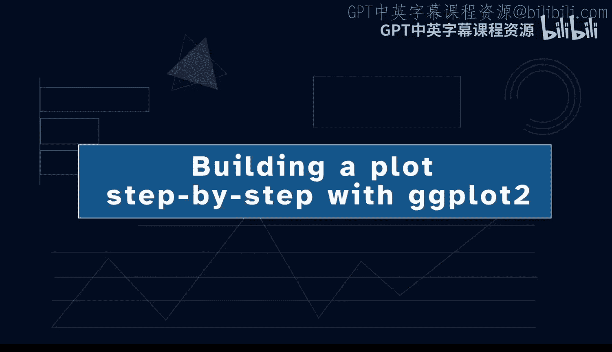
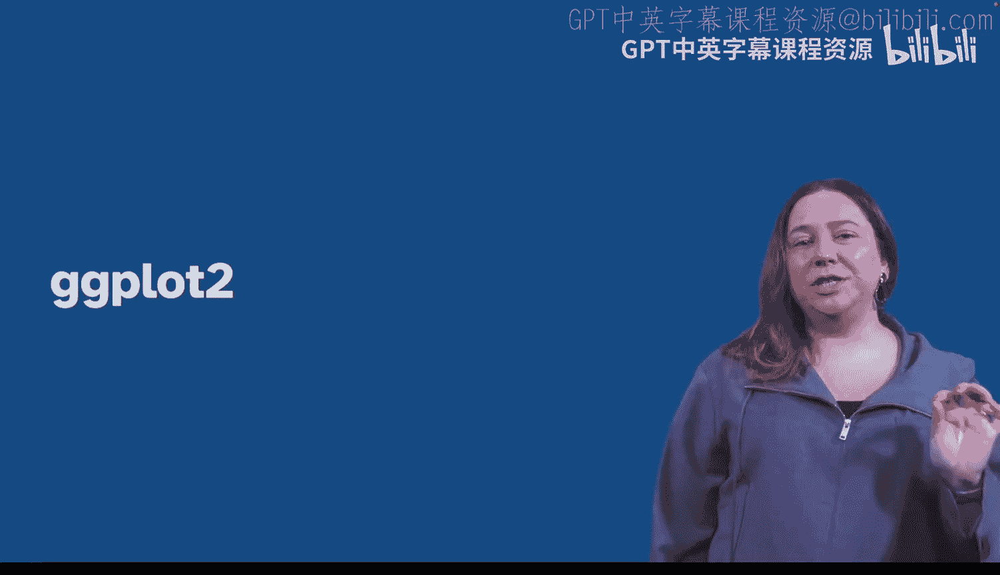
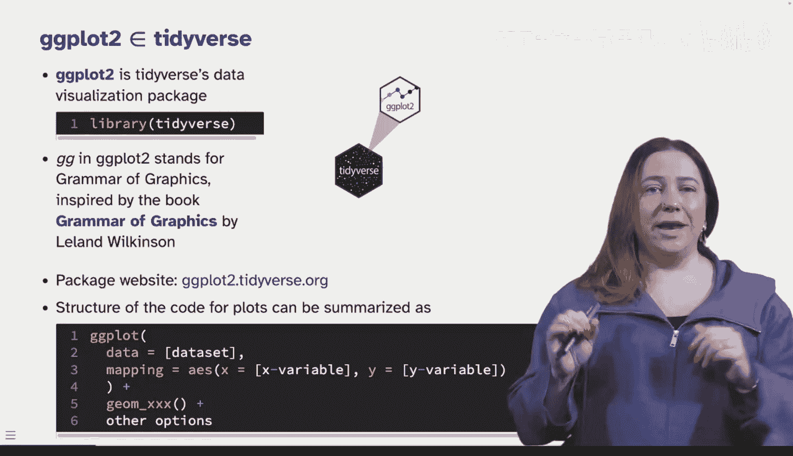
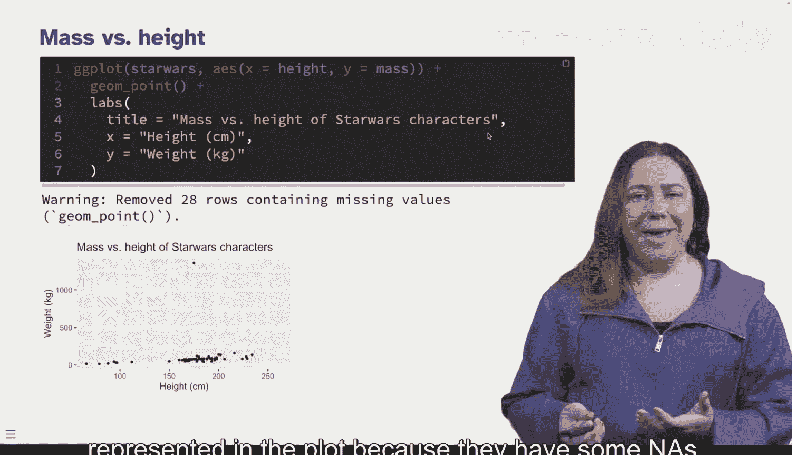
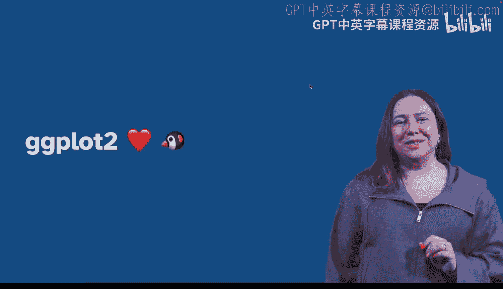
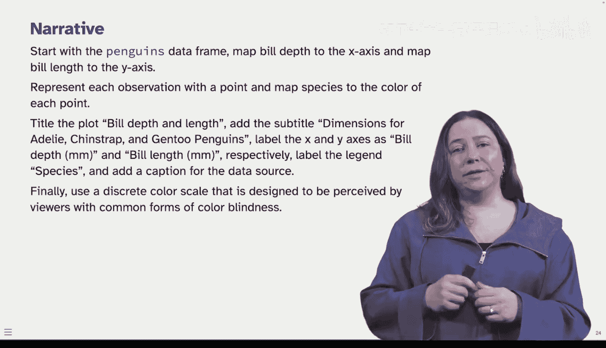
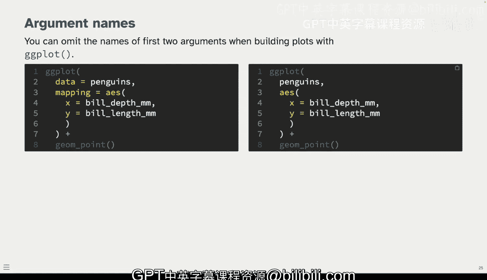

# 杜克大学《R语言数据科学｜Data Science with R》中英字幕 p06 06_02_02_使用ggplot2逐步构建图表.zh_en -BV1Zpv6BaEkB_p6-

🎼。

Hello in this video， we're going to talk about specifics and syntax of visualizing data with a Gplot2 package。

 and we're going to do so using data on penguins first a bit on Ggiplloot2 as a package。

GGPlo2 is tiyV data visualization package， so to access it， we load it with library tidyverse。

Gii in Gigi plot 2 stands for a grammar of graphics， inspired by the book。

 Grmmar of Graphics by Leland Wilkinson。A useful resource for learning about the package and its functions is the package website at ggplloot2。

tidyverse。org。And the code always follows the same structure， GG plot， then the data。

 then aesthetic mappings， then any geos， and finally any other options。

We've seen this plot of mass and height of Star Wars characters。

 but here it is again with the code and any associated warnings this time。

 the structure of G G plotot 2 code looks almost always the same。

 We start with the G G plot function where the first argument is the data that you want to plot。

 and the second argument defines the aesthetic mappings using the AE S function In this template。

 we only have defined the X and Y aesthetics， for example。This one is somewhat unusual。

 you're passing a function AES as the argument of another function G plot。

 you'll see more of this as we progress through the course。

 though more often you'll see data frame or variable names being passed to function arguments。

And then we add on another layer， a Ge layer， which defines the geometric shapes with which you want to represent your data。

And then optionally， though in many cases， recommendedly。

 we add further layers to the plot to make our plot a little bit easier to read。

 a little bit easier to glean information from。And finally。

 the warning tells us that 28 observations are not represented in the plot because they have some Ns。

 in other words， missing values。

Okay， let's visualize those penguins with Dgi plot 2 the data we'll work with are measurements for three species of penguins in Palm archipelago。

 chinstrap， Gentu and Atdeele。

The data are in the Palmer penguins package， so let's load the package first and then glimpse at the data。

 Gly is a function that prints out the variables in the data frame and their types。

 which will dig deeper into later in the course， and the first few observations as comma separated values。

 The data contains body measurements on three species of penguins。

 The body measurements include things like ill length and depth， Fper length and body mass。

 We also know which island the penguin is on their sex and the year of data collection。

There are a total of eight columns， so eight variables。

 the output also shows us that we have 344 rows， that is we have data on 344 penguins。

The plot shown here is our final goal。 Well plot Bill length against build depth。

 both measured and millimeters， will represent each penguin with a point colored by their species。

 The species mappings are summarized in the legend of the plot。 The plot also has a title。

 a subtitle and a caption。And the code for the plot is shown on this slide。

 It looks like what we've seen before。 G G plot function to start with， then the data。

 the aesthetic mappings， the G and some other layers for labels and color palette。

 This is a lot of code to look at at once， though so let's unpack it layer by layer。In other words。

 let's code out loud。We'll start with the GG plot function。

And indicate that we want to plot the penguins data frame as a result。

 we get an empty canvas that we can paint our data on。Then we map build depth to the x axis。

 we can see the x axis indicates the variable name， its range and a reasonable break point。

Then we map the length to the y axis， we can see the Y axis mapped as well。And finally。

 we'll add a Gem layer， a Gem point indicating that the data should be represented as points。

 There seems to be three clusters of points here。 Let's see what happens if we also ask that the points be colored by species。

Since this requires mapping another variable to a new aesthetic of the plot。

 we do this in the aesthetic mappings， mapping color to species。

Note that not only the points are colored， but we also gained a legend describing the mappings。

 red points represent Italy penguins， green， chinstr， blue， Gentu。

Now that the data we want to see on our plot is there。 Let's add some labels。

 Let's set the title to build depth and length， Not a particularly informative title。

 but it's a good starting point。 We do this in the labs function。

 passing it to the title argument as a character string denoted with quotes。

 You you can use double or single quotes in R， sticking to the tidyverse style guide。

 We'll use double quotes。 Let's also add a subtitle again， in the labs function。

 passing it to the subtitle argument。And let's fix up the X and Y axis labels。By default。

 Ggi plotot2 will use the variable names， but we can overwrite them by updating the X and Y label of the plot and using a more human friendly text like build depth and units。

 millimeters， and Bill length millimeters。And finally， let's relabel the legend as well。

We do this also in the labs function， passing the desired label to the color argument。

 note that the name of the argument matches the aesthetic mapping。And finally， in the labels。

 let's add a caption for the data source， this automatically gets placed below the plot。

And before we finish up our plot， we need to do one more thing。

 Use a discrete color scale that is designed to be perceived by viewers with common forms of color blindness。

 We do this in a new layer。 a scale layer using a predefined color palette called verrius。

 The underscore D denotes we will use the discrete color scale in this palette。

 If you have red green color vision deficiency up until this point。

 Some of the points on the plot may have been difficult to tell apart。

 The goal with this palette is to make sure all or at least more viewers can see the points as intended。

Putting it all together， we have our plot。The code。

And the narrative we built with each layer of the plot。

Before we wrap up this introduction to Dgi plotloot2， one quick note about argument names。

 it's common in R to omit the names of the first two arguments of a function。

 So in the D plot function， these are data and mapping。

 so you'll commonly see me and others write Dgi plot code in the second way。

 omitting these argument names from the code。

