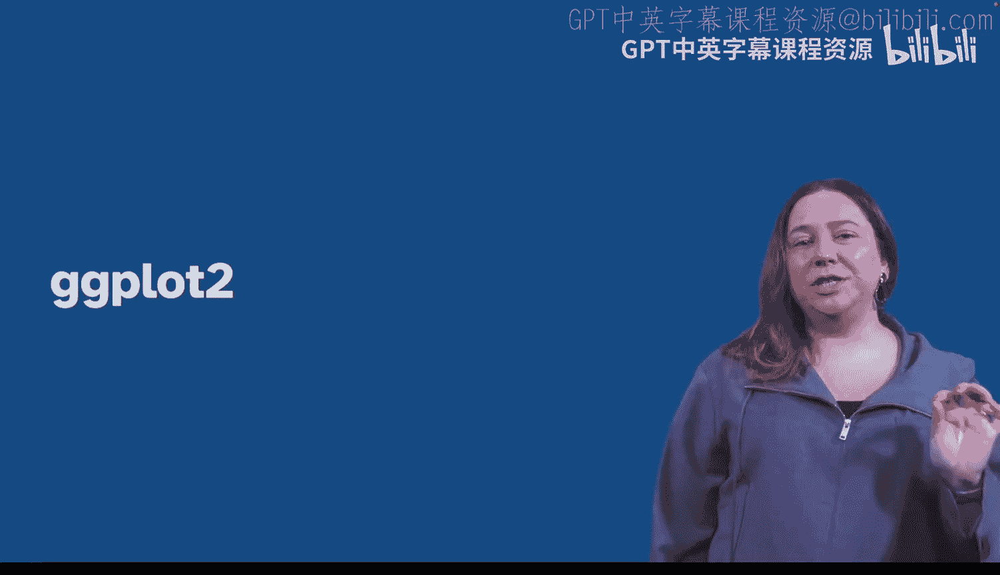
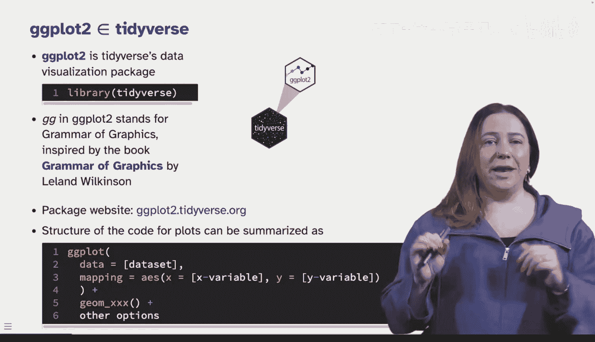
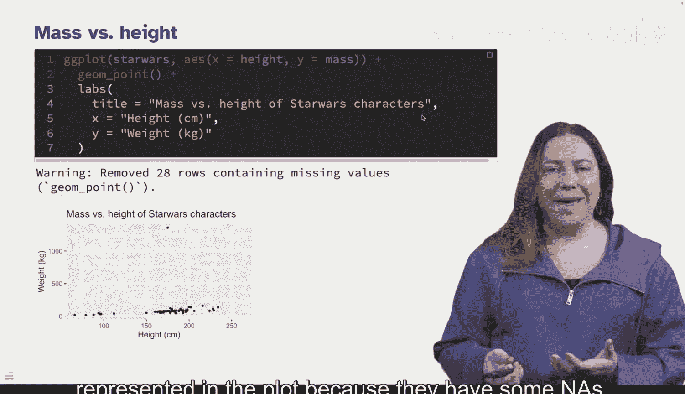
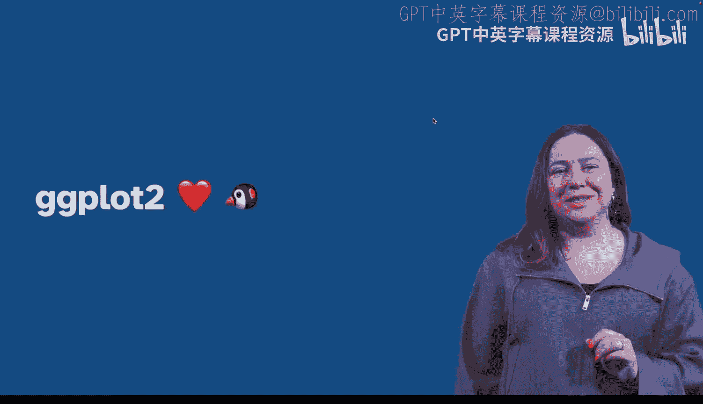
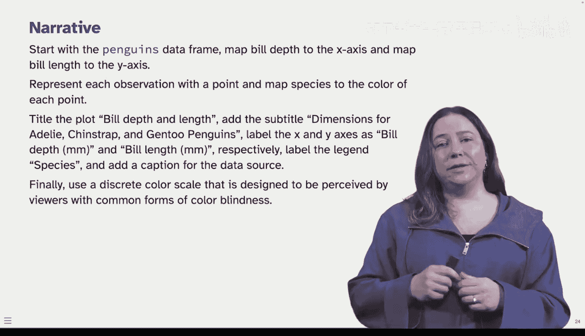

# R语言数据科学：06：使用ggplot2逐步构建图表


在本节课中，我们将学习如何使用`ggplot2`包来可视化数据。我们将以企鹅数据集为例，从零开始，逐步构建一个完整的图表，并了解`ggplot2`语法的核心结构。




## 概述`ggplot2`包

`ggplot2`是Tidyverse生态系统中的数据可视化包。要使用它，我们需要加载`tidyverse`库。

```r
library(tidyverse)
```

`ggplot2`中的“gg”代表“图形语法”，其灵感来源于Leland Wilkinson的著作《图形语法》。学习该包及其函数的实用资源是其官方网站：`ggplot2.tidyverse.org`。



`ggplot2`的代码结构通常遵循以下模式：
1.  `ggplot()`函数，指定数据和美学映射。
2.  添加`geom_*()`层，定义数据的几何形状。
3.  添加其他层（如标签、主题）来完善图表。

## 代码结构示例

我们曾见过一张《星球大战》角色身高与体重的散点图。以下是其代码结构：

```r
ggplot(data = starwars, mapping = aes(x = height, y = mass)) +
  geom_point()
```

代码解析：
*   `ggplot()`：第一个参数是数据（`data = starwars`），第二个参数是美学映射（`mapping = aes(x = height, y = mass)`），定义了x轴和y轴对应的变量。
*   `+ geom_point()`：添加一个几何对象层，指定用点来表示数据。
*   警告信息提示有28个包含缺失值（NA）的观测值未被绘制。

## 逐步构建企鹅数据图表

现在，让我们将这套方法应用于企鹅数据。我们将使用`palmerpenguins`包中的数据，该数据包含了帕尔默群岛三种企鹅（阿德利、帽带、巴布亚）的体型测量值。

首先，加载数据并查看其结构：



```r
library(palmerpenguins)
glimpse(penguins)
```

数据包含8个变量（列），344行观测（只企鹅）。变量包括喙长、喙深、鳍状肢长度、体重、物种、岛屿、性别和年份。



我们的目标是绘制一张散点图：x轴为喙深（毫米），y轴为喙长（毫米），用点代表每只企鹅，并根据其物种着色。最终图表还将包含标题、副标题和图注。

### 第一步：创建画布

我们从`ggplot()`函数开始，指定要使用的数据集。

```r
ggplot(data = penguins)
```

运行这行代码会生成一个空白的画布，等待我们添加数据。

### 第二步：添加美学映射

接下来，我们定义哪些变量映射到图表的哪个视觉属性（美学）上。这里，我们将`bill_depth_mm`映射到x轴，将`bill_length_mm`映射到y轴。

```r
ggplot(data = penguins, mapping = aes(x = bill_depth_mm, y = bill_length_mm))
```

此时，图表坐标轴已根据变量范围和合理断点进行了设置。

### 第三步：添加几何对象

现在，我们需要指定如何用几何形状表示数据。我们使用`geom_point()`来添加点层。

```r
ggplot(data = penguins, mapping = aes(x = bill_depth_mm, y = bill_length_mm)) +
  geom_point()
```

图表上出现了代表数据的点，可以看到大致有三个点簇。

### 第四步：按物种着色

为了区分物种，我们将`species`变量映射到颜色（`color`）这个美学属性上。这需要在`aes()`函数内完成。

```r
ggplot(data = penguins, mapping = aes(x = bill_depth_mm, y = bill_length_mm, color = species)) +
  geom_point()
```

现在，点按物种着色，并且图表自动生成了图例来说明颜色与物种的对应关系。

### 第五步：添加标签

数据已就位，现在添加标签使图表更易读。我们使用`labs()`函数来设置标题、副标题、坐标轴标签和图例标题。

```r
ggplot(data = penguins, mapping = aes(x = bill_depth_mm, y = bill_length_mm, color = species)) +
  geom_point() +
  labs(
    title = "Bill Depth and Length",
    subtitle = "Measurements for Palmer Penguins",
    x = "Bill Depth (mm)",
    y = "Bill Length (mm)",
    color = "Penguin Species"
  )
```

### 第六步：添加数据来源说明

我们还可以在`labs()`中添加`caption`参数来注明数据来源，它会自动显示在图表底部。

```r
ggplot(data = penguins, mapping = aes(x = bill_depth_mm, y = bill_length_mm, color = species)) +
  geom_point() +
  labs(
    title = "Bill Depth and Length",
    subtitle = "Measurements for Palmer Penguins",
    x = "Bill Depth (mm)",
    y = "Bill Length (mm)",
    color = "Penguin Species",
    caption = "Data source: palmerpenguins package"
  )
```

### 第七步：优化颜色方案

最后，为了确保色觉障碍者也能清晰区分颜色，我们使用`scale_color_viridis_d()`函数应用一个专为色觉友好设计的离散调色板。

```r
ggplot(data = penguins, mapping = aes(x = bill_depth_mm, y = bill_length_mm, color = species)) +
  geom_point() +
  labs(
    title = "Bill Depth and Length",
    subtitle = "Measurements for Palmer Penguins",
    x = "Bill Depth (mm)",
    y = "Bill Length (mm)",
    color = "Penguin Species",
    caption = "Data source: palmerpenguins package"
  ) +
  scale_color_viridis_d()
```

## 关于参数名的补充说明

在R语言中，通常可以省略函数前两个参数的名称。对于`ggplot()`函数，这两个参数是`data`和`mapping`。因此，更常见的简洁写法如下：



```r
ggplot(penguins, aes(x = bill_depth_mm, y = bill_length_mm, color = species)) +
  geom_point()
```

## 总结

本节课中，我们一起学习了使用`ggplot2`构建图表的核心流程：
1.  使用`ggplot()`初始化图表并指定数据和基本美学映射。
2.  使用`geom_*()`函数添加几何对象层来展示数据。
3.  使用`labs()`函数添加和修改各种标签。
4.  使用`scale_*()`函数调整颜色、坐标轴等标度。


通过从空白画布开始，逐步添加映射、几何对象、标签和优化选项，我们最终完成了一个信息丰富且美观的企鹅数据散点图。这种分层叠加的语法是`ggplot2`强大且灵活的关键。