# 杜克大学《R语言数据科学｜Data Science with R》中英字幕 p07 07_02_05_代码实践：初探帕尔默企鹅数据集.zh_en -BV1Zpv6BaEkB_p7-

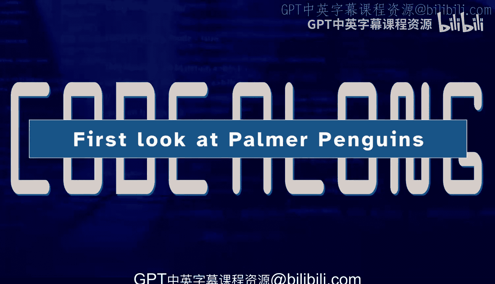

Hello， in this code along， we're going to take a first look at Palmer penguins。

 That's not entirely true。 We've already looked at Palmer penguins and other course videos。 However。

 this is going to be the first time we're actually going to be interacting with this data set。

 So I've opened my Quao document titled first look at Palmer penguins And let's take a look to see what our plan for this code along is。

 We want to explore how Bill sizes。 So that's the Bill depth and length of the penguin vary across species And also consider what happens if we don't take species into consideration。

😊，We're going to work with two packages， the tidyverse package， and the Palmer penguins package。

 the tidyverse package for all the fantastic functionality it provides for data wrangling and visualization and the Palmer penguins package because it has the data set that we need。

And the data set that we're going to visualize is called penguins。

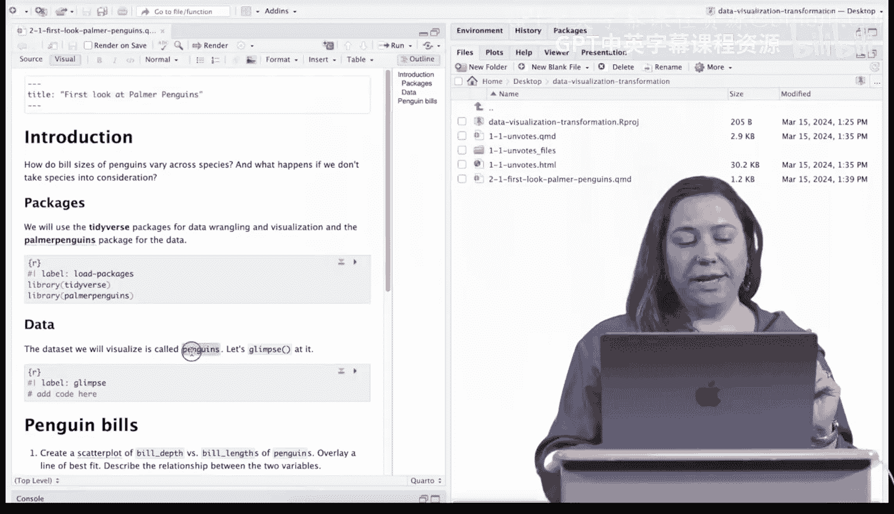

So before I get started with anything else， I'm going to go ahead and render my quo document just to make sure that everything works out of the box。

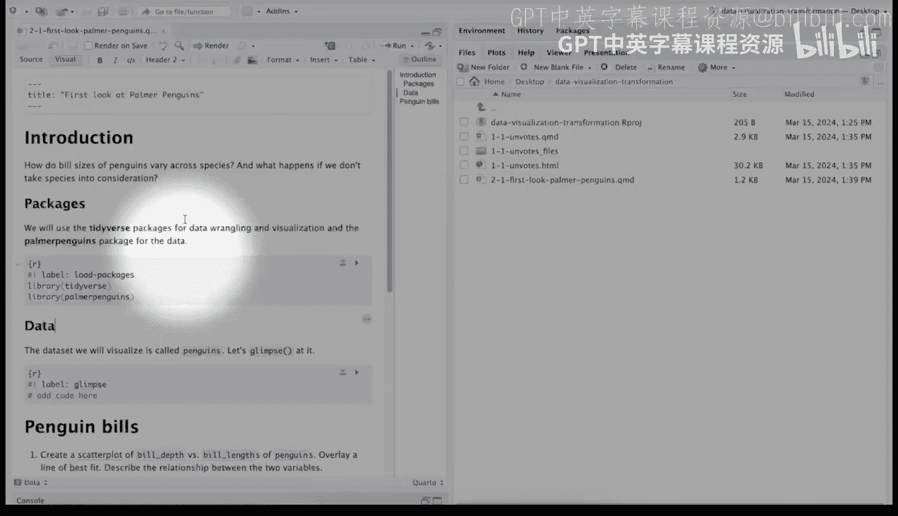

let's take a look at what our input versus output looks like。

 This is a good moment to pause and talk a little bit about what happens when you load the tidyverse package you can see that in this code chunk labeled load packages the first thing I'm doing is loading the tidyverse package And when I render my document I can see a bunch of text being printed so let's go ahead and read what this message is telling us it says attachging core tidyverse packages remember the tidyverse package is a meta package that houses nine packages at this point in time EPer for data wrangling forecasts for working with factors Gpl2 for data visualization lubri date for working with dates per for iteration。

Read R for reading data into R string R for working with character strings。

 Tbble for the tidyverse style data frames and tidy R for tidying and reshaping your data。

 Some of these packages you've already heard about。

 Some of them are going to come up later on in the course。

 Some of them were not going to work with a whole lot。

 The neat thing about the tidyverse packages that by loading that alone。

 you get all of the functionality of these packages。 So you don't have to pause and keep thinking。

 oh， I wonder which function this package was in。 Was it a data visualization thing or data wrangling thing and sometimes they will be more obvious than others。

In addition to that， we also have some information on conflict So what do conflicts mean in this case It says that the filter function in Dliier masks so you can think of it as like an overwrites in a way or the filter function in the stats package what in the world is the stats package we haven't loaded it so why is it there Well the stats package package is part of base R it's distributed with R and it has functions statistical functions that you've been accustomed to using without worrying about what package therein like mean and median and correlation So all these functions that you commonly use are actually provided with the stats package however it also happens to have a function called filter so now when we load Dliier as well the Dliier filter takes over so going forward because Dr is the package that's been loaded after。

The stats package when I refer to filter it's going to try to use the filter function from Dlier and if I needed to use the stats version then I would give the name of the package colon colon the name of the function so this notation of package name colon colon function name is something you might come across in documentation you read online or if you go on stack overflow or ask chat GBT。

 how do I do so and so it might be something that comes up and basically what it's referring to is state the package name and then state the function name。

We don't necessarily need to do that while we're writing interactive code。

 but if one day you are writing our packages yourself or writing code that others run or that gets run in an automated setting。

 this might be the type of thing you pay more attention to at that time。

And another one like this is the lag function in Der that's masking the lag function in the stats package。

 So it's not overr it in the sense that we no longer have access to these filter and lag functions from the stats package but they're not going to be prioritized。

 And if we want to use them， we'll have to specifically ask for them。

 And then it gives you some information about another package called conflicted that could help you resolve these sorts of conflicts。

 We're not going to go there right now。 We'll just say thank you for letting us know The reason why I wanted to take a little bit of time going through this is this you're going to see this message so many times that it's human nature to sort of ignore it after some time and that is totally fine。

 This is one of those messages where it's important to understand what it does。

 And if you ever find yourself in a situation where R is telling you something like I can't find the right filter function or something you might think。

To this moment and ask yourself， oh， I wonder if it has something to do with the conflict between Der and stats versions。

 but otherwise it's probably not the sort of thing that you want to be reading every single time。

 it's also probably not the sort of thing that you want printed out as part of your final output so code chunk options allow us to hide the sort of information。

So for this particular code chunk， I'm going to add a new option。

 these options remember need to follow the hash pipe。

 This is going to be the message and I want to say that I want to turn messages off and I'm using our studio's autofill as opposed to。

Typing these myself soon as I started typing MES， it filled it in for me saying well one of the code chunk options that start with that is message and the two values it can take are true and false。

 they're true by default， I am turning it to false for this particular code chunk it's like a superpower you can suppress these messages but you want to make sure that you read them first and under understand what they say and sort of be actively deciding that by suppressing it I am not misleading myself or anyone who might be reading my analysis。

All right。Then it says the data set we visual we will visualize is called penguins let's glimpse at it so we have a new code chunk here with a code chunk label called G Why do we have these labels by the way one of the nice uses of these labels is that if you go to the bottom of your editor in our studio you'll be able to see that。

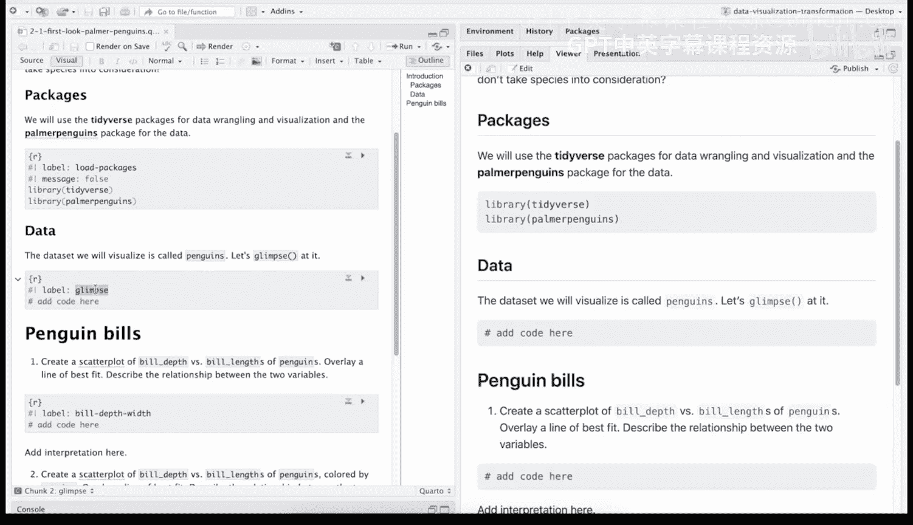

When chunks have labels in them， we actually can navigate within our document easily by sort of jumping between these chunks。

 so if I had a really， really lengthy analysis and I want to do something like。

 oh I want to go back to where I calculated something and maybe change my code。

 it's an easy way of navigating Another reason is that if you have an error in your code。

 so let's go ahead and make a mistake we know by now that if we want to glimpse at a data frame。

 we would say glimpse and then give the name of the data frame and if I just render this。

 I should be able to see the results。

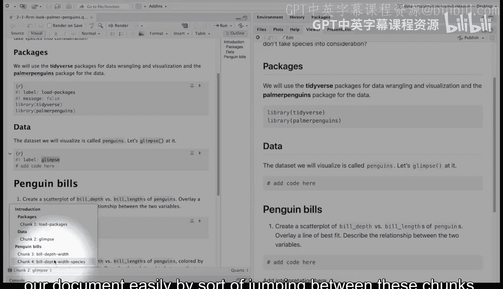

I have 344 penguins， eight columns about them， and here are the variables in this data set。

 but let's go ahead and make a mistake， let's go ahead and forget to close the parenthesis and render again。

In this background jobs pain。We have some information。

 this information is also repeated in my viewer window as well。

Some of the information is helpful and some of it， frankly， is a little bit cryptic。

 so let's start by reading here， quitting from lines 25 to 27。

What is this referring to 25 to 27 It's hard for us to know what it's referring to because we're using the visual mode in our studio right now。

 which doesn't show us the code chunk labels。 The nice thing is it allows us to do neat things like。

 you know use our editor just like we might use something like Google Docs or whatever。

 But if I actually switch over to the source code for a second I can then see the。

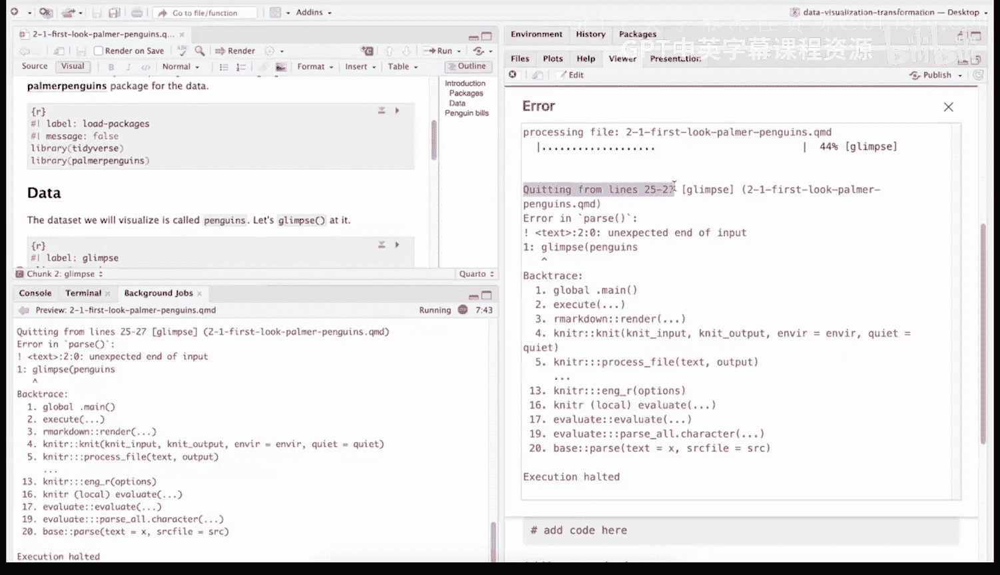

The line numbers and 25 to 27 refers to this particular code chunk。

 which hopefully we're not surprised by because we knew that we made a mistake there。

 but you may want to keep things in the visual editor that's usually how I use it and that's how you're going to see these code alongs go。

Here we go。 We have a little bit of information that might help us identify which code chunk it is。

 So if you label your code chunks and you need to troubleshoot， there's an error。

 the error message will mention your code chunk label as well。

 you can imagine if this wasn't an error you made intentionally。

 but an error in a really lengthy document that you're having difficulty sort of like pinpointing where to look at。

 this could be very helpful。 let's go ahead and。

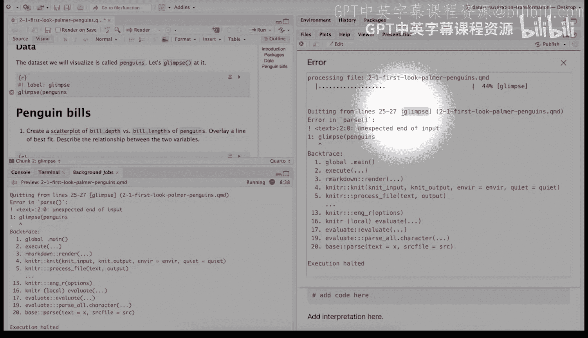

Close that parenthesis and render our document one more time。 Now。

 before we go into the visualization， I'm going to do one more thing。

 What if I click on this little play button here。 It is so attractive。

 It says come click on me and it allows me to run the current code chunk。

 It's also really handy because if I have a long quao document。

 I may not want to constantly render the document with every little thing I do。

 I might just want to run a single code chunk。

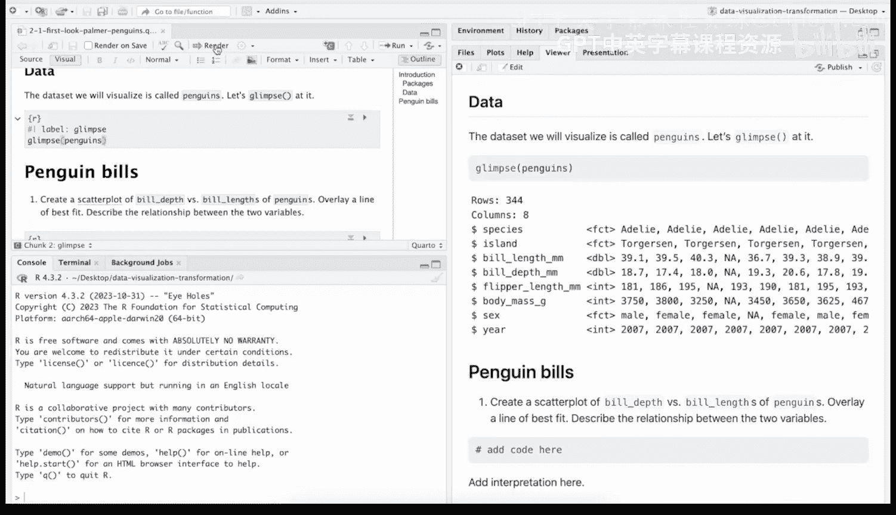

Let's go ahead and run it。And I get an error。 The document was just rendering。

 We can do that one more time and sort of like convince ourselves that my document is working。

 However， when I go to run this code chunk， I get an error。 So why am I getting this error。

 The reason is that when you render your document， Quato will run all of the code up to that point。

 including anything that comes before it， which is the code chunk where we load our packages。

 the package where the glimpse function lives， the package where the penguin data frame lives。

 So right now， we're getting an error that says could not find function glimpse。

 whenever you get one of these could not find errors。 especially if it's about a function。

 your brain should immediately go to I may not have loaded the package。 And in fact。

 we did not load the package in our working environment right now。

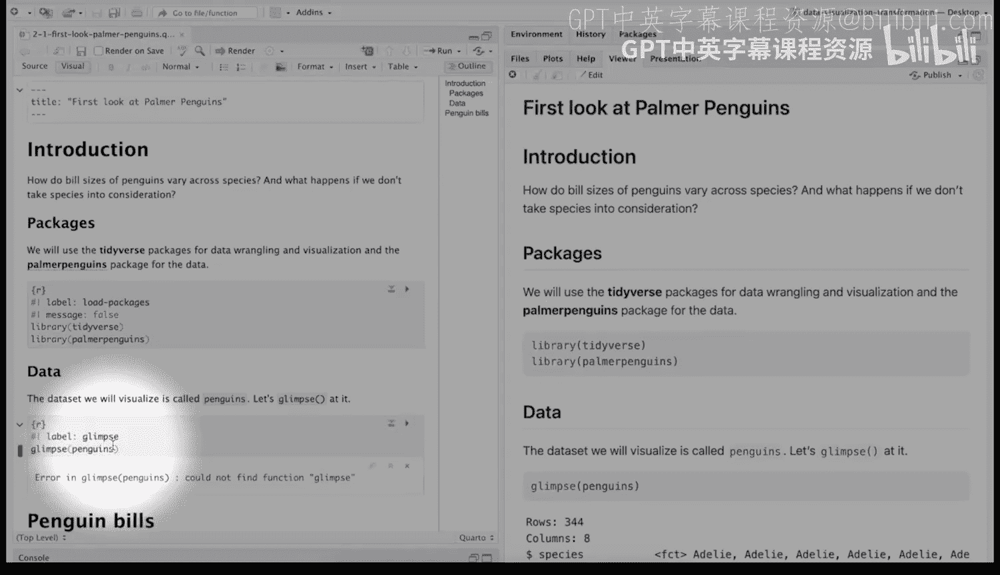

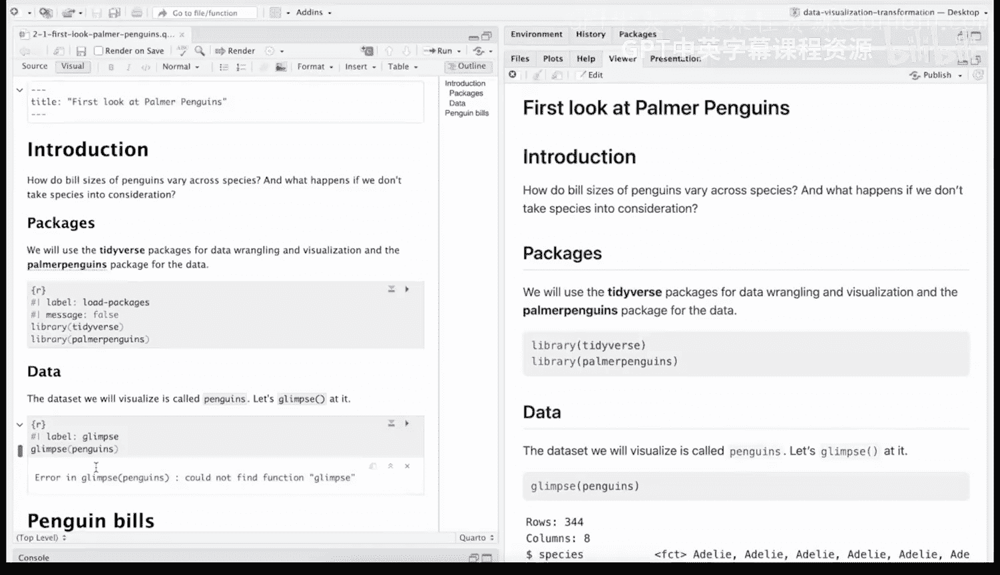

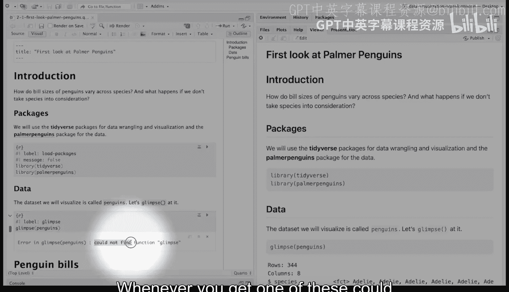

Our quoo document when we render it has as sort of a sandbox separate working environment and the reason for that is that we want the whole document to be reproducible。

 we don't want it to be affected by anything else that might be happening sort of in our console in our current working environment。

 but that also means that anything that's in the quoo document if I want to sort of replicated in my current working environment I need to make sure that I run all relevant code there as well。

 so thing that I can do is either explicitly run any code chunks that come before it or I can click on this down arrow that says run all chunks above。

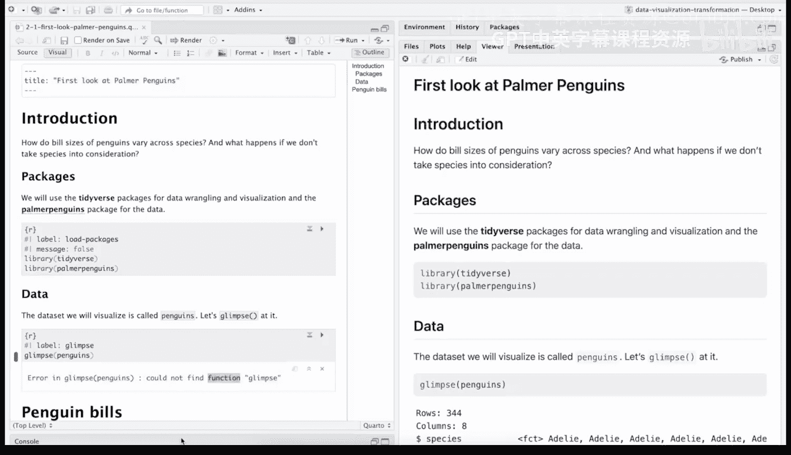

And then run this one as well and now that the package has been loaded in my working environment。

 I actually can see the results of the glimpse function Personal。

 I am not a fan of my results showing up in my document so I'm going to go ahead and make one more adjustment I am going to click on the gear icon and say I want to see the chunk output in console remove any output that already has been put there and let's try running this again。

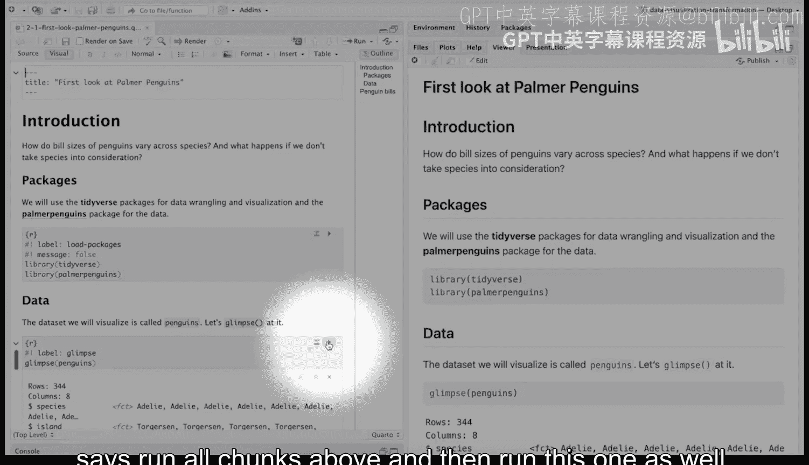

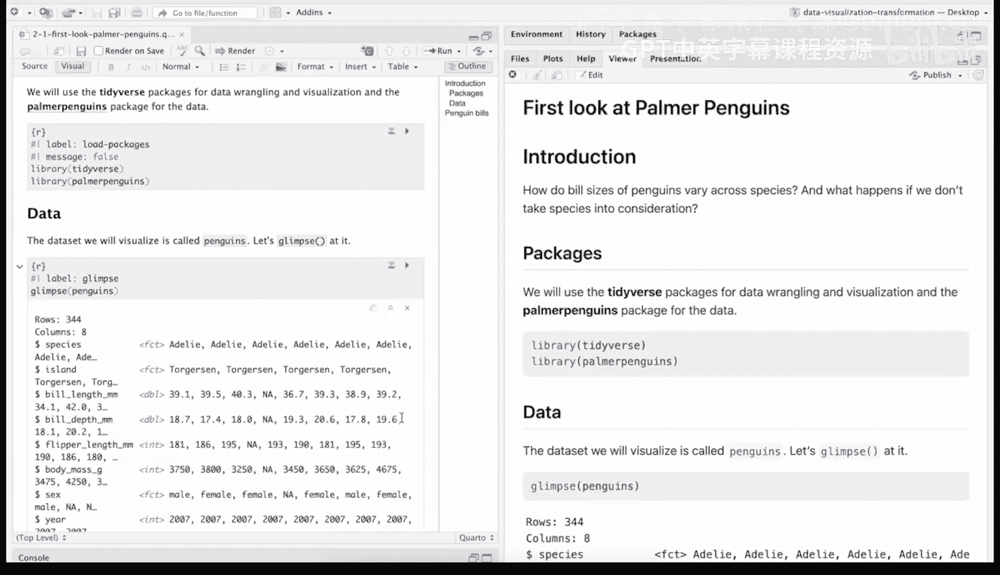

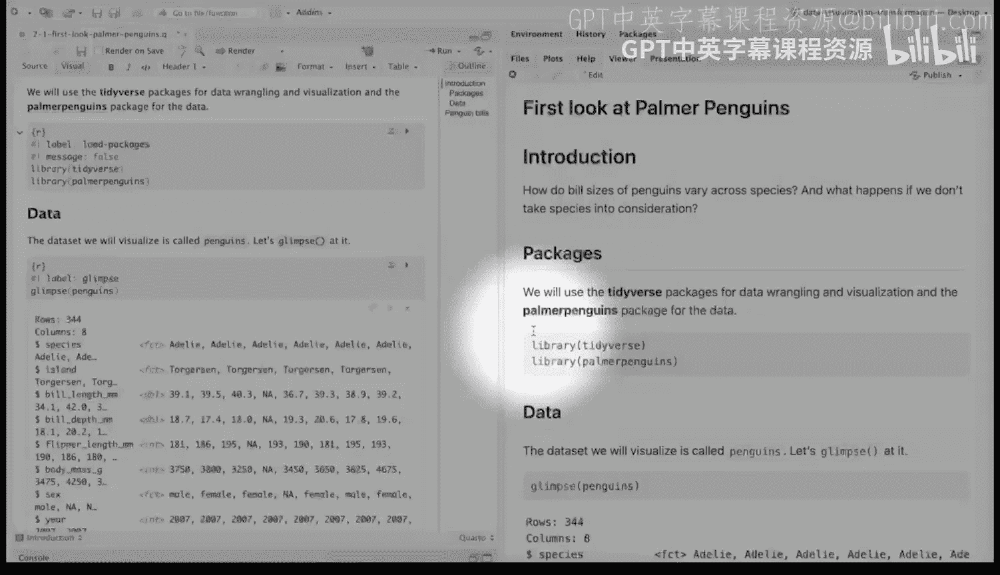

And I can see the result and my console。Okay so let's go ahead and start making some visualizations the first question says create a scatter plot of Bill depth MMm that's the name of the variable versus Bill length and Ms of penguins。

 so when we say something versus something， the first one goes on the y axis and the second one goes on the X axis and then we are to overlay a line of best fit and describe the relationship between the two variables。

Because we're making a plot， we're going to start with Ggi plot。

 the name of our data set is penguins。And then in my aesthetic mappings。

 I'm going say x is the bill length variable。And why is？The Bill depth variable。And then。

I want to represent my data with point， so I will say Ge point， let's go ahead and run this。

 This is what the visualization looks like， does look like a bit of a blob to be perfectly honest。

 sometimes reducing your sort of plotting window to have a better aspect ratio might be helpful and trying to figure out what the relationship between these two variables would be。

It also says to overlay a line of best fit。 so in addition to using points to represent our data。

 we also want to use a line， a line of best fit， a smooth line to represent it as well。

 We can do this by adding a new layer。A smooth layer。

And because it says that we want a line of best fit。

 we don't just want it to be a smooth curve that Ggi plot2 sort of like decides what the best smooth curve here is。

 but instead，We want to set the method to LM linear model。

 We're going to say a lot more about linear models later on in the specialization， but for now。

 just know that LM or another was linear model first to the line of best fit。

 So let's go ahead and run that And what do we see Here's our linear model The band around this line is a measure of uncertainty called standard error。

 Another thing we're going to introduce a bit later in the specialization。

 we can actually turn that off for now。Sincere going that's not going to be part of our discussion。

And here's the line of best fit。 So how would we describe the relationship between the depth and length of bills for these penguins。

 That line is trending downwards， which says that there is a negative relationship。Relationship。

Between Bill depth and the length。The relationship。Is somewhat weak。

 I would say there's a lot of scatter around that line。嗯。And is it linear。

 It does seem somewhat linear。嗯。This is surprising， though。

 why would we expect that as the length of a penguin's bill increases， the depth decreases？

Let's move on to the second question and see what it's asking us to do。

 It says clear create a scatter plot of build depth and build length of penguins again。

 but this time we want to color it by species and then we want to overlay a line of best fit as well and then describe the relationship between the two variables for each of the species。

 So I'm going to go ahead and cheat in the sense that I know that I have some code that works。

I'm going to take that。😊，And paste it here， but I need one more aesthetic mapping。

Color should be mapped to species。 And let's go ahead and run this。Now， what do we see。

 There happen to be actually three clusters of points for one for each of the species。

 And we can see that within each of the species， the relationship between Bill depth and Bill length is positive。

So let's go ahead and note that。There is a positive。Relationship。Between。

Buildill depth and build length。For each of the three species。The relationships。Are moderately。

Strong within each one of these clusters， there's not a whole lot of scatter anymore more。

And each one of them actually appear linear as well。

So if we now go back and reflect on the seemingly contradictory findings。

 what might be going on and which one do you believe more， Well， personally。

 it makes sense to me that a physical measurement on a penguin， a penguin's bill。

 its length and its depth would be positively associated。

 If one grows the other should be growing as well。What is happening though。

 is that the relationship between these three between these two variables。

 as well as sort of the magnitudes or the sizes of these measurements of build length and build depth are pretty different for each one of the species。

 So when we clump everything together， we sort of lose the positive relationship that is apparent。

So which one do we believe more， I believe？The second one， more we should be considering。

Species when when analyzing。The relationship。Between build depth and build length。

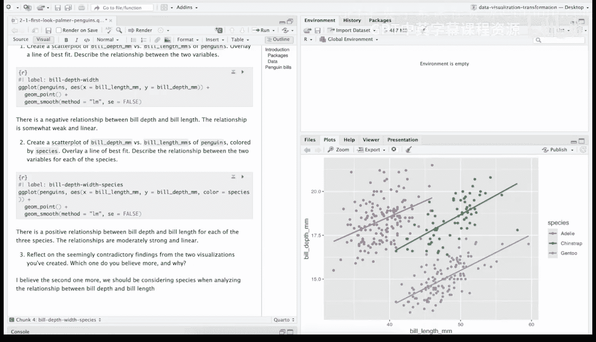

Or penguins。This is called Simpson's Paradox， where you have a relationship that's apparent between two variables and when you bring a third variable in often referred to as the confounding variable。

 the relationship changes entirely。It is not that we did something wrong in the first question。

 however， it is that we did not consider a variable that is an important factor in this relationship How could we have known that it is an important factor you're not expected to know anything about penguin anatomies to be able to learn data science however。

 you are always expected to think about if there may be other confounding variables and make sure that as you analyze your data。

 you bring these other variables in and take a look to see how they change your conclusions if they change your conclusions and the other thing is that if you're working with a domainspecific data set。

 it's always a good idea to consult with someone who is an expert in that domain and I bet if we were to talk to folks who actually study penguins they would tell us that they would expect to see some differences across species and that any analysis we're doing should probably consider species。

As a variable in the analysis。