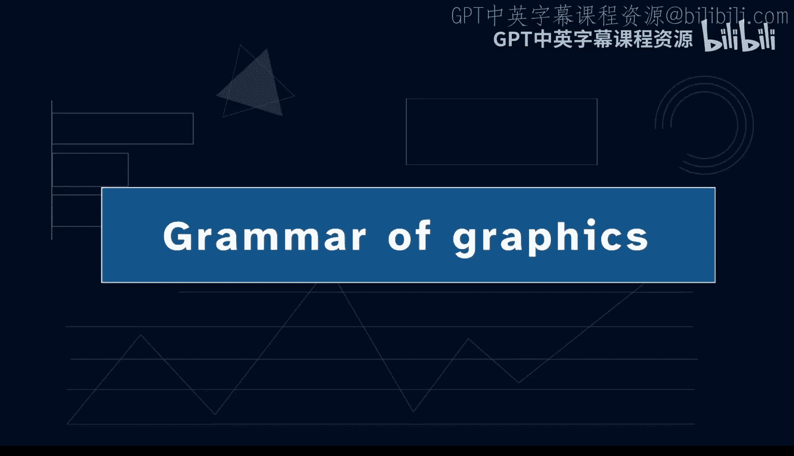
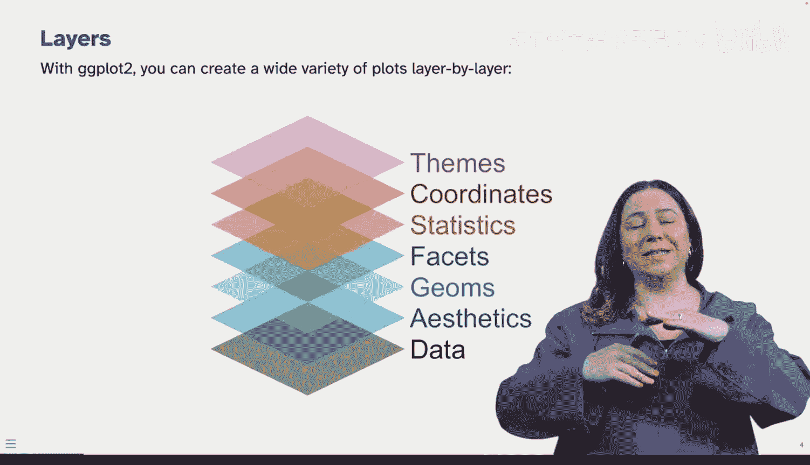
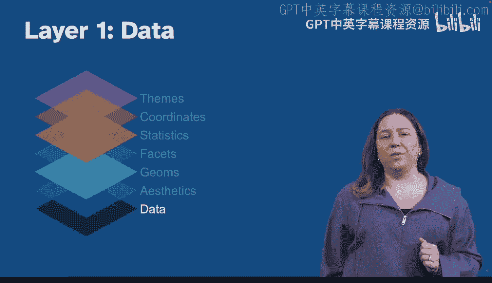
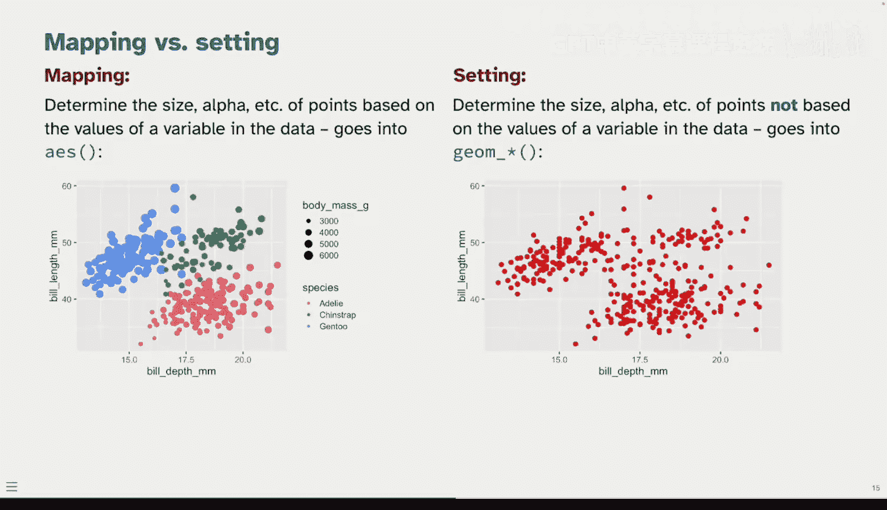
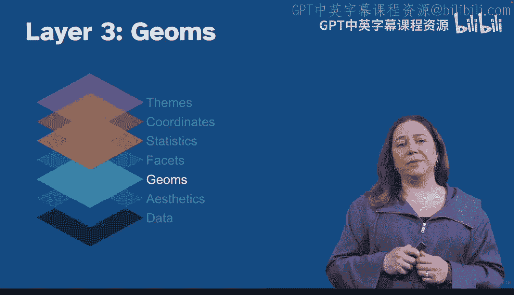
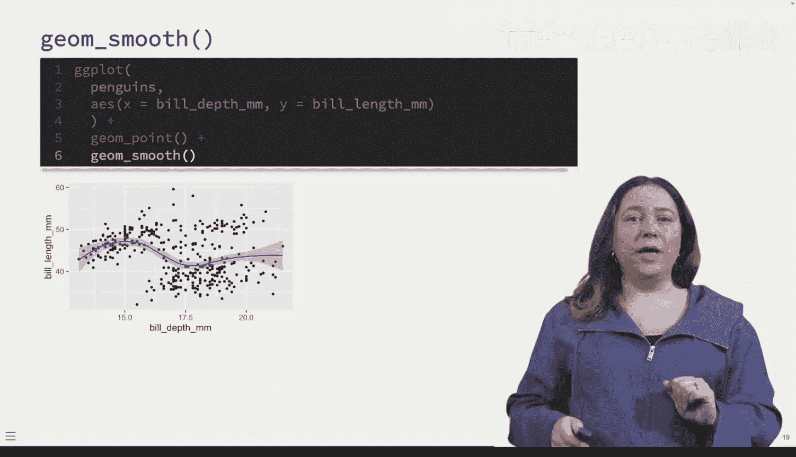
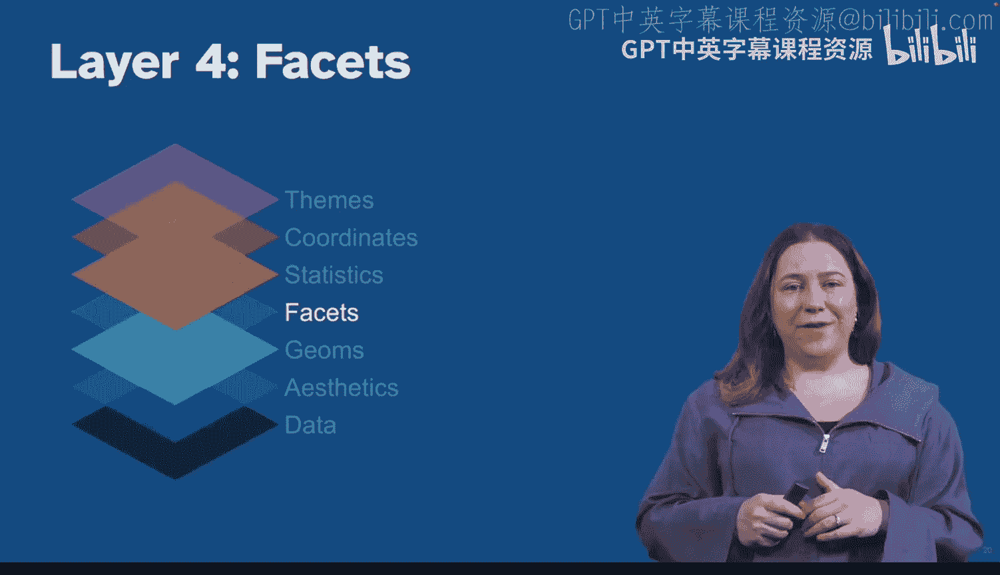
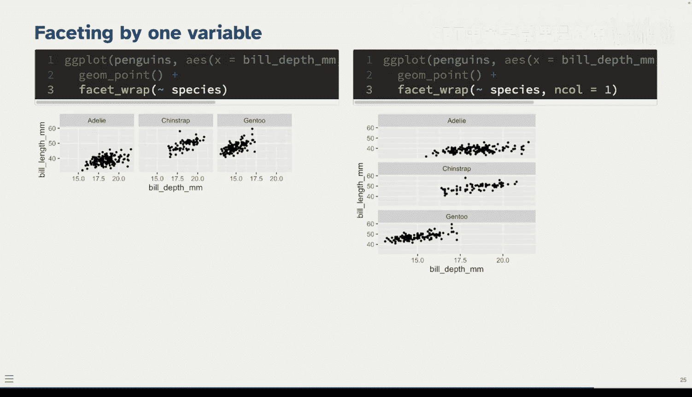
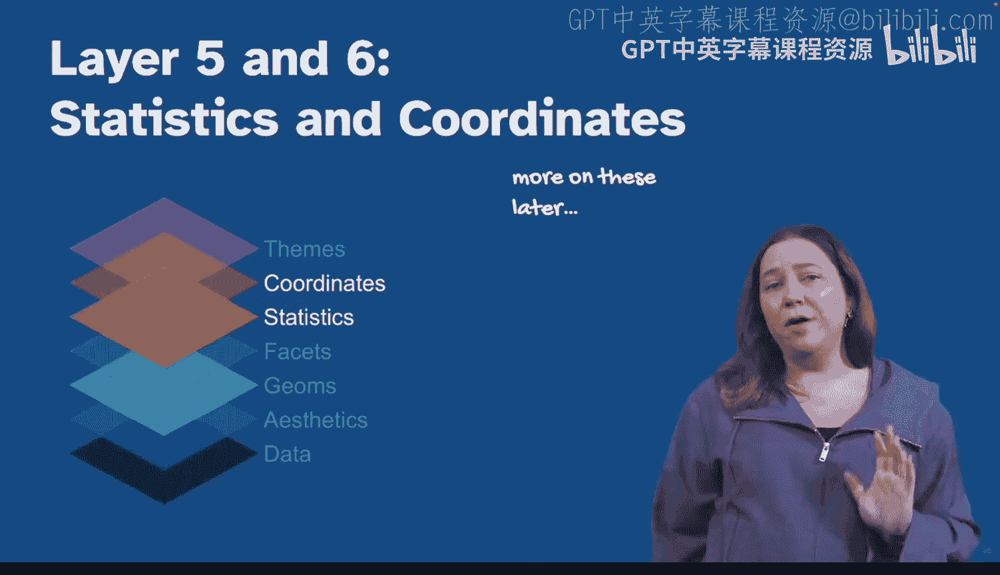
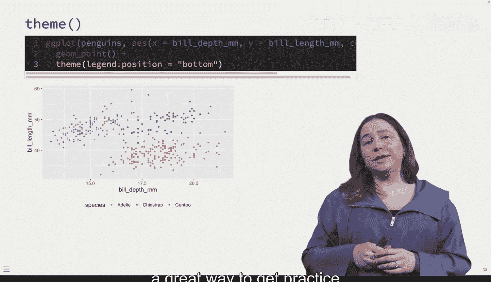

# 杜克大学《R语言数据科学｜Data Science with R》中英字幕 p08 08_02_01_图形语法.zh_en -BV1Zpv6BaEkB_p8-

🎼。

We've been building up our experience making plots with G G P 2 in this video。

 we'll overview the theory underlying it all。 The grammar of graphics。

 The grammar of graphics is a tool that enables us to describe the component of a graphic concisely。

 the G G plot 2 package， which is part of the tidyverse， implements the grammar of graphics in R。

With Gigi plot 2， you can create a wide variety of plots layer by layer。 These layers are data。

 then aesthetics， then geos， then facets， then statistics， then coordinates， and finally themes。

Let's start with layer1 data。

The data layer is the foundation of the plot that gives you the canvas to paint your data。

 A neat feature of G Ploot2 code is that each layer results in a valid plot。

 even if it's an empty plot like the one here。Layer2 is aesthetics。

 we'll spend a bit of time on these。Aesthetics are characteristics of plotting characters that can be mapped to a specific variable in the data。

 For example， color， shape， size， or alpha， In other words， the transparency level。

 There are many more aesthetic mappings， but we'll start with these since they are the commonly used ones in the scatter plot。

 we can see the color aesthetic mapped to species Each level of species is represented by a different automatically selected color。

Here shape is maptu Island。It's possible to map multiple aesthetics to the same variable。

 like species in this plot， we can see that this results in a combined legend。And here。

 size is map to body mass。 This affects the size of the points on the plot。

 which makes it very busy and difficult to read， which means just because you can。

 doesn't mean you should。 It's up to you to decide whether an aesthetic mapping makes sense and results in a useful visualization。

 And the best way to decide is just to give it a try。And one more Alpha here， Al。

 the transparency level is mapped to flipper length。

 This is useful when you have lots of points being over plotted like we have in this plot。

 It shows you where the density of the data is higher versus lower。We've been using the term mapping。

This is reserved for when we're mapping an aesthetic to a variable in the data frame。

 so the values the aesthetic takes is determined by values in the data。

You can also just set an aesthetic to a value just because you want to， for example。

 make all the points red or make all of their sizes a bit bigger。So mapping determines the size。

 alpha， etc of points based on the values of a variable in the data and goes into the AES function for aesthetic mappings and setting determines the size alpha etc of points。

 not based on the values of a variable in the data。

 just based on whatever you want them to be and goes into the GM function mapping versus setting。

 this will come up regularly in this course and when you're doing your own data visualizations。

The next layer is geoOs。

These are the visual representations of data points， they're short for geometric objects。

 and GeO functions are used to add GeOs to a plot like Gem point， Gem， histogram， Gem box plotlo。

 so on and so forth。Each gm adds a new layer to the plot so you can stack them up。

Here we have represented the data with just points to make a scatter plot， so use GM point。

And here we added another geo layer where we're also representing the same data with a smooth curve that's fit to the data。

And you'll learn about many more geos soon。Next up is facets。

What is a facet and why might we want it Fats are smaller plots that each display different subsets of the data。

 they're also commonly referred to as small multiples。

 and they're useful for exploring conditional relationships and large data。

Here's a faceted scatter plot faceted by island across the columns and species across the rows to facet a plot。

 we add a facet layer。 In this case， we've used the facet grid function to facet by two variables into a grid。

Species， Tilda Island means species on the rows and islands on the columns。

 An island Tilda species means island on the rows and species on the columns。

 Don't feel like you have to memorize this or， though。 I often get them mixed up myself。

 Just try it one way。 And if you don't like it， try it the other way。

And to facet by a single variable， we instead use the facet wrap function， which has a quirky syntax。

 just Tilda species， so Tilde followed by the variable you want to facet by。

And then you have some control over how you want these facets to be laid out， for example。

 here we said we want them in a single column with N call argument setting it to one。

Layers 5 and6 are statistics and coordinates。 They're a bit more advanced。

 so I won't say more about them now， but we'll get to them soon。

And layer 7 is themes。Themes control the non data elements of a plot。

 You can select from predefined themes with theme something functions。

 We'll see one of these in a second， or you can take control of individual theme elements in the theme function。

For example， here we've added a dark theme to our plot with theme dark。

And here we've changed the position of the legend to the bottom of the plot with the theme function。

 setting legend position to bottom。We highlight commonly used theme elements throughout the course as they become relevant and remember you can always access the function documentation with question mark theme。

 so question mark followed by the name of the function to learn about all of the options available to you exploring the documentation for all these functions is a great way to get practice making visualizations with Dgipl2。

