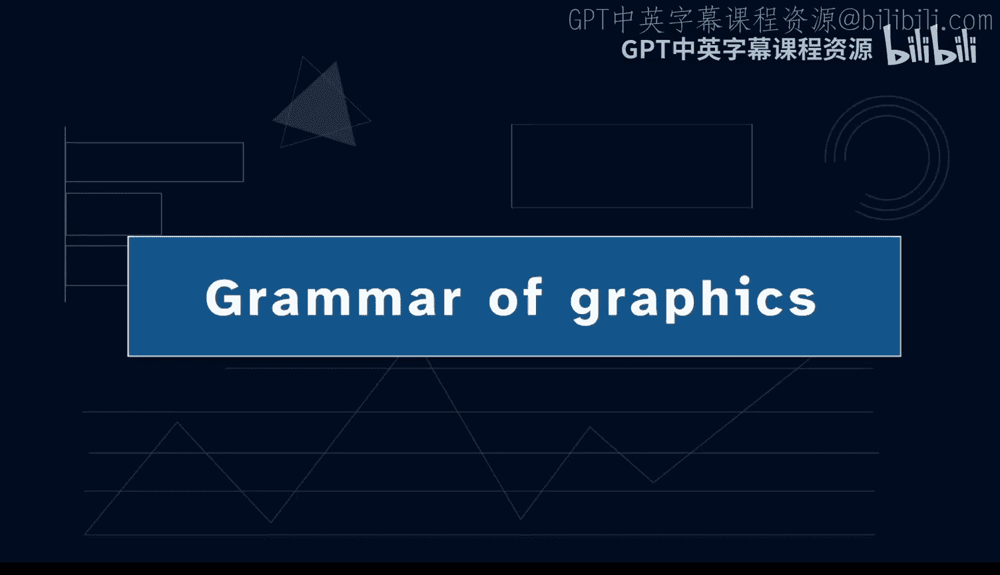
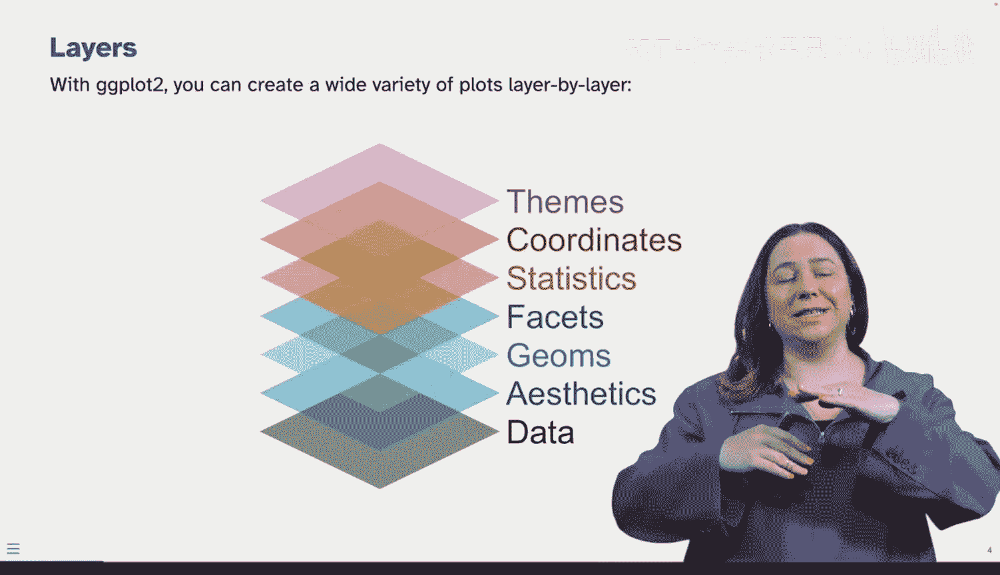
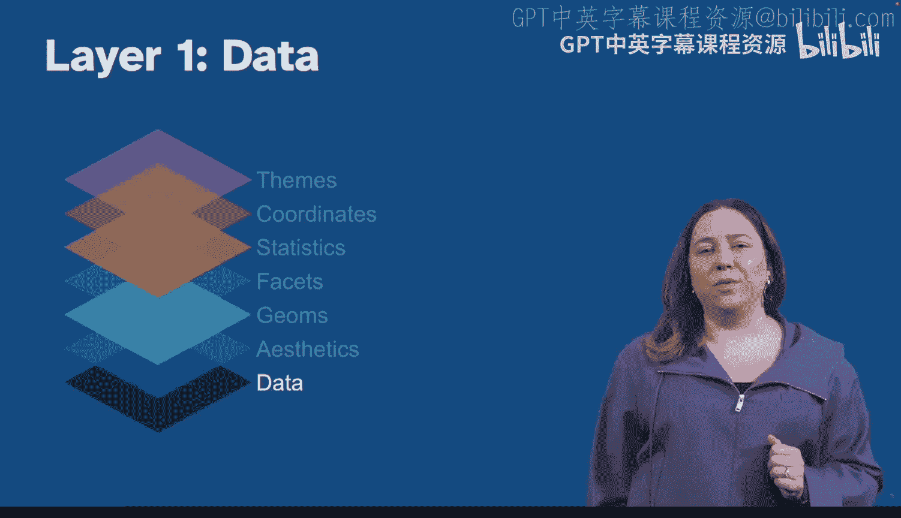
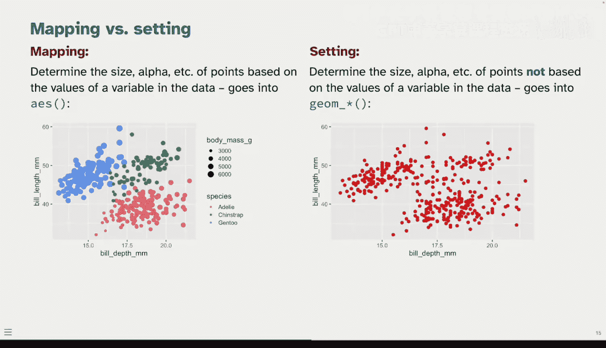
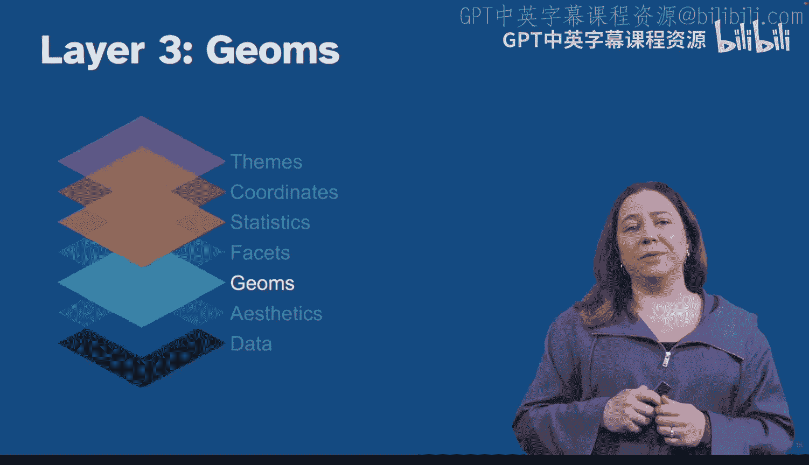
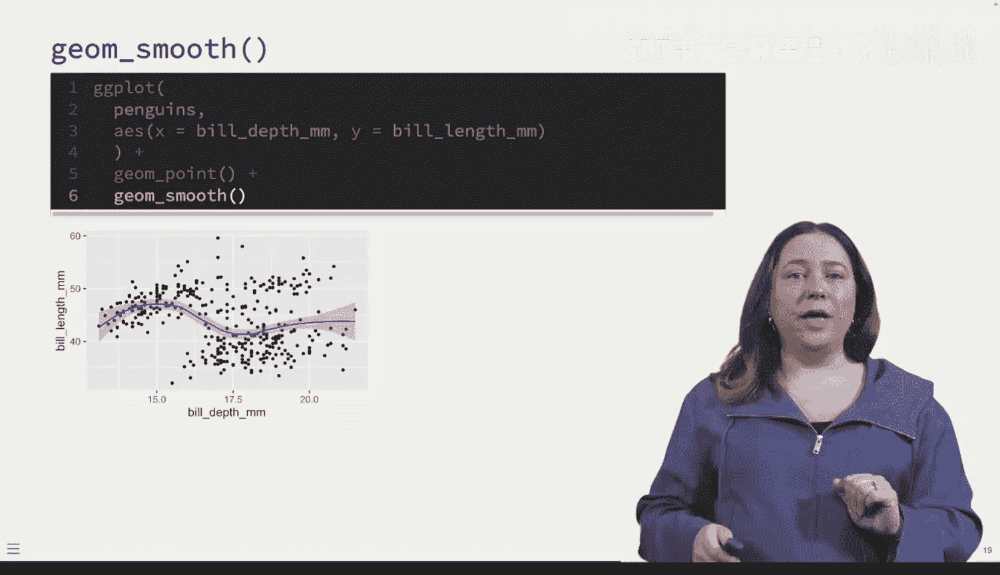
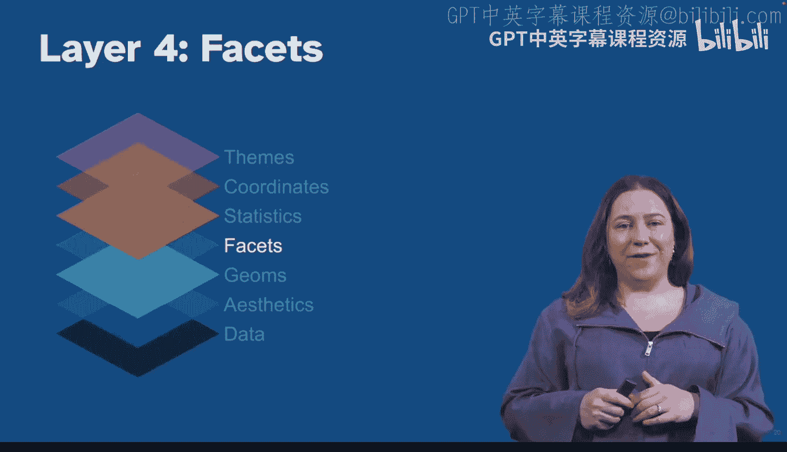
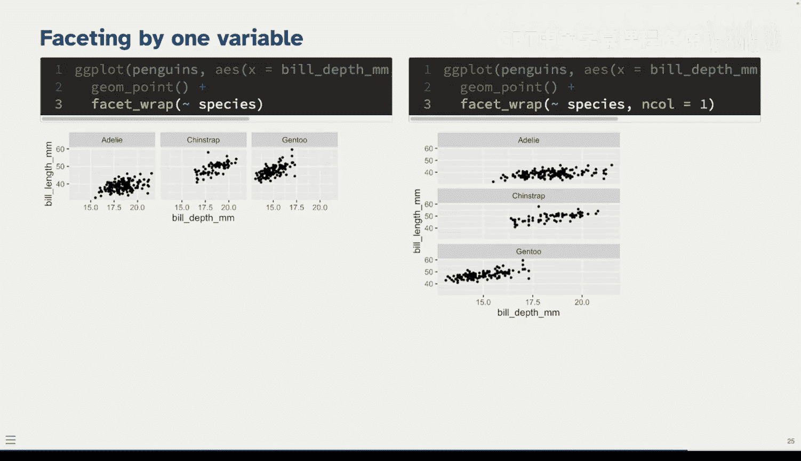
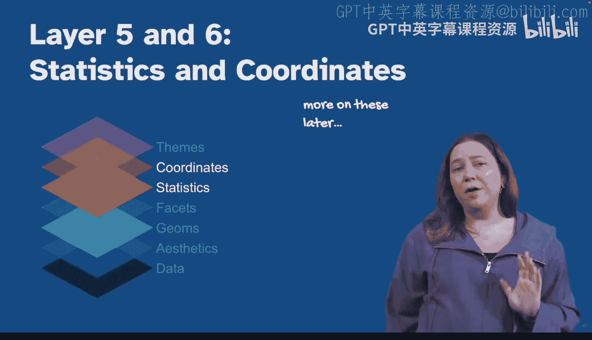
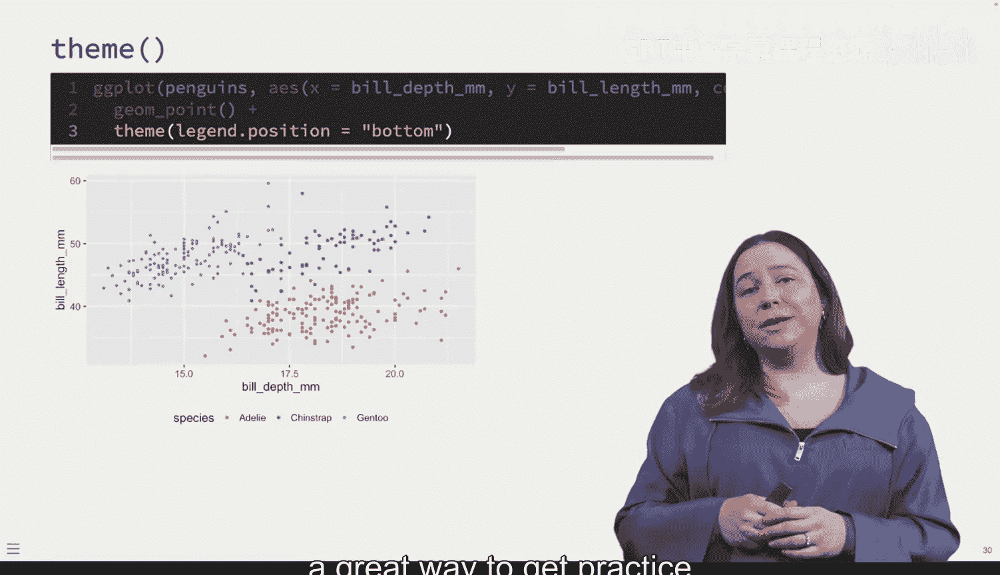

# R语言数据科学：08：图形语法 🎨

在本节课中，我们将学习支撑 `ggplot2` 绘图的理论基础——图形语法。图形语法是一种工具，它让我们能够精确地描述图形的各个组成部分。`ggplot2` 包是 `tidyverse` 的一部分，它在 R 语言中实现了图形语法。使用 `ggplot2`，你可以通过逐层叠加的方式创建多种多样的图形。

这些图层依次是：**数据**、**美学映射**、**几何对象**、**分面**、**统计变换**、**坐标系**，最后是**主题**。

---

## 第一层：数据 📊

数据层是绘图的基础，它为你提供了绘制数据的“画布”。`ggplot2` 代码的一个巧妙之处在于，每一层都会生成一个有效的图形，即使它只是一个像这里展示的空图。

---

## 第二层：美学映射 🎨

我们将花一些时间讨论美学映射。美学是绘图元素的特征，可以被映射到数据中的特定变量。例如，颜色、形状、大小或透明度（alpha）。换句话说，美学映射决定了数据如何被视觉化呈现。

以下是几种常见的美学映射示例：

*   **颜色映射到物种**：每个物种等级由不同的自动选择的颜色表示。
*   **形状映射到岛屿**：不同岛屿的数据点使用不同形状。
*   **大小映射到体重**：这会影响图中点的大小。但请注意，过度使用可能导致图形混乱、难以阅读。因此，能够映射并不意味着应该映射，你需要判断这种映射是否合理并产生了有用的可视化效果。最好的判断方法就是亲自尝试。
*   **透明度映射到鳍长**：当数据点大量重叠时，这非常有用，它可以显示数据密度的高低区域。

我们一直在使用“映射”这个术语。它特指将美学属性与数据框中的变量关联起来，因此美学属性的取值由数据中的值决定。

你也可以直接“设置”一个美学属性为固定值，例如，将所有点设置为红色，或将它们的大小调大一点。

**映射**与**设置**的区别：
*   **映射**：基于数据中变量的值来决定点的大小、透明度等。它写在 `aes()` 函数内。
*   **设置**：不基于数据变量，仅根据你的意愿来决定点的大小、透明度等。它写在 `geom_*()` 函数内。

这个区别在本课程和你自己的数据可视化实践中会经常出现。

---

## 第三层：几何对象 📐

上一节我们介绍了美学映射，本节中我们来看看几何对象。几何对象是数据点的视觉表示，是“geometric objects”的简称。`geom_*` 函数用于向图形添加几何对象，例如 `geom_point`、`geom_histogram`、`geom_boxplot` 等等。

每个 `geom` 都会为图形添加一个新图层，因此你可以将它们叠加起来。

以下是几何对象的示例：

*   我们仅用点来表示数据，以制作散点图，因此使用 `geom_point()`。
*   我们添加了另一个几何对象层，用一条拟合数据的平滑曲线来表示相同的数据。

你很快会学到更多几何对象。

---

## 第四层：分面 🧩

接下来是分面。什么是分面？我们为什么需要它？分面是较小的图形，每个图形显示数据的不同子集。它们通常也被称为“小倍数图”，对于探索条件关系和处理大数据非常有用。

以下是一个分面散点图的示例，按列分面为岛屿，按行分面为物种。

要对图形进行分面，我们添加一个分面层。在这个例子中，我们使用了 `facet_grid()` 函数，按两个变量将图形分面成一个网格。

*   `species ~ island` 表示物种在行，岛屿在列。
*   `island ~ species` 表示岛屿在行，物种在列。

你不必死记这个语法，我自己也经常搞混。只需尝试一种方式，如果不喜欢，再尝试另一种。

如果只想按单个变量分面，我们则使用 `facet_wrap()` 函数，它的语法有点特别：`~ species`，即波浪号后跟你想分面的变量。然后你可以控制这些分面的布局方式，例如，这里我们通过设置 `ncol = 1` 参数让它们排成一列。

---

## 第五、六层：统计变换与坐标系 📈

第五层和第六层是统计变换和坐标系。它们稍微高级一些，我们现在不深入讨论，但很快就会接触到。

---

## 第七层：主题 🖌️

最后是主题层。主题控制图形的非数据元素。你可以使用 `theme_*()` 函数选择预定义的主题（我们稍后会看到一个例子），或者通过 `theme()` 函数精细控制单个主题元素。

以下是主题设置的示例：

*   我们使用 `theme_dark()` 为图形添加了一个深色主题。
*   我们使用 `theme()` 函数，设置 `legend.position = "bottom"`，将图例位置改到了图形底部。

在本课程中，我们会在相关内容出现时重点介绍常用的主题元素。请记住，你始终可以通过 `?theme`（即问号后跟函数名）来访问函数文档，以了解所有可用选项。探索所有这些函数的文档是练习使用 `ggplot2` 进行可视化的绝佳方式。

---

在本节课中，我们一起学习了图形语法的七个核心图层：数据、美学映射、几何对象、分面、统计变换、坐标系和主题。理解这些图层如何协同工作，是使用 `ggplot2` 创建有效且美观的数据可视化的关键。