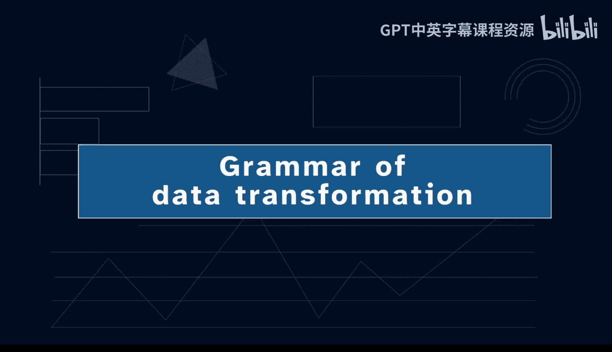
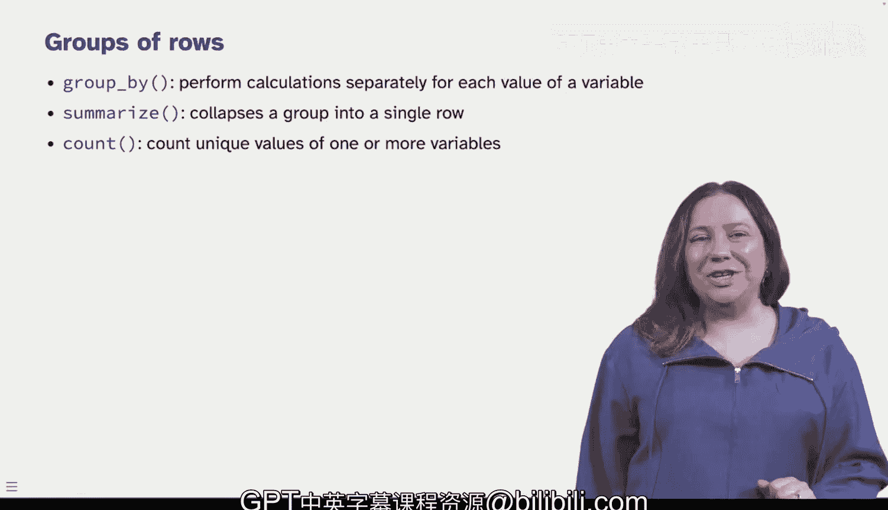

# 杜克大学《R语言数据科学｜Data Science with R》中英字幕 p09 09_03_01_数据转换语法.zh_en -BV1Zpv6BaEkB_p9-

🎼。

We've talked about the grammar of graphics， now let's dive into a grammar for data transformation。

Just like with visualizing data when transforming data， we also always start with a data frame。

 but we've been seeing another term pop up in our outputs， Tbble。

 So let's first talk about data frames and tis。To demonstrate these concepts。

 we will use a data frame called Flights， which contains information on all flights in 2013 out of the three New York City airports for those who are familiar these airports are JFK。

 Laguardia and Newark。Let's load the tidyverse package and the package that contains the flight data called NYC flights 13。

 We can take a look at the number of rows in flights。 There are over 300000 rows。

 so that many flights departing from one of three New York airports that year。

 and there are 19 columns， meaning that we know 19 things about each of these flights。

 Ta a glimpse of the data can also be helpful in getting a sense of the variables and their types。

 For example， we can see we know things like arrival and departure times， any delays。

 etc ce about each flight。With the names function， we can also obtain a list of all variable names。

Another handy function is head， which will by default。

 print out the first six rows of the data frame。And note that the output also mentions the word Tbble。

So what is a Tbble A Tbble is an opinionated version of the R data frame， In other words。

 all Ts are data frames， but not all data frames are tibbles。But to be more clear。

 there are two main differences between a Tiple and a data frame， printing and stricter subsetting。

About printing， when you print a Tbble out， R will only display the first 10 rows of the data frame and all of the columns that fit on the screen will also display along with the type of each column。

When you print a data dot frame out， so that's an original our data frame。

 R will attempt to display all of the data that is all rows and all columns or Ditrine。

 I mean if the data set is too large it might crash so the Tple behavior of printing out only 10 rows and only the columns that fit on your screen is a protection against a potential crash for a large data。

And subsetting Ts offer stricter subsetting。 What does this mean If you try to subset a Tbble for a variable that doesn't exist。

 For example， here， I'm looking for a variable called Apple in the flights data frame。

 we know it doesn't exist。 R not only returns a null， but it also gives a warning。

 saying unknown or uninitialized column Apple， Basically that this column does not exist in the data frame。

On the other hand， with data dot frame， the original R data frame， all you get is noll。

 not the informative warning。 All right， time to introduce a new package Dlier。

 we previously talked in detail about G plot to from its name， it's obvious。

 it had to do with plotting D plier is not so obvious， but I think once you hear the justification。

 it might make sense In short， it's short for data plier like you want to apply your data。

Dlier is tidyverse's primary package for data transformation。

 which includes anything from wrangling and cleaning up the data to summarizing it a great resource for everything DPer offers is the package website at Dpler。

tidyverse。org。When working with data， it's useful to think about operations you might want to do with or to it as row operations versus column operations。

 for example， with Dpler， you can choose rows based on location with slice or choose rows based on column values with filter or order the rows with a range or take a random subset of the rows with sample underscore N。

For example， here I am taking the flights data frame and then slicing its first five rows。

Or here I am taking the flights data frame and then filtering for rows where D。

 the destination is equal to RDU， which is Raleigh Durham Airport serving the area where Duke University is located。

 there were 8163 such flights in the data。This is a good moment to pause and address the elephant in the room。

 a very handy tool we haven't firmly defined yet。 The pipe operator， the pipe。

 which is a vertical line， followed by the greater than sign， is an operator。 In other words。

 a tool for passing information from one process to another。😊。

We use the pipe operator mainly in data pipelines to pass the output of the previous line of code as the first input of the next line of code when reading code in English。

 we can pronounce the pipe operator as and then， for example。

 take the flights data frame and then filter for rows where D is equal to RDU。Allright。

 let's give our introduction of data transformation a clear purpose and try to answer the following question with a data pipeline。

 which airline is the most delayed on average， arriving in RDU from a New York City Air。

So our goal is to obtain a data frame like this one。

 showing the carrier codes for airlines and their mean arrival delay in descending order。

We take the flights data frame。And then filter for flights going to RduU。And then group by carrier。

And then calculate the mean arrival delay for each carrier， so we do this with summarize。

And then arrange in descending order of mean arrival delay。 There we go。

 Carrier with the letters U A that's United Airlines was on average 56 minutes delayed arriving into RDU from a New York City Air in 2013。

We discussed row operations so far， but we can also do column operations with deepwi， for example。

 we can select columns which changes whether or not a column is included。

 we can rename columns which changes the names of the columns。

Or we can mutate with changes the values of an existing column or creates new columns。Additionally。

 we can use D plier to do operations for groups of rows as well。

 so group by performs calculations separately for each value of a variable。Summarize。

 collapses a group into a single row， and count， counts the unique values of one or more variables We'll put these functions to use in the upcoming code along videos。

