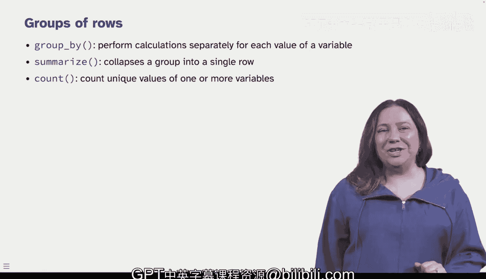

# R语言数据科学：09：数据转换语法

## 概述
在本节课中，我们将学习数据转换的语法。我们将从理解数据框和Tibble开始，然后介绍一个用于数据转换的核心R包——`dplyr`，并学习如何使用管道操作符构建清晰的数据处理流程。

## 数据框与Tibble

上一节我们介绍了图形语法，本节中我们来看看数据转换的语法。

与可视化数据时一样，在转换数据时，我们也总是从一个数据框开始。但在输出中，我们经常看到另一个术语：Tibble。

因此，让我们首先讨论数据框和Tibble。为了演示这些概念，我们将使用一个名为`flights`的数据框，它包含了2013年从纽约市三个机场起飞的所有航班的信息。熟悉的人会知道，这三个机场是JFK、拉瓜迪亚和纽瓦克。

让我们加载`tidyverse`包和包含航班数据的`nycflights13`包。

我们可以查看`flights`中的行数。它有超过30万行，这意味着当年从纽约三个机场之一出发的航班数量，以及19列，意味着我们知道关于每个航班的19件事。

预览数据也有助于了解变量及其类型。例如，我们可以看到我们知道诸如到达和起飞时间、任何延误等信息。

使用`names`函数，我们还可以获取所有变量名的列表。

另一个方便的函数是`head`，它默认会打印出数据框的前六行。请注意，输出中也提到了Tibble这个词。

那么，什么是Tibble？Tibble是R数据框的一个“有主见”的版本。换句话说，所有Tibble都是数据框，但并非所有数据框都是Tibble。

但更明确地说，Tibble和数据框之间有两个主要区别：打印方式和更严格的子集选取。

关于打印，当你打印一个Tibble时，R只会显示数据框的前10行，并且屏幕上能容纳的所有列也会显示出来，同时还会显示每列的类型。

当你打印一个`data.frame`（即原始的R数据框）时，R会尝试显示所有数据，即所有行和所有列。我的意思是，如果数据集太大，可能会导致崩溃。因此，Tibble只打印前10行和屏幕上能容纳的列的行为，是对大型数据潜在崩溃的一种保护。

关于子集选取，Tibble提供更严格的子集选取。这是什么意思？如果你尝试选取一个Tibble中不存在的变量，例如，这里我在`flights`数据框中寻找一个名为`apple`的变量，我们知道它不存在。R不仅返回`NULL`，还会给出一个警告，提示未知或未初始化的列`apple`，基本上就是说这个列在数据框中不存在。

另一方面，对于`data.frame`（原始的R数据框），你只会得到`NULL`，而不是信息丰富的警告。

## 介绍dplyr包

好了，是时候介绍一个新包`dplyr`了。我们之前详细讨论过`ggplot2`，从它的名字来看，很明显它与绘图有关。`dplyr`不那么明显，但我想一旦你听到解释，它可能就有意义了。简而言之，它是“data plier”的缩写，就像你想“处理”你的数据一样。

`dplyr`是`tidyverse`中用于数据转换的主要包，包括从数据整理、清理到汇总的任何操作。关于`dplyr`提供的所有功能，一个很好的资源是其官方网站：`dplyr.tidyverse.org`。

## 行操作与列操作

在处理数据时，将你可能想要对数据进行的操作视为行操作与列操作是很有用的。

例如，使用`dplyr`，你可以根据位置用`slice`选择行，或根据列值用`filter`选择行，或用`arrange`对行排序，或用`sample_n`随机抽取行的子集。

例如，这里我获取`flights`数据框，然后切片其前五行。

或者这里我获取`flights`数据框，然后筛选出`dest`（目的地）等于`RDU`的行，`RDU`是服务于杜克大学所在地区的罗利-达勒姆机场。数据中有8163个这样的航班。

## 管道操作符

这是一个暂停并解决房间里的大象的好时机：一个我们尚未明确定义的非常方便的工具——管道操作符。

管道操作符，即一个竖线后跟一个大于号，是一个操作符。换句话说，它是一个将信息从一个过程传递到另一个过程的工具。

我们主要在数据管道中使用管道操作符，将上一行代码的输出作为下一行代码的第一个输入。用英语阅读代码时，我们可以将管道操作符发音为“然后”。

例如：获取`flights`数据框，然后筛选出`dest`等于`RDU`的行。

## 应用：回答一个数据问题

好了，让我们给数据转换的介绍一个明确的目的，并尝试用一个数据管道来回答以下问题：**从纽约市机场飞往RDU的航班中，哪家航空公司的平均延误时间最长？**

所以我们的目标是获得一个像这样的数据框，显示航空公司的承运商代码及其平均到达延误时间，按降序排列。

我们获取`flights`数据框。
然后筛选出飞往`RDU`的航班。
然后按`carrier`（承运商）分组。
然后计算每个承运商的平均到达延误，我们用`summarize`来做这件事。
然后按平均到达延误降序排列。
结果出来了。承运商代码为`UA`（即美联航）的航班，在2013年从纽约市机场飞往RDU的平均延误时间为56分钟。

## 列操作与分组操作

到目前为止我们讨论了行操作，但我们也可以用`dplyr`进行列操作。例如，我们可以`select`列，这会改变是否包含某列；我们可以`rename`列，这会改变列的名称；或者我们可以`mutate`，这会改变现有列的值或创建新列。

此外，我们还可以使用`dplyr`对行组进行操作。因此，`group_by`对变量的每个值分别执行计算；`summarize`将一组折叠成单行；`count`计算一个或多个变量的唯一值数量。

我们将在接下来的代码练习视频中使用这些函数。

## 总结
本节课中，我们一起学习了数据转换的基础语法。我们首先区分了数据框和Tibble，了解了Tibble在打印和子集选取上的优势。接着，我们介绍了`dplyr`包，它是`tidyverse`中进行数据转换的核心工具。我们学习了如何使用管道操作符`%>%`（读作“然后”）将多个数据处理步骤清晰地连接起来，构建数据管道。最后，我们通过一个实际案例，演示了如何组合使用`filter`、`group_by`、`summarize`和`arrange`等函数来回答一个具体的数据问题。掌握这些基础操作是进行高效数据清洗、整理和分析的关键。