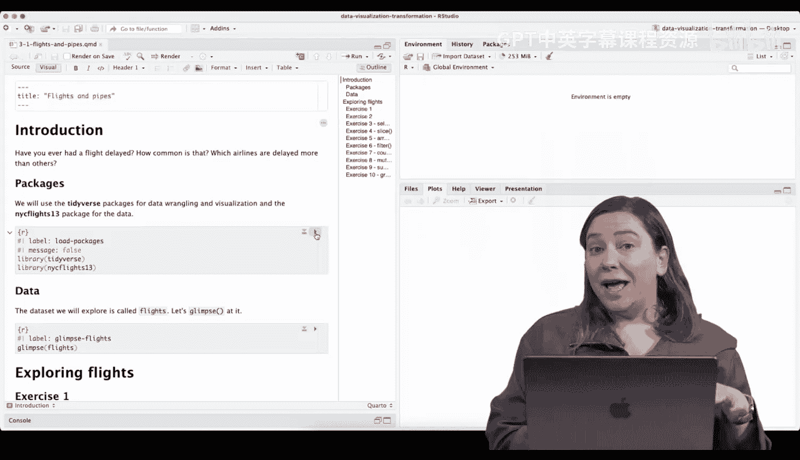
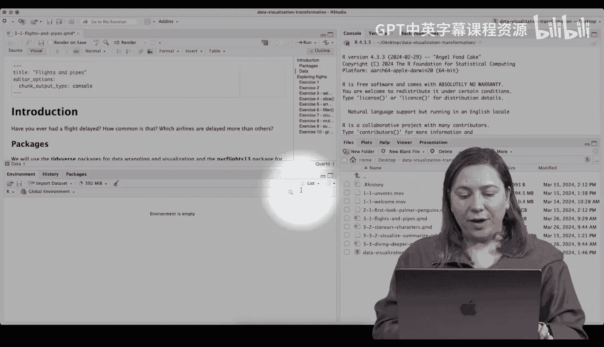
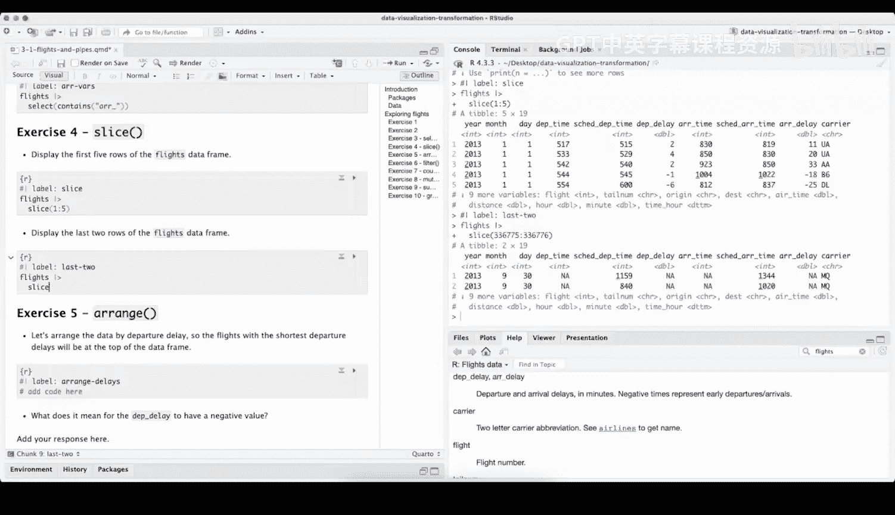
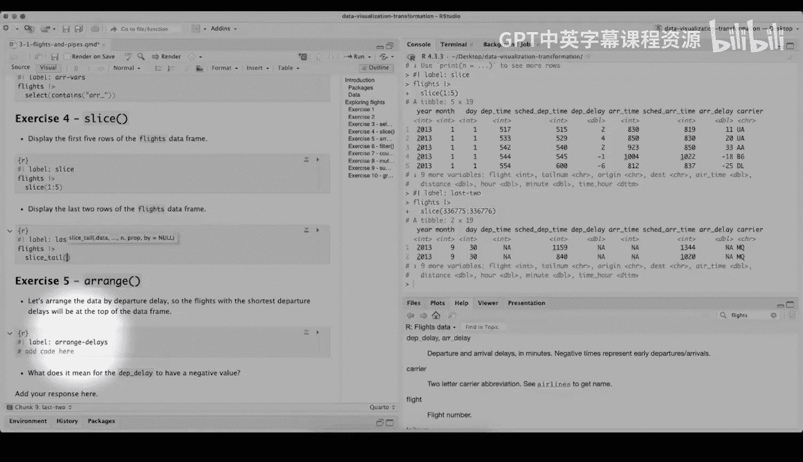
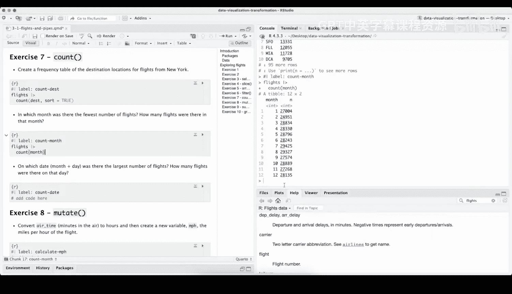
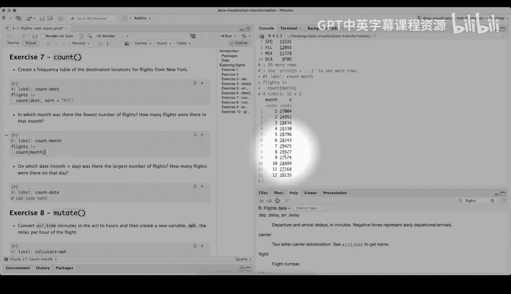
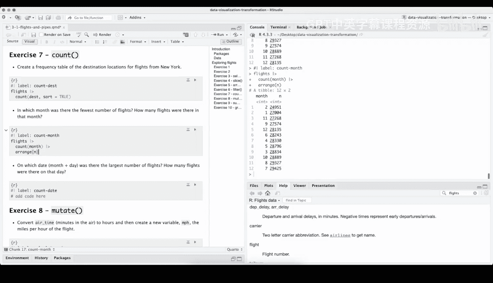
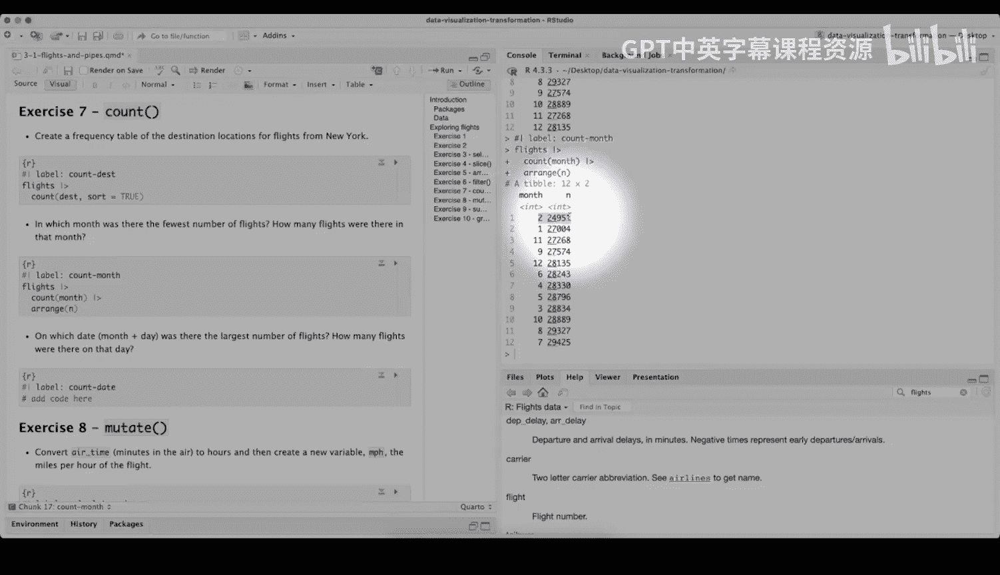
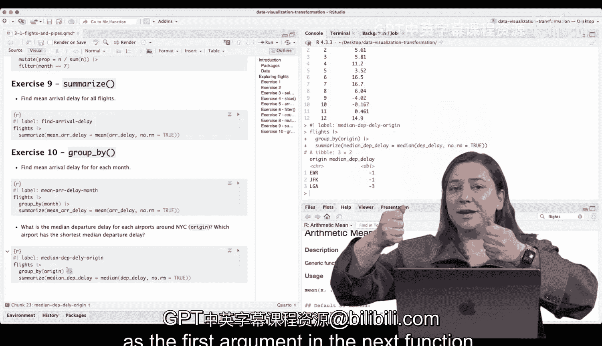

# 杜克大学《R语言数据科学｜Data Science with R》中英字幕 p10 10_03_04_代码实践：航班数据与管道操作.zh_en -BV1Zpv6BaEkB_p10-

In this code along， we're going to work with flights and pipes。 What do I mean by that Well。

 if youve ever flown， chances are， you may have been a little bit delayed， but how common is that。

 how common is it for your flight to be delayed or are there some airlines that tend to be more delayed than others。

 So we're going to work with the tidyverse package as usual for doing our data wrangling and visualization and also use thenyc flights 13 package which has data on all of the flights out of New York City airports there are three airports in New York City。

 Laguardia， John F Kennedy and Newar， So all of the flights from these airports to any destination in year 2013 let's go ahead and load these packages Once again。

 one of them is actually for doing our data wrangling and visualization and the other one is for the data and I'm loading the packages by clicking on the little play button in my corau document to run that current chunk。

 and then let's take。

Look at the flights data set。The function we're going to use that we've introduced before as well is G。

Here we go We can see that our results are printed on our screen whatm in my courto document what I'm going to do is I'm actually going to change where my our results are printed I'm going to close this output and say I would like my chunk output in console I'll say remove any of the existing output and then let's go ahead and run that chunk of code to actually see our results in the console just because it's a little bit easier to sort of see our answers in our questions in one place and our answers in another place Another thing I'll mention about our studio is that you actually have control over where these panes are located so I could go ahead and click on this little icon that has four panes on it and say that I would like to change the layout of my panes and I'm actually going to say I would like to see my console here on the upper right say apply。

H okay。

And going forward， when I run the code， we'll be able to see the results on one side of the screen and see are prompt on the other side of the screen。

 which might be nice， this may not be your preferred arrangement for things and if that's the case you can change them around to whatever you like them to be。

Let's go ahead and start exploring our flights data set says fill in the blanks。

 the flights data frame has so many rows and each row represents something how could we figure out how many rows there are well if I take a look at my glimpse output I can see that there are 336776 flights it's a lot of flights and that's all of the flights out of these three airports in that one year。

One thing I could do is copy this number。And paste it into here。

And let's go ahead and actually write out what each row represents each row represents a flight out of one of three New York City airports。

In 2013。The thing is， one of the things we've done here is we looked at the output of the code and then we grabbed some sort of information from that output and copied and pasted that into our document when you're working in a computational document like a quao document。

 you actually don't need to do that copy and paste which means that you also remove you know any potential of errors along the way because if instead of copying and pasting if I was just typing these numbers。

 it would be pretty easy to accidentally make a mistake like this and have a typo for example。

 so instead of hard coding numbers like this that we can computationally generate。

 we can actually go back and say is there a way for us to embed the code into our document now when we ran the glimpse function to get a look at all of our data which not only tells us how many rows and columns we have but also what all those columns are。

 we were able to grab this one piece of information from the output。

But I can also use a function like N row。Which will give me exactly that number that I need and now that I know what that function is。

 that gives me exactly the number I need， I can say I would like to insert。An inline code chunk。

And in there， I would like to write the code。N row flight so I use my insert anything tool to insert this code chunk and what's happening here is that I'm seeing that the computational language I'm using is R and then I'm giving the code that I want to run in there。

 You can imagine with inline code chunks so you don't want to write very extensive code code that would need to spend multiple lines or anything but something simple like this works nicely and when I render my document you can even tell that there was code underneath it。

 but the neat thing about this approach is that if my data was to change at any point or if I do this analysis for 2013 data and then I happen to get data for a more recent year I can still run my code and all of the all of these numbers will be updated。

Based on the new data set， All right， the next question asks what are the names of the variables in flights。

 so in order to get the names of the variables the function that I would use is names and let's do names flights。

I can again do run one code chunk at a time， which would print my results on in my console。

 or I can say that I want to render my document so that I can see exactly what that looks like in my complete document。

 we saw that there were 19 variables in this data and we can see that there are things like each of them should say year 2013。

 but different month and day of the flight， there departure time if there was any delays at departure or if there was any delays at arrival。

 so on and so forth。If you want to see a full description of each of the variables。

 we can take a look at the codebook since this data set is distributed from a package。

 I can do things like question mark and the name of the data frame。

 or I can just go to my help menu and just search for flights there and either way it will bring up this documentation for the data frame which has the description of each one of my variables。

Al right， next up we're going to go through a set of exercises where we use one or two functions from the tidyverse specifically from the Dli package for data wrangling The first question says make a data frame that only contains the variables depth delay and R delay。

 so departure or arrival delay for each one of these I start with my data frame。Flights。

 and then I pipe that into。Because I want to select only certain columns。

 I'm going to use the select variable and the names of the variables are depth delay。

 I can use the autocomplete here comma。Ari delay。And this will give me a data frame with the same number of rows as before。

 but only the columns that I need if I want to instead make a data frame that keeps every variable except departure delay instead of listing all of the other 18 variables I can take a shortcut and indicate that the only thing I don't want is depth delay and in order to do that once again start with a data frame name and then say select。

Exlamation point delay， we use exclamation point to negate things in R。

 so we're saying everything but departure delay， and you can see that the result is 18 columns in our data set still the same number of rows。

Next， we want to make a data frame that includes all variables between year through departure delay inclusive。

 so that's starting with year through departure delay。Oh。

 I guess I can't see my departure delay variable there， maybe I can take a look at it here。

 so it should be year through departure delay so those should be the variables that I want。

And these are all of the variables it says that provide information about the departure of each flight。

 so we'll start with the flight data frame again。And then say select I want everything from year to departure delay。

 so the operator I use for that is the colon operator。And here we go。

 we have a result of six variables， still the same number of rows。

 so each one of these actions we're doing with the select function is operating on the columns and doing nothing on the rows。

 so my number of rows stays constant。And finally， with select， we're going to do one more thing。

We want to select the variables that。Associated with the arrival。

 And these are all of the variables that contain the string A R R underscore in the name。

 I could take a look back at the output of names。 And I could say there' is scheduled。

 there's arrival time。 there's scheduled arrival time and arrival delay。

 And I could write those out one by one。 But you can imagine that if I had a much larger data set or many more variables to write。

 that's not necessarily going to be handy to do so。 So instead with the select function。

I can also use some select helpers。So I will say I want to select four variables that contains A orR underscore in their names。

So these are all of those variables。 There are other select helpers that we can use， for example。

 if I had use starts with。I would end up with just arrival time and arrival delay if I had use ends with。

 I end up with nothing because none of these actually end with the texturing ARR underscore。

 so contains is a neat way of doing it doesn't matter where that appears in the variables name as long as that is included in the name I would like to select that。

So far we've operated on the columns now let's operate on the rows with slicelic it says display the first five rows of the flights data frame。

 so we'll do flights。And then slice one through five。So now we keep all of the columns。

 but only the top five rows of our data frame。Next。

 we asked to display the last two rows of the flights data frame。 So in order to do that。

 I would start with flights。 and then I could use the same approach。 I can say slice。

 And then I can figure out myself what the indicators for the last two rows are going to be。

 I know that I have。This many，336，766 rows in my data frame so I can say give me everything from。

Up to that row and one before that so 336775 to 336776。

 This works but unfortunately what I've done here is I've once again use the result of an output that I had and hardcoded numbers into my code instead of that I could try to leverage R to find the number of rows for me along the way and in order to be able to do that once I type slice I'm going to click on the tab on my keyboard so that our studio gives me some options of variant of the slice function that I can choose from I can see the names of the functions and also which package they come from so that can help me limit I know that I'm going to use something from the D or package and slice tail is what we want since that's going to give us the last so many rows and in this case we would say。

We would like the last two rows and we can see that we arrive at the same answer。

 but the second way of doing this is a bit more robust， if my data set was to change。

 I would still be able to get the last two rows with this code。

We've operated on the columns by selecting or emitting some of them。

 we've operated on the rows by selecting or emitttting some of them now we're going to arrange our rows so we're not going to be reducing our data frame in any way。

 but we're going to be changing the order for example。

 the first exercise says let's arrange the data bar departure delay。

 so the flights with the shortest departure delays will be at top of the data frame。

Once again starts with flights and then we say arrange departure delay。

And let's go ahead and run that so we can see that the shortest departure delay is negative 43 minutes。

 that means that flight actually took off 43 minutes earlier than it was scheduled to。

Which is the answer here。Flight took off 43 minutes earlier than it was scheduled。

Next we're asked to arrange the data by descending departure delay so the flights with the longest departure delays will be at the top。

 let's go ahead and copy the code we know is good and working。

But we're going to add another function into this and say we actually want these to be in descending order。

So the flight with the longest departure delay is 130001 minutes， how many hours does that make。

 let's divide that by 60 real quick to get a sense that flight was delayed by almost 22 hours so really really long departure time。

Okay。Next， we're asked to create a data frame that only includes the plain tail number。

And the carrier and departure delay for the flight with the longest departure delay and so that we can identify what the plain tail number for this flight was We know how to get the flight with the longest departure delay so we if we were to sort of use the code we ran before that's going to put the flight with the longest departure delay on top We also know how to slice our data frame for the very first row I can do this with slice one or I can do this with slice head and equals one to get the top row。

And then we also know how to select variables， so it says we want to select for a tail number。

Carrier and the departure delay。So we were able to chain the things that we've learned so far。

 the different functions by adding the pipe operator in between each one of our lines。

 we're saying start with the flightlights data frame and then arrange in descending order of departure delay and then slice the data frame for the top one row and then select these three variables。

So the plane with the tail number is printed here and the carrier short code is printed here as well。

Next let's move on to filtering so we have arranged our rows。

 we've also sliced the data frame based on an index number。

 but we can also filter based on a particular condition for example。

 filter all rows where the destination airport is IRDU so that is flights and then we want to filter。

For destination is equal to RduU so the filter function will choose rows based on a condition being true and in order to check for that condition we use what we call logical operators in R I've included like a little cheat sheet of logical operators in this code along as well the double equals basically asks is it exactly equal to we have other options like is it not equal to is it one thing or another or we can also do mathematical operations with mathematical operators like less than greater than or equal to so on and so forth as well So in this case we would articulate this as take the flights data frame and then filter for rows where destination is equal to RduU。

We can also filter all rows where the destination airport is RduU and arrival delay is less than zero。

 so let's go ahead and grab the code we know is good and working and we can say and。Arival delay。

Is less than0。So that is4232 flights from from one of the three New York City airports to RDU where they were not delayed。

 the arrival delay was less than zero。And finally， it says describe what the code is doing in words。

 so let's take a look here， we're saying start with the flights data frame。And then。

We want to filter。For something。And。Another thing。So we can use either a comma operator or the M percent to say and。

 so we're looking for two conditions to hold。 The first one says the destination should be in here。

 So this in operator allows us to check for not for exactly equal to but basically saying either the destination is RduU or the destination is GSO。

 another airport code。And the other condition we're looking for is the arrival delay is less than zero。

Or the departure delay is less than zero。So to articulate this， we can say start with。

Flights data frame， and then filter for rows where。Destination is RduU or GSO。

And arrival delay or departure delay is less than zero。

 Let's see how many flights actually fit this bill looks like there are 6203 flights that actually fit this bill。

Right， now let's move on to a type of summarization so far we've taken our data frame and we've either you know work with the columns or the rows。

 but ultimately every single one of our results was another data frame where each row was a flight。

Another thing we might want to do with the functions is actually summarize our data。

 so we're asked to create a frequency table of the destination locations for flights from New York。

 so where do flights go from New York。Let's go ahead and say we want to start with the flights data frame and then we want to count the different destinations from New York。

So we have a total of 105 different destinations， the first one is ADQ， I believe that's Albuquerque。

 so on and so forth， and we can see that these are in an alphabetical order。

 lots and lots of flights from a New York airport to Atlanta， for example。

If we wanted to see which one was the most common， we could add another argument called sort true。

And this basically would give the destinations not in alphabetical order of their three letter short codes。

 but instead in descending order of magnitude of the number of flights going to that airport。

Next one says in which month was there the fewest number of flights and how many flights were there in that month。

 so let's go ahead and say first we want to figure out how many flights per month。

 so we're going to count the number of rows associated with each month。

And then we're asked how many of which month had the fewest number of flights。

 so I can look through this output， they're all roughly in the 2000s。

 but I can look through this output to try to figure out which one is the smallest number or I can let R help me。

 I can pipe this into and arrange and say that I want the I want my output to be arranged by the value of n。

So this gives me the smallest number on top。And the largest number on the bottom。

 So the smallest number was February， had the lowest number of flights out of one of the three NYC airports。

And finally， on which which date month and day was there the largest number of flights。

 So in this case， what we want to do is we want to not focus on just month or day。

 but we want to focus on a combination of those。 I can do that with flights。

 and then we want to count the number of flights for each combination of month and day。

And then we want to arrange them in descending order so I can say sort equals true。

So it looks like the most number of flights was on November 27 that is probably associated with Thanksgiving travel。

So far we have sort of worked with our data frame and gotten results where each row of our data frame was a single flight and then we've gone into doing a bit of summarization where we've taken our flights data frame and create a frequency tables based off of that with the count function Next we might want to start getting creative what if the variables that are given to us are not sufficient for our analysis or we want to transform them somehow to get different versions of those variables the mutate function we'll take a data frame and mutate that data frame to either add a column or overwrite an existing column to change its nature so the first exercise says convert airtime minutes in the air to hours then create a new variable MP the miles per hour of the flight。

So let's go ahead and again start with the flights data frame。

 and then we want to mutate that data frame to create a new variable。

 I will call that variable airtime hour。And it says take the original air time variable and then divide it by 60。

So this is creating a new variable called airtime hour。

 and I can see that that variable is in my data frame， However。

 I can actually see the values in it because it's too far on the right side to be printed on my output。

 So whenever I'm mutating a data frame and adding new columns。

 a function that I find really handy is relocate。Which will relocate any variables you have that may be elsewhere in the data frame to the very beginning of your data frame and whenever I do that。

 I usually relocate any of the variables that were involved in my calculation so now I can see for example that 227 minutes was indeed translates to 3。

78 hours and I can check myself like this along the way we're not going to stop there though it says and then calculate another variable MPH which is the miles per hour of the flight so first let's figure out what the distance travel was。

That's going to be in the distance variable so I can say and then mutate again to create a new variable called MPH。

 which is going to be the number of miles。Divided by the airtime and hours。

And then let's do the relocation as well to bring to the beginning of our data frame again any of the variables that were involved in our data pipeline。

 so now I can confirm if you know if I agree with calculated values for MPH。

One thing we've done here is that sequentially we've written to mutate statements。

 while this is absolutely valid code， my recommendation would be after you run through your data sort of transformation to pause for a moment and see。

 is there any sort of consolidation that you might make in your code that might make it easier to read it later？

So I would say that let's say we're creating one variable called air time。

Coma another variable called MPH and then I will move my close parenthesis to the next line。

 This basically does the exact same thing， but makes it a lot more obvious that there's going to be two variables that we create along the way and generally once I'm happy with the code。

 I might actually go ahead and get rid of this relocate function so that what I'm outputting is in the same order as the data that was going into it。

The next exercise says first count the number of flights each month and then calculate the proportion of flights for each month。

 what proportion of flights take place in July。So let's start with our flightlights data frame again。

We know how to count how many flights were in each month。

But we're asked to do now is not just to report the number but the proportion and to calculate the proportion。

 we would take the number and divide it by the sum of all of the numbers in this column we can do exactly that and we're going to add a new column so that's a mutate。

Maybe let's call that prop as the new variables name that's going to be the value of n divided by the sum of n so I'm actually using an additional function and my mutate call to do that calculation and it says which what proportion of flights take place in July so I can either look at my output here or I can further filter my data for where month is equal to the seventh month that is July 8。

74% of the flights took place in July。I can use in addition to doing summarization by counting things。

 I can also use a pipeline to calculate summary statistics for my data。

 so let's go ahead and find the mean arrival delay for all flights I'm again going to start with the flights data frame and then I will summarize。

To find the mean。Arival delay， so I'm using the mean function from R to find the arrival delay。

 Let's go ahead and run this to see what we get。 There are a couple things that are peculiar about this output。

 First of all， Y is this an NA。 Well， in my column of arrival delays。

 some of the flights might not have an arrival delay recorded for them。

 If I go ahead and take a look at the help for the mean function。

I will see that it actually has an argument called NARM that I can use。 it's set to。False by default。

 But if I was to say。N a。Rm。Equals true。That gives me the mean of all of the arrival delays if I was to ignore the ones that were NAs。

And then another peculiar thing yet again is that the name of my column now is the exact call that I use to calculate that value。

 so when we use the summarize function， just like with mutate。

 we can actually name our the column the summary column that we're going to obtain and you are welcome to call it whatever you want to。

 but obviously that's not a great idea， we want to name things in a short but informative way。

 I'm going to call it mean underscore our delay for this。So with summarize。

 what we've done is we've taken our whole data frame and reduced it down to a single row。

 a single value that summarizes all of the arrival delays in this data frame。

But what if we wanted the mean arrival delay for each month so let's go ahead and copy this code that we know works for calculating a single mean arrival delay for all of our data and let's instead say before we go there let's group the data by month。

 so what the group by function does is it groups the data so that the next step in the data pipeline is applied once per group。

If I was actually to only run the first two lines of this code。

 you will see that my output looks exactly like my original data frame。

 however it has this group attribute to it， saying that it's being group by month and there are 12 such groups。

 meaning that when I run the whole group by summarized pipeline。

 I'll receive a mean arrival delay per month。And finally。

 what's the median departure delay for each airport around NYC， so that's the origin variable。

 which airport has the shortest mean departure delay。Let's go ahead and copy this code that again。

 we know works。 However， first of all， we're dealing with the median， not mean。

 So let me go ahead and change that。And I'm going to call my summary Statistic median We're also interested in departure delay。

 not arrival delay， So let's say that departure delay is what we're interested in and we're not interested in monthly means。

 but instead we're interested in means by origin， so the variable that I'm going to group by is origin as opposed to month。

So you can see that we're able to build these things like little building blocks for each line of my pipeline。

 and we're able to take a data frame， pass it on to the next function。

 apply another logic to it and pass it on to the next function and what the pipe operator in between each of these steps is doing is taking what comes before it and plugging it in as the first argument in the next function。

