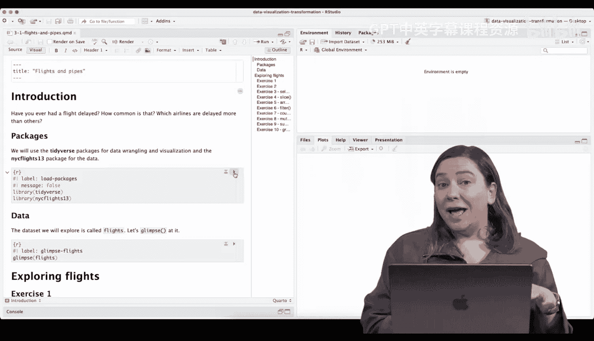
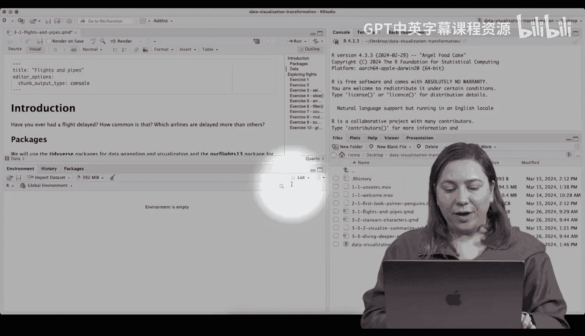
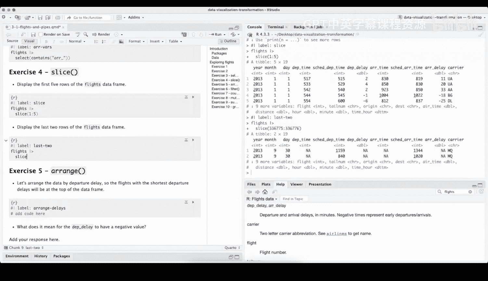
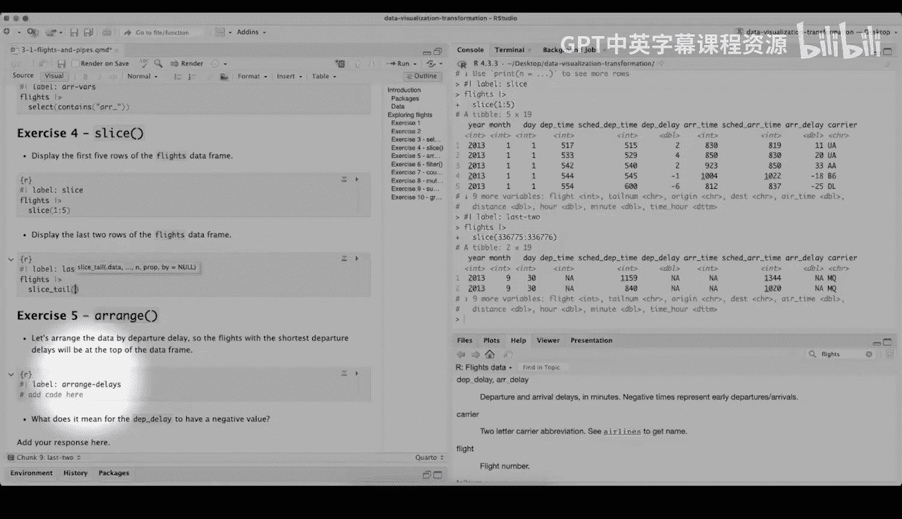
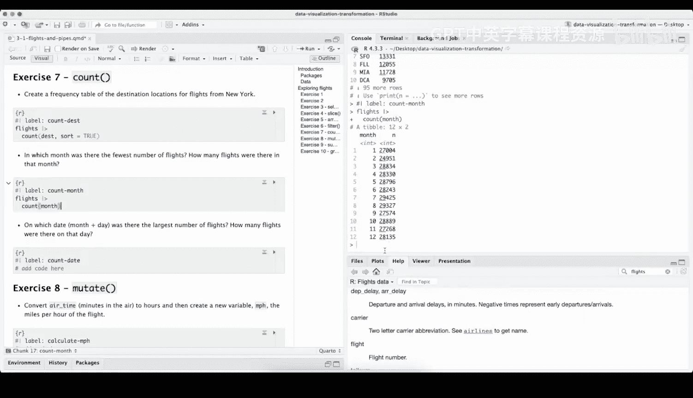
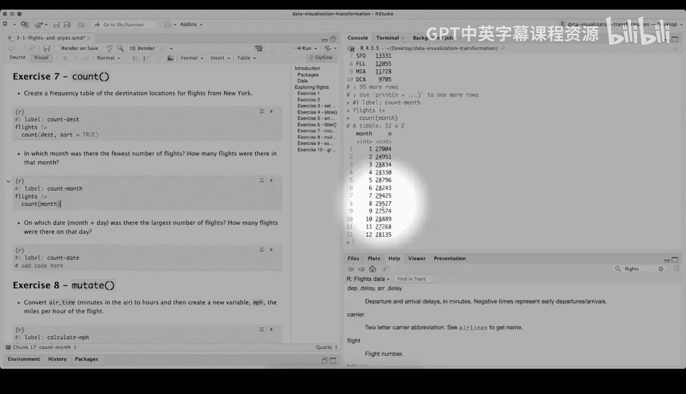
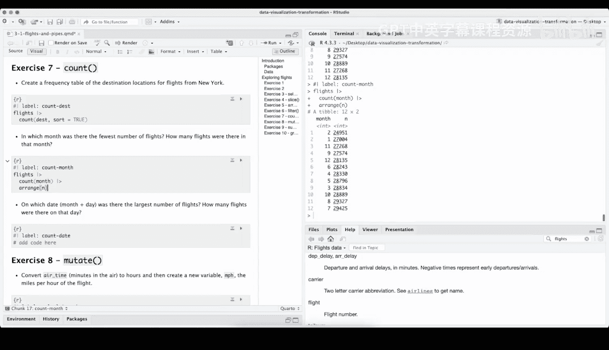
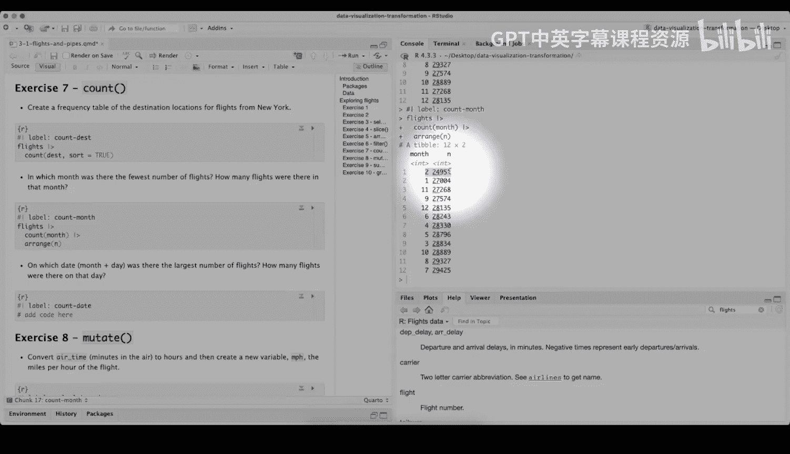
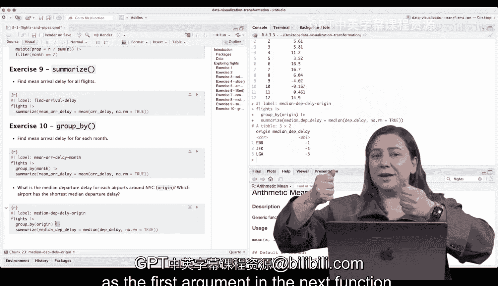

# R语言数据科学：10：代码实践：航班数据与管道操作 ✈️


在本节课中，我们将要学习如何使用R语言中的`tidyverse`包，特别是`dplyr`包，来处理和分析航班数据。我们将重点学习如何通过管道操作符`%>%`将多个数据处理步骤串联起来，形成一个清晰、高效的数据处理流程。



## 概述

我们将使用`nycflights13`包中的`flights`数据集，该数据集包含了2013年从纽约市三个机场（拉瓜迪亚机场、肯尼迪机场和纽瓦克机场）起飞的所有航班信息。通过一系列练习，我们将学习如何选择、筛选、排序、汇总和转换数据。



## 加载数据包

首先，我们需要加载必要的R包。`tidyverse`包用于数据处理和可视化，`nycflights13`包则提供了我们要使用的航班数据。

```r
library(tidyverse)
library(nycflights13)
```

## 探索数据集

在开始分析之前，我们先来了解一下数据集的基本结构。

以下是查看数据集概览的方法：

```r
glimpse(flights)
```

通过`glimpse`函数的输出，我们可以看到`flights`数据框有336,776行，每一行代表2013年从纽约市三个机场起飞的一个航班。数据集中包含19个变量，例如年份、月份、起飞时间、到达时间以及延误情况等。

为了在文档中动态地嵌入行数，我们可以使用`nrow`函数：

```r
`r nrow(flights)`
```

这样，当数据更新时，行数也会自动更新。

接下来，我们查看数据集中所有变量的名称：

```r
names(flights)
```

如果想了解每个变量的具体含义，可以查看数据集的帮助文档：

```r
?flights
```

## 选择数据列（`select`函数）

现在，我们开始使用`dplyr`包中的函数来处理数据。首先，我们学习如何选择特定的数据列。





以下是使用`select`函数选择特定变量的示例：

*   **选择特定列**：创建一个只包含`dep_delay`（起飞延误）和`arr_delay`（到达延误）的数据框。
    ```r
    flights %>%
      select(dep_delay, arr_delay)
    ```
*   **排除特定列**：创建一个包含除`dep_delay`外所有其他列的数据框。在R中，使用`!`符号表示“非”。
    ```r
    flights %>%
      select(!dep_delay)
    ```
*   **选择列范围**：创建一个包含从`year`到`dep_delay`（包含两端）的所有列的数据框。使用冒号`:`操作符。
    ```r
    flights %>%
      select(year:dep_delay)
    ```
*   **使用选择辅助函数**：选择所有名称中包含字符串`"arr_"`的变量。`contains()`是一个非常有用的辅助函数。
    ```r
    flights %>%
      select(contains("arr_"))
    ```

## 选择数据行（`slice`函数）

上一节我们介绍了如何操作数据列，本节中我们来看看如何操作数据行。`slice`函数允许我们根据行的位置（索引）来选择数据。

以下是使用`slice`函数选择特定行的示例：

*   **显示前五行**：
    ```r
    flights %>%
      slice(1:5)
    ```
*   **显示最后两行**：我们可以手动计算行数，但更稳健的方法是使用`slice_tail`函数。
    ```r
    flights %>%
      slice_tail(n = 2)
    ```

## 排序数据行（`arrange`函数）

我们不仅可以选择行，还可以改变行的顺序。`arrange`函数用于根据一个或多个变量对数据框的行进行排序。

以下是使用`arrange`函数排序数据的示例：

*   **按起飞延误升序排列**：延误时间最短的航班排在最前面。
    ```r
    flights %>%
      arrange(dep_delay)
    ```
*   **按起飞延误降序排列**：延误时间最长的航班排在最前面。使用`desc()`函数实现降序。
    ```r
    flights %>%
      arrange(desc(dep_delay))
    ```
*   **组合操作**：找到延误时间最长的航班，并只显示其飞机尾号、承运商和起飞延误信息。这结合了`arrange`、`slice`和`select`函数。
    ```r
    flights %>%
      arrange(desc(dep_delay)) %>%
      slice_head(n = 1) %>%
      select(tailnum, carrier, dep_delay)
    ```

## 筛选数据行（`filter`函数）

除了按位置选择行，我们还可以根据条件来筛选行。`filter`函数用于保留满足指定逻辑条件的行。

以下是使用`filter`函数筛选数据的示例，其中使用了R的逻辑运算符（如`==`, `!=`, `<`, `>`等）：

*   **筛选目的地为RDU的航班**：
    ```r
    flights %>%
      filter(dest == "RDU")
    ```
*   **组合条件筛选**：筛选目的地为RDU**且**到达延误小于0（即提前到达）的航班。使用逗号或`&`表示“且”。
    ```r
    flights %>%
      filter(dest == "RDU", arr_delay < 0)
    ```
*   **使用`%in%`和`|`操作符**：筛选目的地是RDU或GSO，**并且**到达延误或起飞延误小于0的航班。
    ```r
    flights %>%
      filter(dest %in% c("RDU", "GSO"),
             arr_delay < 0 | dep_delay < 0)
    ```









## 数据汇总（`count`和`summarize`函数）

到目前为止，我们的操作结果都是一个数据框，其中每一行仍然代表一个航班。接下来，我们将学习如何对数据进行汇总，得到更高层次的统计信息。

### 使用`count`进行计数

`count`函数可以快速计算每个组中的观测值数量。

以下是使用`count`函数汇总数据的示例：

*   **创建目的地频率表**：
    ```r
    flights %>%
      count(dest)
    ```
*   **按计数排序**：添加`sort = TRUE`参数，使结果按航班数量降序排列。
    ```r
    flights %>%
      count(dest, sort = TRUE)
    ```
*   **找出航班最少的月份**：首先按月份计数，然后使用`arrange`排序找到最小值。
    ```r
    flights %>%
      count(month) %>%
      arrange(n)
    ```
*   **找出航班最多的日期**：按月份和日期的组合进行计数，并排序。
    ```r
    flights %>%
      count(month, day, sort = TRUE)
    ```

### 使用`summarize`进行统计

`summarize`（或`summarise`）函数可以将数据框压缩为单行摘要统计。

以下是使用`summarize`函数计算统计量的示例：

*   **计算所有航班的平均到达延误**：注意处理缺失值（NA）。
    ```r
    flights %>%
      summarize(mean_arr_delay = mean(arr_delay, na.rm = TRUE))
    ```
*   **按组计算统计量**：结合`group_by`函数，计算每个月的平均到达延误。
    ```r
    flights %>%
      group_by(month) %>%
      summarize(mean_arr_delay = mean(arr_delay, na.rm = TRUE))
    ```
*   **计算每个起飞机场的中位起飞延误**：
    ```r
    flights %>%
      group_by(origin) %>%
      summarize(median_dep_delay = median(dep_delay, na.rm = TRUE))
    ```

## 创建新变量（`mutate`函数）

如果数据集中现有的变量不满足分析需求，我们可以使用`mutate`函数来创建新的变量或修改现有变量。

以下是使用`mutate`函数转换数据的示例：

*   **单位转换与计算**：将空中飞行时间（分钟）转换为小时，并计算航班的速度（英里/小时）。
    ```r
    flights %>%
      mutate(air_time_hour = air_time / 60,
             mph = distance / air_time_hour)
    ```
*   **计算比例**：首先计算每月的航班数，然后计算每月航班数占总航班数的比例。
    ```r
    flights %>%
      count(month) %>%
      mutate(prop = n / sum(n))
    ```

## 总结

本节课中我们一起学习了如何使用`dplyr`包中的核心函数和管道操作符`%>%`来处理`flights`航班数据集。我们掌握了以下技能：
1.  **选择列**：使用`select`函数。
2.  **选择行**：使用`slice`函数。
3.  **排序行**：使用`arrange`函数。
4.  **筛选行**：使用`filter`函数和逻辑运算符。
5.  **汇总数据**：使用`count`进行计数，使用`group_by`和`summarize`进行分组统计。
6.  **创建新变量**：使用`mutate`函数。



通过将这些函数用管道`%>%`连接起来，我们可以构建出清晰、可读且强大的数据处理流程，这是用R进行数据科学分析的基础。