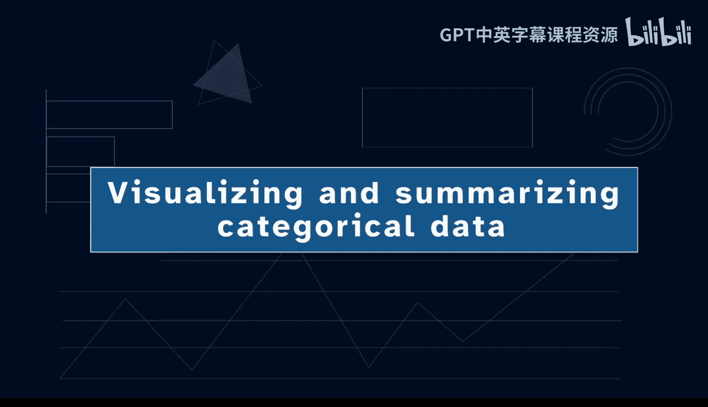
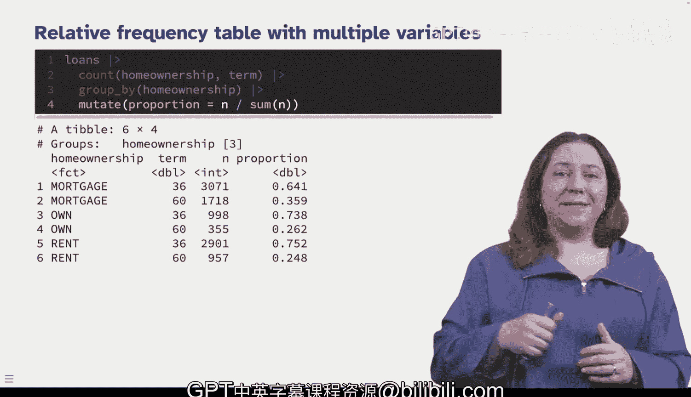

# 杜克大学《R语言数据科学｜Data Science with R》中英字幕 p11 11_03_01_分类数据的可视化与摘要统计.zh_en -BV1Zpv6BaEkB_p11-

🎼。

In this video， we're going to talk about tools and techniques for visualizing and summarizing categorical data。

 but before we get into focusing on categorical data alone， let's introduce some terminology first。

First， we'll categorize the types of analyses we're doing into three based on the numbers of variables involved。

Univevariate data analysis is the analysis of the distribution of a single variable。

 which is what we'll focus on in this video mostly。

 and we'll focus specifically on analyses for categorical variables。

 byvariate data analysis is the analysis of the relationship between two variables。

 and multivariate data analysis is the relationship between many variables at once。

 usually focusing on the relationship between two while conditioning for others。 As you can imagine。

 the last one， multivariate data analysis most closely reflects reality。

 Chances are the relationship between two variables has other variables that play a role。

 For example， your energy level for the day isn't just related to the number of hours of sleep you got。

 but also the calories you consume the amount of exercise you got， etc ce。

Our goal is to work our way up to multivariate analyses after tooling up a bit with Uniivariate and bivariate analyses。

And since we mentioned， we'll focus on categorical variables。 Let's define what we mean by that， too。

 numericalum variables can be classified as continuous or discrete based on whether or not the variable can take on an infinite number of values or only nonnegative whole numbers。

 respectively， On the other hand， if the variable is categorical。

 we can determine if it is ordinal based on whether or not the levels have a natural ordering。

 and the data we'll use for this video comes from lending club。

 A platform that allows individuals to lend to other individuals。

 The data are thousands of loans made through lending club。 Not all loans are created equal。

 The ease of getting a loan depends on the apparent ability to pay back the loan。

 So in addition to information on the loan itself like the loan amount and its interest。

 we also have some data on the borrower。 like their income and their debt。

 And know that the data well work with includes loans already made， not loan applications。

Let's load the tidyverse and open intro packages。 The open intro package contains the data we'll work with。

 It's called loans full schema。 Let's take a glimpse。 It has lots of variables。

55 to be exact and 10000 rows。 That's 10000 loans that we have information on and 55 pieces of information for each one of them。

 But we're going to work with a subset of these variables only。 So let's reduce our scope a bit。

 will create a new data frame called loans where we select 8 variables from the full set of 55。

 the loan amount， interest rate， term， grade， state， annual income。

 homeowner ownership and debt to income ratio。We'll then save this new data frame as loans using the assignment operator。

 which looks like an arrow with a less than sign followed by a dash。

 so we start with loansan full schema and then we select and we assign the result and then let's take a glimpse at it。

Here's a description of each one of these variables We have information on the loan amount given in US dollars。

 we know the interest rate in an annual percentage， we know the term of the loan。

 which is always set as a whole number of months， we know the grade of the loan。

 so a through G that represents something about the quality of the loan and its likelihood of being repaid。

 We have the state where the borrower is from， their annual income in US dollars。

 their home ownership status， whether they own， have a mortgage or our renting their home。

 and then finally their debt to income ratio。Now that we got a sense of what each variable is about。

 we can now determine whether they're numerical categorical and then further determine whether they're continuous or discrete or ordinal or not。

 So loan amount is a numerical and continuous variable。

 interest rate is also numerical and continuous， The term is numerical。

 but it's a discrete variable in whole months remember。

 grade and state are both categorical variables。 grade is ordinal， we said a through G。

 something that represents the quality of the loan while the state is not ordinal。

 there is no inherent ordering to the state where the borrower is from their annual income is numerical and continuous。

 their home ownership status is categorical， and again there is no ordinal nature to renting having an outstanding mortgage or owning your home and then finally their debt to income ratio。

 which is also a numerical and continuous。😊，All right， now that we know what the variables are。

 let's visualize some categorical data。For a single categorical variable we can use a bar plot and for that we're going to use GO bar so we start with the GG plot function。

 we pass as its first argument our data frame loans and then we say that for the X aestheticthe we want to map it to the home ownership variable and then we use the GO bar to say we want to represent our data as bars on our plot GG plot does all the calculations for you it counts how many people have a mortgage。

 how many people own their home and how many people rent their home and determines the heights of the bars based on these。

If we want to bring in another categorical variable。

 we can use a segmented bar plot and to do so we fill in the existing bars based on the values of the second variable this means we now use two aesthetic mappings we have our home ownership on the X axis。

 but we bring in a new aesthetic mapping fill and we map that to the grade of the loan。

 what we're still using the same GM， so GG plotot2 is still doing calculations both of how many people mortgage owner or rent their home and also within each one of these groups which how many people have which grade of loan。

Now let's try this with another variable term， what happens now？When we do this。

 we're getting a warning， it says the following aesthetics were dropped during statistical transformation fill。

 this can happen when Gigi plot fails to infer the correct grouping structure in the data。

 and then it gives us a useful hint， Did you forget to specify a group aesthetic or to convert a numerical variable into a factor。

 remember term which is what we're trying to fill these bars by was actually a numerical variable。

It can take on only two values， 36 months or 60 months。

 those were the two types of loans we have in this data set。

 but these were encoded as numerical data so what we need to do in order to create this bar plot is a little bit of data transformation。

What we're going to do is we're going to use the mutate function and we are going to convert the term variable to a factor note that R calls categorical data factors。

 this is a term we' come back to over and over throughout the course and you'll most definitely encounter it when you're doing your own analyses with R。

So let's first convert the term variable to a factor。

 we're doing it with a function called as dot factor， and then we do this in a mutate statement。

 which allows us to change the values in a column of a data frame。

And then we fill the bars in with the updated version of the term variable how are we using the updated version because remember the pipe operator will take what comes before it and use it in the next step。

And then we use the same GR and falla。One challenge with this plot that we made here is that the frequencies of the various homeowner levels are not consistent。

 more people rent or mortgage their homes than actually own their homes in this data set。

 so it's hard to compare rates of different terms across these levels。To do this properly。

 we need a stacked bar plot that shows proportions of different terms， not frequencies。

 and we can obtain this with a new argument in GeO bar we are saying that we want our bars to fill the entire space so we said position equal to fill so each one of these bars for mortgageowner rent now represent 100 percent of the people in that category and then we can show the proportions of those with a 36mon term and those with a 60month term within each group so in this plot we can see that among those who have an outstanding mortgage the proportion of those with a 60month term are higher than the other two categories。

So which bar plot is more useful for visualizing the relationship between home ownership and term。

 if our goal is the relationship， then we should be using the proportional plot so that our conclusions and decisions are not governed by how many people happen to mortgage owner or rent their home。

 but the distribution of different terms within each one of these categories。

Now that we have a plot we like， let's customize it a bit。 First。

 we can change the aesthetic mapping so our bars are horizontal， not vertical。

 This is simply a choice。 one of these is not more correct than the other but this is how you would go about changing the look of your plot instead of setting mapping X to home ownership where simply mapping y to home ownership and then we can add some informative labels。

 This is always good practice to add title， a subtitle a caption that tells us where our data are coming from as well as informative information for our aesthetic mappings like X Y and the color so in this case which changes the title of the legend and finally we can choose our own colors here I've simply chosen a bluish and a greenish color you can choose whichever colors you like or can use hex codes for colors or it has a large number of predefined colors that you can choose from so I've used。

It'Blue and dark green for this one。All right， we visualize the data。

 but this is only half the story。 Let's also summarize it。

 If we want to know how many people mortgage， rent or own their homes。

 we can create a frequency table with the count function So this pipeline says start with the loans data frame and then count how many times different levels of home ownership occurs in the data and the result is always a Tbble the number of rows in the Tbble is the number of levels in the variable your count and then you get a new column always called N which gives you the frequencies so we can see that 4789 people mortgage their homes while 1353 people own their homes。

Then we can add a new column to our frequency table with mutate which can allow us to now talk about relative frequencies。

 so what we're doing here is that we take the output from the earlier step and then with mutate。

 calculate the proportions using a formula of n over the sum of n。

Note that I gave this new column a new name， proportion， I really could have called it anything。

 but it's good practice to use a short and evocative name。

We can also create frequency tables for multiple categorical variables here we're count how many 36 and 60 month loans are in each level of home ownership and to do so。

 we again use the count function， but we pass it to variables， home ownership comma term。

And then we can do the same trick we use before to calculate relative frequencies。

 but we do one new thing before we use mutate to calculate the frequencies。

 we group by home ownership because I want to calculate the proportions of 36 and 60 month loans with mortgage and then with an own and with an rent separately。

 so I group by home so that my next calculation is done once per group。

So I calculate now a proportion using the same formula n over some of n so what this output is showing me is that 64。

1% of those who mortgage their homes have a 36 month loan while 35。

9% of them have a 60 month loan and similarly among those who rent， 75。

2% have a 36 month loan and 24。8% have a 60 month loan。

