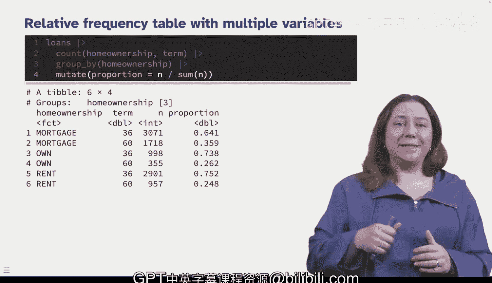

# R语言数据科学：11：分类数据的可视化与摘要统计


## 概述
在本节课中，我们将学习如何对分类数据进行可视化和摘要统计。我们将介绍单变量、双变量和多变量分析的基本概念，并使用一个实际的贷款数据集来演示如何创建条形图、分段条形图以及计算频率和相对频率表。

---

## 变量类型与数据介绍

上一节我们介绍了数据分析的基本类型。本节中我们来看看如何区分不同类型的变量。

首先，根据涉及的变量数量，我们可以将分析分为三类：
*   **单变量数据分析**：分析单个变量的分布。本节课我们将主要关注分类变量的单变量分析。
*   **双变量数据分析**：分析两个变量之间的关系。
*   **多变量数据分析**：同时分析多个变量之间的关系，通常是在控制其他变量的条件下研究两个变量间的关系。

多变量分析最接近现实情况。例如，你一天的能量水平不仅与睡眠时长有关，还与你摄入的卡路里、运动量等其他变量有关。我们的目标是在掌握了单变量和双变量分析工具后，逐步过渡到多变量分析。

既然我们提到要关注分类变量，那么也需要定义一下什么是分类变量。
*   **数值型变量**可以根据是否能取无限个值，进一步分为**连续型**或**离散型**。
*   **分类变量**则可以根据其类别是否具有自然顺序，分为**有序分类**或**无序分类**。

本节课使用的数据来自Lending Club，这是一个允许个人向其他个人提供贷款的平台。数据集包含了数千笔通过该平台发放的贷款信息。请注意，这些数据是已发放的贷款，而非贷款申请。

让我们加载`tidyverse`和`openintro`包。`openintro`包包含了我们将要使用的名为`loans_full_schema`的数据。

```r
library(tidyverse)
library(openintro)
glimpse(loans_full_schema)
```
数据集包含10000行（代表10000笔贷款）和55个变量（每笔贷款的55条信息）。我们将只使用其中的8个变量。

```r
loans <- loans_full_schema %>%
  select(loan_amount, interest_rate, term, grade, state, annual_income, homeownership, debt_to_income)
glimpse(loans)
```

以下是这8个变量的描述：
1.  `loan_amount`：贷款金额（美元），**数值型连续变量**。
2.  `interest_rate`：年利率（百分比），**数值型连续变量**。
3.  `term`：贷款期限（月），**数值型离散变量**。
4.  `grade`：贷款等级（A到G），代表贷款质量和偿还可能性，**有序分类变量**。
5.  `state`：借款人所在州，**无序分类变量**。
6.  `annual_income`：年收入（美元），**数值型连续变量**。
7.  `homeownership`：房屋所有权状态（自有、抵押、租赁），**无序分类变量**。
8.  `debt_to_income`：债务收入比，**数值型连续变量**。

---

## 分类数据的可视化

了解了变量类型后，现在让我们来可视化一些分类数据。

### 单变量条形图

对于单个分类变量，我们可以使用条形图。我们将使用`geom_bar()`函数。

```r
ggplot(loans, aes(x = homeownership)) +
  geom_bar()
```
`ggplot2`会自动计算拥有抵押、自有房屋和租赁房屋的人数，并根据这些计数确定条形的高度。

### 双变量分段条形图

如果想引入另一个分类变量，我们可以使用分段条形图。具体做法是根据第二个变量的值对现有条形进行填充。

```r
ggplot(loans, aes(x = homeownership, fill = grade)) +
  geom_bar()
```
现在，`ggplot2`会同时计算每个房屋所有权组的人数，以及每个组内不同贷款等级的人数。

### 处理数值型分类变量

让我们尝试用`term`（期限）变量来填充条形图。

```r
ggplot(loans, aes(x = homeownership, fill = term)) +
  geom_bar()
```
此时我们会收到一个警告，提示“在统计转换期间丢弃了以下美学属性：fill”。这是因为`ggplot2`无法推断数据正确的分组结构。它给出了一个有用的提示：“您是否忘记指定`group`美学属性或将数值变量转换为因子？”

记住，`term`虽然只有36个月和60个月两个值，但它被编码为**数值型变量**。为了创建条形图，我们需要进行一点数据转换，使用`mutate()`函数和`as.factor()`函数将其转换为因子（在R中，分类数据称为“因子”）。

```r
loans %>%
  mutate(term = as.factor(term)) %>%
  ggplot(aes(x = homeownership, fill = term)) +
  geom_bar()
```

### 比例堆叠条形图

我们目前制作的图表存在一个挑战：不同房屋所有权水平的频率不一致（此数据集中，抵押或租赁房屋的人比自有房屋的人多），因此很难跨组比较不同期限的比例。

为了正确比较，我们需要一个显示不同期限**比例**而非频率的堆叠条形图。我们可以通过设置`geom_bar()`中的`position = "fill"`参数来实现。

```r
loans %>%
  mutate(term = as.factor(term)) %>%
  ggplot(aes(x = homeownership, fill = term)) +
  geom_bar(position = "fill")
```
现在，抵押、自有、租赁每个条形都代表了该类别下100%的人，我们可以清楚地看到每个组内36个月期限和60个月期限贷款的比例。例如，从这个图中我们可以看到，在有抵押贷款的人群中，60个月期限贷款的比例高于其他两类。

如果我们的目标是研究房屋所有权与贷款期限之间的关系，那么应该使用这个比例图。这样，我们的结论和决策就不会受到抵押、自有或租赁房屋人数多少的影响，而是基于每个类别内部不同期限的分布情况。

### 自定义图表

现在我们有了一个满意的图表，让我们来自定义一下它。

首先，我们可以改变美学映射，让条形水平显示。这只是一个选择，无关对错。

```r
loans %>%
  mutate(term = as.factor(term)) %>%
  ggplot(aes(y = homeownership, fill = term)) + # 将x改为y
  geom_bar(position = "fill")
```
其次，我们可以添加一些信息丰富的标签，如标题、副标题、说明数据来源的注释，以及X轴、Y轴和图例的标签。最后，我们还可以选择自己的颜色。

```r
loans %>%
  mutate(term = as.factor(term)) %>%
  ggplot(aes(y = homeownership, fill = term)) +
  geom_bar(position = "fill") +
  labs(
    title = "贷款期限与房屋所有权状态",
    subtitle = "按房屋所有权状态划分的36个月与60个月贷款比例",
    caption = "数据来源：Lending Club",
    y = "房屋所有权状态",
    fill = "贷款期限（月）" # 更改图例标题
  ) +
  scale_fill_manual(values = c("steelblue", "darkgreen")) # 自定义颜色
```

---

## 分类数据的摘要统计

我们已经可视化了数据，但这只是故事的一半。让我们也对数据进行摘要统计。

### 单变量频率表

如果我们想知道有多少人抵押、租赁或拥有自己的房屋，可以使用`count()`函数创建一个频率表。

```r
loans %>%
  count(homeownership)
```
这段代码的意思是：从`loans`数据框开始，然后计算`homeownership`变量中不同水平出现的次数。结果总是一个`tibble`，其行数等于被计数变量的水平数，并且会生成一个名为`n`的新列来显示频率。我们可以看到，有4789人抵押房屋，1353人拥有房屋。

然后，我们可以使用`mutate()`在频率表中添加一个新列，用于计算**相对频率**（比例）。

```r
loans %>%
  count(homeownership) %>%
  mutate(proportion = n / sum(n))
```
注意，我给这个新列起了一个新名字`proportion`。我可以叫它任何名字，但使用简短且具有提示性的名称是良好的实践。

### 双变量频率与比例表

我们也可以为多个分类变量创建频率表。这里我们计算每个房屋所有权水平下，36个月和60个月贷款的数量。

```r
loans %>%
  count(homeownership, term)
```
然后，我们可以使用之前用过的技巧来计算相对频率。但在使用`mutate`计算比例之前，我们做了一件新的事情：**按`homeownership`分组**。因为我希望分别计算抵押、自有、租赁各组内部36个月和60个月贷款的比例。

```r
loans %>%
  count(homeownership, term) %>%
  group_by(homeownership) %>%
  mutate(proportion = n / sum(n))
```
这个输出显示：在抵押房屋的人群中，64.1%的人有36个月贷款，35.9%的人有60个月贷款。同样，在租赁房屋的人群中，75.2%的人有36个月贷款，24.8%的人有60个月贷款。

---



## 总结
在本节课中，我们一起学习了分类数据的可视化和摘要统计方法。我们首先区分了变量类型和分析类型。然后，使用Lending Club贷款数据集，演示了如何创建单变量条形图、双变量分段条形图以及比例堆叠条形图来可视化分类数据。最后，我们使用`count()`和`group_by()`结合`mutate()`函数，计算了单变量和双变量的频率与相对频率表，从而对数据进行了有效的数值摘要。掌握这些工具是理解数据分布和变量间关系的基础。