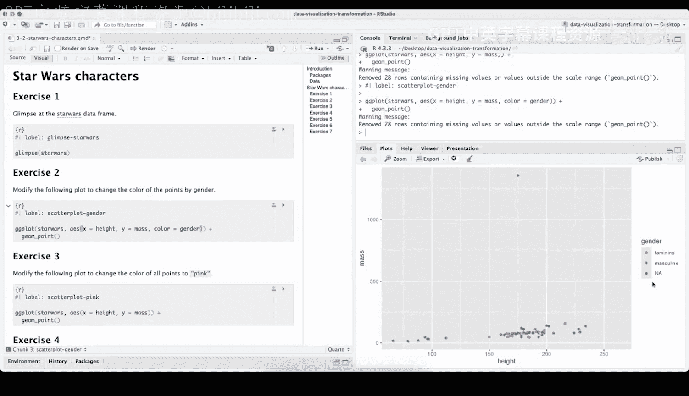
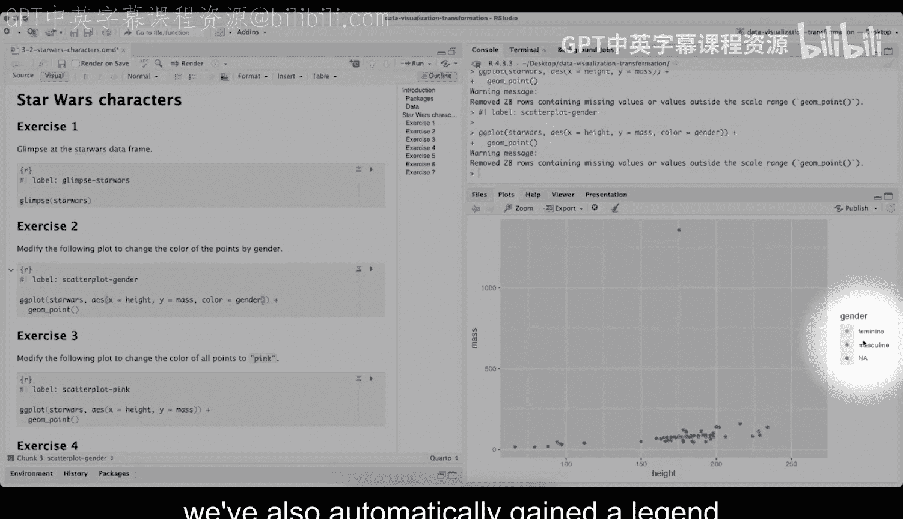
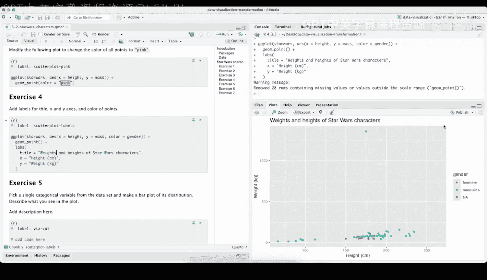
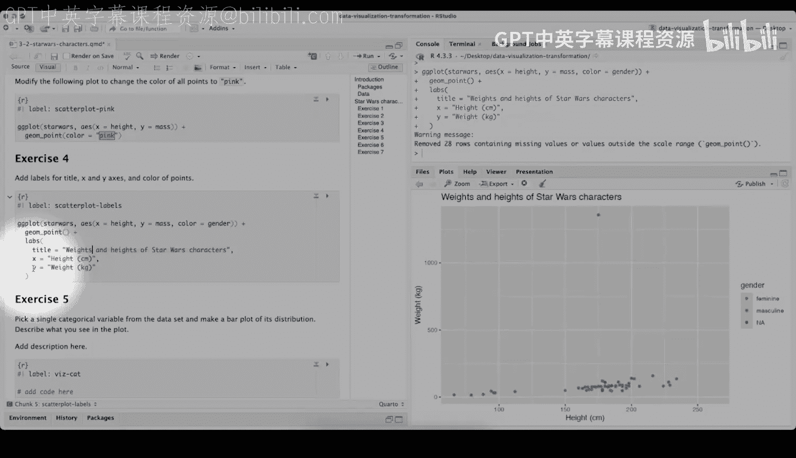
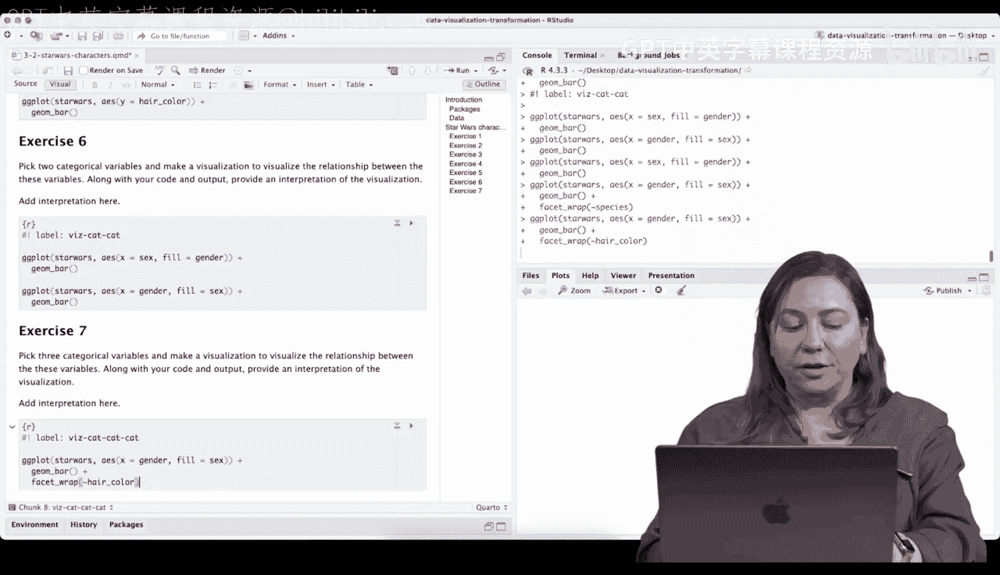

# 杜克大学《R语言数据科学｜Data Science with R》中英字幕 p12 12_03_05_代码实践：星球大战角色分析.zh_en -BV1Zpv6BaEkB_p12-

。In this code along video we're going to work with the Star Wars data frame and specifically focus on categorical variables you might not be a Star Wars fan or you might be。

 but you've probably heard of the movie franchise nonetheless。

 so the packages that we're going to use is only just one remember the tidyverse package is a meta package that brings along with it a variety of other packages and we're going to work primarily with the Gplot2 package now to visualize some categorical data。

But before we go to that， let's go ahead and take a look at the data that we're going to be working with。

 The data set that we're going to be working with is called Star Wars。 So let's take a glimpse at it。

You can see that my results are appearing both in my Quao document and in my console。

 I'm going to go ahead and close out of these and click on the gear icon to say I would prefer to use all of my chunk output in line。

And remove everything else and let's go ahead and run this one more time There we go We have 87 rows so that's 87 characters in our Star Wars data frame and 14 columns and we know a number of things about them their name。

 their hair color， their gender the vehicles they've been in so on and so forth since this data set is distributed with a package as well I can access its data dictionary by using the question mark shortcut for getting to help or going to the help menu and。

We're going to the help menu and typing the name of the data frame in this box。

 and there I can learn all about what each of the variables mean in the data。

The next exercise says modify the following plot to change the color of the points by gender let's go ahead and run this code first to see what it is that we're getting so we are plotting mass。

 so the weight of the character by their height and what we want to do is we want to add a new aesthetic mapping to this as in we want to take another column from our data frame which is the gender column which is the gender role of the character in the movie and we want to color the points by that so since we are taking a column from our data frame and mapping an aesthetic element to it。

 this is going to go in the aesthetic function so the AES function and I would say color is equal to gender let's go ahead and run that。

And we can see that we have feminine characters， masculine characters。

 and some characters with no gender assigned for their roles。

 and they're indicated by different colors in our data frame。

 and by adding that categorical variable to this visualization。

 not only have we changed the coloring in the points。

 but we've also automatically gained a legend that tells us what each color pertains to。

Next， we're asked to modify the plot that same plot that we had before。

 but by changing the color of all points to pink。 so in this case。

 we're not bringing in another categorical variable from our data frame。

 but instead we're just making what I might call a cosmetic change to our plot as opposed to an aesthetic change and in that case since we're not mapping a variable but instead setting a color that is going to go in the GO function。

And I can simply pass it on as a character string when R recognizes a color by name。

Our studio will actually change the color as well so you can see what that would look like。

And here all of my points are pink not that not all color names that you might think of are necessarily going to be recognized。

 so if I was to say dark pink for example， that's not a color that R is recognizing and therefore the color isn't changing but pink it does recognize so the difference between exercise two and exercise3 is that in exercise two we were mapping color to gender and in exercise3 we are setting color to pink。

Next we're asked to add labels for the title and X and y aes and also the color of the point so let's go ahead and run this code as well。

 this is the same plot we created in exercise2 remember that in GG plot between the layers we use the plus operator not the pipe operator so we have the plus operator here and the labels go into the labs function。

The title of my plot， I can say something like body mass and heights of Star Wars characters。

So that places that text string is the title of my plot。My X axis is height， and my y axis is mass。

 I might just call it body mass。And so let's go ahead and run these too I've added this information but that's basically the information I had that was automatically included as access labels which were you know the names of the variables that I was using in my aesthetic mapping but something that would be useful to additionally include here is what do we mean by height what are we measuring it in is it feet and inches is it centimeters and in order to be able to answer that question we need to go back to the data documentation so let's go back to our help and let's take a look to see。

Height is measured in centimeters。So。I might put that and mass is basically the weight of the character。

 so maybe to make it a little bit more human friendly to read， I will change this to say。

Weight in kilograms。 And I might update my title than to say weights and heights of Star Wars characters。

 Note that I didn't get everything right the first try。

 And what I'm doing is instead of trying to build all of the labels up one by one。

 I am adding one at a time， running my code， going back to the documentation。

 making modification and running it again。 You should not aspire to get the perfect visualization in the first try。

 instead， hopefully throughout the course， you will learn to iteratively build up to a visualization that you are happy with。

The one last thing is we may want to update the label。

For the legend， I might want to make a sentence title case with G capital or I might want to add more information to it。

 And in order to be able to do that I need to go back to thinking about where did this come from。

 So this came from an aesthetic mapping and the name of the aesthetic element was color So just like the name of the aesthetic element for the X axis was X and for the y axis was Y those are a little bit more perhaps self-evident in this labs function if I want to change the title for my legend。

 I refer back to my aesthetic mapping and I can say。

Gender and that updates it as well。 So if I keep adding more aesthetic mappings， let's try one more。

 maybe I don't want to just color the points by gender。

 but I also want their shapes to be updated by gender as well。Now I can see that I have two separate。

Legends， one for shape and one for gender， and if I want to bring them together。

 I just need to make sure that they are labeled exactly the same and now we've brought them together basically since there is no shape that can be given to an NA observation those actually just sort of went away。

Next， we get to get a little bit more creative in our exploration and actually explore the variables we might be interested in。

 Exerse 5 says pick a single categorical variable from the data set and make a bar plot of its distribution and describe what you see in the plot。

 So let's go ahead and figure out which ones are the categorical variables。

 How might we go about that。 We can look at the data documentation for their descriptions。

 I might go back and bring back my glimpse of my star Wars data set so that I can take also a look at each of the observations in my variable so I can see。

 for example， that height is not categorical。 It has numerical values but hair color is So why don't we go ahead and work with hair color。

😊，I am going to create a plot， so I start with a GG plot function。

 the name of the data set is Star Wars， and in my aesthetic mapping I can set x equals to hair color。

And the GO that I'm going to use to make a bar plot is GM bar。

So this gives me all of the possible hair colors。 We can see those stretching across the X axis in alphabetical order and the heights of these bars indicate how commonly they are there are lots of characters that have no hair。

 lots of characters with brown black or blonde hair， those are probably the human characters。

 maybe even the whites as well and there are many， many other colors that you may not necessarily see commonly that are being represented as hair colors in among the Star Wars characters if I wanted to flip my bar plot around and have my the values for my。

Each of the hair color options appear on the Y axis as opposed to the X axis。

 which can be helpful when you have longer labels for things。

 you can simply change the aesthetic mapping to say y equals hair color。

And now we get to see each of the labels a little bit more clearly as well。

 and we can see that some of the characters actually have multiple hair colors associated with them。

Next we're asked to pick two categorical variables and to make a visualization to visualize the relationship between these variables。

 so how might we visualize the relationship between two categorical variables let's go ahead and choose our categorical variables first maybe we might take a look at something like sex and gender so that's the sex of the character and their gender role in the movie。

We start with GG plotot， the name of our data frame。

 and then we need to figure out our aesthetic mappings。

I'm going to now overthink it first and say x is equal to the first variable that comes up in line。

 sex。 And then let's go ahead and make a bar plot of this。

So these are the sexes that are represented among the Star Wars characters now if we want to see within each of these sexes。

 what's the distribution of gender roles， we can say I want to fill each of the thoughts based on the gender of the character。

So here we can see the distribution alternative we can go about it the other way and say let's go ahead and copy this code and say I actually want gender to be represented on the xaxes and sex to be the variable with which I fill my bars so that gives me a slightly different visualization which one you want really depends on which distribution you're more interested in so if we wanted to talk about within given gender roles。

 what's the distribution of sexes， this would be the variable this would be the visualization that we stick with if we wanted to talk about gender roles within each of the sexes this would be the distribution this would be the visualization that we would be sticking with and ultimately the interpretation is going to depend on sort of which visualization you're interested in but I'll leave that up to you to write。

てま。To conclude， let's bring in one more categorical variable。

 so we're sort of running out of axes with which to sort of to add things in we have our X axis representing one of our categorical variables。

 we have filled those bars with the values of another categorical variable。

 what would be a way of bringing in a third variable。

One way we could do this would be by now dividing our visualization into small multiples or what we call facets。

 so we can go ahead and pick one of the visualizations we made before。

And bring in one more variable with which we facet our just we facet our visualization I'm going to go ahead and remind myself the variables that we had in our data frame。

Perhaps we may want to pick species as our third variable。

 so let's go ahead and say we want to facet and since it's a single variable we're faceting by。

We can say we want to facet wrap。Tilda the name of the variable we're faceing by。 So that gets me。

 Let's go ahead and zoom for each of the species represented the distribution of different sexes and genders。

 Now at some point， what we're seeing is that we're sort of coming to the end of like how many ways we can oetize these data in a way。

 And at some point if your sample size is not that large。

 We didn't have that many characters to begin with。 and you're bringing in many。

 many variables into your exploration。 you're not necessarily getting something that meaningful from the visualization that you produce。

 And at that point， you might want to say， okay， maybe this is not necessarily going to give me something all that useful。

 I might take my exploration another way。 but you would never come up with that conclusion。

 if you hadn't tried this before。 So don't hesitate to try it's not a problem if you。

Come to dead ends with your analysis。 you can always take that back。

 So what we can do is we can go back to our visualization and say， well。

 maybe we don't want to facet by species， maybe I want to facet by hair color。

And maybe that gives me something a little bit more useful that I can use for my analysis。

