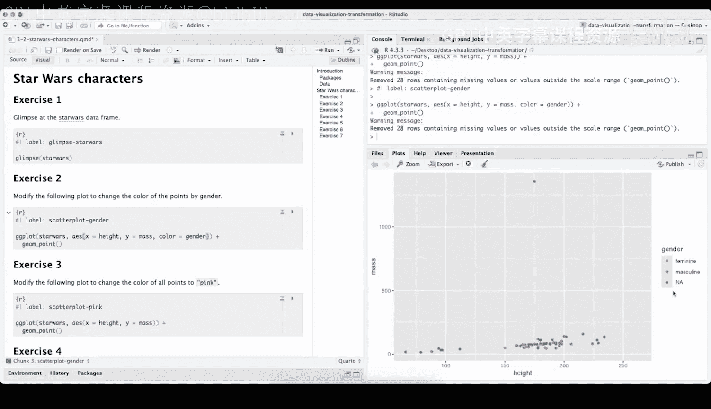
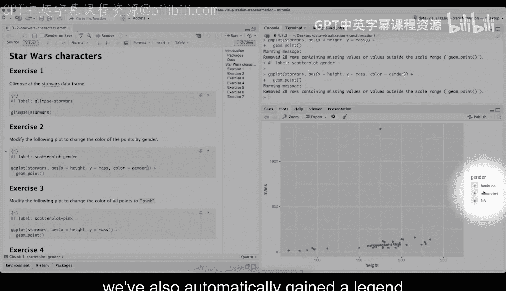
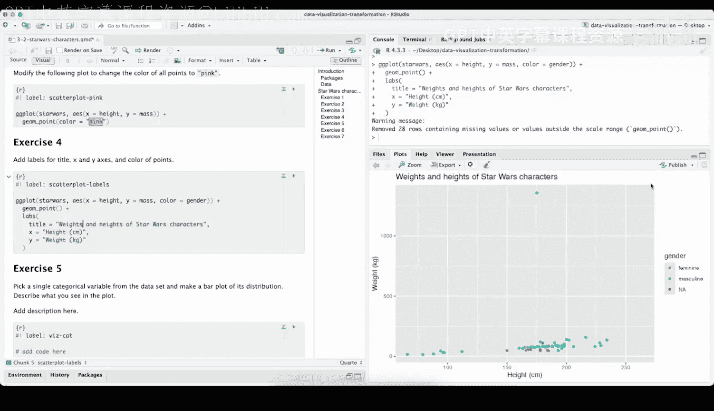
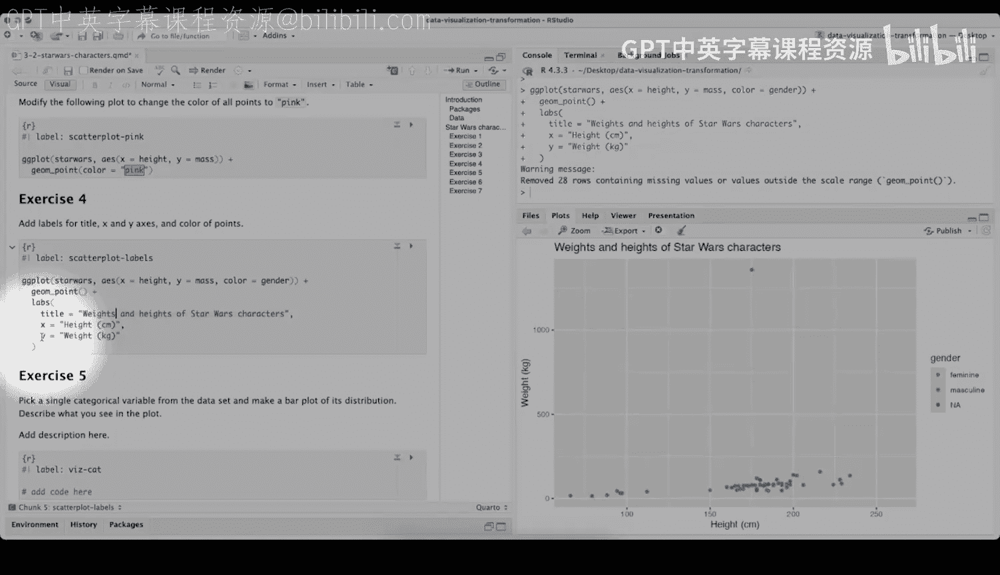
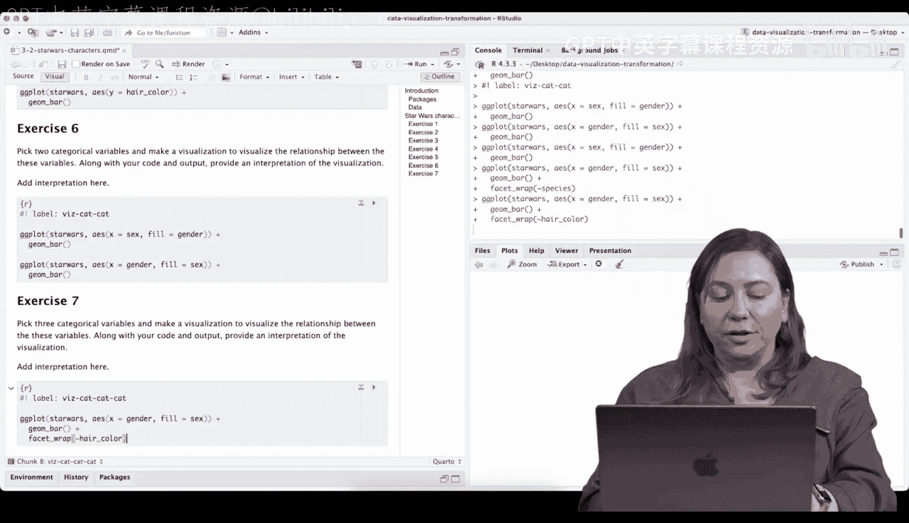

# R语言数据科学：12：代码实践：星球大战角色分析 🎬


在本节课中，我们将使用《星球大战》数据集进行实践，重点探索如何分析和可视化分类变量。我们将学习如何通过`ggplot2`包创建图表，并理解映射变量与设置固定属性之间的区别。

## 数据概览

首先，我们来查看将要使用的数据集。这个名为`starwars`的数据集包含87个角色（行）和14个变量（列），记录了角色的姓名、头发颜色、性别、驾驶的载具等信息。

```r
# 加载tidyverse包，它包含了ggplot2
library(tidyverse)
# 查看数据集结构
glimpse(starwars)
```

由于这个数据集随R包提供，我们可以通过帮助菜单查看其数据字典，以了解每个变量的具体含义。

## 练习1：按性别着色散点图

上一节我们查看了数据，本节中我们来看看如何创建第一个可视化图表。第一个练习要求我们修改一个散点图，根据角色的性别为数据点着色。

以下是初始代码，它绘制了角色的体重（`mass`）与身高（`height`）的关系：



```r
ggplot(data = starwars, aes(x = height, y = mass)) +
  geom_point()
```



我们需要将性别（`gender`）变量映射到颜色（`color`）美学属性上。由于这是将数据框中的一列映射到图表的美学元素，因此代码应放在`aes()`函数内。

```r
ggplot(data = starwars, aes(x = height, y = mass, color = gender)) +
  geom_point()
```

运行代码后，图表中的点会根据性别（女性、男性、无性别）显示为不同颜色，并且会自动生成图例说明每种颜色对应的类别。

## 练习2：将所有点设置为粉色

在上一节我们通过映射变量改变了颜色，本节中我们来看看如何设置固定的颜色属性。这个练习要求我们将所有数据点的颜色统一改为粉色。

这里的关键区别在于，我们并非根据数据变量着色，而是进行一种“装饰性”的固定设置。因此，颜色参数应直接设置在几何对象函数`geom_point()`内部。

```r
ggplot(data = starwars, aes(x = height, y = mass)) +
  geom_point(color = “pink”)
```

注意，R能识别“pink”这类颜色名称，但并非所有你想到的颜色名都有效。练习二与练习三的核心区别在于：练习二是**映射**（`mapping`）颜色到变量，而练习三是**设置**（`setting`）一个固定颜色。

## 练习3：添加图表标签

现在我们已经创建了基本的图表，接下来需要为其添加清晰的标签，使图表更易读。这个练习要求我们为图表添加标题、坐标轴标签，并更新图例标题。



我们基于练习一的图表（按性别着色）进行添加。在ggplot2中，使用`+`操作符来叠加图层，`labs()`函数用于添加标签。

```r
ggplot(data = starwars, aes(x = height, y = mass, color = gender)) +
  geom_point() +
  labs(
    title = “星球大战角色的体重与身高”,
    x = “身高（厘米）”,
    y = “体重（千克）”,
    color = “性别”
  )
```



在迭代构建可视化图表时，查阅数据文档很重要。例如，我们从帮助文档得知`height`以厘米为单位，`mass`是体重（千克）。我们根据这些信息更新了坐标轴标签。同样，要修改图例标题，需要在`labs()`函数中引用对应的美学映射名称（这里是`color`）。

## 练习4：探索单个分类变量

前面我们使用了分类变量作为辅助信息，本节我们直接聚焦于分类变量本身。这个练习要求我们选择一个分类变量，并绘制其分布的条形图。

首先，我们需要识别数据集中的分类变量。例如，`hair_color`（头发颜色）就是一个分类变量。

以下是创建条形图的步骤：
1.  使用`ggplot()`初始化，并设置`aes(x = hair_color)`。
2.  使用`geom_bar()`几何对象生成条形图。

```r
ggplot(data = starwars, aes(x = hair_color)) +
  geom_bar()
```

生成的图表按字母顺序显示了所有头发颜色，条形高度表示该颜色出现的频率。我们可以看到许多角色没有头发，棕色、黑色和金色头发也很常见。

如果类别名称较长，可以将条形图翻转，让类别显示在Y轴上，这样更便于阅读：

```r
ggplot(data = starwars, aes(y = hair_color)) +
  geom_bar()
```

## 练习5：探索两个分类变量之间的关系

在观察了单个变量的分布后，我们进一步探索两个分类变量之间的关系。这个练习要求我们选择两个分类变量，并可视化它们之间的关系。

我们选择`sex`（生理性别）和`gender`（社会性别角色）作为示例。一种有效的方法是使用堆叠条形图或分组条形图。

以下是创建过程：
1.  将一个变量（如`sex`）映射到X轴。
2.  将另一个变量（如`gender`）映射到填充色（`fill`）。

```r
ggplot(data = starwars, aes(x = sex, fill = gender)) +
  geom_bar()
```

这个图表显示了在每个生理性别类别中，社会性别角色的分布情况。我们也可以交换变量，将`gender`放在X轴，用`sex`来填充，从而观察在每个社会性别角色中，生理性别的分布。选择哪种方式取决于你的分析重点。

## 练习6：引入第三个分类变量

当我们想同时观察三个分类变量时，二维图表可能显得拥挤。这时，可以使用分面（faceting）功能来创建“小 multiples”。

我们基于上一个图表（`sex`和`gender`），引入第三个变量`species`（物种）进行分面。使用`facet_wrap()`函数，按物种将图表分割成多个小面板。

```r
ggplot(data = starwars, aes(x = sex, fill = gender)) +
  geom_bar() +
  facet_wrap(~species)
```

分面后，我们可以分别观察每个物种内部，角色的生理性别与社会性别角色的关系。需要注意的是，当样本量较小（如本数据集只有87个角色）而引入过多变量时，图表可能变得难以解读或信息量有限。探索过程中遇到死胡同是正常的，你可以随时回溯并尝试其他分析路径。

## 总结

本节课中我们一起学习了如何使用`ggplot2`对《星球大战》数据集中的分类变量进行可视化分析。我们实践了：
1.  在散点图中通过`aes()`**映射**分类变量来着色。
2.  在几何对象函数中直接**设置**固定颜色属性。
3.  使用`labs()`函数为图表添加标题、坐标轴标签和图例标题。
4.  使用`geom_bar()`创建单个分类变量的分布条形图。
5.  使用堆叠条形图探索两个分类变量之间的关系。
6.  使用`facet_wrap()`进行分面，以同时观察三个分类变量。



记住，优秀的数据可视化往往是一个迭代过程，不要期望第一次就得到完美结果。不断尝试、修改和查阅文档，是数据科学探索中的关键步骤。