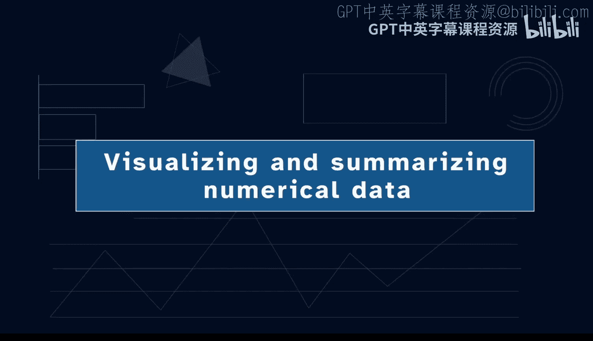
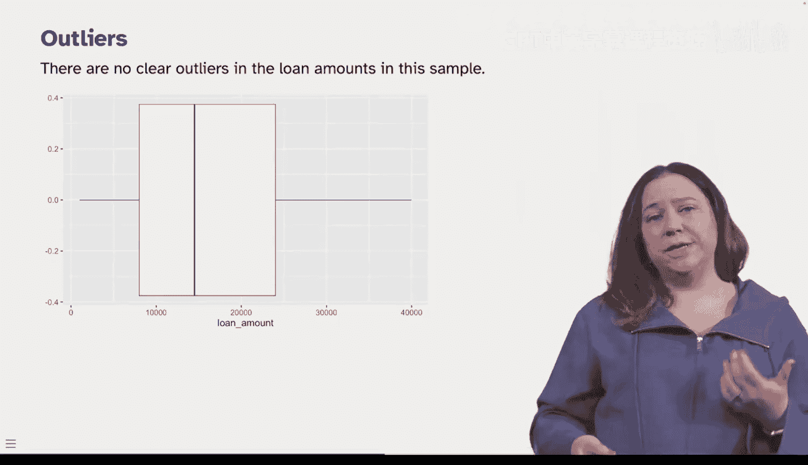
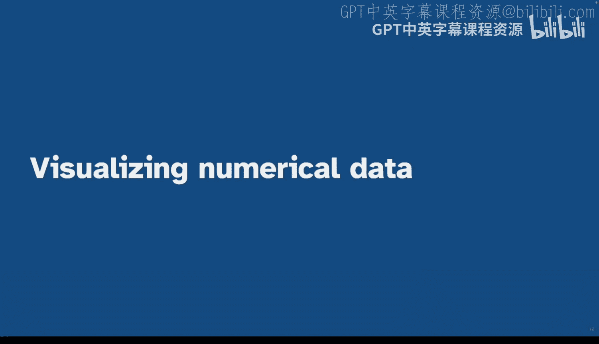
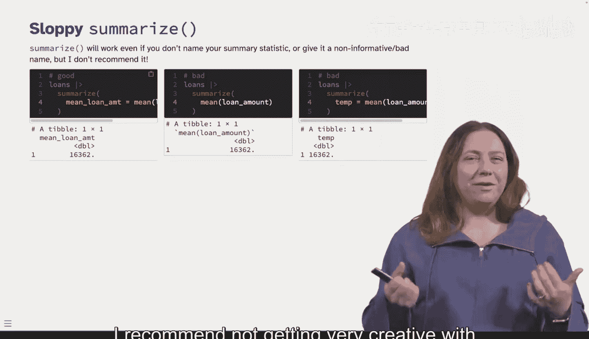

# 杜克大学《R语言数据科学｜Data Science with R》中英字幕 p13 13_03_01_数值数据的可视化与摘要统计.zh_en -BV1Zpv6BaEkB_p13-

🎼。

In this video， we introduce techniques for visualizing and summarizing numerical data。

 Let's set up our analysis。 We'll use a tidyverse package for data wrangling and visualization。

 the open intro package for the data and the scales package for pretty access labels。

 This last one is new。 I'll introduce it shortly。 Let's load all three packages with the library function。

And we'll continue to work with the lending club data focusing our analysis on a subset of the variables。

 I create this subset with select and say the result is a new data frame called Los， it has 10。

000 rows and  eight columns。First， let's introduce how we discuss distributions of numerical variables。

 the variable of interest is loan amount。 Here's a histogram of this variable。

 Pay attention to the x and the Y axises。The first characteristic is the shape of the distribution。

 When discussing the shape， we mention something about modality。

 whether it's unimotal with a single prominent hump， bimodal with two prominent humps or multimodal。

Next is the centre of the distribution。 This is generally the mean or median。

 depending on whether the distribution is symmetric or skewed for symmetric distributions。

 we use the mean to describe the centre。 While for skewed distributions。

 particularly for very skewed ones， the mean is not a good measure of the centre。

 as it not robust to extreme values。 For example， if we had one more alone in our data that was much。

 much larger than any of the other loans， the mean would be affected by its amount， but the median。

 the 50th percentile would not be。The decision of how to describe the spread is similar for symmetric distributions。

 we use the standard deviation which tells us the average deviation from the mean。

 and for skewew distributions we use the intracortile range， commonly referred to as IQR。

 which gives us a range for the middle 50% of the data。Finally。

 we mention whether there are any outliers and where they're located on the higher end or the lower end。

 If feasible， it's good practice to identify these outliers in the data and look into them to try to understand why they stand out from the rest for this be a data entry error or do the differences make sense in the context of the data。

The shape of the lo amount distribution is unimmodal and right Cu。

 You can see that we have the smooth curve overlaying it。

 And that's sort of what we want to imagine when we look at a histogram。

 I often think about the bars in the histogram as wooden blocks and think about dropping a limp spaghetti or a piece of silk over them。

 Think about how that would drape over the bars。 That's what we mean by the smooth curve。

 And imagining that smooth curve makes it a lot easier to figure out whether there is only one prominent peak or many of them and whether the distribution is skewed or symmetric。

Since the distribution is skewed， we use the median to describe the center。

 the median loan amount in this sample is $14，500， so these are smaller loans。

 they're not large home loans， for example。And the middle 50% of the loans are between $8。

000 and $24，000。Finally， there are no clear outliers in the loan amounts in the sample。

In the description of this distribution， we talked about the shape， the center， the spread。

 and outliers， we use a variety of visualizations and summary statistics。

 so next you'll learn about how to create and compute these。

Let's start with visualization。Histograms are helpful for identifying shapes of distributions and allow us to see both modality and skewness and they require a careful selection of bandwidth with and if you don't make this selection。

 G plotot2 will get set so to make a histogram I use my GG plot function。

 give it the name of the data frame that I want to make a histogram of loans and then I map the X axis to the variable that I want to make a histogram of loan amount。

 and then I use Ge histogram for the geometric object with which I want to represent my data。

And I get this message Sta bin using bins equals 30。

 So Ggi Plock2 is saying that by default it created 30 bins for your data。

 and it's telling us to pick better value with B width。Picking a B width is an art and a science。

 so let's create a plotting object we're going to call it P loans that only is created with the first line of our platform earlier。

 so it's a GG plot of loans and we have the aesthetic mapping of X to loan amount and then let's layer on our G here I've layered on a G histogram with a B width of 1000 so each one of these bins have a width of 100 so the loans within each bin are within1000 of each other。

 it looks very spiky。Next we have a B of 5000， so we grouped our loans into bins of 5。

000 and then another one is 20，000。1000 seems really spiky。

 and 20000 is giving us barely any information。 We've lumped things together so much。

 So a value in between them seems more appropriate。 We've gone with 5000 here。

 you can keep playing around until you settle on a bandwidth width that both makes sense in the context of your data and also gives you a visualization where you can identify a modality and skewness easily。

Once you have a histogram you may want to customize it a little bit so building on our histogram with a bin width of 5000 I've given it some labels like a title label for the X axis and note that I am giving the units of measurement for the loan amount and also a label for the Y axis and then I've done two more things and here I'm using that new scales package for the continuous scale on the X axis so using the function scale X continuous I've asked Gpl2 to create prettier labels for me and I don't want to go through the pan of creating these labels myself so I am using a predefined function from the scales package called label dollar and just say saying to Gplot2 but these are dollar amount so format them like dollars it gives me the dollar sign and it puts these the commas at the thousand。

Places。And for the Y axis， we're doing something similar， but on the Y axis， we only have numbers。

 not dollars， so I'm saying use a number labeled number function to create the labels for the Y axis。

 and then where the thousand dividers are， the big mark， I'm using a comma。

 some languages use periods and some languages use commas。

 so depending on the language your natural language， you can adjust this。

Another way to visualize numerical data is using a density plot these are also helpful for identifying the shape of a distribution both its modality and skewness and just like with histograms。

 you have some control over how these are created We do this using an argument called adjust just which allows us to adjust the bandwidth of our density plot so think of it as how closely do you want to follow the spiky bins versus how smooth you want your plot to be once again an art and a science and I wouldn't dwell too much on what is the correct value for the adjust parameter but instead try out a few things to see which visualization makes the most sense to you in the context of your data。

Box plots are also very helpful， they are first of all。

 helpful for identifying certain markers like the minimum， the maximum， the 25th percentile。

 which is going to be the bottom of your plot， the median， which is the 50th percentile。

 the value that splits your data into equal house that's the thick line in your box and the 75th percentile which is the upper bound of your box In addition。

 they're helpful for identifying the shape of your distribution is well， however。

 from a box plot while we can see skewewness， so wherever the whisker。

 the line is longer where that's the side in which the distribution is skewed but not modality so we don't get to see our humps anymore。

Another nice per of box plots is that they make outliers very clear。

 according to a strict definition of an outlier。 So here we have the same plot that we have started with before。

 So a plot of the loan data frame where the X axis is mapped to the loan amount。

 and we're using a new Gem Gem box plot to create this visualization。

If I want to make a visualization for a different variable。

 I would just change the aesthetic mapping， so in this case I'm making a box plot of interest rate and you can see those dots now on the higher end of the visualization。

 so these are defined as potential outliers， so these are loans with interest rates that are much higher than the other ones。

Just like we have done with a histogram， we can also customize a box plot as well。

 You're by now probably used to customizing the labels。

 I've given it a title and I've given it an X axis label as well。

 I have also turned off the label for the Y axis because on a box plot the y axis does not give us anything informative。

 This box could be wider or it could be squishier and it would be giving us the exact same information and because the y axis is not really useful in the context of a box plot I can also turn off any other markers around the y axis as well。

 remember we said earlier that we can modify theme elements for anything that's not related to our data so in this case I am setting the text for my y axis and the text for my y axis to blank elements to say just get rid of all of that for me。

We've talked about visualizing numerical data and now let's summarize it as well the summarize function returns a summary statistic for all observations in the data。

 so I can start with my loans data frame and then summarize it to calculate the mean loan amount the mean loan amount in this data set is $16。

362。I can use the summarize function to calculate multiple summary statistics at once as well。

 so here separated by comms I'm calculating two separate summary statistics。

 one I'm calling Q25 and another one I'm calling Q75 Q25 is the 25th percentile or the 25th quantile and Q75 is the 75th percentile so these are basically the values that bound my box or in other words that give me the middle 50% of my data。

Now I've used the summarize function to calculate these summary statistics。

 and Ive given them some names。 summarizeise will actually work。

 even if you don't name your summary statistic， or give it a noninformative or a bad name。

 but I don't recommend it。 So this is what we've done so far when we're calculating the mean loan amount I've actually given it a useful name like mean loan amount。

 it's longer， maybe but at least when I come back to my code。

 I can see exactly what I was calculating。 I could do the following where I can just say find the mean loan amount for me。

 I'm not going to give it a name。 you can see that R will create a new tibble for you and will label that column with the expression that you use to cal this so you get the parentheses and everything in your column header。

 which is going to be a headache to work with further down the road So this is something I wouldn't recommend。

 and another thing I wouldn't recommend would be to give it a name that doesn't really mean anything。

Temp， for example， for a temporary value Yes you're getting the calculation and you're getting the the value that you need however。

 if you were to set your code aside for a bit and come back to it in a month or so you won't be able to tell exactly what you are calculating here so whenever you're calculating these summary statistics I recommend giving them names and I recommend not getting very creative with them。

 keeping them short and evocative。😊。

