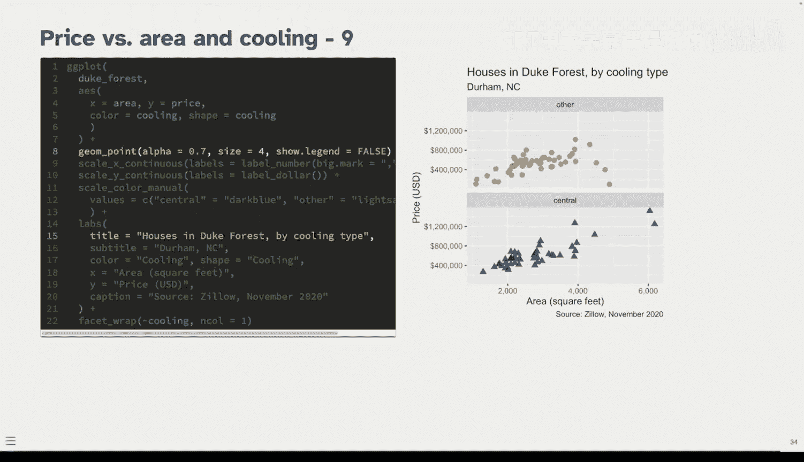
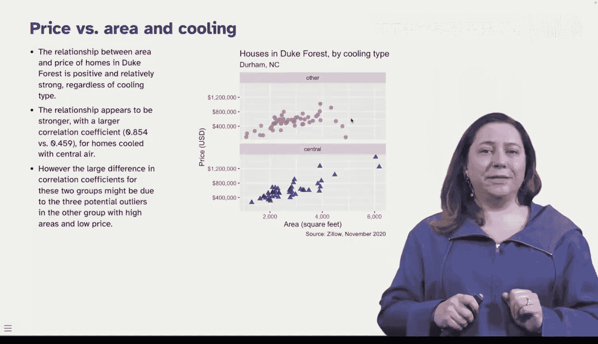

# 杜克大学《R语言数据科学｜Data Science with R》中英字幕 p14 14_03_03_变量间关系的可视化与摘要统计.zh_en -BV1Zpv6BaEkB_p14-

🎼。

In this video， we'll discuss tools and techniques for exploring relationships between variables。

Let's set up our analysis。We'll use a tiverse package for data angling and visualization。

 the open Intro package for the data， and the scales package for pretty access labels。

 let's load all three packages with library。The data we'll use comes from Duke Forest。

 a neighborhood in Durham， North Carolina， where Duke University is located to construct this data set。

 data on home prices， as well as other attributes of homes was scraped from Zillow in November 2020。

 The data set is distributed with the open intro package， and it's called Duke Underco Forest。

 Gimpsing at the data shows 98 observations and 13 columns。

What would you expect the relationship between prices and areas of homes to be positive for negative Personal。

 I'd expect positive figure the home， the more it should cost。

Here's a multivariate plot of these data， visualizing the relationship between prices and areas of homes based on their cooling type。

 whether they have central air or some other system。Let's keep this plot in mind。

 we'll work our way back to it。Let's talk about how to visualize relationships between two numerical variables and how to summarize them。

A scatter plot is a great starting point for visualizing the relationship between two numerical variables。

 we can make a scatter plot by mapping X and y aesthetics to variables in our data and then representing the data with points with geoon point。

We can also quantify this relationship with the correlation coefficient。

 since this is a summary statistic， we calculated in a summarize statement and the R function for calculating the correlation coefficient is core a correlation coefficient of negative1 is a perfect negative relationship。

 positive 1 is a perfect positive relationship with 0。667。

 This seems like a moderately strong relationship。One other aspect of the relationship we should evaluate is its form。

 specifically whether it's linear or not。 In fact， we should evaluate this before calculating the correlation coefficient。

 correlationrelation is that measure of linear association between two numerical variables。

 If the association is not linear， we shouldn't be calculating a correlation coefficient in the first place。

 Thankly here， the association does look linear。And how about relationships between a numerical and a categorical variable？

Here's a histogram of prices of houses， a unimotal and somewhat right skewed distribution。

We can bring in a categorical variable by coloring the bars based on the values of the second variable。

 by mapping the fill aesthetic to this variable。In this case， we've mapped it to cooling。

Unfortunately， the result isn't very helpful。 I find these plots difficult to make sense of。

 A better alternative is side by side box plots， which we can achieve by mapping the Y aesthetic to the categorical variable of interest。

 This display allows us to compare medians， IQ Rs and outliers across the groups。

Filled density plots are also helpful， particularly for comparing shapes across groups。

To make this plot， I've mapped the color and fill aesthetics to the categorical variable cooling。

Note that I also set a value for alpha so we can see both curves easily。

Another useful representation is violin plots， they're like box plot and density plots coming together and can be created with GM violin。

In addition to visualizing the relationship， we should also summarize it quantitatively to do so。

 we can group the data by cooling and then summarize to find， for example。

 the median home price in each group。We can also use the same approach to calculate many summary statistics at once separated by commas and informatively names。

 values such as minimums and maximums， medians and IQRs for each group can be helpful in building a narrative for describing the relationship between price and cooling type。

Next up， relationships between two categorical variables。Unfortunately。

 we don't actually have a great second categorical variable in the data set。

 so let's first create one， we'll call the new variable year built cat short for categorical。

 and its values will depend on the year built variable when the home was built 1970 or later if the house is built in 1970 or later and 1969 or earlier otherwise。

Since we're creating a new variable， we use mutate。In the mutate statement。

 we define the new variables' name， year built CA， and then write a logic for creating it using the if else function。

The first argument of the ifL's function is the condition。

If year built is greater than or equal to 1970， make year built cat 1970 or later。

 it's a character string so it's in quotes。If not， make it 1969 or earlier， also in quotes。

And assign the whole thing back to Duke Forest so that the Duke Forest data frame is now overwritten with this updated version that contains the new variable。

It's a good idea to check your work。 So let's do that by selecting the relevant columns from the Duke Forest data set。

 We can spot check that the values for year built cat are correct。

 They seem to be the first observation had a year of 1972， and it was mapped to 197 year later。

 The second one was 69， and that was mapped to 1969 or earlier。😊。

Note that to select the relevant variables， I use a selection helper。

 I selected for columns that contain the character string year built in their names。

Now we can make a stacked bar plot that shows how cooling types vary between newer and older homes。

Since there are much fewer newer homes， we can also look at proportions。

With position fill in the Ge bar。We can also calculate how many homes fall into each one of these categories using count。

 so here we're looking at the frequencies when we count ear builtil cat and cooling。

And then we can group by year built cat to create these two groups that we're interested in。

 and then within each group， we can calculate the proportions as n divided by some of it。

 It appears that for newer homes built in 197 or later， a higher proportion have central air。

 while older homes have a higher proportion of other setups for cooling。Finally。

 let's talk a bit about visualizing and summarizing relationships between multiple variables。

 the actually exciting stuff。Here's a scatter plot of price versus area of homes where each home is represented with a point and the color and shape of the points are determined based on their cooling type。

As usual， set up the plot with GG plot， specify the data name， specify aesthetic mappings。

 and specify a GeO。Then let's set a larger size and slight transparency for the points so we can see them a bit better on the plot。

Let's add some informative labels。And I'm also going to manually set colors for different cooling types。

 I chose these colors based on personal preference， but you could select a different pair。

Let's also predify access labels with label number， a function we've already learned about。

 and Y access labels with label Do。Given that the relationship appears to be linear。

 let's also calculate the correlation coefficients for the relationships between price and area for each of the cooling groups。

We do this with a group by followed by a summarize。 The correlation coefficient is a lot higher。

854 versus 0459 for the central error group。 This is surprising to me， at least as in the plot。

 the two groups didn't seem very different。 But the businessness of the plot might have made it hard to see the patterns。

 A good way to avoid over plotting is faceting。 So let's do that。

 We have a single variable where faceting by cooling。 So we'll use facet wrap with the quirky syntax。

 Tilde cooling。 Let's also place the two facets on top of each other with N co equals one to organize them into a single column。

😊。

Now that we faceted the plots， the color and shape legend is redundant。

 We can already see these labels in the facet labels so we can turn that off and gain some space to do so。

 go to the relevant Gm， In this case， a Gm point and set show legend to false。

 Note that true and false are always uppercase in R。

 we can also adjust the title to reflect this update。

 So I've now said houses in Duke For come up by cooling type。

Here's our plot one more time。 The relationship between area and price of homes in Duke For is positive and relatively strong regardless of cooling type。

The relationship appears to be stronger， with a larger correlation coefficient， 0。854 versus 0。

459 for homes cooled with central air。However， the large difference in correlation coefficients for these two groups might be due to the three potential outliers in the other group right around here。

 with high areas and low price。

