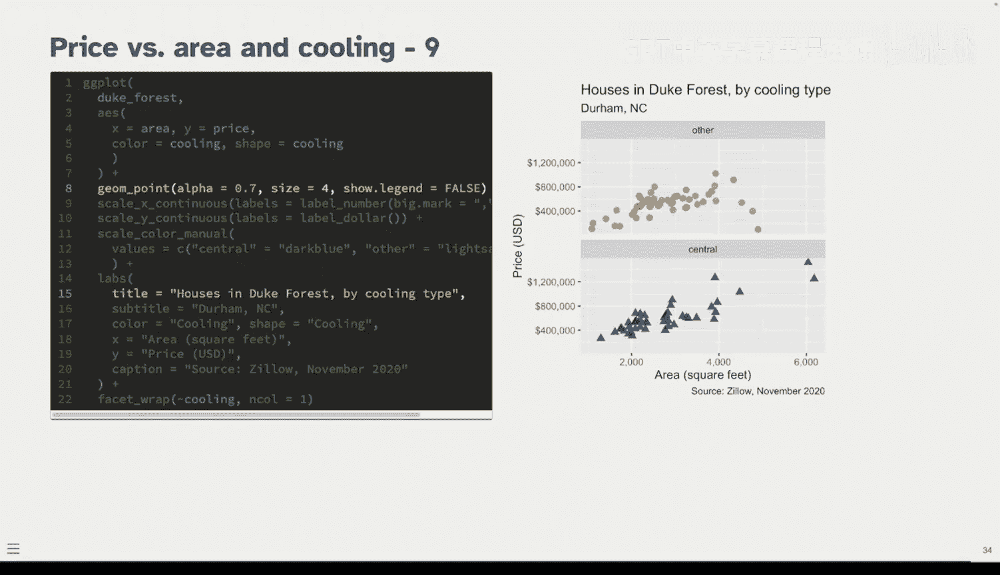
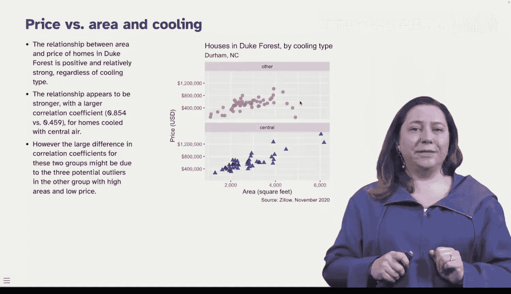

# R语言数据科学：14：变量间关系的可视化与摘要统计


在本节课中，我们将学习探索变量之间关系的工具与技术。我们将涵盖如何可视化及量化两个数值变量、一个数值与一个分类变量，以及两个分类变量之间的关系。最后，我们将探讨如何同时分析多个变量之间的关系。

## 设置分析环境

我们将使用 `tidyverse` 包进行数据处理与可视化，使用 `openintro` 包获取数据，并使用 `scales` 包优化坐标轴标签。

以下是加载所需包的代码：
```r
library(tidyverse)
library(openintro)
library(scales)
```

我们将使用的数据来自北卡罗来纳州达勒姆市的杜克森林社区。该数据集包含了2020年11月从Zillow网站抓取的房屋价格及其他属性信息，名为 `duke_forest`。

查看数据概览，可以看到它有98个观测值和13个变量。

## 两个数值变量间的关系

首先，我们探讨两个数值变量间的关系。例如，我们预期房屋价格与面积之间应存在正相关关系：面积越大，价格越高。

### 可视化：散点图

散点图是可视化两个数值变量关系的绝佳起点。我们可以通过将X和Y美学映射到数据中的变量，并使用 `geom_point()` 函数来创建散点图。

### 量化：相关系数

我们可以使用相关系数来量化这种关系。相关系数是一个介于-1到1之间的值，其中-1表示完全负相关，1表示完全正相关，0表示无线性相关。

计算相关系数的R函数是 `cor()`。在 `summarize` 语句中计算如下：
```r
cor(price, area)
```
在本例中，计算出的相关系数为0.667，表明存在中等强度的正相关关系。

### 评估关系形式

在计算相关系数之前，我们必须评估关系的**形式**，特别是它是否为线性。相关系数衡量的是两个数值变量之间的**线性**关联。如果关联不是线性的，则不应首先计算相关系数。幸运的是，本例中的关联看起来是线性的。

## 数值变量与分类变量间的关系

接下来，我们看看如何分析一个数值变量（如价格）与一个分类变量（如冷却类型）之间的关系。

### 可视化：分组直方图与密度图

一种方法是在直方图中，通过 `fill` 美学将条形按分类变量着色。然而，这种图形可能难以解读。

更好的替代方案是并排箱线图。通过将Y美学映射到分类变量，我们可以轻松比较不同组的中位数、四分位距和异常值。

填充密度图也很有帮助，尤其适用于比较不同组之间的分布形状。创建此图时，需要将 `color` 和 `fill` 美学都映射到分类变量，并设置 `alpha` 值以确保两条曲线都清晰可见。

另一种有用的表示形式是小提琴图，它结合了箱线图和密度图的特点，可以使用 `geom_violin()` 创建。

### 量化：分组摘要统计

除了可视化，我们还应该定量地总结这种关系。我们可以按分类变量对数据进行分组，然后计算每个组的摘要统计量。

以下是计算每个冷却类型组中房屋价格中位数的代码示例：
```r
duke_forest %>%
  group_by(cooling) %>%
  summarize(median_price = median(price))
```
我们还可以一次性计算多个统计量，例如最小值、最大值、中位数和四分位距，这有助于构建描述价格与冷却类型之间关系的叙述。

## 两个分类变量间的关系

现在，我们来探讨两个分类变量之间的关系。数据集中没有合适的第二个分类变量，因此我们先创建一个。

### 创建新分类变量

我们将基于房屋的建造年份创建一个名为 `year_built_cat` 的新变量。如果房屋建于1970年或之后，则标记为“1970 or later”；否则标记为“1969 or earlier”。

以下是使用 `mutate()` 和 `ifelse()` 函数创建此变量的代码：
```r
duke_forest <- duke_forest %>%
  mutate(
    year_built_cat = ifelse(
      year_built >= 1970,
      "1970 or later",
      "1969 or earlier"
    )
  )
```
创建后，建议检查新变量是否正确生成。

### 可视化：堆叠条形图

我们可以制作堆叠条形图来显示新旧房屋中冷却类型的分布。由于新房屋数量较少，查看比例可能更有意义，这可以通过在 `geom_bar()` 中设置 `position = "fill"` 来实现。

### 量化：计数与比例

我们可以使用 `count()` 函数计算落入每个类别的房屋数量（频率）。然后，通过分组和计算 `n / sum(n)` 来得到每个组内的比例。

分析显示，对于1970年或之后建造的新房屋，拥有中央空调的比例更高；而较老的房屋则更可能使用其他冷却设置。

## 多个变量间的关系

最后，我们来探讨同时可视化与总结多个变量关系的更高级方法。

### 多变量散点图

我们可以创建一个散点图，其中X轴为面积，Y轴为价格，并通过点的颜色和形状来区分不同的冷却类型。这能让我们在一个图中同时观察多个关系。

### 分组计算相关系数

鉴于关系看起来是线性的，我们可以为每个冷却组分别计算价格与面积之间的相关系数。这通过 `group_by()` 后接 `summarize()` 来实现。

分析结果可能出人意料：中央空调组的相关系数（0.854）远高于其他冷却类型组（0.459）。这表明对于有中央空调的房屋，面积与价格之间的线性关系更强。


### 避免过度绘制：分面图

散点图中的点可能重叠严重，使得模式难以看清。使用分面是避免过度绘制的有效方法。我们可以使用 `facet_wrap(~ cooling)` 按冷却类型将图分成多个面板。



分面后，颜色和图例变得冗余，可以通过在相应的 `geom`（如 `geom_point`）中设置 `show.legend = FALSE` 来关闭图例，从而节省空间。

## 总结

在本节课中，我们一起学习了探索变量间关系的多种方法：
1.  对于两个**数值变量**，我们使用**散点图**进行可视化，并使用**相关系数**进行量化，同时评估了关系的线性形式。
2.  对于**数值与分类变量**，我们使用了**并排箱线图**、**密度图**和**小提琴图**进行可视化，并通过**分组摘要统计**（如中位数）进行量化。
3.  对于两个**分类变量**，我们创建了**堆叠条形图**来显示分布，并计算了**频率和比例**。
4.  对于**多个变量**，我们通过**多美学映射散点图**和**分面图**来同时探索复杂关系，并进行了**分组相关性分析**。



通过结合这些可视化与定量工具，我们可以更全面、深入地理解数据中变量间的相互作用，为后续的数据分析与建模打下坚实基础。