# 杜克大学《R语言数据科学｜Data Science with R》中英字幕 p15 15_03_05_代码实践：深入探索帕尔默企鹅数据集.zh_en -BV1Zpv6BaEkB_p15-

We've worked with the Palmer penguins dataset before。

 but we've barely scratched the surface of exploring the penguins data frame。

 so in this code along we're going to dive deeper with Palmer penguins and try to answer questions like how the sizes of penguins vary across species across islands across sexes and what about other characteristics to do so we're going to use the tidyverse packages usual for data wrangling and visualization and we're going to introduce a new package G Bwarm as an example of a G plot2 extension package that provides a new GM that is not included with G plot2。

 but that a member of the open source our community has developed and now works really nicely with other G plot packages let's call a Bwarm plot we're going to see that in a second and we're also going to use the Palm penguins package because that has our data So let's go ahead and load our packages。

And then let's visualize， let's take a look at the penguins data frame， as usual。

 we start with a glimpse of penguins。And I'm going to， as usual。

 turn off my output here and say that I would like to see my output in console。

You are welcome to keep it wherever you like seeing your output in your quarter document or just in your console so we can see that we have 344 penguins on which we have data。

 we have eight columns of information and we also have a list of all of the variables we have available for these penguins。

Let's start with visualizing penguin weights and focusing on a single variable so analyzing a single variable is called univariate analysis of working with a single variable and we want to create a visualization of the distribution of weights of penguin so let's pause for a second and think how big are penguins what is the weight that you might expect and note that our weight is recorded in grams so you might want to pause here for a moment and think how big do I expect these penguins to be before diving into the rest of the code。

First， let's make a histogram。We start with G plot。

 the data set we're going to plot is penguins and we're making a histogram。

 so in my aesthetic mappings I set x equal to body mass grams and then。I want to make a histogram。

Here we go Here's a histogram of weights We can see that the weights of these penguins range from roughly 2500 to 6500 so grams and we also get a warning message that says remove two rows containing non-finite outside the scalar range what that means is that there were two rows for which we didn't have weight data so those were removed from our data prior to plotting and we get one other message as well。

 which says that' sta bin so the function under the hood that's first of all binning your data before it can be plotted in these bars uses bins equals 30 so it divides your data into 30 bins no matter what your data is but G plot2 is saying you should pick a better value with bin so looking at these data。

From 2500 to 6500， what would be a good bandwidth？Well， let's try something。

 What if we tried 1 thousand0。 This seems really wide。

 It's really sort of bend our data into so few bars that we don't really get a sense of the distribution anymore。

What if I was to try 10 and these are very skinny。 So that's only very few penguins at a time in each one of my bins。

 So if I want to get a better sense， I might try other values。 let's try 100。 This is looking okay。

 I might say 1 hundred and50。 that's also looking okay。 and at some point， no one could really say。

 oh 1 hundred and20 is better or worse than 1 hundred50 or 100。

 So choosing an appropriate bandwidthu is really an art in a science and you may want to think about what are some cutoff points that makes sense in the context of my data if the data context is something you're familiar with。

Or you might take a look to see。What could be a reasonable bandwidth width that will allow me to make some interpretations Round numbers tend to be nice。

 so I'm going to stick with 100 here， but really we could think of a variety of bandwidth width that would be appropriate for this visualization What we can see is that we have a right skewed distribution of weights the typical weight is somewhere around 3500 and the tail goes much longer on the positive end than on the negative end。

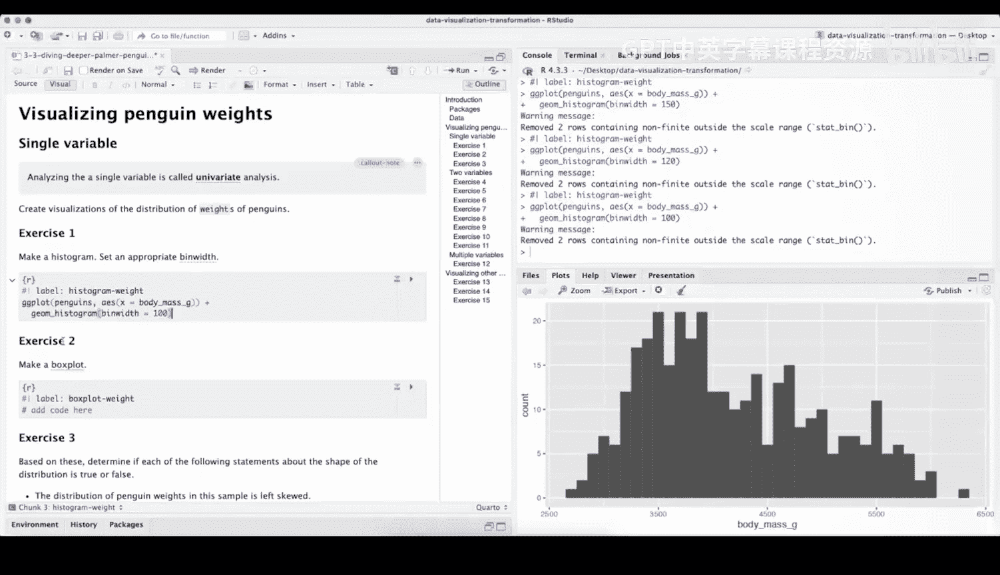

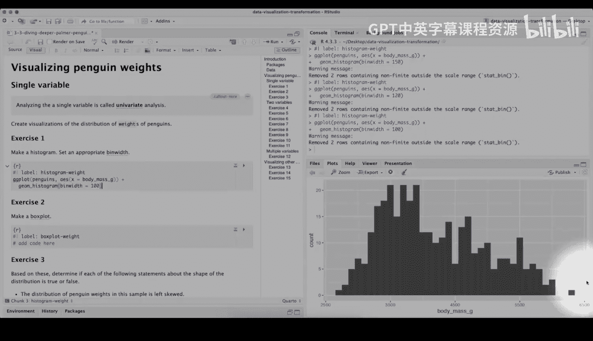

Next， we're asked to make a box plot of the same variable。

 So I'm going to go ahead and copy my code from before。

 and since it's how I change the data on my plot is what's changed。

Since it's how I visualize the data on my plot that's changing， not the aesthetic mapping。

 I would simply change my G。To be the GMO that I want for this particular visualization and the particular GMM here is GMM box plot compared to a histogram with the box plot shows me a little more easily is the median of my distribution happens to be around 4000 I was guessimating around 3500 based on the histogram but here I'm able to get a more precise answer and I can see sort of a measure of variability。

 the intercorrtile range which is the width of this box and I have a sense of how far my data reaches out on the lower end and on the higher end and importantly that we don't have any outliers in this data。

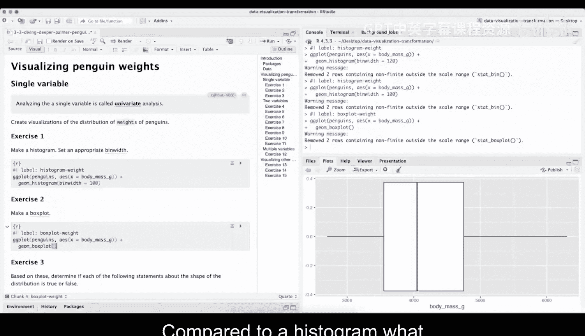

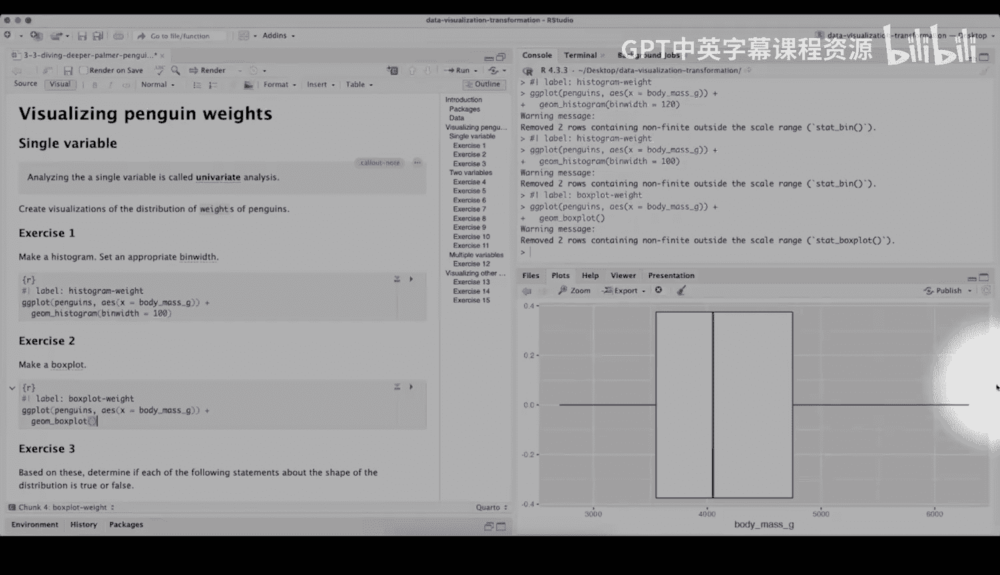

Now it says based on these， based on the histogram and the box plot。

 and I can scroll between the two of them using the arrow buttons in my ps pane。

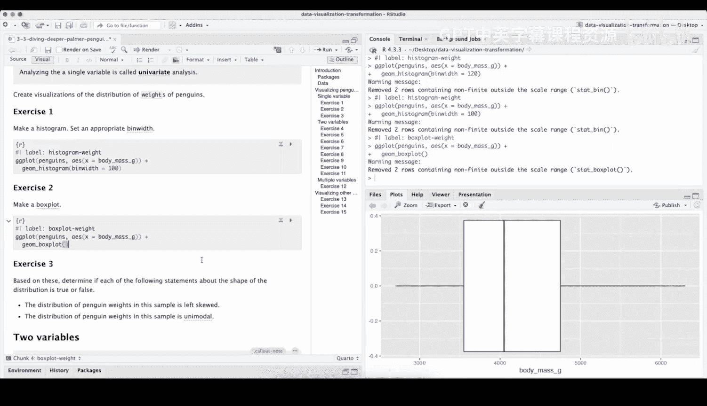

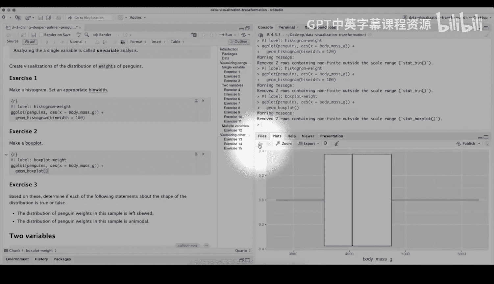

Determine if each of the following statements about the shape of the distribution is true or false。

The first statement says the distribution of penguin weights in the sample is left skewed。

 so skewness can be gleaned both from a box plot。And from a histogram and in order to be able to talk about skewness。

 what we want to be sort of visualizing in our heads is a smooth curve being fitted to this histogram you might think about it as a limp spaghetti draping over it or a piece of silk fabric draping over it and we can see that there's a longer tail to the higher end。

 so that is a right skewed distribution， so this statement is false。

The next prompt says the distribution of penguin weights in this sample is unimmodal and modality is something we can glean from。

A histogram。But not from a box plot。 So the box plot hides any of that information and makes it。

Makes it impossible to glean versus with a histogram。

 we can think about how that silk would drape over these peaks or how many apparent peaks there are in our visualization。

Frankly， it's a little bit hard to tell if the weights in this sample are unimmodal or not。

 And in order to be able to get a better sense of that。

 we may want to keep playing around with a few other bandwidths。

 So let's try something a little bit smaller。 That's not necessarily giving us a whole lot。

 Let's try something a little bit bigger。 It does appear that we have maybe one peak over here。

 And potentially another peak right around here as well。 So therefore。

 I would say this is either difficult to determine。

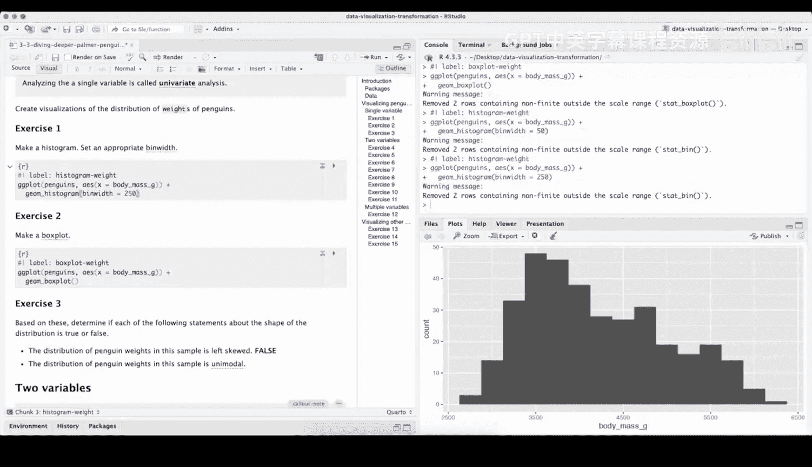

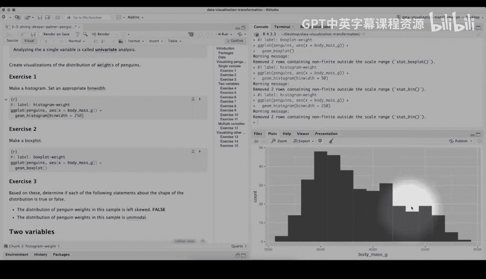

Are false。 And I am not making a。Direct sort of call here。

 What this means is maybe I would like to try to visualize my data in different ways before I can make a call。

 So another way I could go about doing that is in addition to a histogram or a box spot。

 I could try one other thing。 So let's go ahead and insert on a new code chunk here。

 I'm going to click on command forward slash to bring in my。

Insert anything tool and say that I want to insert an R code chunk and let's go ahead and copy the code we know we had working before and instead try a density plot。

So with this too， with a density plot， we can see that there is a peak round here。

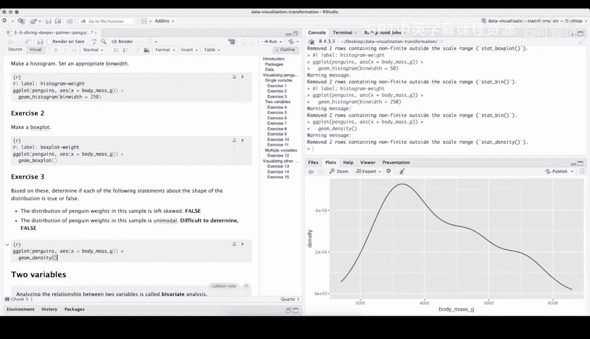

And potentially， there's another peak around here as well。

 This might be something we might want to investigate further。

 but we're not going to be able to get to the bottom of that simply by looking at different visualizations of the same variable。

 Instead， what we might want to do is bring in another variable into our exploration。

 And that's where we get to talking about the relationship between two variables also called byvari analysis。

 So we're going to stick with working up looking at weights。

 But we actually want to do so by species。 So。

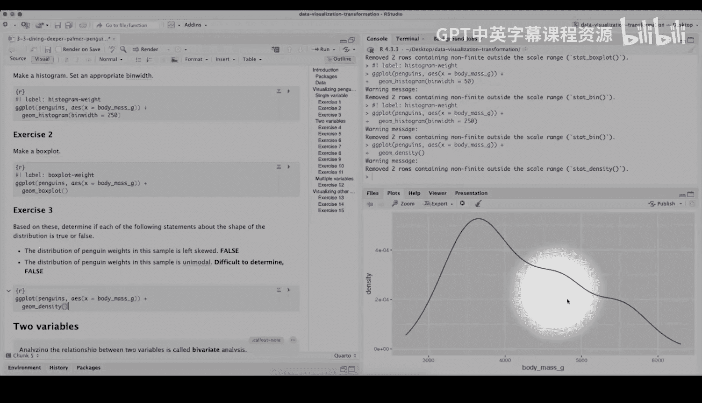

First， we may want to make a single histogram that incorporates both of these variables let's go ahead and grab the histogram code we had before。

And let's go ahead and run this real quick。And then we want to bring in the other aesthetic mapping。

 the species aesthetic mapping。 One way we can do this is we can set that to the fill aesthetic。

And what this does is it allows us to sort of。Separate the。Sorry。😔。

It allows us to fill the bars with colors representing each of the species。

 so in this case the red pinkish color is the a species， the green one is the chinstr species。

 and the blue one is the Gen2 species。The problem is that when we have a histogram like this that's filled in it's a little bit difficult to see what is happening if there are bars overlapping or not。

 so another thing we might want to do is actually split these three the visualizations of these three species into their own plots and we can do that by adding a facet so I'm going to go ahead and copy my code from before and add another layer。

lled with facet wrap since I only have one additional variable I'm bringing in and I can say I want that to be by species if I want to compare sort of the peaks of these weights for each of the species for example one thing I might want to do is stack these plots on top of each other as opposed to next to each other and I can do that by adding a argument to my facet trap function I will say n call one to say I want everything in a single column so now I can see that addeles and chin traps have peaks that are closer to each other but Gens。

 the blue one at the bottom has a peak that's a little offset from the two of them so they're on average a little bit bigger。

And that might be the reason for that potential second mode I was seeing in my original visualization of weights on their own。

Another way of visualizing the relationship between a numerical and a categorical variable so that's weight and species is using side by side box plots so let's go back up and grab the code that we had written to create a box plot it's a good exercise to sort of like get used to recycling code you have written before and then running it again to remind yourself exactly what was there and then thinking about okay how would I bring in the new piece of information here in this case if we want our box plots sort of to be stacked on top of each other by species we could say why equals species so now I have box plots for each one of my species and I can again see that the median weight for Gens is much bigger than the median weights for the chin strap and add penguins so these are just bigger penguins in general than the other ones and what the box plot shows me that the histogram did。

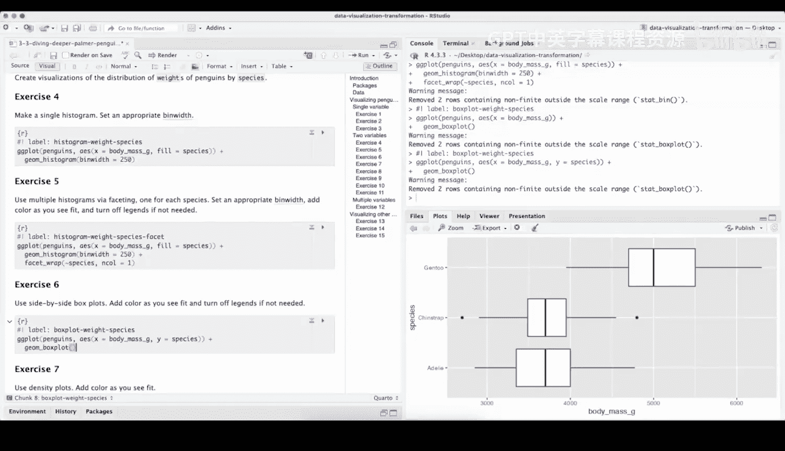

Are things like what exactly the medians are， perhaps an easier way of measuring the variability based on these widths of these boxes and also clearly indicating any outliers。

 so among the chin straps， there are some outliers。

 really tiny penguins and really big penguins for those species。

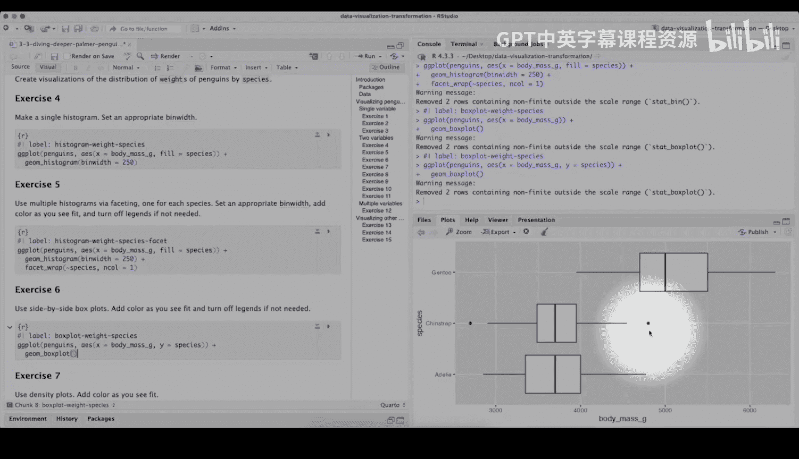

We can also add some color to this。 it's redundant， but it might be helpful。

 so let's go ahead and say color equals species as well。

And the nice thing is this brings the colors back into our visualization。

 we can do it with color or we can do it with fillil depending on which look you prefer。

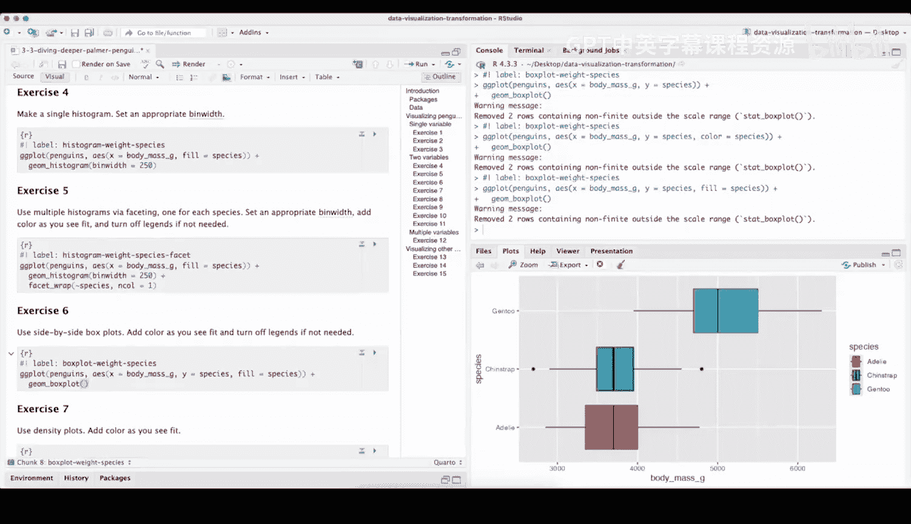

But I am here gaining an automatic legend again， which can be helpful。

 but in this case happens to be redundant because my Y axis already has that information so given that this is redundant information I could then tell Ggi plot to not to show that legend by setting show legend equals to false in my GM function so usually we wouldn't want to hide legends if that's the only information for our color mapping。

 but in this case that mapping is obvious because we have the species names on the Y axis so we can safely turn that off。

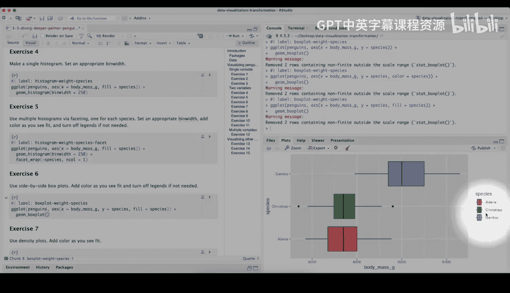

Next， it says use density plots， so let's go ahead and copy what we had。

And see what happens if we just do GM density。That did not really work。

The reason why it did not work is that while on the X axis we have body masses。

 the y axis of a density plot is meant to be the density value。

 That is something G plot2 should be calculating for us So one thing I might recommend here is to say。

 okay， that didn't work So I'm going to backtrack and make a univariate plot first so just the density plot and then think about how could I bring in this third piece of information I don't the second piece of information sorry I don't want to change the y axis that something G plot2 is calculating but I could bring in the species information with perhaps the fill aesthetic。

This works it gives me different density curves for each of my。Species， however。

 they're sort of covering each other up so I'm not able to see exactly what's happening with the addellies that are sort of stuck behind the chin straps so I might add an alpha level that's a little bit smaller saying that we want these curves to be transparent。

 not completely opaque And remember in this case we're not mapping the alpha level to another variable in our data frame we're just setting a default value for it so now we can see the ade curve behind the chin strap curve as well and you can keep going with this。

 you can say maybe you don't want those black outlines so you want to color by species as well so this way you're getting both the outline color and the fill color to be exactly the same。

In this case， we wouldn't want to turn off the legend because we don't have other information that tells us which species map to which color so that's something we would want to leave there。

Violin plots are another way of visualizing the relationship between a numerical and a categorical variable。

 so let's go ahead and copy what we had working for us before and let's see if G。Violin just works。

It doesn't， so whenever you run into something like this。

You might want to either try to decipher the error itself or go back to first principles and say。

Let me take away the various aesthetic mappings that I had。

And now I'm getting another error as well and then I might say。

 well let me try another aesthetic mapping that might work so let's try to map species to why and now I'm able to see something just like the box plot so viin plots are similar to box plots but instead of showing the quantile so the 25th percentile the 50th percentile median and the 75th they actually show the density so they're in a way bringing together the density plot information with box plot information together and they're basically mirror images on either side of the density plot so the presentation is a lot more like a box plot but I'm actually able to glean things about our modality as well。

And again， if I wanted to， I can bring in other aesthetics to this， I can say。

 let's also color by species， let's also fill by species。

 let's perhaps make things a little bit more transparent and in this case。

 because the legend is a bit redundant， we already have the species information on the y axis。

 I could say show legend equals false。The reason why I'm running through these options is that I am trying a new setting or a mapping and running the code again。

 so instead of trying to build up to a complete plot。

 Im changing one thing at a time running my code， if I'm happy with it。

 keep going if I'm not happy with it backtrack until I get to a point where I'm happy and my code is running without an error and then keep moving forward again。

Another way we can visualize these data is with a jittered scatter plot。

 But before we jitter things and talk about what that means， let's actually make a scatter plot。

 We've made scatter plots before。 So let's make one more time here。

 We're going to make a scatter plot of penguins。 on the X axis。 I have body。Mass G。

And let's say G point and see what that gets me。So right now， if I just say。

So make a scatter plot for me with just body mass。 I'm again， getting an error。

 which tells me I actually need to bring in another aesthetic mapping to this。

 Let's go ahead and try what has worked for us before。

And now I can see that I am actually seeing a scatter plot it usually requires two aesthetic mapping。

 something on the X axis and something on the y axis in this case。

 the thing on the y axis happens to be a categorical variable。

 buts very difficult to see what is going on with these data。

 even if I was to set an alpha level that's a little bit lower than one where maybe I can start to see where the points are a bit denser。

 perhaps around here compared to not so dense here， it's still difficult to make sense of。

 so something like Gome jitter。Is going to basically allow me to move these data around a little bit so jitter the data around so that I can avoid that overping I can move things around a little bit as well。

 so let's make species R X aesthetic and body mass our Y aesthetic。So that's the same visualization。

 but stretch across the x axis as opposed to the y axis and what is happening here？

This doesn't mean that the penguin that's on the higher end of the Gens is more of a Gentu penguin than perhaps this penguin that's on the lower end all it is is the points are being randomly jittered around to avoid over plotting and I'd like you to pay attention to the plot window now as I run this code over and over again。

We can see that we're seeing roughly the same patterns。

 but the position of the points move around because we're adding a random noise every time we j the points。

 That means that if I was to render this document。 So I' am writing a report about the weights of penguins and how they are distributed across species。

 And in order to be able to visualize these data properly。I am using a G jitter。

 and this is what my plot looks like the first time around。 If I render it again。

 the plot is going to change ever so slightly。 If I render it again。

 the plot is going to change ever so slightly again。

 And that might be something I may not want to do And therefore。

 what we can do is we can say before we do anything that adds a bit of randomness to our analysis。

 we can set a seed， which basically means that we would want the same randomness to be applied。

 every time we render the document， and doesn't really matter what number you put it。

 It's basically a way of giving a random seed for R to get started with in calculating random values to be added to our body masses and to jitter the the points across the X axis as well。

 This time every time I run my code， I get。The exact same jittered version。

 and every time I render my document， I'll get the exact same jittered version as well。

One more plot again， looking at the same thing， but this time we're making bewarm plots。

 so let's go ahead and copy the code that we had working before and let's take a look to see what Geome B swarm gives us。

So the name of these plots come from， they look like bees swarming basically around and in a way this is doing a jitter。

 but it's doing it in a particular way where there is more of the points that are being jittered around where the density is higher as opposed to where the density is lower and this might be it's like a helpful way of bringing together something that looks like a violin plot with something that looks like a scatter plot。

Again， we can add things like color。And we can decide， I don't need this additional legend。

So make show legend false， I can even add things like。Shape。

As well if I wanted to have some sort of double encoding for color and shape。

Al right our last way we're going to visualize these is by using multiple geos on a single plot and we says be deliberate be deliberate about the order of plotting so let's take a look we said that these bewarm plots were basically like violentol plots as well so maybe we can go back up。

And grab our violin plot code。Run that。😮，And then see what happens if we add a G E swarm to this as well。

So we can see that we're able to sort of。Visualize the same data using both of these。

 I could probably keep going。 I could add a Gm box plot， as well。But at some point。

 the order becomes such that my boxes， which are now filled in with the color of the species。

 are covering up the layers that are underneath them。

 So what if I wanted to say I don't want my boxes to be colored or filled in with these colors。

 Then instead of defining my aesthetic mappings at the global level。

 I would need to bring them down to the local levels。 So I could say for my violin plots。

 I do want my color by species。And my fill。By species as well。

And let's get them out of the global layer here。😔，I could say that for my be swarm plots。

 I want the same thing as well， but for my box plots， I don't want those aesthetic mappings。

 the only aesthetic mappings that are common to all three layers are body mass on the X axis and species on the Y axis。

 So I get something like this。 This is not necessarily much better。 So I can start experimenting。

 Maybe I actually don't want my violin plots and see what this gives me， or maybe I want to say。

 I would like to put the box plots in first， and then add the B swarm plots on top of those。

 And if I'm doing this， I might want to say， maybe we should actually go ahead and make color the same color by species a feature of all of these geoomes。

But only the ph aestheticthetic being applied to the be swarm plot。

So we can see that this is not giving us any errors， but let's try one thing。

 I'm going to go ahead and actually remove this aesthetic mapping。

We're getting exactly the same plot。 The reason for that is that the shapes that we're using for plotting these weights do not actually have a philathetic。

 So G G plot2 is happily ignoring that。 So what happens as you're iteratively building up these plots is that sometimes you end up with code that's actually doing absolutely nothing。

 but also not giving you an error or a warning or a message either。

 So it's good practice once you're done with your iteration to go back and critically look at your code to see are there bits and pieces that I've left here as artifacts of things I've tried along the way that I actually want to move out。

All right， now let's go ahead and bring in one more variable it said facet the plot that you just created in the previous exercise by island and adjust the labels accordingly so let's go ahead and grab the plot that we have created。

And we want to facet it by a variable， a single variable we're faceing by。So let's say facet wrap。

By island。And now we're able to see the distribution of weights of different species of penguins across each of the islands。

 we're also seeing that some islands have certain species and not the others for example。

 in Bisco Island， we have Gen to an Adeee species versus in dream Island we have Chinstrrap and Adeide and ingerson Island。

 we only have penguins from Adeide species Since this is a plot for comparing the body masses across。

 I would say it would make sense to actually stack these on a column as opposed to a cross rows so that we can see how the distributions compare across the islands。

And we can then add。Labels to our visualization， our X axis is the weights in。Frams。

Our y axis is species。Our。And let's maybe give it a title。This is weights of penguins。

Across species and islands。And in addition， I could do things like turning off the legend since that's redundant information with show legend set to false for both of the layers of Ges that I have。

Let's take this opportunity to pause for a moment now that we've visualized 1。

2 and three variables at a time and render our document when we render our document and we're scrolling through it and I'll actually pop it out。

 I'd like you to pay attention to the sizes of the figures。 You can see some of them are really。

 really giant。 and also note that we have a bunch of warnings that are being repeated over and over。

 and the same warning is being repeated over and over because we have some penguins in the data set that are。

That we don't have weights for。 So we're getting the same warning for each one。

 While it's never a good idea to ignore warnings。 once you've read through a warning and you've decided。

 I'm good with this。 I am okay with visualizing the data as is you can actually decide。

 actually want to turn off that warning。 And if you want to turn off that warning。

 Let's go back to our first exercise for a single plot。

 We can add a new code chunk to say warning equals false。Let's do that for our second one as well。

 so I am clicking on the line break here， I'm adding a new option called War and as soon as I start typing our studio suggests some options for me and then it suggests what the values this chunk option can take I want it to be false and if I render my document I will see that the warnings have been turned off for the histogram。

And the box blocked， but for the remaining visualizations there there。

And if I wanted to instead turn it off for all of my visualizations。

 I can go up to the very top of my document。ActuallyI can go up to the very top of my document and I can say that I want to add an execution option。

Where warning is set to false and when I render my document that's going to apply to every single one of them。

 I can also give other options， for example， I can give an option for figure width。

 let's call it six inches， I can give an option for an aspect ratio will choose a visually pleasing aspect ratio that will now apply to every single one of our visualizations。

And we can see that they're not taking up as much space now and then if for any given visualization。

 I would like to change things， I can go back to it and give an individual chunk option。

 say I would like the aspect ratio for this to be smaller maybe let's call it 0。

3 so that's the aspect ratio between the height and the width of the plot and if I render my document。

I can see that I get a much skinnier box plot。I will leave this here for the code long video for exercises 13。

 14 and 15， you can pick a single categorical variable。

 two categorical variables and then make another plot that uses at least three variables and continue your exploration。

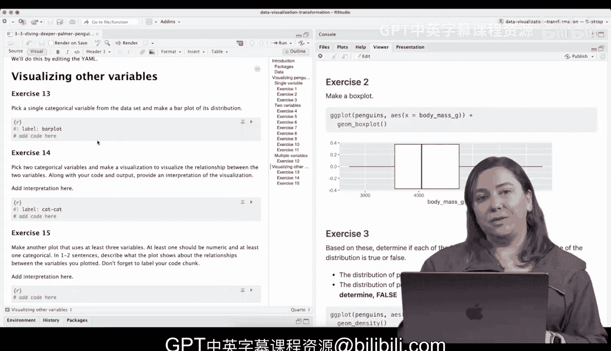