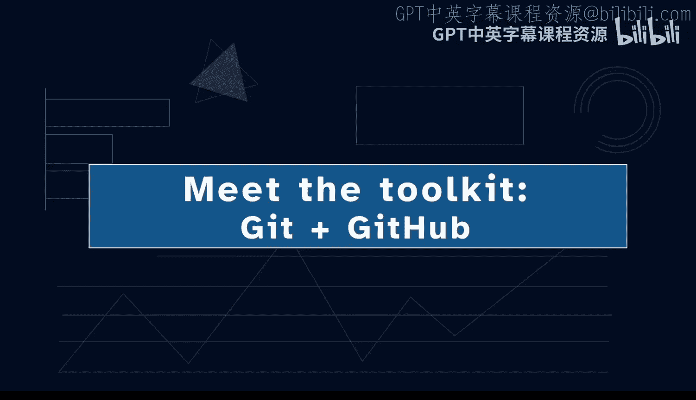
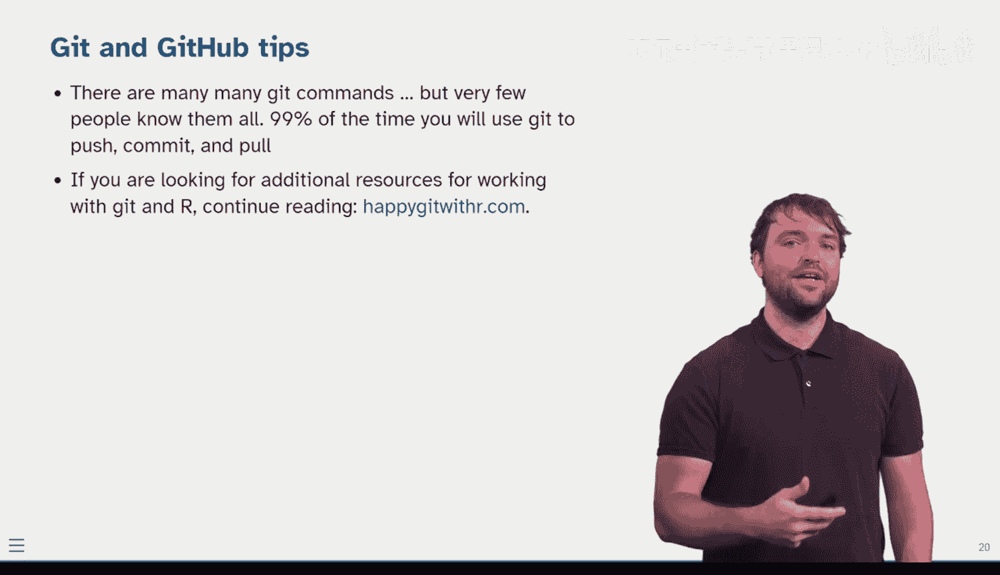

# 杜克大学《R语言数据科学｜Data Science with R》中英字幕 p16 16_03_01_认识工具：Git与GitHub.zh_en -BV1Zpv6BaEkB_p16-

🎼。

In this course and throughout the specialization， we learned a variety of techniques to visualize and transform data in R in this video。

 we'll introduce the idea of version control and how to implement version control into your workflow。

Start things off， let's review our learning goals。By the end of this course。

 you will understand the importance of version control。

 understand how we use Git and Gitthub for version control。

Set up a configure of personal access token， so GitHub and our studio can communicate with each other。

As well as you will understand how to clone your course project。

So what is version control Vi control is the process of tracking and managing online documents。

 allowing you to see what changes you and others are making。

There are both good and not so good ways to go about this。Take this cartoon for example。

 where a graduate student is working on some final document， they get edits from there。

 let's say advisor， they go through this process and many iterations later。

 they have nothing but a me fileses， comments and suggestions that are near impossible to keep up with。

 which really isn't all that useful for us for them。

I like to think of good version control as building a Lego house where in one place each step you record and track what is happening so the process is easier to follow。

If you wanted to quickly see a change someone else made in a file or revert that file back to a previous step。

 it's going to be a lot easier if things are organized like this。

This process becomes even better and easier to track if you have short readable messages that describe what has been accomplished at each step。

For example， you see in step  two has the message build back and front of base。

 which could be a useful message to others you are working with or to yourself when coming back to the project。

And when you are using Virgin control， you get to decide when to make these messages appear。

 This could be after you've written a paragraph or just created your visualization。Now。

 the version control software that allows us to do this process well is called Git Git is a popular version control software。

 especially in the statistics and data science community。

 and can often be thought of as similar to track changes in word。

 but has many more user functionality that may be helpful for us。We are also going to use GitHub。

 which is a cloud based hosting service for all our Git projects。 It's similar to Dropbox。

 but also has much more user functionality that may be helpful。😊。

Your course project will be found on GitHub。So let's take a tour of Github In this tour。

 we're going to walk through how to generate and configure your personal access token with our studio。

 clone your project， and then walk through a demonstration on how to use version control when working on a document。

Let's take a tour of Github and our studio。 And here we have this project repo that is hyperlinked。

 This is where your project is going to live within the data science with our organization and the first thing that we need to do is we need to make sure that we have a Github account。

 And so if you haven't made a Gitthub account yet， you can go to Github。

 com and follow the instructions and do so。 and then once you're logged in。

 you're going to see your little icon up here， pop up in the top right。

 Once you're logged in to Gitthub。 what we're going to do is we're going to take this repository and we're going to become the owner of a cloned version。

 So to do so we're going to click use template and create new repository。

What we need to be careful of is that we need to make sure that we are the owner。

 So this is where your Gitthub username is going to show up。

 You're going to be the owner of the repository。For your project one。What we suggest is。

 we suggest naming this。Repository， the same thing。As it's called up top within the organization。

 I'm going to take demo to the end of mind。 And then what we're going to do is we're going to decide if we want to make this a private repository or a public repository。

 and then we're going to click create。And now we're going to see that exact same project repository。

But we're going to be the owners of it here。Now that we have our personal repository。

 we are going to outline the steps needed to configure Git in our studio。First。

 open our studio and install the use this package by typing the first line of code you see here in your console。

Next， we are going to use the use Git config function from the use this package。

Please type the second set of code seen here in the console。

 making sure to replace the sample text with your actual name and associated email address。

What we're now going to do is we're going to create our personal access token so GitHub and our studio can communicate with each other and we can work on all of these files locally in our studio。

So to do that， like I said， we'll need to set up our personal access token and to do this。

 we're going to use a function from the use this package。And it's going to be create GitHub token。

And when we run this in our console， it's going to pop up a website that's going to allow us to make this personal access token。

Now， the first thing that we're going to do in creating this token is we're going to describe its use。

And so I'm going to say this is a project demo。And then we can set an expiration date， GitHub。

Often suggest setting an expiration date that isn't no expiration。

 You can think about this personal access token as a password that allows these two programs to communicate with each other。

 So 30 days， 60 days，90 days， something in there。 and then we have these scopes and GiHub selects scopes that are recommended for you and for the purpose of the project。

 everything that GitHub recommends is going to be useful。

 these scopes are going to allow us to clone repositories， push to repositories， things like that。

And once we have this all taken care of， once we've described our personal access token。

 once we've set this expiration date， we're going to generate this token here。 Now。

 this token is going to be different for everyone。And what we're going to do is we're going to copy this token to paste it in our studio in just a little bit。

Once we've clicked these double squares and copied this personal access token。

What we're going to do is we're now going to configure it with our studio。And to do that。

 we're going to go back to the count console。We're going to use something in the git crreeds package。

Specifically， we're going to use Git crrez set。 And once we run Git cred set in the console。

 it's going to prompt us to enter that password or token。

You're going to then paste that password into here。Click enter。

 You're going to see then our studio adding those credentials。

 removing any credentials that anyone may have had， and then it's going to be done。

 And when you see done，We know that it worked， and we know that now our studio and Github are configured。

 and we can clone repositories from Github locally on our computer and work with those files through our studio。

 So now that we have access to do that。 let's demonstrate how to do that。

 So if we go back to our own project repository where you can see that I'm the owner here。

 We're going to click code。We have H TTPS， and then we're going to copy this URL here。

We're then going to take that information， and we're going to create a new project。 Now。

 a new project can be thought of as your own personal file for the project that we're cloning from Gitthub locally。

We're using version control。 So we're going to click that。 There's Git。

 and that's what we're working with and cloning from Git and Gitthub。 And then once you click Git。

 it's going to prompt you to paste in that repository URL。 Once you do this。

 it's also going to give you a project directory name。

 And it's going to ask you where you want to save this locally on your computer。

I recommend having some sort of reos file where you can save all of your different repositories that you're going to clone through this entire specialization。

I'm then going to click， create project。And now that I've created the project。

 I have all of these different files here that were initially on that Github repository。

And I can click one， and I can interact with it in this our studio window。

Now that we have our project cloned。What I want to do is I want to demonstrate how to use Git for Ver control in this setting。

So the first thing that we can notice is in this environments window up here， we have this git tab。

 and this git tab has commit。Pull and push。 Now， the first thing that we often want to do is we want to pull when we open a new project。

 Now， this is not necessary when we first clone a project。

 but it's really nice to get into the habit of always pulling as you open up a project。

 because what pulling does， is it makes sure that all of the files that you have here to work on locally。

😊，Match exactly with the files that are on this repository。 So it's extremely important to pull。

 especially if you are working in a group setting。Once this is already up to date。

 we are ready to make changes and work in these documents here。

 So the first change that I'm going to make is I'm going to change the author。To my name。And then。

 I'm going to save。This document。Now that I've made a change and I've saved that change in this git panel。

 we can see that this index QMD has now popped up。Let's say I want to save this change。

We can think about the commit button as like a save button。

 or we can think about the commit button as where we want to build another piece of that Lego house and add an appropriate message。

And so in this commit window， I can see the index QM D。

 It's going to show what I deleted here in the red line， what I added here in the green line。

 If I like those changes， I'm going to stage those changes。

 which is preparing them to be pushed up to the Github repository。

I'm going to add that useful message。Saying I added my author's name。

 and we're going to save it or commit it。And now we get this message saying your branch is ahead of the original by one commit。

 meaning what we have here is different than what's up on that repository that we cloned。

 But now we're going to push。These changes up。It's going to take a second。And now。

 that message goes away。We no longer see the index QMD here。 and if we go back。2。Our repository。

And refresh。We can see that。Useful message that we added。

 as well as we can see that the index dot QMD was changed right now。 which is great。

So this is the general workflow for good version control。

And you're encouraged to use good version control and practice good version control throughout the entirety of your project。

Now， one other thing that I want to show you and another reason why we're using Gitthub is that we want to afford the opportunity for you to use these projects as proof of worker to have them linked to your C hosted on a live URL。

 so to set that up what we're going to do is we're going to again。

 be in this personal repository that you own。Going to go to settings。And then， pages。

We have deploy from branch here， and we're going to click main and save。

This is going to be able to host your project and all of your hard work on to a live URL for you to show off after we click save。

 we can go back。To our repository here。And in order to grab that URL。

 we're going to click this little gear icon。 And we can say， use your Github Page website。 Yes。

 it's going to auto generate it for you here。 and we're going to click save changes。Now。

 this URL is not going to work right away。We can actually click this actions tab here and we can see that it's building our website right now。

It takes one to two minutes， possibly， but after it's done building the web page。

You'll be able to click that link。That we have here and you're going to be able to see your project。

Let's recap。 The first thing that you will need to consider is making a Gitthub account。

 There's a link provided here， and there's advice for picking a username。

 including using your actual name， making your name timeless。

 and picking a username you are comfortable showing your future boss。Next。

 what we need to do is we need to make sure that you own the project repository。 So again。

 here's a link for the project repository and what you're going to do is you're going to click Use templatelate。

 create new repository and make sure you're the owner and then when you're becoming the owner of that repo。

 we recommend naming that repository the same name as the original。Next， in the console。

 run the following two lines of code to generate and configure your personal access token。

 As a reminder， create token， generates a token for you to copy and Git creds prompts you to paste in your token so our studio and Gitthub can communicate。

Once everything is configured， what we need to do is we need to clone our repository。

The first thing that we do is we click code。H T TPS。 and then we're going to copy that URL。

We're then going into our studio， clicking File， New project， Vi control， Git。

 and then pasting that URL when prompted to create your clone your repository。

Now that you have cloned your project and have working documents。

 you can practice using proper Vige control workflow It's always suggested again to pull before starting to work on a project。

 This is especially important if you are working on a project with multiple people as polling ensures that your documents are the most up to date and match exactly what is in your repository。

When you find a good place to save your work， we click commitmit。

 stage our changes and write a short informative message before pushing those changes up to your GitHub repository。

All of these git commands can be found in the environment window under the Git。Tab。

Clicking the Git tab will reveal where you can push， commit， and pull。

There are many Git commands that helps us with version control。

 but very few people know all of them and often just stick to using pull， commit and push。

 If you're looking for additional resources for working with Git and R。

 I encourage you to continue reading Happy Git and Github for the use R。

