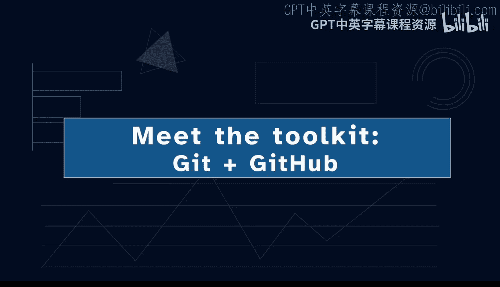
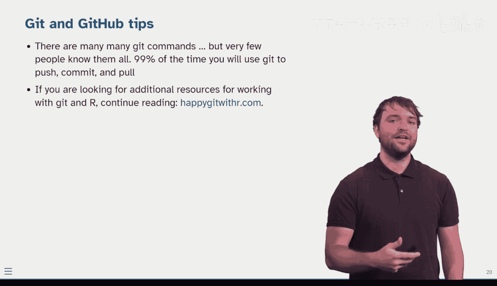

# R语言数据科学：16：认识工具：Git与GitHub 🛠️



在本课程中，我们将学习版本控制的概念及其在数据科学工作流中的重要性。我们将重点介绍如何使用Git和GitHub来管理项目，确保代码的追踪、协作与安全。

## 什么是版本控制？

版本控制是追踪和管理文件变更的过程，它允许你查看自己或他人所做的修改。有效的版本控制能避免项目陷入混乱。

上一节我们介绍了版本控制的基本概念，本节中我们来看看一个反面例子。以下是一种低效的版本管理方式：

*   一位研究生在撰写最终文档。
*   导师发回带有修改意见的版本。
*   经过多次来回修改后，文件夹里堆满了诸如“最终版”、“最最终版”、“真的最终版”之类的文件，以及难以追踪的评论和建议。

这种方式效率低下且容易出错。

## 优秀的版本控制：像搭乐高房子 🧱

优秀的版本控制就像搭建一座乐高房子。每一步操作都被清晰地记录和追踪，整个过程易于追溯。

如果你需要快速查看他人对文件的修改，或者将文件回退到之前的某个步骤，有条理的组织方式会让这一切变得非常简单。

如果每一步都有简短、可读的信息来描述完成了什么工作，这个过程会变得更好、更易于追踪。例如，第二步的信息可能是“搭建了房屋底座的前后部分”。这对于你的协作者或日后回顾项目的你自己都非常有用。

在使用版本控制时，你可以自行决定何时创建这些记录信息。这可能是在写完一个段落之后，也可能是在完成一个可视化图表之后。

## 版本控制工具：Git与GitHub

现在，我们来看看实现优秀版本控制的软件。Git是一款流行的版本控制软件，尤其在统计和数据科学社区。你可以将其类比为Word中的“跟踪更改”功能，但它提供了更多对用户有帮助的功能。

我们还将使用GitHub。GitHub是一个基于云的Git项目托管服务。它类似于Dropbox，但同样提供了更多有用的功能。

你的课程项目将存放在GitHub上。

## GitHub与RStudio实战演练 🚀

接下来，我们将进行一次实战演练，学习如何生成并配置个人访问令牌，以便RStudio与GitHub通信；如何克隆你的项目；以及如何在处理文档时使用版本控制。

以下是配置Git和RStudio的步骤：

1.  **安装`usethis`包**：首先，在RStudio的控制台中运行以下代码来安装必要的包。
    ```r
    install.packages("usethis")
    ```
2.  **配置Git用户信息**：接着，使用`usethis`包中的函数设置你的姓名和邮箱。请确保将示例文本替换为你自己的真实信息。
    ```r
    library(usethis)
    use_git_config(user.name = "你的姓名", user.email = "你的邮箱")
    ```

### 创建个人访问令牌

现在，我们需要创建个人访问令牌，以便GitHub和RStudio能够相互通信，让我们能在本地的RStudio中处理所有文件。

我们将使用`usethis`包中的`create_github_token()`函数。在控制台运行此代码后，它会弹出一个网站页面让你创建令牌。

在创建令牌时，你需要：
*   **描述用途**：例如“项目演示”。
*   **设置有效期**：GitHub通常建议设置一个有效期（如30、60、90天），而不是“永不过期”。你可以将此令牌视为允许两个程序相互通信的密码。
*   **选择权限范围**：GitHub会为你推荐一些权限范围，这些范围足以满足项目需求，例如克隆仓库、推送代码等。

完成上述设置后，点击“生成令牌”。这个令牌对每个人都是不同的。点击复制图标，复制此令牌。

### 在RStudio中配置令牌

复制令牌后，我们需要在RStudio中配置它。回到RStudio控制台，使用`gitcreds`包中的`gitcreds_set()`函数。

具体操作如下：
```r
library(gitcreds)
gitcreds_set()
```
运行后，控制台会提示你输入密码或令牌。将刚才复制的令牌粘贴进去，按回车键。你会看到RStudio添加凭证并移除任何可能存在的旧凭证的提示。当看到“完成”时，就表示配置成功。现在，RStudio和GitHub已配置好，你可以从GitHub克隆仓库到本地计算机，并在RStudio中处理这些文件了。

### 克隆你的项目

既然我们已经具备了访问权限，接下来演示如何克隆项目。

回到你拥有的个人项目仓库页面，点击绿色的“Code”按钮，选择“HTTPS”，然后复制显示的URL。

接着，在RStudio中创建一个新项目。你可以将新项目视为从GitHub克隆到本地的个人项目文件夹。我们点击“File” -> “New Project…” -> “Version Control” -> “Git”。点击“Git”后，系统会提示你粘贴刚才复制的仓库URL。同时，你需要设置项目目录名称，并选择在本地计算机上的保存位置。

建议创建一个专门的文件夹（例如“repos”）来保存你在这个专项课程中克隆的所有仓库。然后，点击“Create Project”。

创建项目后，所有最初在GitHub仓库中的文件都会出现在这里。你可以点击任何一个文件，在RStudio窗口中与之交互。

## Git版本控制工作流演示 🔄

现在我们已经克隆了项目，我想演示如何在此环境中使用Git进行版本控制。

首先，请注意环境窗口上方有一个“Git”选项卡，里面有“Commit”、“Pull”和“Push”按钮。

打开一个新项目时，我们通常要做的第一件事是“Pull”（拉取）。虽然首次克隆项目时这不是必须的，但养成每次打开项目都先拉取的习惯非常好。因为拉取能确保你本地要处理的所有文件，与远程仓库中的文件完全一致。这一点在团队协作中尤为重要。

确认文件已是最新后，我们就可以开始在这些文档中进行修改和工作了。

我要做的第一个修改是更改作者名为我的名字。然后，保存这个文档。

在我做出修改并保存后，在Git面板中可以看到`index.qmd`文件现在出现了。假设我想保存这个更改。

我们可以把“Commit”（提交）按钮想象成一个保存按钮，或者认为它是我们想在乐高房子上添加另一块积木并附上适当信息的地方。

在这个提交窗口中，我可以看到`index.qmd`文件。它会用红线显示我删除了什么，用绿线显示我添加了什么。如果认可这些更改，我就将它们“Stage”（暂存），这相当于准备将它们推送到GitHub仓库。

然后，我添加一条有用的提交信息，例如“添加了我的作者名”，接着点击“Commit”保存或提交它。

现在，我们看到一条消息：“Your branch is ahead of ‘origin/main’ by 1 commit”，意思是我们本地的内容与我们克隆的远程仓库内容不同了。

接下来，我们点击“Push”（推送）将这些更改推送到远程。稍等片刻，那条消息就会消失，`index.qmd`文件也不再显示在这里。如果我们回到GitHub上的仓库页面并刷新，就能看到我们添加的有用提交信息，并且能看到`index.qmd`文件刚刚被更改了。这很棒！

这就是良好的版本控制的一般工作流程。我们鼓励你在整个项目过程中使用并实践良好的版本控制。

## 使用GitHub Pages展示项目 🌐

我想展示的另一点，也是我们使用GitHub的另一个原因，是希望为你提供机会，将这些项目作为工作成果的证明，并链接到你的简历上，通过一个实时URL在线展示。

要进行此设置，你需要再次进入你拥有的个人仓库页面。点击“Settings”（设置），然后找到“Pages”（页面）选项。

在“Build and deployment”（构建和部署）部分，选择从“main”分支部署，然后点击“Save”（保存）。这将把你的项目和所有辛勤工作托管到一个实时URL上，供你展示。

点击保存后，我们可以返回仓库主页。要获取那个URL，可以点击页面右上角仓库描述旁边的齿轮图标（Settings），在“GitHub Pages”部分，你会看到系统自动生成的网站URL。点击该链接即可访问。

请注意，这个URL不会立即生效。你可以点击仓库顶部的“Actions”（操作）选项卡，看到它正在构建你的网站。这可能需要一到两分钟。构建完成后，你就可以点击那个链接，看到你的项目网站了。

## 总结与回顾 📝

本节课中我们一起学习了版本控制的核心概念与Git、GitHub的基本操作。

首先，你需要考虑创建一个GitHub账户。建议使用你的真实姓名，选择一个经得起时间考验且你愿意展示给未来老板看的用户名。

接下来，确保你拥有项目仓库的所有权。点击“Use this template”（使用此模板）创建新仓库，并确认你是所有者。建议将仓库命名为与原始仓库相同的名称。

然后，在RStudio控制台中运行指定的两行代码来生成和配置你的个人访问令牌。记住，`create_github_token()`生成令牌供你复制，`gitcreds_set()`提示你粘贴令牌以使RStudio和GitHub能够通信。

一切配置完成后，我们需要克隆仓库。操作是：在GitHub仓库页面点击“Code” -> “HTTPS”，复制URL；然后在RStudio中点击“File” -> “New Project…” -> “Version Control” -> “Git”，粘贴URL以克隆仓库。

克隆项目并获得可工作的文档后，你就可以练习使用正确的版本控制工作流程了。再次建议，在开始处理项目前先进行“Pull”操作，这在多人协作项目中尤为重要，因为它能确保你的文档是最新的，并且与仓库中的内容完全匹配。

当你工作到一个合适的节点想要保存时，点击“Commit”，暂存你的更改，并编写简短、信息丰富的提交信息，然后将这些更改“Push”到你的GitHub仓库。

所有这些Git命令都可以在RStudio环境窗口的“Git”选项卡下找到。点击Git选项卡会显示你可以进行推送、提交和拉取操作的地方。




有许多Git命令可以帮助我们进行版本控制，但很少有人全部掌握，通常只坚持使用拉取、提交和推送。如果你需要更多关于在R中使用Git的资源，我鼓励你继续阅读《Happy Git and GitHub for the useR》。