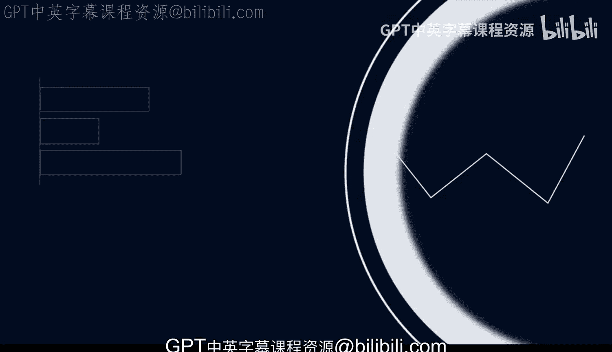

# 杜克大学《R语言数据科学｜Data Science with R》中英字幕 p17 01_01_03_欢迎2.zh_en -BV1Zpv6BaEkB_p17-

🎼，Hello and welcome。 My name is Minna Titingka Ronundll。

 and I will be your instructor for the specialization titled Data Science with R。

 This is the second course in the series， data tidying and importing。😊，In the first course。

 we introduce data science cycle with this figure from the book R for data science In this course。

 we're going to continue our foray into data transformation， formally introduce data tidying。

 which often involves reshaping and joining data and then take one more step back and learn to import data sets and discuss many of the considerations and challenges for getting data into R。

 we'll start with rectangular data like CSv files and Excel spreadsheets。

 and then venture on to getting unstructured data off the web with web scraping。

So given that this is course2 in the specialization， what should you know if you haven't。

 or even if you have taken course 1 data visualization and transformation。

 Let's start with the toolkit。 Com into this course。

 you should have basic familiarity with R and R studio and with writing simple reproducible documents with Quato。

 Additionally， you should have some experience with visualizing and transforming data with the tools from the Tidiverse。

 primarily Ggi P 2 and Dlier。The tidyverse is vast， though。

 and can be used to tackle many data science tasks some well beyond this course。 So for now。

 as long as you know that most tidyverse functions take a data frame as their first argument。

 that data transformation can be done in data pipelines with Dlier。

 and data visualizations can be built layer by layer with G G P 2， you should be good to go。

 And if you need an introduction or a refresher for any of these。

 take course one or complete the recommended readings before jumping in。

And if you're ready or just thinking，B it on， let's dive in。

