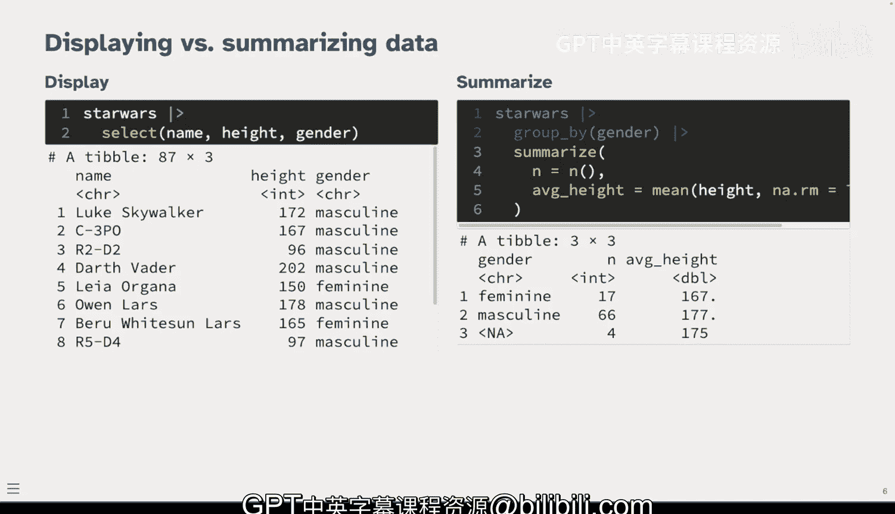

# 杜克大学《R语言数据科学｜Data Science with R》中英字幕 p18 02_01_01_整洁数据.zh_en -BV1Zpv6BaEkB_p18-

🎼。

We've been talking about the tidy verse for a while now。

 and it's time to actually define what we mean by tidy data。

I'm going to start with a quote from Leo Tolstoy to set the scene。 Happy families are all alike。

 Every unhappy family is unhappy in its own way。 So how does this relate to tidy data。

 While not all tidy data are alike， we can define characteristics of tidy data。

 Each variable forms a column， Each observation forms a row and each type of observational unit forms a table。

On the other hand， like unhappy families， Untidy data can be untidy in many ways。 Additionally。

 a data set that's tidy for one analysis may not be ideally tidy for another analysis。

 So we're going to learn about how we actually tidy up data and sometimes even reshape it to make it more appropriate for our analyses。

Let's start with a few examples of untidy data， what makes this particular one not tidy。

This one comes from， I believe， a hobbyist maintaining information on World War I aircrafts。

 The data set gives for each month the number of airplanes available by type。

 But while most rows are months， some rows are years and some rows are merged cells that indicate certain important time points in history。

😊，If we were to tidy up these data， we would have another column called year。

 We might add even another column with important events and indicate those in their respective months。

Here's another data set from Gapminder， which is a website that maintains lots and lots of country level information。

 This particular data shows estimated HIV prevalence for 15 to 49 year olds across countries and years。

 What makes this data not tidy， is the orange highlighted cell。

 which describes the data set as opposed to naming the values in that column。

To make this data set tidy， that cell would need to say something like country or country name。

And finally， here is one from the American Community Survey。

 Data for these data are collected at the individual level。

 but there are privacy concerns around releasing it at the individual level。

 So the US and many other countries。 release information like this in the aggregate。

 This is a nicely organized table， but ultimately， it's a table of summary statistics。

 While the table is comprised of rows and columns， the contents do not follow tidy data principles。😊。

Each row represents a subgroup， some subgroups contain others； for example。

 the civilian labor force number contains the employed and unemployed numbers。

Let's clarify what we mean by a table of summary statistics。

 referring to a data set you might have seen before。

 data on Star Wars characters where each row represents a character and each column is an attribute of that character。

 For example， in row1 here， we can see the height and gender of Luke Skywalker。

On the table on the left， we can see how many characters fall into each gender category and the column called N and their average height in the column called average height or A V G underscore height。

 These summary statistics are obtained with a group by and then a summarized statement。

 The table on the right is simply displaying the data。 While the table on the left is summarizing it。

 For most analyses， we'll want to start with the table on the right as opposed to the already summarized data。

 While each of these data frames are arguably tidy。

 One gives us a lot more granular information and leaves the door open for a larger variety of analyses to be conducted based on this information。

😊。

