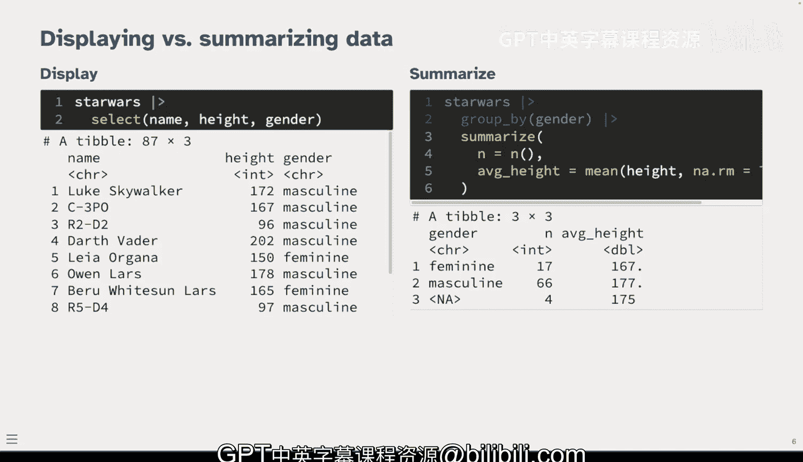

# R语言数据科学：02_01_01：整洁数据 📊

在本节课中，我们将要学习“整洁数据”的核心概念。我们将了解整洁数据的定义、特征，并通过实例对比整洁与不整洁的数据，最后学习如何将数据整理成适合分析的形式。

---

## 概述

我们一直在讨论“整洁宇宙”（tidyverse），现在是时候明确定义什么是“整洁数据”了。整洁数据遵循特定的结构原则，这使得数据分析和可视化过程更加高效和一致。相反，不整洁的数据则可能存在多种多样的结构问题。一个数据集对一种分析是整洁的，对另一种分析则可能不够理想。因此，我们需要学习如何整理和重塑数据。

## 整洁数据的定义

为了阐明概念，我们可以引用列夫·托尔斯泰的一句话来开场：“幸福的家庭都是相似的，不幸的家庭各有各的不幸。”这与整洁数据有何关联？虽然并非所有整洁数据都完全相同，但我们可以定义其共同特征。

整洁数据遵循以下三个核心原则：
1.  **每个变量构成一列**。
2.  **每个观测构成一行**。
3.  **每种观测单元类型构成一个表格**。

另一方面，就像不幸的家庭一样，不整洁的数据可以以多种方式呈现混乱。此外，一个对某种分析是整洁的数据集，对另一种分析可能并非最理想的结构。

## 不整洁数据的示例

以下是几个不整洁数据的例子，让我们看看它们具体违反了哪些原则。

### 示例一：历史数据集

这个数据集来自一位记录一战飞机信息的爱好者。它显示了每个月按类型划分的可用飞机数量。

**问题所在**：虽然大多数行代表月份，但有些行代表年份，还有些行是合并单元格，用于指示历史上的某些重要时间点。

**整理方法**：为了整理这些数据，我们需要添加一个名为 `year` 的列。我们甚至可以再添加一列来记录重要事件，并在相应的月份中标注。

### 示例二：Gapminder数据集

这个数据集来自Gapminder网站，该网站维护了大量国家层面的信息。此特定数据显示了各国各年份15至49岁人群的估计HIV患病率。

**问题所在**：橙色高亮的单元格描述的是数据集本身，而不是命名该列的值。

**整理方法**：为了使这个数据集整洁，该单元格应改为类似“国家”或“国家名称”的内容。

### 示例三：美国社区调查数据

这些数据是在个人层面收集的，但由于隐私问题，美国和许多其他国家以汇总形式发布此类信息。

**问题所在**：这是一个组织良好的表格，但本质上是一个汇总统计表。虽然表格由行和列组成，但其内容并不遵循整洁数据原则。每一行代表一个子组，有些子组包含其他子组；例如，“民用劳动力”数量包含了“就业”和“失业”数量。

## 汇总统计表与原始数据

为了澄清“汇总统计表”的含义，我们可以参考一个你可能见过的数据集：关于《星球大战》角色的数据，其中每一行代表一个角色，每一列是该角色的一个属性。

例如，在第一行，我们可以看到卢克·天行者的身高和性别。

*   在左侧的表格中，我们可以看到每个性别类别中有多少角色（在名为 `N` 的列中）以及他们的平均身高（在名为 `average_height` 或 `avg_height` 的列中）。这些汇总统计是通过 `group_by()` 和 `summarize()` 语句获得的。
*   右侧的表格只是简单地显示原始数据。

对于大多数分析，我们希望从右侧的原始数据表开始，而不是已经汇总好的数据。虽然这两个数据框都可以被认为是整洁的，但原始数据表提供了更细粒度的信息，并为基于此信息进行更多样化的分析敞开了大门。

---

## 总结

本节课中，我们一起学习了整洁数据的基本原则：每个变量一列、每个观测一行、每种观测单元一个表。我们通过多个实例识别了不整洁数据的常见问题，例如混合层级的数据、不当的列名以及汇总统计表与原始数据的区别。理解并实践这些原则是进行有效数据分析和利用tidyverse工具包的基础。