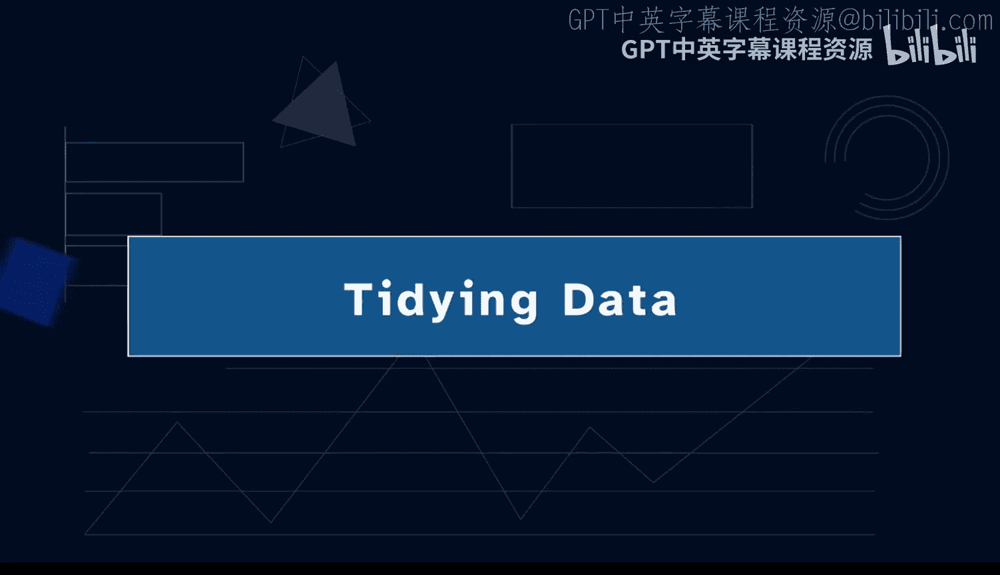
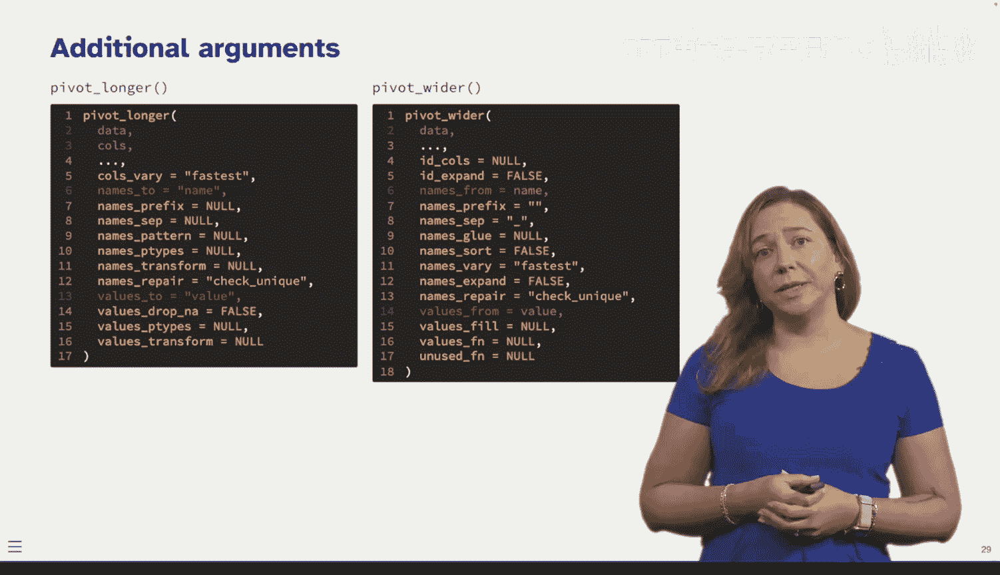

# 杜克大学《R语言数据科学｜Data Science with R》中英字幕 p19 03_01_02_数据整理.zh_en -BV1Zpv6BaEkB_p19-

🎼。

We define what tidy data is。 Next， let's talk about tidying data。

 This doesn't necessarily mean the data in its raw form is messy。

 It just means it's organized in an unideal way for the analysis we want to conduct。 Often。

 tidying data for this purpose involves reshaping it。

 and that's what we're going to introduce in this video。

So we have our data organized in an unal way for our analysis。

And we want to reorganize the data to carry on with our analysis。 and of course。

 we'll use our trusted tools from the tidyverse to do this。The data we have is on grocery sales。

 Each row represents a customer。 There are two customers in the data。

 Each column is an item they purchased。  customerer 1 purchased three items， breadread。

 milk and banana。  customer 2， purchased two items， milk and toilet paper。 In this format。

 it would be cumbersome to answer questions like how many customers purchased milk。

 What's the most popular item， etc cetera。Instead， we want to get the data into a one row per customer per item format。

To do so， we're going to use a new tool from our tidyverse toolkit， the tidy R package。

 The goal of this package is to help you tidy your data via pivoting for going between wide and long data。

 and we'll discuss more in detail what we mean by wide and long data shortly。

 splitting and combining character columns， nesting and un nesting columns and clarifying how Ns should be treated while doing these operations。

Let's talk about pivoting data from wide to long or long to white。 So what do I mean by pivoting。

 Not this。 Those of you who have watched the show friendsend might get that reference。

 but this that is reorganizing the rows and the columns of our data。

 So the same information is captured across many rows or across many columns。In the wider format。

 the original data we had， items purchased by each customer are organized across many columns。

 The data frame is wider as it has more columns。 In the format， we said we want to see the data。

 items purchased are organized across many rows。 The data frame is longer as it has more rows。 First。

 let's talk about going from wider to longer。 to go from wider to longer data。

 we'll use an aptly name function。 Pivo longer。 The first argument of the function is the data。

 As usual， with most tidiverse functions。 Then we specify which columns we want to pivot。

 In the next argument， we specify the name we want to give the column where the original column names of pivoted variables go。

 Let's pause for a moment that's a mouthful。 Remember。

 in the original data we had column names like item 1， item 2， item 3。

 This argument specifies how to organize them。What to name the column they go into。

Note that this is a character string。 It's not a variable that already exists in our data。

 so we provide the name of the variable to be created as a character string。

And in the fourth and final argument， we name the column where data in pivoted variables go。

 Also as a character string for the same reason， the variable is yet to be created。

 so we provide the name of the variable to be created as a character string。Putting it all together。

 we want to pivot columns named item1 through item 3。

 the colon operator means to or through a shortcut to not have to list every single variable name between these variables。

The column names from the original data， item1， item 2 and item3 will be organized in a new column called item No。

And the items themselves， the values in the cells of the original data will be organized in a column called item。

The result is a 6 by three data frame，6 rows， three columns。 Note， however。

 though the last row has an N in it， since customer 2 only purchased two items。

 it seems silly to have a row for an item 3 that doesn't exist when the data is in this format。

 So let's deal with that N。 We can add another argument to our pivot longer function。

 values drop N to specify what to do with this row here。

 we're setting it a true meaning that we want to draw rows that contain only Ns in the values to column。

The result then is a 5 by3 data frame， three items from customer one， two items from customer 2。

Putting it all together and naming the resulting longer data frame purchases。

 we get a data frame with Ps where each row corresponds to a customer item combination。

This data frame has a higher number of rows，5 compared to 2， and a lower number of columns。

3 compared to 4， hence making it longer than the wider data frame we started with。

Note that we are not making hard and fast rules about what constitutes a wide or long data frame。

 Hence， we say wider or longer compared to our original starting point。 So why pivot Most likely。

 because the next step of your analysis needs it。 For example。

 supposeupp we have a separate data frame of prices of items。

 We could join these two data to our purchases data。 And we'll talk about join soon。

 but you can think of it as bringing in price information into our purchases data frame。

Now that youve learned about pivoting longer， let's consider the scenario where we go from longer to wider data。

 we'll start with the purchases data we created and pivot it back to wider to its original format with one row per customers and items organized across columns。

To do so， we use the pivot wider function where the first argument as usual is the data。

The second argument is names from， which tells us which column or columns in the long format contains what should be column names in the wide format。

 and the third and last argument is values from， which tells us which column or columns in the long format contains what should be values in the new columns in the wide format。

In this video， we've introduced pivoting from wider to longer and longer to wider。

 We've also defined the fundamental arguments of the pivot longer and pivot wider functions。

 We've even touched on one optional argument that tells us what to do with Ns。

 Both of these functions have a large number of arguments， some of which we introduce in the course。

 and some you might find helpful as you continue to use these functions， As usual。

 reading the function documentation is the best way to familiarize yourself with these additional arguments。

😊。

