# 杜克大学《R语言数据科学｜Data Science with R》中英字幕 p20 04_01_04_代码演练：随时间变化的国家人口.zh_en -BV1Zpv6BaEkB_p20-

Hi in this code along video we're going to look at country populations over time and our ultimate goal is to recreate this visualization looking at how populations of the United States India and China have changed over time and when I say over time we're going to be focusing specifically on years 2000 to 2023 the data for this day code alone comes from the World Bank and at the time of recording the video。

 the 2023 numbers were the latest estimates I had access to and the World Bank indicates that the population numbers that they distribute are midyear estimates basically so what do we have here。

 we have what we would call a line plot on the X axis we have our year on the y axis we have population given in millions and we can see a separate line and points for the three countries of interest here throughoutout the video I will be focusing on these three countries I have chosen them not just because I live。

In the US but also because these are the three countries with the highest population recorded in 2023。

 according to the data that I had access to， however。

 you are welcome to modify the code along the way and add the country that you are from or another country that you might be interested in the principles that we're going to talk about are going to remain the same and you will see that at some point throughout the code along we're going to have a filter statement where we limit our analysis to these three countries in my case so you could choose other countries yourself as well and carry along and follow along with the rest of the code for making the visualization。

In order to do this， we're going to use the tidyverse package and we're also going to bring in the scales package so the scales package is not in the core tidyverse but it is a tidyverse sort of package from the tidyverse universe if you will and it is used for making pretty labels particularly for your plots so you can see on my y axis for example I don't have the raw population numbers those are really large numbers when we first make the visualization we'll see that R use a scientific notation for large numbers and everything looks a little bit cluttered and we want to avoid that。

So we're going to use functionality from the scales package to fix that up。And as we said。

 our data comes from the World Bank。 So let's go ahead and read our data in。

 Remember that before I can read my data， I'd like to first。Load my packages。

 I'm getting a bunch of messages about sort of when I load the tidyverse。

 which are the packages that are coming along with it and what their versions are and any sort of conflicts with existing functions in baseR and samename functions in the tidyverse are being reported to me as well。

And then in my next coach Cheng I am loading the data set。

 we're hosting the data for all the courses in this specialization at a central repository so you're going to be just pulling in the data from there if you're working with data that you want that you have you would have that stored locally and you could read it in from a local directory as well。

And let's take a look at what this population data looks like Personal I prefer to see my code output in the console as opposed to in line in my courtto document so I'm going to change that setting by clicking on the gear icon next to the render button and selecting chunk output in console and at this point our studio asks me would you like to remove any of the output that we've already generated and I'm just going say remove that output for me so next time I run that same line of code I can see my data sort of being printed here and again even looking at the data here is not a very pleasant experience so you might actually go to your environment and click on your data set here and we can see our data in more of a spreadsheet format we can see that our data has 217 observations so that's 217 countries that is not necessarily exactly how many countries there are in the world。

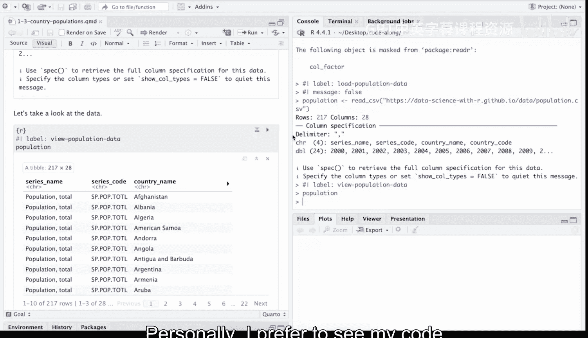

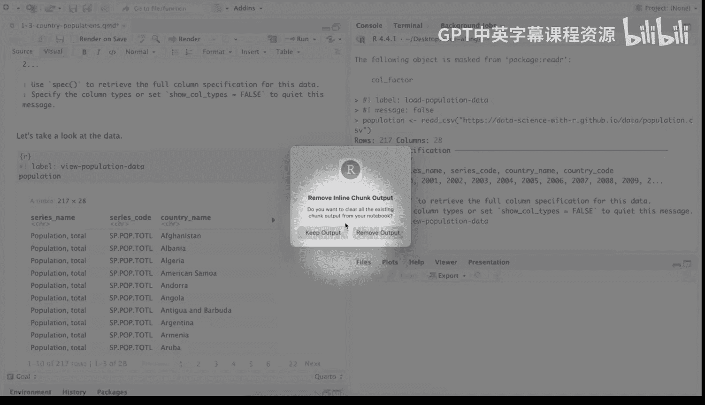

But that's how many countries the World Bank is releasing population information on and we have 28 variables。

 some of these variables are indicators for the particular data that World Bank releases so I have kept these in the data in case you wanted to refer back to other World Bank resources and match these numbers。

 we know the country name and three digit country code and then across all of the other columns。

 we have population numbers。For years 2000 to 2023。

All right now the first question we want to answer is what are the aesthetic mappings in the plot shown above so that is our goal plot and based on that what pieces of information do we need represented as columns as variables in our data frame in order to be able to recreate this plot why don't we render this document so that we can see our render document and our source document next to each other and when you render your document if you are getting a popup window you can go back to this gear icon here and choose preview in viewware pane you might have preview in window selected that way you can see our source code and your output next to each other I find this handy when I want to look at a visualization here and then write about it in my source document so。

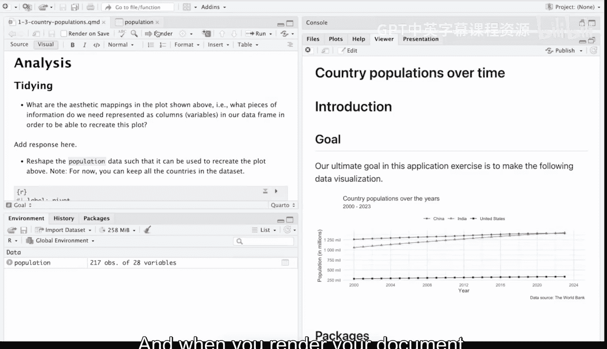

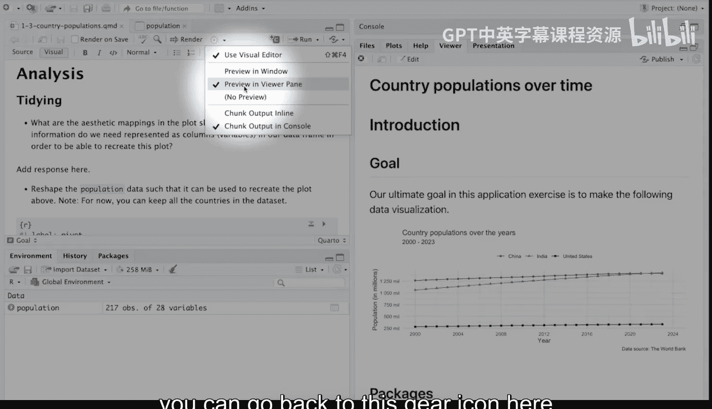

It says that this is our ultimate goal， so what are the aesthetic mappings here on the X axis？

We have year。On the Y axis， we have population and there's one other variable that's represented here that is we're using color and shape to indicate the different countries。

 we can see that the different countries are represented with different colors and also the shapes of the points are different as well。

So color and shape aesthetics are mapped to country。

What this means is that when we're writing code with GGPlo2， if I want to have an aesthetic mapping。

 I need those variables to be variables in my data frame， so to be columns in my data frame。

 so I need to have a data frame that has a column called year。

 a column called population and a column called country or country name。

When I look at my source data frame， country name is indeed indeed one of those， so I'm good there。

 but I don't have a single column called year and I don't have a single column where my population numbers are recorded。

Therefore， the next exercise is asking us to reshape our data frame so that we can get to a data frame as we desire so that we can make this visualization so how do we go about that Currently my population information is given to me in a wider format the population numbers for each year are spread across columns What I would like to do is to combine all of that population information into a single column and then have another column and that identifies which year a particular population number belongs to so if I have 217 observations for the year 2023 I want to have another 217 for 2022 another 217 for 2021 so on and so forth which means my data set is now going to be longer this operation of going from wider to longer data is called pivoting。

So we're going to start with our population data frame。

And we're going to pivot longer and when we're pivoting longer。

 we're going to tell R which columns we want to pivot。

Where the names of the variables we're pivoting， those years are going to go to。

And where the values are going to go to。So the columns that we want to pivot are all of the year columns。

 so those are all the columns between 2000 and 2023。 There are a variety of ways I could get at this。

 I could say。Anything but series name to country code， or I could explicitly say 2000 to 2023。

 I'm going to go ahead and do that， so it's very clear， however。

R doesn't actually like numbers or at least a variable name starting with a number。

 So if you have a variable name that's starting with a number。

 you're going to need to quote those variable names with a back tick。

 so that's why I'm saying that we want to look from 2000 to 2023 and I'm putting it in back ticks you can see that that's the same notation that R is using when it prints out your data into your console as well。

The names， so these numbers 2000 to 2023 are going to go into a column。

 that column is going to be called year。And all of the values。

 all of the population numbers are going to go into a single column as well。

 we can call that population。Let's go ahead and do this。

 we can see that we have a much longer data frame now for each country。

 I have the population number recorded across many。

 many years and each of those are given to me as a row in my new data frame。😊。

The next exercise is asking us what is the type of the year variable so we can take a look at our output here and see that the type of the year variable is character。

But why， why is it a character and what would we expect it to be？ Well， it is numbers。

 so I would we it should be numeric。Why is it not numeric。

 The reason is that these years came from the labels of our column。

 So the column names are generally expect that your column names are going to be character strings。

 it can't just see the content of those of those column names and say， hey。

 buddy this look like numbers。 So I'm just going to make that numeric for you。

 So we need to be intentional about what type we want that column to be and we want to indicate that either at the time of pivoting or after we pivot as an additional mutate statement。

 But since we are sort of using this code long video to learn more about pivot longer or pivot wider type functions。

 let's take a look at the documentation for pivot longer。

So we've given the names too and we've given the values too， and we want to do something with the。

Names， right， we want to transform them somehow。 So we could say that as you're doing the pivoting also transform these names。

 So I will say names transform and using the as dot numeric function to transform them to numeric values。

 Actually， let's go ahead and copy this down to the next exercise so that we have a good record of what we have done before where year was a character variable。

And what we've done now where year is a numeric variable。

 this will be helpful because ultimately on the X axis of my plot。

 I want those to be numbers alright， now that we have our data set ready to be plotted and I can see that my pivot longer code is working well。

 I'm going to assign this to an object called population longer。

And we can go ahead and inspect that object to make sure that we're happy with what we're seeing here。

 So for the rest of the code along video， we are going to work on visualizing this。

 We want to start by making a plot， but we're not going to get too fancy right away。

 We just want to create a line plot for these three。😊，Countries so we're going to start with GG plot。

 the data set that I am plotting is population longer and in my aesthetic mappings on the X axis I want here。

 on the Y axis， I want population， and I want the color to be the country name。

And I want to represent my data with points， and I want to represent my data。With lines as well。

Let's go ahead and give this a try and see what we get。😊。

We can see that we're getting an incredibly busy plot。 Why is this happening， In fact。

 this whole thing seems to be just the names of the countries as opposed to even the plot itself。

 so this looks like the legend because one thing we haven't done yet was to say I actually don't want this entire dataset。

 I want only a subset of this dataset so instead of using my entire dataset I am going to take that dataset and first filter it for instances where country name is in。

 remember we can use the in operator where we want to say it could be equal to United States or India or China。

And each of these will be given as character strings。

And then the result of this can be piped into my GG plot。

 and at that point I can actually remove the reference to the data again because the filtered data frame is now being directly piped into the GG plot call。

And here we go， we have something that actually looks quite a lot like our ultimate plot that we want to make。

 but we're going to want to add a few bells and whistles to it next。

So what aspects of the plot needs to be updated to go from the draft that we created？

To the goal plot at the beginning。 So let's take a look at our goal plot here and let's enumerate some of the things。

 It looks like we want different colors。 In this case， we also want different shapes。

 We haven't actually captured that here。We want to adjust the x and y axes。

 and we want to fix up our plotting labels and we also want to change the theme。

 so let's take a note of those real quick。X and Y axis scales。Shapes。点。Labels。

And placement of legend So these are things that we are going to add onto our plot and for the remainder of the exercises。

 each time I'm making a new plot， I'm just going to grab my code from the previous exercise and add the component that is asked for me so I'm not writing the code over and over again and again。

 if you would like to follow along with a different set of countries you're welcome to do so just make sure that how you spell that country's name matches exactly how that country's name is spelled in the data。

So in addition to color， we want the shape to be country name as well。😊。

So now we actually have different shapes for each of the countries。

 we can see that circles are used for China， triangles for India and squares for United States。

Then it says update the X axis such that the years displayed go from 2000 to 2024 in increments of four years。

 so let's go ahead and take our code。And add another layer to it because I'm dealing with the X axis and that's a continuous variable or numeric variable。

 I'm going to say scale x continuous， and my breaks are going to be a sequence from 2000 to 2024 by four。

Let's go ahead and take a look。This looks like I actually have all of the years that I've asked for on my X axis so I can go with this if I wanted to give myself a little bit more room at the end of the plot near the 2024 here。

 I could actually expand the limits of this as well。

 because remember that our data only goes up to 2023 so I could say start here but take my plot all the way to 2024 to give me a little bit more breathing room at the end of my axis label。

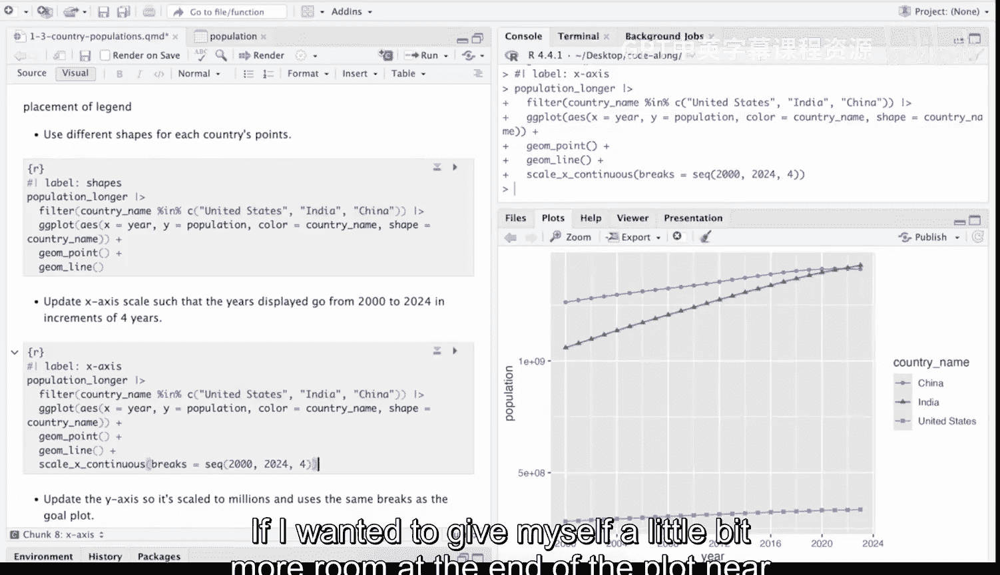

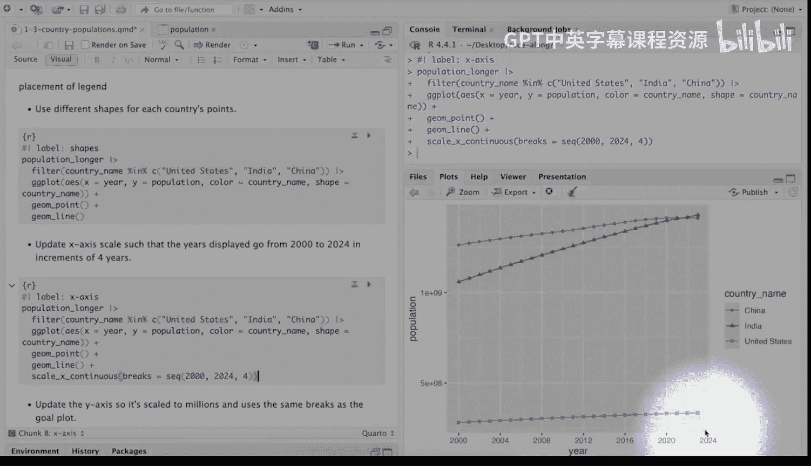

And for the next exercise， we're going to again start with the plot that we have。

 but do something with the y axis。 So for the y axis， that's also a continuous variable。😊。

We're going to want to change the breaks。And we're also going to want to change the labels remember that our plot on top of our document had breaks starting from 250 million。

 going to 1 billion250 million increasing by 250 million at a time。

 so let's go ahead and bring that into our visualization。So we want it to be a sequence。

So many zeros。2，1，2，50。Increasing by。250 million at a time。

 I might actually want to take a look to see what this looks like first。

 that seems to be doing what I wanted to do。 But remember， as I said at the beginning of the video。

 R is using this pesky scientific notation here that it' useful for big numbers but annoying when they show up in your visualization。

 So we want to make those labels a little bit prettier。 and that's where the scales package comes in。

 specifically the label number function comes in。And what we want to say is that we don't want all the entire number here。

 I actually want to scale it by。Dividing it by 1 million。

 So each of those will be divided by 1 million。 and then I want to have a suffix。

That has the letters mi for a million in front of it。 So if we take a look at this。

 each of my access labels are now divided by a million so all those zeros are gone。

 no more need for scientific notation， and the letters ML short for a million show up。

In the next exercise， it says do something with the colors these particular colors that are given here are colors that come from the flags of each of these countries so。

We've touched the scale for x and y。 And now we want to touch the scale for the color aesthetic。

 and we want to manually define。Some values for these colors。

 And the way we're going to define these is actually very similar to how they are given here。

 wherever the。Level name is United States， This is the color I want to use。

 where the level name is India， this is the color I want to use and where the level name is China。

 this is the color I want to use。 This is what we call a named vector in R and it allows you to keep things straight when you're doing a manual assignments like this and our studio nicely shows you what those colors are actually going to look like so you can actually have an expectation。

So let's go ahead and do that and we can see that now our plot uses those particular colors。

The next exercise is saying change the theme to minimal， so let's do that that's easy enough。

So that basically removes that gray background and maybe gives you a little bit of a cleaner look and then add some tight labels as well。

So on the X axis， we have year on the Y axis， we have population。

 and I think it said in millions in our original plot。

 the title of the plot was let's go ahead and cheat country populations over the years。

And the subtitle is 2000 to 2023 and the caption。Said data source。World。Ba。

I actually think I had a call in there， so let's go ahead and do this。

 So now we have a much better sort of。Annotated plot that we're working with and the legend title is the only thing that still looks a little bit wonky。

 It's still the exact variable name in the snake case but we're going to deal with that in this very final exercise。

 So let's go ahead and copy this giant code cell and let's take a look to see what we want to do next Finally move the legend to the top of the plot and remove its label so how do we go about doing that when I'm writing Gigi plot2 code。

 I usually like to put my theme layer the last actually and then any modifications to that theme layer coming after that and the placement of the legend。

 the legend position and top is an argument that I can pass to it is one of my theme options。

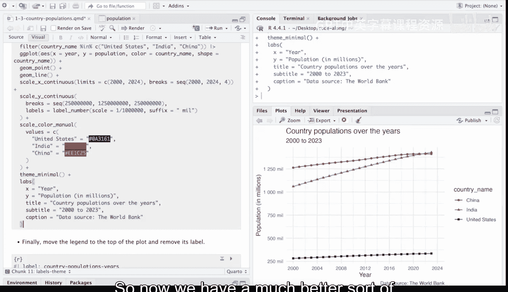

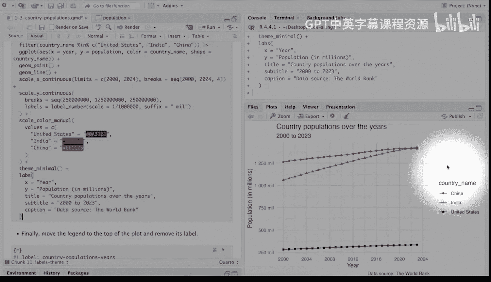

And what we want to do is we want to remove this name from here。

 Remember that that name is coming from the aesthetic mapping， the aesthetic mapping of the color。

 and I actually don't want anything there。 if you refer back to the original plot。

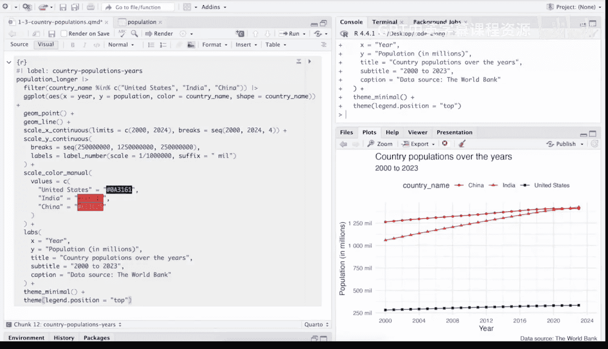

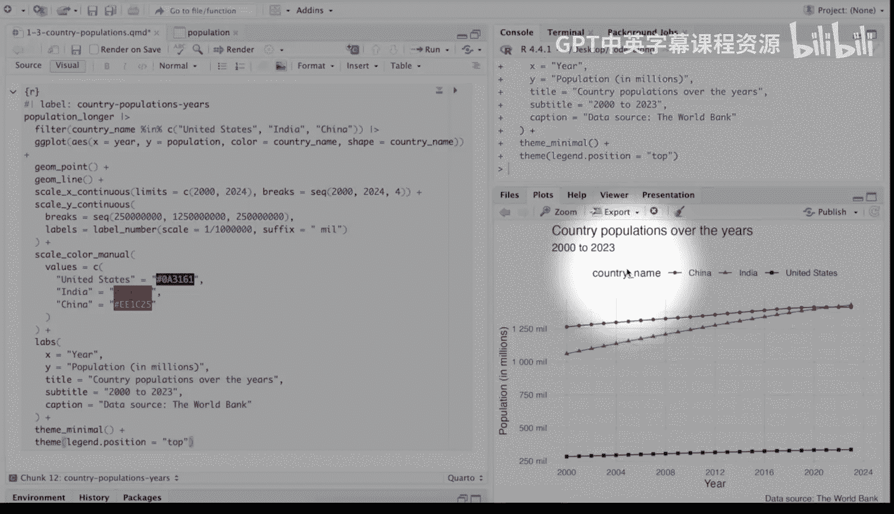

And soon as I do this， now I've actually duplicated my legend because you remember that it's not showing me just the color。

 but my shape as well， so I need to actually name them in exactly the same way with a null saying don't use anything in there in my labels layer。

Let's go ahead and render this entire document to see where we get so what we've shown here is first pivoting our data to get it into the shape that we want for visualizing and oftentimes when you want to visualize a data set。

 you're going to end up pivoting longer to be able to gather information in a single column。

And if I scroll all the way down， I can see that I have a nicely formatted plot that looks exactly like the plot that I wanted and the size of this plot is being governed by the width and the aspect ratio that I've defined on top of my document if I wanted to modify those a bit。

 if I wanted to say give me a little bit more space for that last plot。

 I could actually add additional cell options like fig as to be a different number for one of these cells and render again to see if that gives me a more pleasant output。

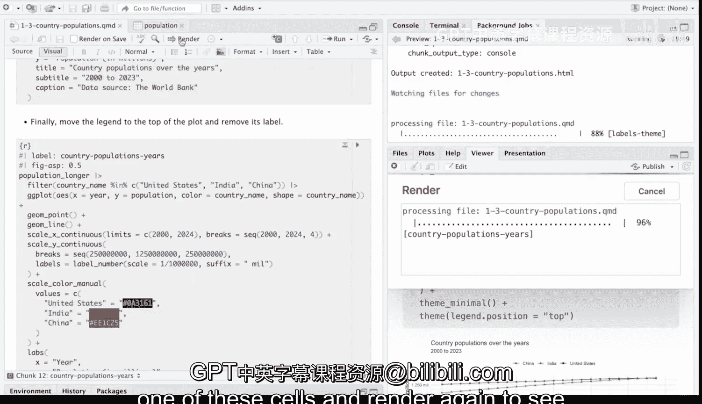