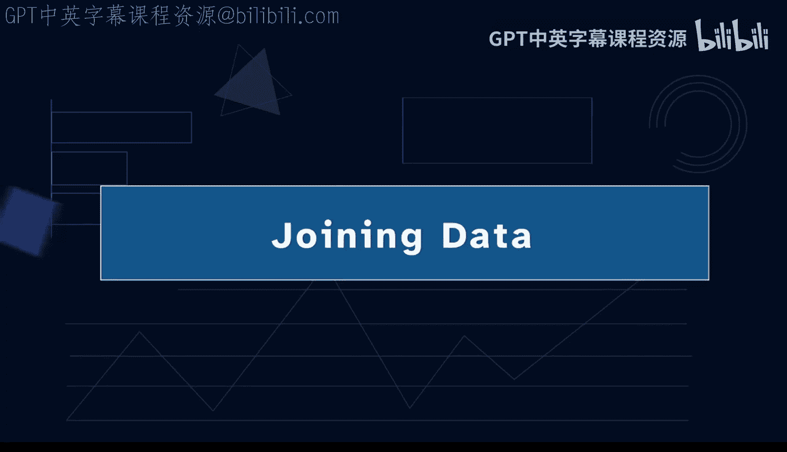
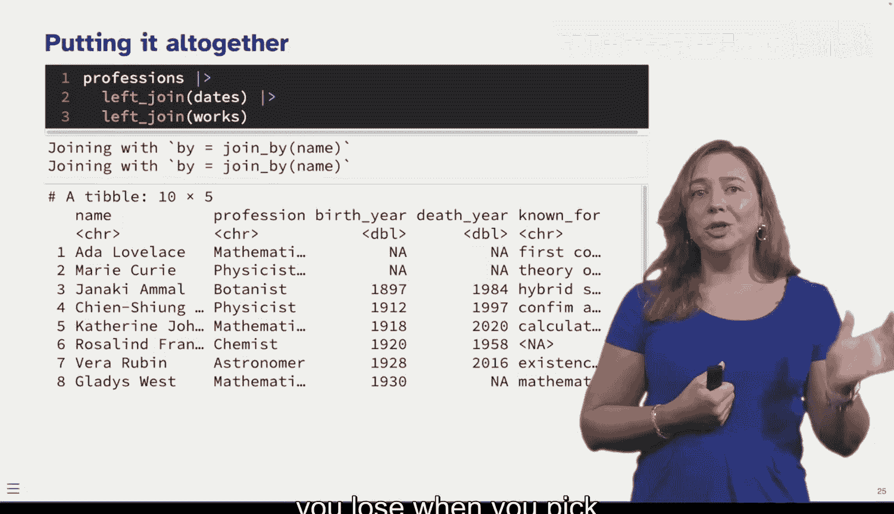

# 杜克大学《R语言数据科学｜Data Science with R》中英字幕 p21 05_01_02_数据连接.zh_en -BV1Zpv6BaEkB_p21-

🎼。

So far， we've worked with single data frames and transformed and tidied them using functions primarily from the Dlier and tidy R packages from the tidyverse。

 In this video， we're going to work with multiple data frames that we want to bring together and join based on common information across the data sets。

 Our setup is as follows。 We have multiple data frames。😊。

We want to bring them together and we'll accomplish this using our trusted tools from the tidyverse。

 So let's go ahead and load the tidyverse package。Our data come from a Discover magazine article on 10 women in science who change the world。

 Hopefully， you'll recognize a few of these names like Ada Lovelace， Murray Creary， etc cea。

The data we need for our analysis is spread across three data frames。

 The first one is called professionessions， and it has the names and professions of all 10 scientists we're interested in。

The next one is dates， And it gives the birth and death years of the scientists。

 You'll note that this information is only given for8 of the 10 scientists。 This is surely annoying。

 but it's also very real。 Oftentimes when you're in the business of joining data from multiple sources。

 You find out that you don't have the same observations in each of these sources。

 and it can take some manual digging to find the missing pieces you need。

 Another feature you'll notice here is that some of the dates are Ns。

 This is because these scientists are still alive at the time of recording this video。 and hence。

 we don't have death dates for them。And the third data set is works。

 which gives the names of the scientists and what they're known for。 and again。

 we don't have all our scientists here， only nine of them are in this data set。

Our goal is to get a data frame with 10 rows and information from all three of these sources。 name。

 profession， birth year， death year， and what they're known for。

 Since all of these data are not available for each of the 10 scientists will end up with Ns in the final output。

 But that's okay。 That might be something we can remedy at a later stage of the analysis by looking up things like the birth and death years of Ada Lovelace。

 She lived between 1815 and 1852。 And what Rosalind Franklin is known for。

 Her work that was central to understanding of the molecular structures of DNA and RNA。 But for now。

 we'll keep these external pieces of information out and focus on joining the three dataset sets as they're given。

😊，Before we dive into that， let's remind ourselves which variables come from which data frame and how many rows each of these data frames have。

 The professions data frame has names and professions for 10 scientists。

 The dates data frame has names， birth and death years for8 scientists。

 The works data frame has names and what they're known for for 9 scientists。 You'll notice a trend。

 Nas are in all of the data frames。 So when we join these data frames。

 we'll use that as our identifying column。Alright， let's get to it。

 The functions that are useful for joining data frames all end with underscore join。

 And the first word of the function name signals what type of join you're doing。 For example。

 a left join keeps all rows from the data frame on the left。

 The one that's passed to the first argument of the function X and joins to it。

 information from the data frame on the right。 A right join does the opposite。😊。

But while the slide is provided to communicate， there are many types of joins。

 Let's see them in action instead of reading through all possible joins For the next few slides。

 We'll work with both our scientist data， and much smaller toy data sets that we can use to more easily visualize what's happening in these joins。

 We'll call the first data frame X。 It has two columns， I D， which takes on the values 1，2， and 3。

 and value X。 And we'll call the second data frame Y， It has two columns。 I D。

 which takes on the values 1，2， and 4。😊，And value Y。

 So you can see that some of the Is are common  one and2， and some only exist in data frame X。

 that's3， and some only exist in data frame Y， that's4。If we left join X and Y。

 we keep all rows from X and all the values associated with them。

 and bring in the value column from Y for observations with IDs 1 and 2。

We end up with an NA for value Y for ID3， because that observation didn't exist in the data frame Y。

 so we have nothing to bring in for it。 The G on the right visualizes what's happening when joining。

 which can be helpful for some learners as well。So now if we do a left join for the data we're actually interested in。

 professions and dates， we end up with1 rows， all of the scientists from the professionfs data set and birth and death year information for eight of them that were in the dates dataset set where dates aren't available。

 they're denoted as Ns。Another important aspect of the code to point out here is the use of the pipe operator。

 We could write this as left join， and then professions， comma dates and parentheses as well。

 But we're choosing to use the join function in a data pipeline。

 just like we do everything else in data pipelines as well。

 Remember that the pipe operator takes what comes before it and plugs it into the next function as its first argument。

Next， our right join， we keep everything from Y this time and bring in the associated values from the x data frame。

 Since observation 4 wasn't an x， we end up with an N for value x for that row。Similarly。

 if we were to write join professions and dates， we would end up with the eight scientists from the dates data frame and all of their professions since they all exist in the professionessions data frame。

Note the message underneath the code and above the output joiningin with by join by name。

 There was a similar message with the left join Too。 We glossed over it at the time。

 What R is telling us here， is that it looked for a common column between the two data frames we joining。

 found the column named name to be the common one。 We noted this earlier， too。

 and joined the rows based on what's in the name column。

 It's important to note that the names have to be spellt in exactly the same way for the join to succeed。

 and there N's in this output， too， but those are， as we noted before Ns because these scientists are still alive。

 not because we don't have information on them in both data sets。

A full join keeps all rows from all data frames， so we end up with observations 1，2，3， and 4。

 even though three is missing a y value and4 is missing an x value。

 It's a useful join when you want to make sure you end up with all possible information available to you。

 but it can also result in a data frame you need to do further cleaning on。

 So if we do a full join on the professions and dates。

 we end up with all 10 rows and nas wherever the scientist is missing from the dates data set。

An inner join finds the common observations and only keeps the rows that exist in both data frames。

 So with X and y， that's just observations 1 and 2。

 It can be useful when you want to see who is in two data sets。

 like who' is taking a course and another one as well or who purchased an item and another one as well。

Or in our case of the scientists， who we have both profession and date information on。

A semi join is similar to an inner join， except it looks up which rows match another data frame。

 but doesn't actually bring in information from the other data frame。 In this case。

 observations1 and 2 are in X and y as well， but when we do a semi join。

 we end up with just those observations and just their x values while an inner join would have brought the y values as well。

In our case of the scientists， a semijo of professions and dates can be used to tease out who from the professionessions data frame is also represented in the dates data frame without bringing in their date information。

Finally， an anti join can be thought of as the opposite of an inner join。

 It tells us which rows in a data frame are not in another data frame。 It can be useful to find out。

 for example， which student is enrolled in one course。

 but not another or which customer bought one item， but not another。 When the X and Y data frames。

 observation 3 is an X， but not Y， hence the result here。😊。

Antijo of professions and dates then gives us which scientists we have profession information on。

 but not date information。This can be useful at the data prep stage。

 you could use it to do some additional digging to augment the date data frame first before joining it to the professionessions data frame。

 for example。So let's put all the information on our scientists together。 professions。

 left join to dates， which means we want everyone in professions。

 and don't care if someone is in dates， but not in professions。

 And the result is piped into another left join to works， which means we again。

 only care about who is in professions and want to just pull in works information about them。

 Of course， in our case， the professions data set had everyone we need it。

 So we can get away with a left join here。 In fact， if you're not sure which join to use。

 I'd recommend starting first with a left join and then trying out right and full as well to get a sense of your data。

 When sample sizes are small， like in these examples， the correct choices are pretty obvious。

 as your data gets larger and harder to inspect visually。

 you only to think harder about which observations you lose when you pick a particular type of join over another。

😊。

