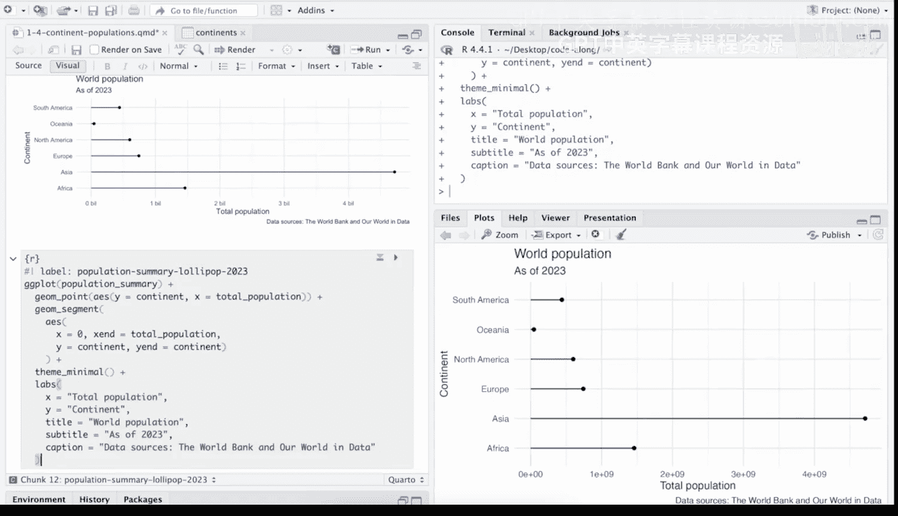
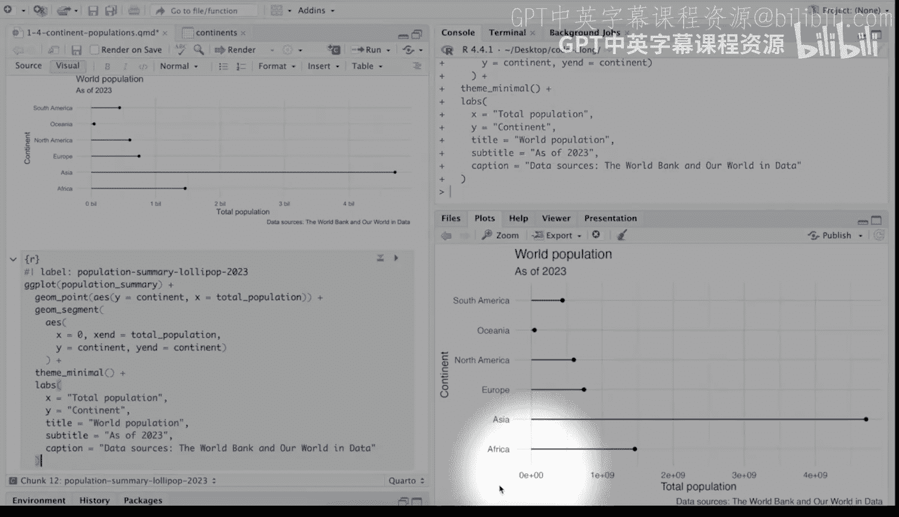
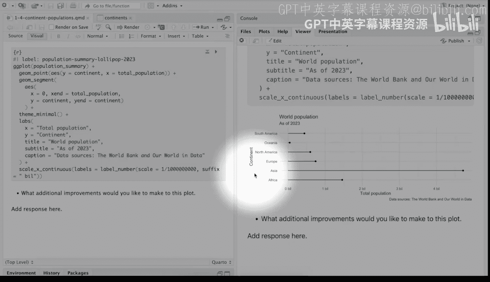
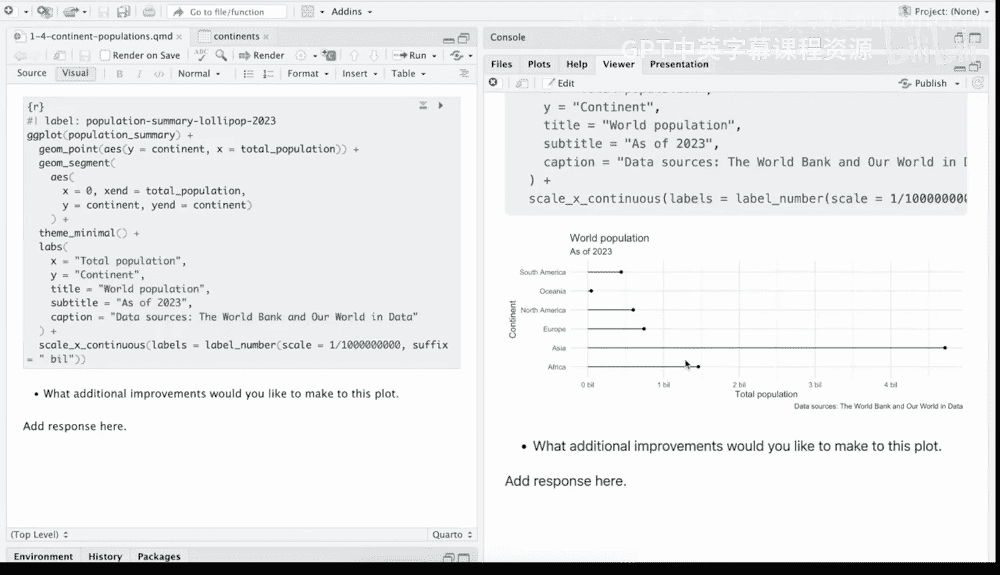
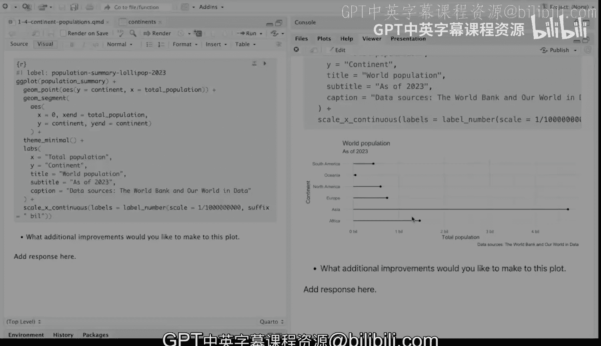

# 杜克大学《R语言数据科学｜Data Science with R》中英字幕 p22 06_01_04_代码演练：大洲人口.zh_en -BV1Zpv6BaEkB_p22-

In this code along video we're going to continue our exploration of the population data。

 but bring in some new information on continents where each of the countries are located in and work on some joints so our ultimate goal is to create a barpl of total populations of continents and our two input datasets are countries and populations and countries and continents so you can see that there's some commonality between these two data。

 the country information that's what we're going to use to join these on。

The packages that we're going to use are tidyverse and scale。

 so let's go ahead and load those packages， tidyverse for pretty much everything and the scales package for making pretty labels。

 access labels for our plots。And the data that we work with since we have two data sets that we're going to be working with actually come from different resources。

 One of them comes from the World Bank。 that's our population data。

 Let's go ahead and load that in and take a peek at what it looks like。And once again。

 I am going to change where my cell output is displayed by clicking on the gear icon and say I want my chunk output to be in the console and remove everything else。

 so let's take a look at that population data here。

 we can see countries and their population numbers for each of the years for which we have data spread across the columns。

And the continents data， if we load that up， looks something like this country name。

 they're calling it an entity in this case， the code， the country code。

 and the year in which this was recorded now it's not that country move between continents really from year to year。

 but it's just there as a record year of this was the country that was in existence in that year and this is the continent that it belonged to at the time。

So before we can analyze and visualize these data， we need to do a little bit of data prep so for this analysis we're focusing on the latest available population numbers 2023 so we want to modify our population data frame so let's start with that and pipe it in to only include 2023 population numbers now whenever we say only include this or that we often think about a filter statement but in this case the different population numbers are in columns of this wider data set so in order to say I want only the 2023 numbers and not the other years。

I'm going to use a select statement。And let's take a look at our data to see which columns do we want to select Let's go ahead and get all of the identifying information so series name through country code。

And。The 2023 column as well。 And remember， since the column label is numeric。

 we have to quote that with a single back tick。So now I have only five columns。

 all the identifying information about the country， and there are 2023 population numbers。

 and this particular exercise says to save this over as population。

 so going forward when we refer to the population data frame。

 we just mean the data for this one year。The next question asks。

 which variable or variables will we use to join the population and continentence data frames？

In order to do that， it's helpful to take a look at the names of the two data frames we're working with。

So we can see that we have series names series code country name country code in 2023 for population and continents for continents we have entity code year and continent so what's the common information between these two it could either be the name of the country or the country code My recommendation when possible if there is a code that's available to particularly if that's a common code between them。

 which in which case it is here， go with the code instead of the names there are many。

 many ways where that country's names can be spelled slightly differently maybe it's in their native language or not the country names change from year to year and the year of record for the different data sets may be different remember for our continents data。

 we had some older data like from 2015 but for the population。DataWe have data up to 2023。

 So where possible I would recommend joining by a code。 So let's give that a try。

 So from the population data frame。We are going to use the。

Country code variable and from the continents。Data frame we want to use the code variable。Oh。

 and I skipped a step earlier on， let's go ahead and fix that because it's going to get annoying later on remember that ultimately we want to make a visualization of these population numbers and I don't want to have to keep quoting this number 2023 so once I select those columns I want to rename that column to be the population。

So we can do something like this so that going forward， when we refer to the population column。

 we're referring to the 2023 population， obviously。Okay。

 so we want to create a new data frame that keeps all of the rows and columns from the population data frame and brings in the corresponding information from continents which join function should we use as a reminder。

 we could be doing things like left join， right join， semijo， antijo， inner join， full join。

 a full join， for example， says keep everything from both data frames。

 I don't care if there are some countries in the continentence data frame。

But theyre not represented in my population data frame。

 I want to start with my population data frame as the source of truth， if you will。

 and only pull in relevant information from that。 So if I'm starting with population。

 I could do a left join。And that will allow me to keep everything on the left from population and bring in information from continents。

 So let's go ahead and do that。 let's start with our population data frame。

Pippe that into a left join。And say I want to join it with the Coninence data frame。

 and I need to indicate which columns I am joining them by。

 so join by from population it's country code。From。When we do a double equal here from continents。

 it's coat。Let's go ahead and do that。 So now we can see that we have the 217 rows that we started with from our population data frame。

 and we have added in some columns to it。 If I was to expend this console window a little bit more and run this again。

 we can see that we've added entity。 the year of record and the continent。 Really。

 the only thing I want from here is the continent。 So something that I could do could be to say。

While doing this join， just select the code and continent。

Names for me so that the only thing that ends up coming in is the continent and the code column is much matched to country code I can of course do that at a separate step after the join has happened to select things out or there may be very good reasons why you actually want to keep that information too。

 but this way I end up with not a very busy data frame to work with。

Let's go ahead and save this as population continents as requested by the exercise。

 and let's go ahead and print it out one more time to make sure that we're happy with what we're seeing there and in the next exercise we're asked take a look at the newly created population continent data frame。

There are some countries that were not in continentts。 First， identify which countries these are。

 They are going to have N values for the continent variable。

 So which countries from the original data frame。Have NAs for their Con information。

Now we can filter for isN a continent？And we're seeing two such countries。

 Kosovo and Channel Islands。Why might this be the case What this means is that when our try to do a one to one character string match between the country code in one country and the code in one data frame and the code variable in the other data frame It could not find an exact match This might happen because they simply don't exist in the continent's data frame in which case we could just Google these countries and see where they're actually located and fill in the continent information ourselves。

 or maybe they were just spelled differently。 how might we go about answering this question。

 let's go to our environment open up our continents data frame and use the filter functionality in our data viewer to see this Kosovo even exist here。

 Yes， it actually does the thing is it exists as two entries。

 one is Kosovo and one is Serbia excluding Kosovo for this continent information but we only have one entry。

for its population right now and ultimately they're both in Europe。

 it's sort of for the purpose of this doesn't matter which one you match it to。

 so we can say if in the population data frame the code was equal to exactly what it's equal to in the continents data frame。

 we could have matched things so I'm going to take a note of this code。And say for Kosovo。

 the code that we want to use is this， and let's also look at channel Islands。

And for Channel Islands as well， the code that we wanted to use is not CHI。

 but it's OID underscore CIS。So we can actually modify our population data frame first and then try joining again。

 then that's exactly what the next exercise is asking us to do so we're ultimately going to do this same join。

So I am in fact， going to。Keep that， but before we do a join。

 we're going to do a little bit of transformation of our data so that we can get a one to one match。

 We have a column called country code that we want to modify so we're going to use the mutate function。

And in the mutate function， the variable that we want to modify is country code。

And we need to write some statements about how we're going to decide to modify it。

 There's really three conditions we're interested in。 If it's Kosovo， use this code。

 If it's Channel Islands， use this code for everything else。

 leave them as is because they were happily joined anyway。 So since we have these basically three。

 if statements， if you will， we can use a case when statement and say if the country。Name。Is Kosovo？

Make the code。The same code that it will match in the other data frame。If the country name is。

Channel Islands。Use the other code that we got from our investigation。

And everything else leave as is， the way we denote everything else leave as is is dot default。

 so if it doesn't match either of these conditions。

 the default should be whatever the country code was to begin with。

Let's go ahead and run this code to see if it works。

 So we have this interim state step of modifying our population data frame。

 and then we're doing a join。 Did it work， I don't know， I mean the code ran。

 so at least I don't have any syntax errors， but was I able to accomplish what I wanted to accomplish in order to ask that question I really need to save this data frame again and do the same investigation again。

 So let's go ahead and save it and say if there are any continents that are NA please report them to me。

It looks like the answer is yes。 and let's take a look to see why that might be because I made a mistake in my code。

 the country name was supposed to be channel I lens， not channel I。

 So R wasn't able to make that match for me。 Let's try this again。And great。

 we are getting a zero for the number of rows when we filter for Ns。

 which means everything has been joined。The next question。

 just so you can start thinking about things is which continent do you think has the highest population or which one is the second highest or the lowest。

 I'll give you a second to think through this and put your answers in here。

 you might know about certain countries with lots of population and that might tell you something about this。

 it's usually useful to think through such questions before you do your analysis。

 particularly if your analysis is in an area of interest to you or that you know about which most likely is the case。

 this way， when you actually complete your analysis， It might be easier for you。 to。

Not be surprised by your answers， or if you are surprised。

 you might have reasons and ways of investigating why that surprising thing happened。

Next what we're asked to do is to create a new data frame called P summaryum。

 let's see what's going to go in that data frame， it's going to contain a row for each continent and a column for the total population for that continent。

So remember in our population Conence data frame， each row is a country and what we want is a summarized data frame where each row is a continent that operation that we need along the way is a group by and then a summarize。

 so I want to start with my population continentence data frame I want to group by my continent variable。

And then I want to summarize and create a new variable， we can call it maybe total population。

And that is going to be the sum of the populations for all of those countries。

So what this is saying is instead of creating， giving me the total world population as a single number。

 first group by continent and give me the total populations per continent。

Let's take a look to C and even now you might be able to take a look at these numbers and see if the continent。

 you expected to have the highest number in fact does or the lowest number in fact does。

Now that we know this is working， let's go ahead and store this result。

 note that whenever I am at a point in my analysis where I have an interim step that I want to save of as an object。

 I first write my data pipeline。I run the code and I investigate to see if it worked。 You know。

 did I get any errors， Do I have any syntax errors， And even if not。

 even if the code runs without an error， do I believe the answers， once I know that this is good。

 then I ask myself， iss this going to be an object that I might want to use later on in my analysis。

 If so， let's go ahead and assign it to a new object。

 one that will then show up in my environment as well。Where is that， here we go。

 one that will show up in my environment as well that I can always go back to and investigate。

Now that we have this， we're going to make our visualization， we're asked to make a bar plot。

Of total population on the y axis and continent on the X axis。

 So we want to make a plot of this population summary data frame。On the X axis。

 we want the continent variable。On the Y axis， we want the total population variable。

And we want to represent our data。With bars。Or actually we're going to use G Co。

 not GM bar because we are not asking R to do some counting under the hood for us。

 we already have the numbers， we know exactly how tall our bars or columns in our data in our visualization needs to be so when you specify both an X and a y aesthetic and you want a bar plot we use the GM Co Gm。

And here is what things look like。So this looks like a perfectly reasonable bar plot。

 maybe we would want to play around with the axes a little bit and clean it up or the axis labels。

 but it tells the story that we were seeing from the numbers that we calculated。As a last step。

 we're told to recreate the following plot， so the same information is given in a slightly different way here as what we call a lollipop plot or a lollipop chart。

What we' are seeing here is the same data is represented as points and then line segments that go up to those points instead of my population being on the y axis。

 this time it's on the x axis and things are nicely labeled on that axis and then my continents are on the Y axis and it has some nice labels as well。

So how could we go about recreating this in order to do that。

 I'm actually going to start in exactly the same way as I did before。

 let's start by flipping the axes though。I I say y is the continent and x is the total population。

 so already we can see that platforming， but we just don't have the right GeM。

The hint says to start with the points， so let's go ahead and say I want a point。

 so now I can see that I actually have the points that I need。And then try adding the segments。

 so we're going to add a GM segment here。And in order to do that， I'm going to go ahead。

 it's a new GO， I'm going to go ahead and take a look at the documentation for GMO segment。

Specifically， what are the aesthetic mappings that I can use for it and oftentimes。

Either looking at the aesthetic section or just looking at some of the examples can be helpful。

 so it looks like I can define an x and a y and then an x n and a Y end so。

Let's go ahead and think about what each of these are going to be for our plot for each one of these continents。

The starting X point is going to be。But this in our aesthetic mapping zero， right。

 we're starting at x is equal to zero and the ending point is going to be the total population。

And for each of them， the y is going to be defined by the continent。

 So at the global level I have set y to continent， so I don't really need to repeat that here。

 but maybe for the sake of sort of readability， I just might do that。

 and then for the ending point of that segment， the y is going to be continent too。

Now if I try to run this， let's take a look at what happens， I actually get the plot that I want。

 which is great， but I find it a little bit confusing that we are defining an X aesthetic for the global plot and then a different X aesthetic for the segment。

 So when you have these different aesthetic mappings for different layers or different geos of your plot。

 my recommendation would be to actually take those aesthetic mappings out of the global level and define them locally just for readability purposes and again。

 for readability purposes， I actually might do something like this here。😊。

So that my code is a little bit easier to read。All right。

We're like more than halfway there at this point。 Prety much everything else we need to do is sort of cosmetic。

 if you will。 What are some things we need to change。

 It looks like we want to change the theme to a minimal theme。

We want to play around with our labels on the x axis we're going to call it total population。

On the y axis， we're going to call it continent。Our title is World Population。

Our subtitle is as of 2023 and our caption says data。That's a character string， data sources。

The world， bank and our。World and data。So now we have those components figured out。

 and there's just one last thing we need to do。 The X axis is using scientific notation again because we're dealing with large numbers。

 but we now know exactly how to treat that。 That's going to be on the scale。

Of x。 And it's a continuous variable。 So I'm going to say scale x continuous。

 I don't need to define break points for it， but I do want to play with the labels using the label number function from the scales package。

I want to scale everything by a billion。And I want to add a suffix that says a space and then BL short4 billion。

 so now we actually have a visualization that matches the visualization that we wanted to construct。

 let's go ahead and render this document since we're very close to the end of what we want to accomplish here。

Interactively working with these code cells and seeing your results either in your document underneath the code cell or in your console or your plot viewer is great for sort of playing around an incremental additions。

 but ultimately you want to render your whole document to make sure there aren't any errors that came up along the way。

And also that your visualizations actually look good in terms of your of their width and their aspect ratio。

 And this does， in fact， look good。 It looks like the default with an aspect ratio that we had set。

 works nicely for that。 To wrap things up。 Let's brainstorm for a second。

 What additional improvements would you like to make to this plot。 Your answers might marry vary。

 You might want to bring in some color， maybe different shapes。

 Those seem a little bit redundant and not to me， but they could， you could use a different theme。

 One thing that might be really helpful because we are looking at these populations， is to actually。

😊。

Deal with this y axis and reorder the y axis or reorder the continents so that the numbers we're looking at are an increasing or decreasing order。

 That's something we're going to learn about later on in the course。

