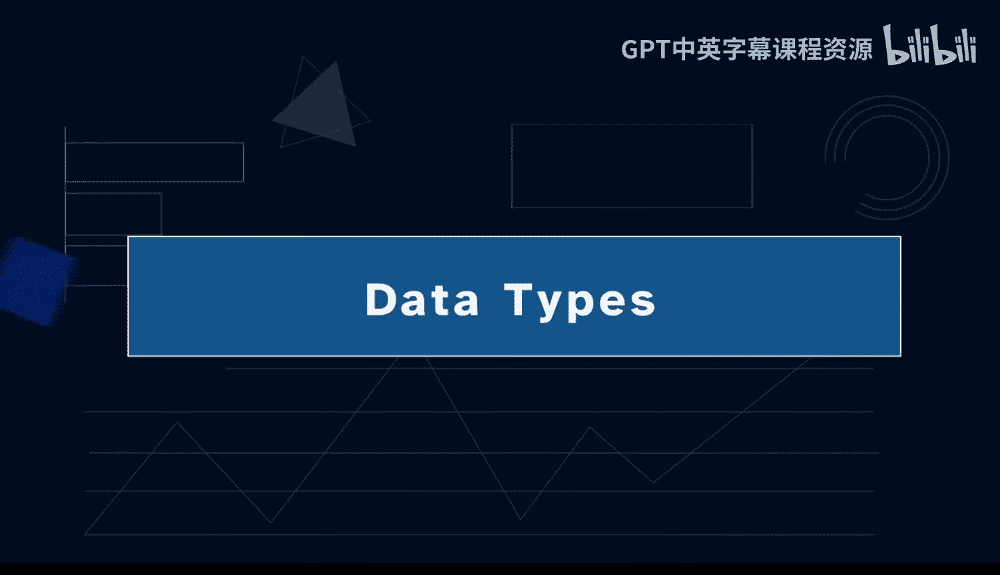
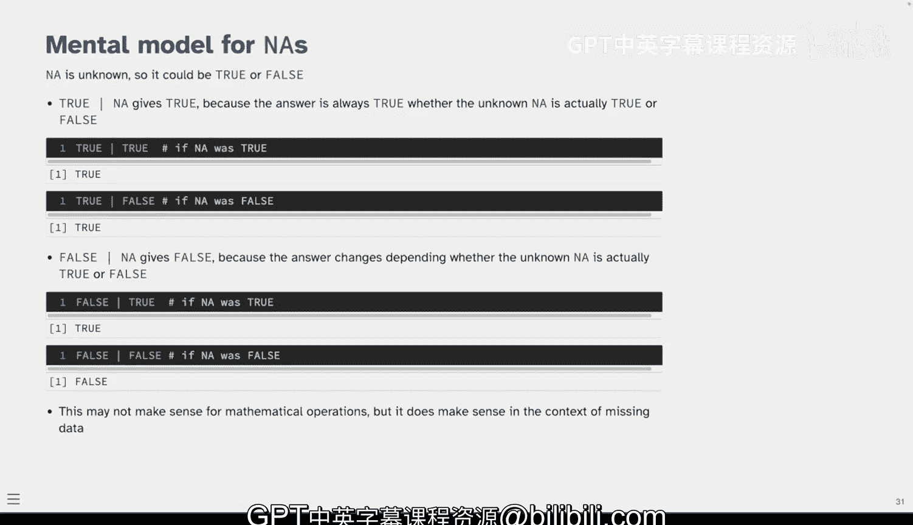

# 杜克大学《R语言数据科学｜Data Science with R》中英字幕 p23 07_02_01_数据类型.zh_en -BV1Zpv6BaEkB_p23-

🎼。

We've introduced R and use it as a tool for data science。 Before we go any further。

 we're going to pause for a moment and discuss certain features of the R language。

 starting with data types。 Just like natural languages have their peculiarities to them and learning a new language requires familiarizing yourself with these peculiarities。

 we need to do the same for computing languages as well。

 But I'm not sure if that was convincing enough。 So before we learn about data types in R。

 let's discuss why you should care about data types。 and give a very real and practical example。

 We'll do this with an example about a hypothetical。 but again， very realistic survey on cat lovers。

 suppose a survey asked respondents their name and the number of cats they have。

 And also suppose that the instruction said to enter the number of cats as a numerical value。Here。

 we read the survey data in from a C SV file where they're stored and take a peek at it。

 It looks like there are 60 respondents， And for each one。

 we know their name and the number of cats they have on this slide。

 we can see the first few responses。A reasonable question we can ask of these data is。

 how many cats do the survey respondents have on average？

So we pipe the cat lovers data frame to the summarize function and calculate the average number of cats using the mean function。

Unfortunately， though， the result is an N A and a pretty wordy warning。 It's not an error。

 The code ran， but the result looks nothing like what we would expect。

If we read the warning carefully， it says the warning is in sum and specifically in finding the mean number of cats。

 and it's caused by the argument to the mean function， not being numeric or logical。

Nummerican logical， are two data types in R， we'll learn more about them in a bit。

 but hopefully it's not a huge leap to say numeric meansnu data。

But we know number of cats as a numerical variable。 We saw the survey data in the last slide。

 since it's unclear why we're getting this warning and the unexpected result。

 And since we know it has something to do with the mean function。

 let's review the documentation of this function。Remember。

 we can get to the documentation with a question mark followed by the function name。

 We can see in the documentation that mean has an N RM argument for removing Ns before calculating the average。

Let's try setting that to true。Unfortunately， no luck。

 the pesky warning is still there When looking into the function doesn't solve the problem。

 it's a good idea to take a closer look at the data。So let's glimpse at our cat lover's data frame。

 Next to the names of the variables。 We see the letters C H in brackets。

 These stand for character as in character string。 It makes sense that the names are character strings。

 but doesn't make sense that the number of cats variable is。 Let's look a closer look at the data。

 The first few observations look good。 And the next few。

 But some respondents clearly didn't follow instructions。 Doug Bass， for example。

 says they have three cats， but they didn't enter it in as a number。 And Ginger Clark， Well。

 don't get me started on Ginger Clark。 And their sense of humor。 As a cat owner myself。

 I can understand the feeling of thinking your cat is half human。 But as a data scientist。

 this is super annoying。😊，Because due to ginger and dog's responses as character strings。

 the entire number of cats variable is coerced to a character string。

 We'll come back to the concept of type coercion shortly。 But in a nutshell， in R。

 each type of entry in a vector must be the same。So all answers are converted to character strings upon reading the data。

Hence， the N A result and the warning we get when we try to find the mean number of cats。

 In other words， the mean of a bunch of character strings。 So what do we do next。

 we'll need to clean up Doug and Ginger's responses。

 Sounds like Ginger actually has two cats that we want to indicate with the number 2。

 and Doug has three cats for everyone else， We just want their responses as numbers。

 So we use a case when function statement that sets the number of cats to two for Ginger Clark and three for Doug Bass and converts to numeric for everyone else。

😊，Then we try to find the mean number of cats again。And progress。 We have a mean number。

 but still a warning， too。 Now， warnings aren't errors。 It can be okay to note a warning and move on。

 but it's important to understand at first。 It seems like there is still some type coercion issue going on。

So let's try this again this time， first setting two and three as character strings。

 just like everything else in that column。And then we convert all values to numeric at once。

 and finally， try to summarize again。Ela， finally， where not only do we have a mean number of cats。

 but we also have addressed the warning。The moral of this story is that if your data does not behave how you expect it to。

 type coercion upon reading the data in might be the reason。If this is the case。

 you need to go in and invest to get your data and apply the appropriate fix and live happily ever after。

 Of course， being able to do so requires understanding data types and concepts like type coercion。

 So now that we have a good motivation for learning about data types in R。

 Let's actually learn about data types in R。Logical， double， integer。

 and character are some of the data types you'll encounter most commonly in a data science context in。

There are more data types， but we won't be focusing on those in this course。

 Loicals are what we call Boolean Values like true and false。

 And note that these are in capital letters。 Characters are， well， character strings。

 They're always quoted。 You can use single or double quotes。

 but we're going to stick to the double quotes as suggested by the tidy verse style guide。

 which will reference numerous times throughout the course， as we learn to not only write our code。

 but to write better our code。Doubles are what we call floating point numerical values。

 the default numerical type in R。In simple terms， these are numbers that can take on decimal values。

And integers are well integers。 They're always whole numbers to make a number an integer in R。

 we add the letter L next to it。 Also， if you ask R to give you a sequence of numbers。

 say from  one to 3， it will assume you want integers。

 as opposed to an infinite number of doubles between these two numbers。

We can construct vectors on the fly with concatenation using this C function in R。

 All values in a vector must be of the same type as we've seen in the cat lover's example。

 like doubles or characters or vectors of characters concatenated to make a bigger vector。

As we saw in the Cat lovers example， we can intentionally convert between data types。 For example。

 here， we have a vector of integers， and with the as character function。

 we can convert the vector to character。Similarly， we could start with logicals and convert them to numerics or doubles。

 true is a1 and false is a0。But again， as we saw in the cat lovers example。

 conversion between data types can also happen without intention。

 If you create a vector with a double in a character， they both get converted to a character。 Why。

 Because there's no way to represent the character string hello as a number。

 But the number one can be quoted to turn into a character string。

R will happily convert between various types without complaint when different types of data are concatenated in a vector。

 and sometimes that's handy。But it's not always a great thing。 A logical and an integer concatenated。

 We get an integer vector， as it's straightforward to represent a logical as an integer like a0 or a1。

A double in an integer， we get a double， as it's possible to represent an integer as a double。

 but we can't go from a number with a decimal to an integer without losing the decimal。

And an integer in a character string， everything becomes characters。

We've seen two ways in which types of variables can be changed explicitly with functions like as dot logical。

 as dot numeric， as dot integer， as dot double， or as dot character。

 and we call this explicit coercion。Implicitly， when you use a vector in a specific context that expects a certain type of vector。

 and r sometimes does it for you。Just like human languages have special cases and exceptions。

 unfortunately， so does computing languages。 Some of our special values are Ns。

 These are not available。 Ns or N Ns， not a numbers like something undefined you get when you divide 0 by 0。

 positive infinity and negative infinity。😊，We'll focus on NAs as those are the ones you'll encounter most commonly when working with data。

We've already seen that when we try to apply certain functions to vectors that contain NAs。

 things fail。NA is often want special treatment， like explicitly being removed before applying a function。

 or they show up as a special case in the results of other functions， like the summary function here。

Now， here's the last twist we'll touch on this video。 Ns are actually logicals， but why。Unlike Nans。

 Ns are genuinely unknown values， but that doesn't mean they can't function in a logical way。

 Let's think about why Ns are logical。To answer this question。

 let's take a look at these two scenarios and think about why they give different answers。

 True or N gives true， while false or N gives false， but why N is unknown， so it could be true。

Or it could be false。True or N A gives true because the answer is always true。

 whether the unknown N is actually true or false。 While false or N gives false。

 because the answer changes， depending on whether the unknown N is actually true or false。 Now。

 this may not make much sense in a mathematical operation。

 but it does make sense in the context of missing data。

 And this is the context we will focus on as we continue our foray into data types and classes in R。

