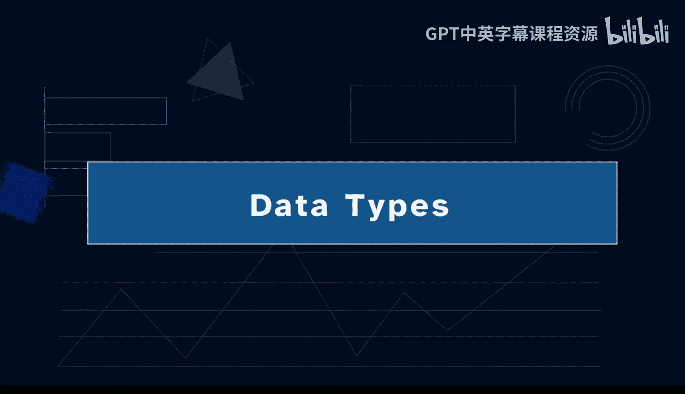
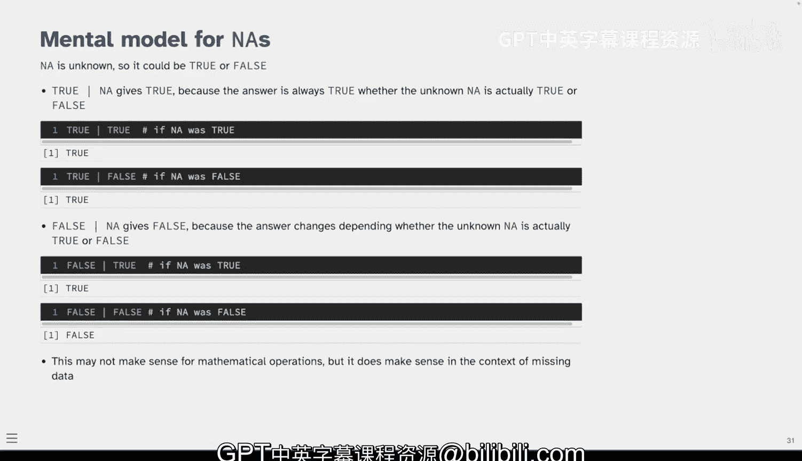

# R语言数据科学：07_02_01：数据类型




## 概述

在本节课中，我们将学习R语言中的数据类型。理解数据类型是有效进行数据科学分析的基础。我们将探讨为什么数据类型很重要，认识R中常见的数据类型，并学习如何处理类型转换和特殊值。

## 为什么需要关心数据类型？

上一节我们介绍了R语言及其在数据科学中的应用。本节中，我们来看看为什么理解数据类型至关重要。我们将通过一个关于“爱猫人士”的假设性调查来说明。

假设一项调查询问了受访者的姓名和拥有的猫的数量，并且要求以数字形式输入猫的数量。我们从CSV文件中读取数据并查看。

以下是数据的前几行：

*   John Doe: 2
*   Jane Smith: 1
*   Bob Johnson: 0

一个合理的问题是：受访者平均拥有多少只猫？我们使用`summarize`函数和`mean`函数来计算平均值。

```r
cat_lovers %>%
  summarize(mean_cats = mean(number_of_cats))
```

不幸的是，结果返回了`NA`和一个冗长的警告。代码没有报错，但结果并非预期。警告指出，`mean`函数的参数不是数值型（numeric）或逻辑型（logical）。我们知道“猫的数量”应该是数值变量，问题出在哪里？

## 深入探究数据

既然函数本身没问题，我们就需要仔细检查数据。让我们查看数据框的结构。

```r
glimpse(cat_lovers)
```

在变量名旁边，我们看到括号里有`<chr>`，这代表字符型（character string）。姓名是字符型很合理，但“猫的数量”变量也是字符型就不对了。让我们再看一下数据。

前几个观测值看起来正常，但后续一些受访者没有按照指示填写。例如，Doug Bass填写了“three”而不是数字“3”，而Ginger Clark则填写了“two and a half human”。由于这些字符型回答，整个“猫的数量”列在读取数据时被强制转换成了字符型。这就是我们尝试计算平均值时得到`NA`和警告的原因。

## 数据清洗与类型转换

接下来，我们需要清理Doug和Ginger的回答。我们将Ginger的猫数量设为2，Doug的设为3，并将所有人的回答转换为数值型。

```r
cat_lovers_clean <- cat_lovers %>%
  mutate(
    number_of_cats = case_when(
      name == "Ginger Clark" ~ "2",
      name == "Doug Bass" ~ "3",
      TRUE ~ number_of_cats
    ),
    number_of_cats = as.numeric(number_of_cats)
  )
```

然后我们再次尝试计算平均值。

```r
cat_lovers_clean %>%
  summarize(mean_cats = mean(number_of_cats))
```

这次我们得到了一个平均值，但仍有警告。警告提示我们仍有类型转换问题。让我们换一种方式：先将“2”和“3”作为字符型处理，然后一次性将所有值转换为数值型。

```r
cat_lovers_clean <- cat_lovers %>%
  mutate(
    number_of_cats = case_when(
      name == "Ginger Clark" ~ "2",
      name == "Doug Bass" ~ "3",
      TRUE ~ number_of_cats
    )
  ) %>%
  mutate(number_of_cats = as.numeric(number_of_cats))

cat_lovers_clean %>%
  summarize(mean_cats = mean(number_of_cats, na.rm = TRUE))
```

成功了！现在我们不仅得到了平均猫数，也解决了警告问题。

这个故事的启示是：如果你的数据表现不符合预期，读取数据时的类型强制转换可能是原因。要解决这个问题，你需要理解数据类型和类型转换。

## R中的常见数据类型

既然我们已经有了学习R数据类型的充分动机，现在就来正式学习它们。在数据科学中，你最常遇到的数据类型包括逻辑型、双精度型、整型和字符型。

以下是这些类型的简要说明：

*   **逻辑型**：即布尔值，如`TRUE`和`FALSE`。注意它们是大写的。
*   **字符型**：即字符串。它们总是被引号包围。根据tidyverse风格指南的建议，我们通常使用双引号。
*   **双精度型**：即浮点数值，是R中默认的数值类型。简单来说，就是可以包含小数的数字。
*   **整型**：即整数。它们总是整数。在R中，通过在数字后添加字母`L`来创建整数。例如，`5L`。另外，如果你要求R生成一个数字序列（如`1:3`），它会默认你希望得到整数。

## 向量与类型一致性

我们可以使用`c()`函数即时创建向量。向量中的所有值必须是相同类型，正如我们在爱猫人士例子中看到的。

```r
# 双精度型向量
c(1.5, 2.8, 3.1)
# 字符型向量
c("apple", "banana", "cherry")
```

## 类型转换

正如爱猫人士的例子所示，我们可以在数据类型之间进行转换。

以下是显式类型转换的例子：

```r
# 将整数向量转换为字符型
as.character(c(1L, 2L, 3L))
# 将逻辑型转换为数值型（TRUE为1，FALSE为0）
as.numeric(c(TRUE, FALSE, TRUE))
```

然而，类型转换也可能无意中发生。当你创建一个包含不同类型数据的向量时，R会自动进行强制转换。

以下是隐式类型转换的规则：

*   字符型与任何类型组合：所有元素都转换为字符型。因为数字可以表示为字符串，但字符串不一定能表示为数字。
*   双精度型与整型组合：所有元素都转换为双精度型。因为整数可以表示为双精度数，但反之则会丢失小数部分。
*   逻辑型与整型组合：所有元素都转换为整型（TRUE为1，FALSE为0）。

## 特殊值

就像人类语言有特例一样，编程语言也有。R中的一些特殊值包括：

*   `NA`：表示“不可用”（Not Available），即缺失值。
*   `NaN`：表示“非数字”（Not a Number），例如`0/0`的结果。
*   `Inf` 和 `-Inf`：表示正无穷和负无穷。

我们将重点关注`NA`，因为它在数据处理中最常见。当对包含`NA`的向量应用某些函数时，操作可能会失败。`NA`通常需要特殊处理，例如在应用函数前显式移除它们。

```r
# 使用 na.rm 参数忽略 NA
mean(c(1, 2, NA, 4), na.rm = TRUE)
# summary 函数会显示 NA 的数量
summary(c(1, 2, NA, 4))
```

最后一个重点是：`NA`本身实际上是逻辑型。为什么？因为`NA`代表未知值，但它可以在逻辑运算中发挥作用。考虑以下情况：

```r
TRUE | NA  # 返回 TRUE
FALSE | NA # 返回 NA (在R中实际返回NA，但逻辑上应为FALSE？需要澄清)
```

解释：`TRUE | NA` 返回 `TRUE`，因为无论未知的`NA`是`TRUE`还是`FALSE`，结果都是`TRUE`。而`FALSE | NA`的结果取决于`NA`的实际值，由于未知，所以返回`NA`。这在数学运算中可能不太直观，但在处理缺失数据的背景下是有意义的。

## 总结



本节课中，我们一起学习了R语言中的数据类型。我们首先通过一个调查数据的例子理解了为什么数据类型至关重要。然后，我们认识了四种常见的数据类型：逻辑型、字符型、双精度型和整型。我们学习了如何创建向量，并理解了向量中所有元素必须类型一致的原则。接着，我们探讨了显式和隐式的类型转换，以及转换时的优先级规则。最后，我们介绍了`NA`等特殊值及其在处理缺失数据时的行为。掌握这些概念将帮助你更有效地诊断数据问题并进行数据清洗。