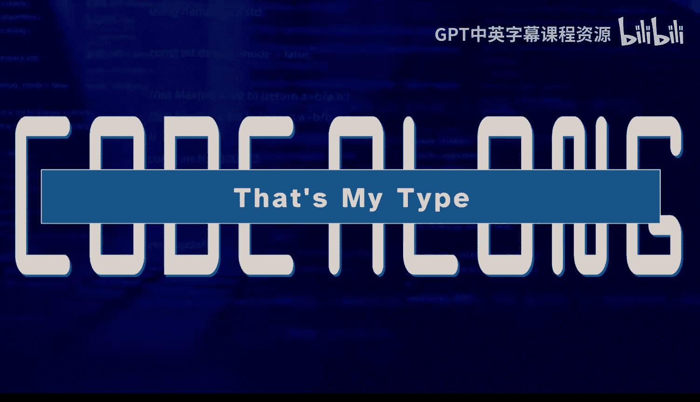
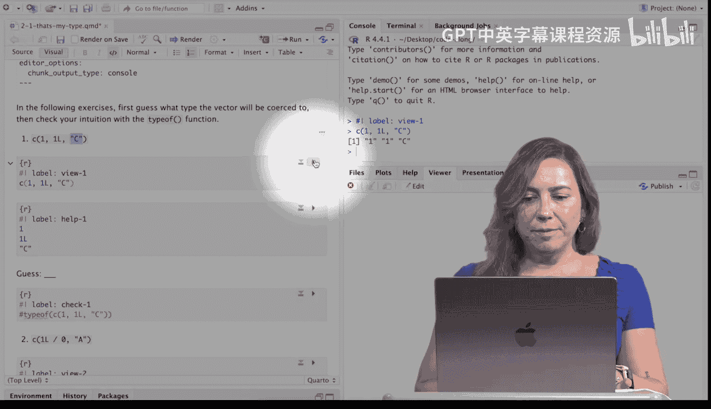
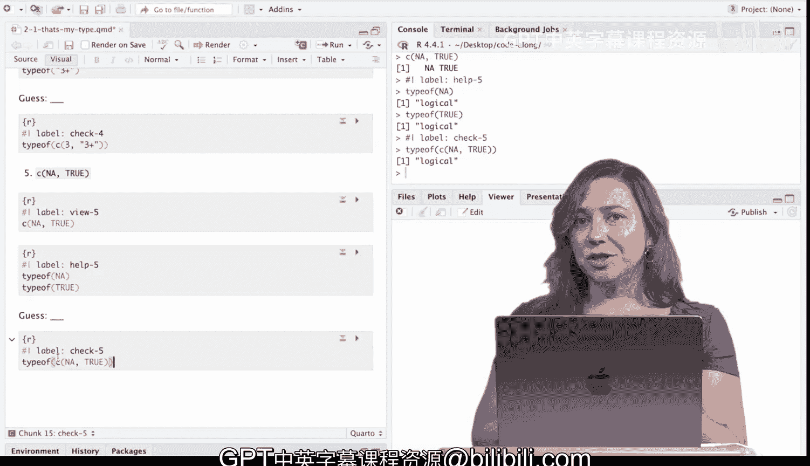

# 杜克大学《R语言数据科学｜Data Science with R》中英字幕 p24 08_02_06_代码演练：这是我的类型.zh_en -BV1Zpv6BaEkB_p24-

In this code along， we're going to review what we've learned about data types in R and particularly focusing on what we define as implicit coercion。

 Why do we care about it because it's something that happens under the hood。

 oftentimes without you even realizing and as a data scientist it's something that you want to be wary of and be on the lookout for so that when things start to act in a way you don't anticipate。

 you might have in the back of your mind， this idea of oh I wonder if some implicit type coercion may have happened。

 that's biting me here， let me go in and try to debug that situation。

So for those of you who like puzzles， this might be a fun code depending on how you define fun。

 but we're going to give you five puzzles to solve each one of these is a vector and we're going to take a look at these vectors with varying types of data in them and first try to guess what the type of the overall vector is going to be once any potential coercion type coercion has happened and then check to see if we're guessing things right。

Number one， we have a vector with the number one。A 1 L， which remember means an integer。

 and then the letter C， a character string here。 So first。

 what I might do in the first code chunk is take a look to see what this vector looks like。

 So let's go ahead and run that。 And I'm actually going to put things in the console again just so I can keep them side by side。

 This is what my vector looks like。 Looking at this output。

 You already might be able to guess what the type of this overall vector is going to be。

 Everything is in quote so that might be a hint。😊。

If not though， you might want to take a look at each of these one by one and ask the question what are the types of each one of these elements so in order to do that you can use the type of function and I'm using the multicursor in R to write that function three times but at once and I'm going to run that to see what the type of11 L and C R1 is a double which is the default numeric variable in R。

1 L is an integer。And C is a character。 So what we've done is we've created a container。

 a vector that has a double an integer and a character in it。 What should the overall result be。

 My guess would be that it would be a character。Because we can't really go from letters to numbers。

 but we can take numbers and put quotes around them and turn them into characters。

 And we can go ahead and check this so I can say， give me the type of this entire vector。And in fact。

 that's a character， so that's sort of the plan for each one of these five exercises。

 let's take a look at them one at a time。First， let's take a look at this vector that has a 1 L。

 an integer divided by0， and the other element in that vector is a character。

So I might just run that to see what that looks like， I have an infinity。And an A。

 though both of them are in quotes， I might take a look to see。

What is the type of1 L divided by0 and what's the type of。A， that should be a character string。

 So 1 L divided by 0 is a double。And type A is a character。

 so ultimately what I'm getting is a double and a character put together。

That should indeed be a character again。And let's take a look to see if we're right。

I can check my work and see type of this vector， in fact， that is a character。

Let's pause for a moment。 Why do I care about this？ Well， maybe it is fun， In fact。

 to solve these puzzles。 and that might be one reason。

 Maybe you want to appreciate the R R as a computing language， and that might be another reason。

 but also ultimately， when you get a data frame， each one of your columns is a vector。

 And if you have mixed type entries in those columns like we saw in the videos where we had a survey responses where some people entered in their answers as numbers and some people entered in their answers as character strings。

 We know that upon reading that variable and that data frame in。

 that variable is going to be coerced to character string。

 So that is the reason why you might care about the different variable types in R。 All right。

 let's continue。 Let's take a look at this。 What do we have here。

 I have a sequence of numbers from one to3 and the number5。It looks like all integers to me。

 at least they're all whole numbers。 We can take a look at there each one of their types。

 so type of one to 3 and type of 5，1 to3 is an integer where now R is not going to give you an infinite set of numbers between two integers so it will give you1。

2 and 3 and type of5 is a double because that is the common。Type numeric type。 sorry。

 that is a default numeric type in R。 So take a moment。Enter your guests here。

And let's check our intuition。If I bring these two things together， a set of integers and a double。

 they all get coerced to a double because we can always add a  point0 at the end of an integer to make it a double。

 but we can't go from a double， even if it doesn't have a decimal point。

 the fact that it could take on a decimal point that it was defined as a double means we wouldn't want to coerce it to an integer。

Here's another one， we have the number three and then the character string 3 plus this to me looks like a perfect example of a survey question where maybe you're selecting how many of something you have。

So if we were to take a look at this this vector， we can see that each one of those are printing out as characters if I was to take a look at type of each of these elements。

 the number three。And the character string 3 plus。The first one is a double， the default。

 numeric in R， and the second one obviously is a character since it's in quote。

I'll give you a moment to take care of guests to see what these are going to be courseed into。😊。

And let's go ahead and check our intuition。So the type of this overall vector bringing in a double and a character is going to be a character string。

 So you can see that oftentimes we're just defaulting to a character soon as a character enters the scene。

 everything ends up being a character， basically。Finally， we have one last exercise here。

 We're looking at a vector of an N and a true。 We've talked about how Ns are somewhat special snowflakes。

 but we've also discussed their type as well。 so what would the type of these be We can take a look at each one of them separately first。

😊，Oops。Both of them are logical。 so take your guess as to what the。

Vectctor containing two logicals should be。And let's check our intuition。No type corercion needed。

 you got apples and apples， you get a vector of apples， you got a logical analoglogical。

 you get a vector of logical。

