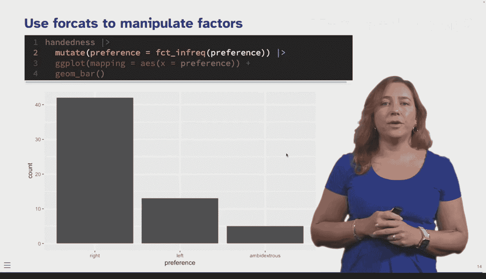
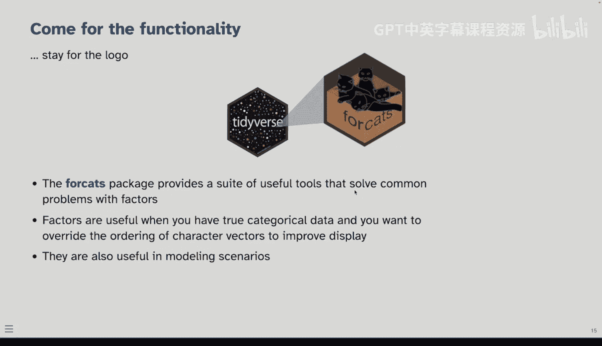

# 杜克大学《R语言数据科学｜Data Science with R》中英字幕 p25 09_02_01_数据类.zh_en -BV1Zpv6BaEkB_p25-

🎼。

Previously， we talked about data types and in this video we're going to talk about data classes vectors are like Lego building blocks。

 so we stick them together to build more complicated constructs， in other words。

 representations of data。The class attribute relates to what is called the S3 class of an object。

 which determines its behavior。 And if you're interested in reading more about what S3 classes are or what other classes there are in R。

 I have linked here on the slides to a book chapter you can read more about。

 but note that all of this is not necessarily covered in this course。

We're going to be talking about just a few classes of data that are going to be important for us to know when we're working with data。

 these are factors， dates and data frames。R uses factors to handle categorical variables。

These are variables that have a fixed and known set of possible values。 For example， here。

 X is a factor of， let's say， educational attainment。 We have people who have bachelor's degrees。

 master's degrees and PhDs。 So we have four elements here or four people。 The first person has a B。

 S， the second N M， the third of PhD and the fourth and M。 But if I say this as a factor variable。

 you'll see that when I print out the vector， it also tells me that the vector has the levels B， S。

 M and PhD。 So those are the unique observations in this particular vector。😊。

The type of a vector is integer， which can be difficult to reason， but we'll get to that in a second。

 And the class is a factor。 And that class is what we're going to be talking about here。

 Factors are comprised of two components， character strings that are the factor level labels and integers。

 which are the level numbers， and they are in a way， glued together。Remember。

 we talked about the idea of constructing things like Lego building blocks。

 If I were to glimpse at the vector that I just created， it's a factor with three levels， BS。

 MS and PhD， and the values are 1，2，3， and 2。These are the integers。

 R has assigned to the observations under the hood。

 and the labels are like the character strings like B， S，MS S and Ph D。

 So R will happily convert between factors and integers。

 If I were to convert this factor to an integer， It will happily return to me just those level numbers。

 Factors are super important for dealing with categorical data in a statistical context。

 We' give an example of this shortly。😊，Let's take a look at another data class date here I have a character string that looks like a date that's 20250101。

 and I'm converting it to a date using the as dot date function。

 Note that this is a date with a capital D。 if I just print it out。

 it looks like plain old character string。 But if I ask for the type of it， it's a double。That's。

 again， a little difficult to reason around。 Why is a date， a double。If I ask for the class。

 it does give me a date back。 So that's date with a capital D again。 So it's happening。

 We can think of dates like an integer。 The number of days since the origin and another integer。

 the origin glued together。 So if I take a look at this y value， which was January 1，2025。

 as that integer gives me 200089。 And if I actually divide that number by 365。

 roughly the number of days per year， I get roughly 55 years。

 The number of years between 1970 and 2025。 In short， when constructing dates in R。

 these two pieces of information， origin January 1，1970。

 and day since origin can be thought of to be glued together。😊。

Another class of interest to us is a data frame。Data frames can be thought of as vectors of equal length glued together。

 For example， here we have a data frame with two variables。 X and Y。

 each with two observations in them。 If we inspect the type of the data frame。 It's a list。

 The class is a data frame。 In a way， two vectors glued together makes a data frame。

 We just encounter a list。 let's take a closer look at it。 lists are generic vector containers。

 and vectors of any type can go in them。 For example， here we have a list with three elements。

 One is integers， the other is characters and the other is logicals。

 R will happily allow you to put them all together in a single object called L。

 with no type coercion whatsoever to make these three vectors look like each other。

 That's why we call a list a generic vector container。 If these vectors were of equal length。

 we could actually combine them in a data frame， which is often how will encounter data。😊。

You can think of data frame as a specialist list containing vectors of equal length。

 using the pull function， we can extract vectors from data frames while we like keeping our data and data frames that we can work with in data pipelines。

 sometimes it can be useful to pull out a variable， a vector out of a data frame， for example。

 as the final step of an analysis。Now that we've reviewed a variety of data classes that well commonly encounter when working with data in R。

 let's give an example involving working with factors。

 We have data frame a survey on handedness for each respondent。

 we know their name and their preference， whether they are right handed， left handed or ammbexxters。

Both of these are character variables to start with。

 we can make a bar graph of these data under the hood， when creating a bar plot of these data。

 R coerces the preference vector into a factor。And it orders the levels of that factor in alphabetical order。

Unfortunately， though， alphabetical order is rarely， if ever the order that makes the most sense。

For example， we can instead order the levels in decreasing order of frequency with a function called FCT stands for factor underscore infrc。

Which modifies the preference variables and reorders its levels in decreasing order of frequency。

This function comes from the forecast cats package。

 which happens to have a really cute logo and is designed to work with factors and offers many functions for solving common problems with them。

Factors are useful when you have true categorical data。

 and you want to overwride the ordering of character vectors to improve their display。 Otherwise。

 everything would be an alphabetical order， which is rarely what you want for your data visualizations or your data summaries。

 Factoracts are also useful in modeling scenarios。 So that's something we're going to touch on later in the specialization。

