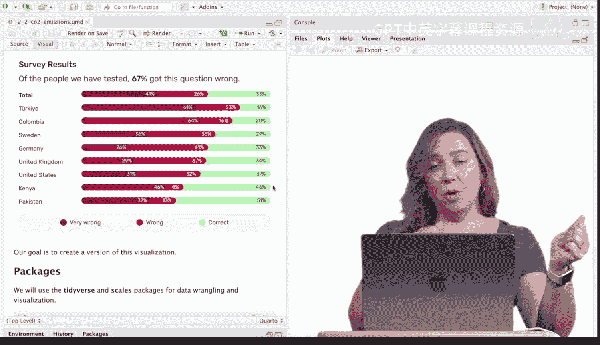
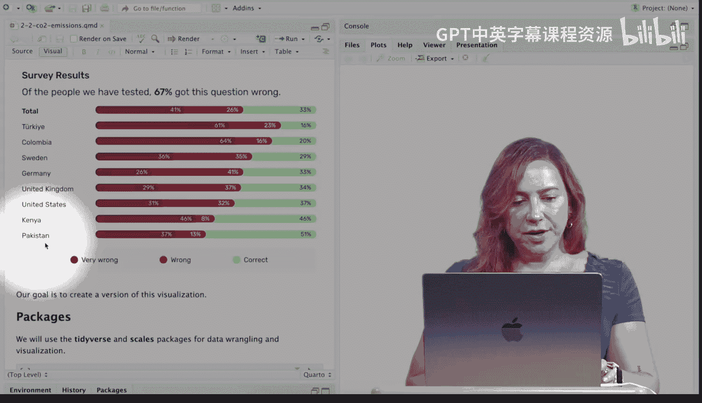
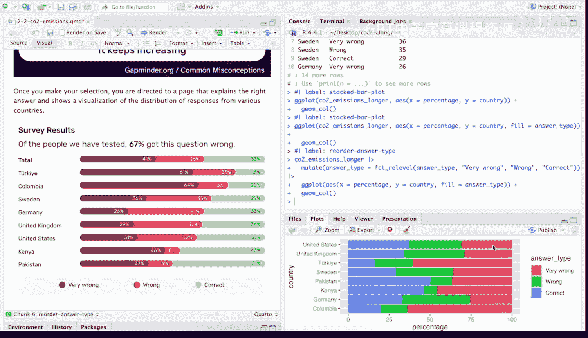
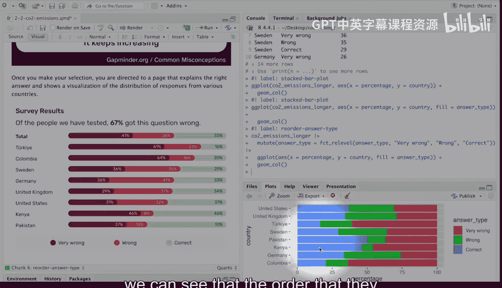
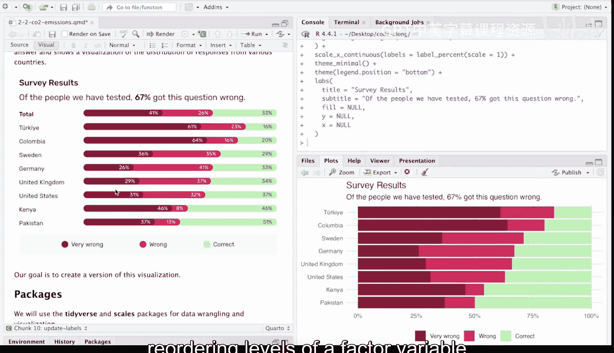
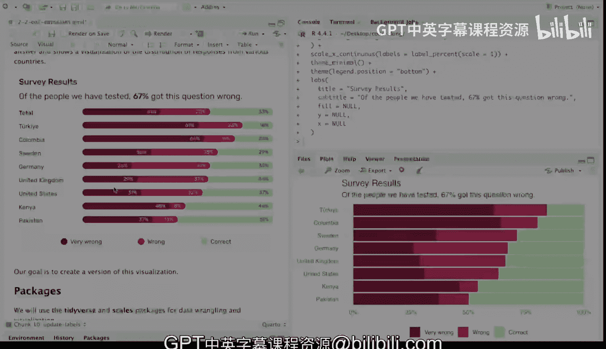

# 杜克大学《R语言数据科学｜Data Science with R》中英字幕 p26 10_02_05_代码演练：减半二氧化碳排放.zh_en -BV1Zpv6BaEkB_p26-

In this code along， we're going to work with data from gaptminder dot org。

 It's going to be a little meta。 though。 I went to gettminder dot org to find some data for this particular code along。

 And I was faced with the following question。 I got directed to a page that asked me the following question。

 What happens to the average global temperature。 If we have the annual net emissions of carbon dioxide today day。

 And the choices are it decreases。 It stays the same， and it keeps increasing。

 I'll give you a moment to think。And come up with your own answer。So on gaptminder。org。

 once you make your selection， you get directed to another page that explains what the right answer to this question is。

 So it turns out this is the answer this question has lots of common misconceptions around it。

 And Gtminder has a list of such questions。 So if you were to visit gaptminder。org today。

 you might come across a slightly different question， another common misconception。

 and once you make your selection， you'll be directed to a page that explains what the right answer should be and also gives you some summary statistics on how people have been voting on it based on I believe your IP address。

 Gtminder is able to place you into what country you're connecting from。

 and here is the visualization that I came across at the time that I was on this web page it said of the people we have tested 67% got this question wrong。

So what is the wrong answer here if you think that howlving CO2 emissions today actually decreases the annual net emissions。

 that is not true， in fact it would continue to keep increasing as long as CO2 emissions continue to happen now obviously we should be doing whatever we can to reduce but just reduction alone is not going to be reducing the annual net emissions so these three answers were then categorized into categories of very wrong wrong and correct and we can see the total statistics over here。

So the 67 number is the sum of this 41% that got it very wrong and 26% that got it wrong。

 and then also for a selection of countries and I'll be very honest。

 I'm not really sure how they decided to select these particular countries。

 you can see the country based statistics as well。

Our goal is to create a version of this visualization we're going to do that using the tidyverse and scales packages。

I am going to say， I want to see my chunk output in console and start running my code and the data that we're going to work with。

 I've actually grabbed the data that was presented to me and put it into a CSV file。

That you can go ahead and load you will note one discrepancy here for Pakistan。

 37 plus 13 plus 51 actually gets to 101。 so I made one correction as I was putting the data together and made that 50 so that for each of the countries we add up to 50 and also note that in the data set that you will be working with。

 there is no total row， we just have the eight countries that are summarized here。

So the first thing we want to do is to pivot the CO2 emissions data frame longer。

 such that each row represents a country answer type combination and answer type and percentage for that country are columns in the data frame。

 So let's go ahead and do that。 Let's take our CO2 emissions data frame I want to pivot it longer。

 what we said we' often going to want to do in order to do a visualization。

 The columns that I want to pivot are the very wrong。

 wrong and correct instead of listing three things I'd rather be lazy and list one thing I want to say anything other than country so I'm using the exclamation point to say not country。

The names of these variables will go to answer type。And the values， So the numbers。

We'll go to a new column called percentage as the exercise suggests， so we have as an output。

 a longer data frame， 24 rows， so eight three for each of the eight countries。

 and then we have a column called answer type and percentage。

Let's go ahead and store this data set as CO2 emissions longer。

And let's make sure that we're happy with what that data set contains， great。

Next we want to create a stacked bar plot of response type by countries so where our goal is to create something like this visualization。

 we're not going to hit it exactly right， we're not going to worry about adding rounded edges and stuff。

 but ultimately this is a stacked bar plot so let's start there。I want to create a plot。

So I'll start with G plot， I want to use this longer data frame。On my X axis， I want the percentages。

On my y axis， I want the country。And since I know the X and Y values， I'm going to use a G Co。

 Let's go ahead and give this a try。 The countries look okay。

 but the bars look nothing like what we wanted。 We want to be some color in this， right？

 We want there to be different colors for different answer types， which we haven't yet indicated。

 Now， used color， but color is not the aesthetic mapping that we want to make in a bar。

 we would use the fill aesthetic。To say give me different segments of the bars for the different answer types so we are starting to make strides towards achieving that final look but things look quite different just yet and one of the the two ways in which these look different is the order of the countries and the order of the answer types both of them are categorical variables with a number of levels and what we want to do is we want to play around with the order of those levels so we are going to next leverage the forecast cats package and functions from that package to movies around so the next exercise says in the original plot the levels of answer type are。

Very wrong， wrong， and correct。 Right now， I have them in a different order in an alphabetical order。

 as you would expect。Update the previous plot to reorder the levels in this order。

Since it says updated the previous plot， let's go ahead and copy that code over。

 we know that we're going to need to modify it now。The prompt says update the plot。

 but actually I'm not going to solve this problem by adding another layer to my plot。

 What I really want to do is change the data that's going into this plot。

 So I want to add a data transformation step beforehand to say that answer type variable that is a factor let's go ahead and modify that before we pass it into our plot。

 So instead of adding another layer， I'm going to start with the data frame。

I'm going to pipe that into a function that allows me to modify a column。 So that's a mutate。

 The column that I want to modify is answer type。And I want to do something there。

 we'll get to what that is in a second， and then I want to pipe that into my GG plot call。

So what do we do here？We want to modify the answer type by changing the order of the levels。

 so we're going to use factor re level。Because I want to manually give it the order of the levels。

The variable that I want to relevel is answer type and the order in in which I want these to appear is very wrong。

Rrong。And correct。Let's go ahead and make this。And quote。

"A note that it's very important that the spelling of these levels exactly match how they appear in the data set。

Let's go ahead and run that， so now the colors don't look anything like our plot。

 but we can see that our answer type variable is ordered in the order that we want。

So we have very wrong， wrong， and correct。Let's go back， and。Take a look at our visualization。

 though， so blue refers to correct。Green refers to wrong and the pinkish red refers to very wrong。

 And I know that these default G G plot2 colors are not very accessible。

 So when I say blue or pinkish red， you might be seeing slightly different colors。

 We'll modify the colors in a second， but we can see that in the bars first。

 the correct responses come， then the wrong responses come， then the very wrong responses come。

 So even though we've given the order that they were in here。

 we can see that the order that they appear in the bar plot is not actually what we want。

 We sort of actually want the opposite of that。 I could address this in one of two ways。

 I could go back and change the order here。

Wwhichch will require a little bit of copying and pasting， or I could quickly say。

 let's go ahead and reverse it with FCT Re for reversing the order。

And let's see if that looks better to us。 Now， that looks better to me in terms of the order in which the bars。

 the segments and the bars appear。Now， I've also messed up how my legend is appearing。

 but I can see that I'm going to need to do more with my legend anyway。

 If I were to take a look at my goal， that legend is go to the bottom。

 And that's another exercise we're going to do in a minute in this video。

 So I'm going to leave things as is because I've at least been able to obtain this segment to be in the right order。

😊，And let's take a look later to see if we can actually modify the legend to match as well。

In the next exercise， it says update the color。 So this is specifically about the plot itself。

 not the data that's coming into it。 So in order to do that I actually will solve this problem by adding another layer to my plot。

 What is that layer going to be here it says update the colors。

 So I want to actually give some manually defined colors。 So that's going to be a scale。

A color manual。Or actually， a scale fill manual。 since it's the fill aesthetic that I'm working with。

 not the color aesthetic。The values are， and I can give it a named vector again。

Let's go ahead and copy these over here。This is not looking great。

 but we just need to add some stuff。 so very wrong。

 That's a character string should be equal to this character string that defines a hex code。Wrong。

 that's a character string should equal to this character string that defines another hackx code。

And the correct。Is。This one here。 So I have actually done a little bit of pre work。2。

Get you the colors to match the plot that we're trying to reconstruct。

 So let's go ahead and run this again。 We can start to see how the goal plot we want to make is sort of coming into fruition。

The next exercise is asking me to move the legend to the bottom and then to make sure that the levels appear in the same order They appear in the plot。

 Let's move it first and see where that gets us。Theme。Legend position is going to be bottom。

And we can see， in fact， that that call out about the order in which the levels appear is a useful one because right now they're not what we exactly want。

 So in addition to moving the legend itself， we actually want to indicate how we want to how we want the guide。

 in other words， the legend for the scale to appear I'm going to say guide。

Guide legend is the function that's helpful for modifying the contents of a legend。

 So let's go ahead and take a look at the documentation for that。

 And it has an argument called reverse。 that is。By default false， let's try setting it to true。

 and now we can see that our legend is in the order that we want as well。Now。

 our plot still doesn't look exactly like the plot we want it to have。

 So the one thing that we're missing is that the countries on the Y axis are not ordered in the order that we want them to be。

 And so we want to actually put them in that order。

And if we were to take a look at our original data frame， the CO2 emissions data frame。

 the countries were indeed in the order that we wanted。 so I can actually say， hey， give me。

The country names from that。 And that is the order in which I want my countries to appear。

 And since it's about the order of levels in a categorical variable。

 that's going to be something I address in the data prep step as opposed to in the visualization step。

 So let's add another line to our mutate call here and say we are going to do something with countries。

 What are we going to do， we're going to relevel the countries。

And we want them it to be in this order。 So let's go ahead and copy and paste that。 Obviously。

 we're going to need to do a little bit of cleaning。It's not too many countries。

 so doing this manually doesn't seem like a huge hassle。And let's see if that gives us what we want。

 So now we have Turkey at the bottom and Pakistan at the top。 Is that exactly what we want。Actually。

 we want it to be exactly the opposite again。 because remember。

 the origin starts at the bottom for a G G plot， and we want it to be going up。 So。

 but we've already learned how we can address that without typing more things。 I can just say。

 just reverse the order for me。😊，And now we have things in the order that were given to me。

To wrap things up， let's see how much closer we can get to our visualization。

 so let's go ahead and actually render this document once to make sure that all of our code is working nicely and also to get this rendered version of the document in our viewer pane。

I'm going to go ahead and。Copy that code here。 What are some things that I might want to do。 I might。

 for example， want to change the theme to something like a minimal theme as opposed to the gray background that might be helpful。

 I might want to add some labels。Maybe the title could say survey。Results。Subtitle。

Could actually give us the statistic of the people we have tested。67%。Got this。Question。Wrong。

And the last thing that we might want to do is address this idea of percentages。 Now。

 it is possible to place those percentages into your bar segments， though， a little bit tedious。

 So instead of doing that and placing the text there。

 what we're going to instead do is play around with our。Xscale。And say that for our labels。

 we want to do a label percent。Using the scales package。

 And since our numbers are given as numbers between 0 to 100， as opposed to from 0 to 1。

 we don't need the label percent function to multiply things for us。

 I can just say keep the same scale for me。 So my values range from 0 to 100%。

 I might do a few other things like for my legend。I might remove that answer type variable and also for my y。

 I might do the same and perhaps even for my X。Just to clean things up because it is pretty obvious what each of those stand for。

 So in general， we like to label our plots as informatively as we can。

 But when we look at a visualization like this， it's very obvious what's on the Y axis our countries and what's on the X axis is a distribution of responses。

 So what we have shown in this code along is that we had an inspiration plot， we wanted to achieve。

We needed to do a little bit of pivoting to get started with that。

 and then we used functionality from the forecast cats package and the idea of releing and reordering levels of a factor variable to get as close to our inspiration plot as possible。

