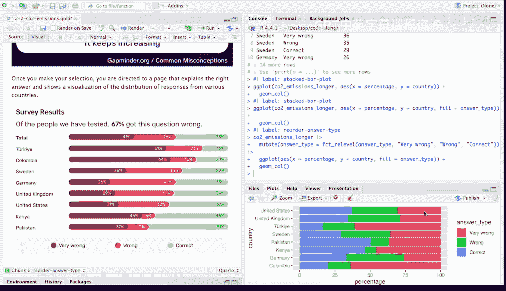
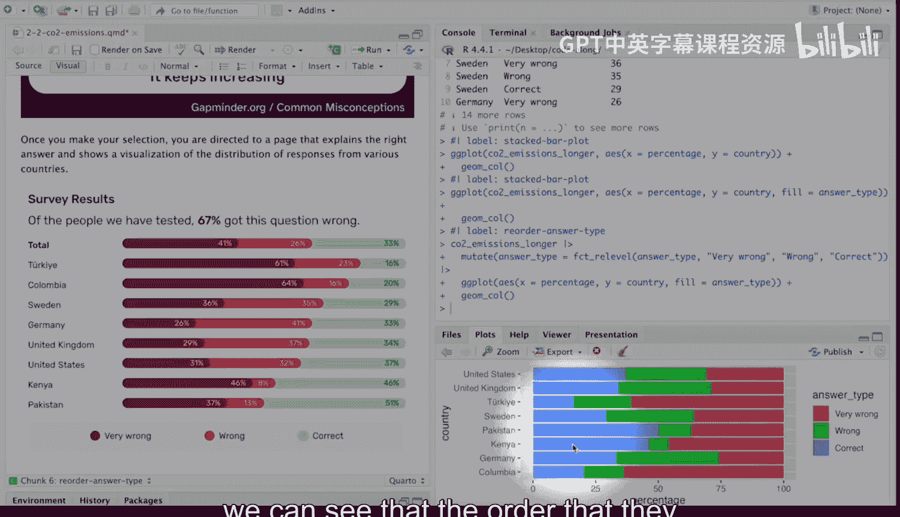
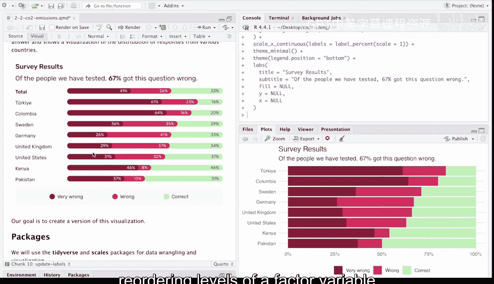

# R语言数据科学：10_02_05：代码演练：减半二氧化碳排放 📊


在本节课中，我们将学习如何使用 `tidyverse` 和 `scales` 包，基于 Gapminder 网站上的一个关于二氧化碳排放的常见误解调查数据，创建一个堆叠条形图。我们将重点练习数据重塑、因子变量排序、颜色自定义以及图形美化。

## 概述

我们将使用来自 Gapminder.org 的数据。该网站提出了一个问题：“如果从今天起将二氧化碳年净排放量减半，全球平均气温会如何变化？”选项包括：下降、保持不变、持续上升。许多人对此存在误解。我们的目标是复现网站上展示各国回答情况的堆叠条形图。


## 数据准备


首先，我们需要加载并查看数据。数据已保存为 CSV 文件，包含八个国家对于“非常错误”、“错误”和“正确”三个选项的回答百分比。

```r
# 加载必要的包
library(tidyverse)
library(scales)

# 读取数据
co2_emissions <- read_csv("path/to/your/co2_emissions_data.csv")
# 注意：数据中不包含“总计”行，只有八个国家的数据。
```

## 数据重塑

原始数据中，每个国家占一行，三个答案类型各占一列。为了绘图，我们需要将其转换为“长”格式，使每一行代表一个国家与一个答案类型的组合。

以下是转换步骤：

```r
co2_emissions_longer <- co2_emissions %>%
  pivot_longer(
    cols = -country, # 转换除‘country’列之外的所有列
    names_to = “answer_type”, # 新列名：存放原列名（即答案类型）
    values_to = “percentage” # 新列名：存放原列的值（即百分比）
  )
```
运行后，`co2_emissions_longer` 数据框将有 24 行（8个国家 × 3种答案类型），包含 `country`、`answer_type` 和 `percentage` 三列。

## 创建基础堆叠条形图

上一节我们准备好了数据，本节中我们来看看如何创建基础的堆叠条形图。我们将国家放在Y轴，百分比放在X轴，并用颜色填充区分不同的答案类型。

```r
# 创建基础堆叠条形图
ggplot(co2_emissions_longer, aes(x = percentage, y = country, fill = answer_type)) +
  geom_col()
```
此时图形已初具雏形，但答案类型和国家的顺序都是默认的字母顺序，与目标图形不符。

## 调整因子顺序

我们的目标图形中，答案类型的顺序是“非常错误”、“错误”、“正确”，而国家的顺序也是特定的。我们需要使用 `forcats` 包的功能来调整因子水平顺序。





以下是调整答案类型顺序的步骤：

```r
co2_emissions_longer <- co2_emissions_longer %>%
  mutate(
    # 手动指定答案类型的顺序
    answer_type = fct_relevel(answer_type, “very wrong”, “wrong”, “correct”),
    # 手动指定国家的顺序（顺序来自原始数据框）
    country = fct_relevel(country, “Turkey”, “United States”, “Sweden”, “South Africa”, “Pakistan”, “Japan”, “Germany”, “Brazil”)
  )
```
调整后，我们发现条形图中各分段的顺序（从下到上）与图例顺序相反。我们可以简单地使用 `fct_rev()` 函数来反转答案类型的顺序，使其在条形图中的堆叠顺序与图例一致。

```r
co2_emissions_longer <- co2_emissions_longer %>%
  mutate(
    answer_type = fct_rev(answer_type) # 反转因子水平顺序
  )
```

## 自定义颜色与图例

现在图形结构正确了，但颜色是默认的。我们需要根据目标图形的配色方案进行自定义。同时，我们需要将图例移动到图形底部。

以下是自定义颜色和调整图例的步骤：

```r
# 定义颜色（使用十六进制码）
custom_colors <- c(
  “very wrong” = “#E7553C”,
  “wrong” = “#35B0AB”,
  “correct” = “#FDE725”
)

# 创建图形，应用自定义颜色并调整图例
ggplot(co2_emissions_longer, aes(x = percentage, y = country, fill = answer_type)) +
  geom_col() +
  scale_fill_manual(values = custom_colors) + # 应用自定义填充色
  theme(legend.position = “bottom”) + # 将图例移动到图形底部
  guides(fill = guide_legend(reverse = TRUE)) # 反转图例项顺序，使其与条形图分段顺序匹配
```

## 完善与美化图形

我们的图形已经非常接近目标了。最后一步是进行一些美化工作，例如添加标题、修改主题、调整坐标轴标签格式等。

以下是最终的美化步骤：

```r
final_plot <- ggplot(co2_emissions_longer, aes(x = percentage, y = country, fill = answer_type)) +
  geom_col() +
  scale_fill_manual(values = custom_colors) +
  scale_x_continuous(labels = label_percent(scale = 1)) + # 将X轴标签格式化为百分比（0-100%）
  labs(
    title = “Survey Results”,
    subtitle = “Of the people we have tested, 67% got this question wrong.”,
    x = NULL, # 移除X轴标签，因其含义已很明确
    y = NULL, # 移除Y轴标签
    fill = NULL # 移除图例标题
  ) +
  theme_minimal() + # 使用简洁的主题
  theme(legend.position = “bottom”) +
  guides(fill = guide_legend(reverse = TRUE))

# 显示图形
print(final_plot)
```

## 总结




本节课中我们一起学习了如何复现一个复杂的堆叠条形图。我们从数据重塑开始，使用 `pivot_longer` 将数据转换为适合绘图的长格式。接着，我们利用 `forcats` 包中的函数调整了因子变量（答案类型和国家）的顺序。然后，我们通过 `scale_fill_manual` 自定义了颜色，并使用 `theme` 和 `guides` 函数将图例移动到底部并调整了其顺序。最后，我们通过添加标签、修改主题和格式化坐标轴，使图形更加清晰美观。这个过程展示了数据准备、图形构建和细节调整在数据可视化中的完整工作流。